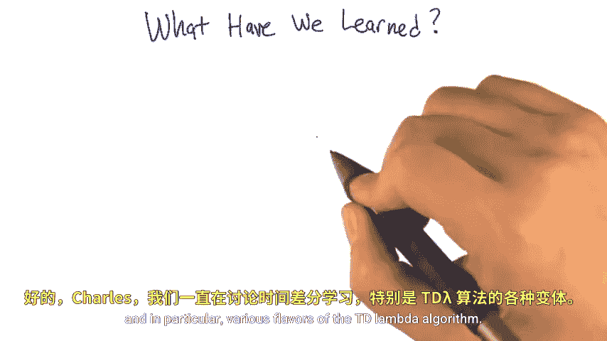
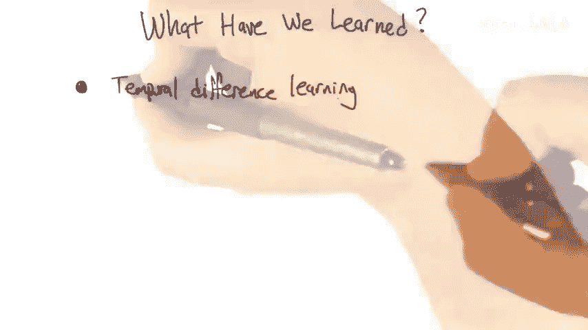
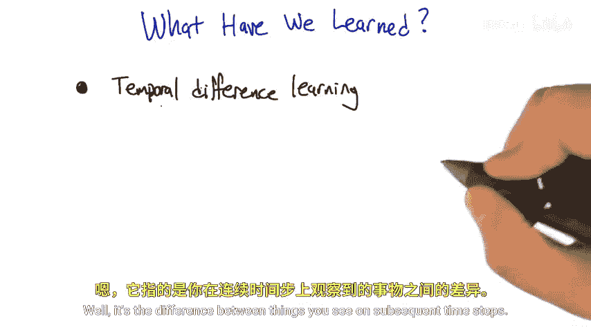
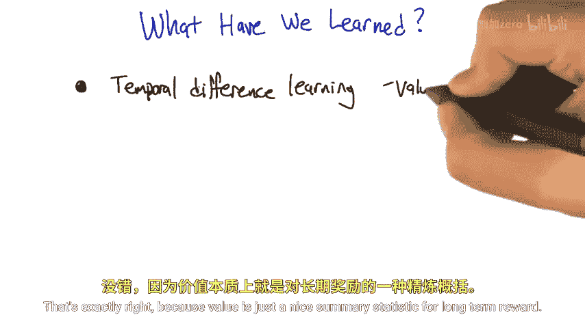
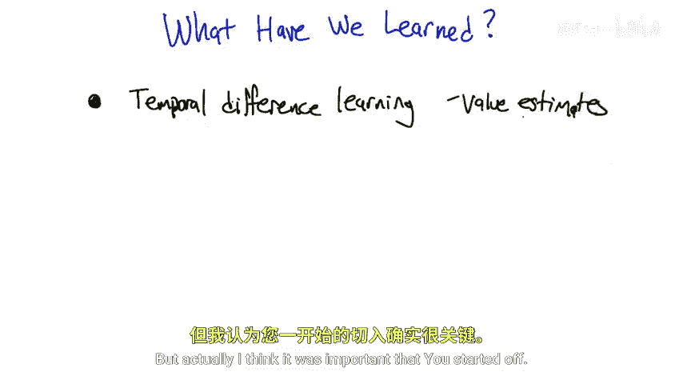
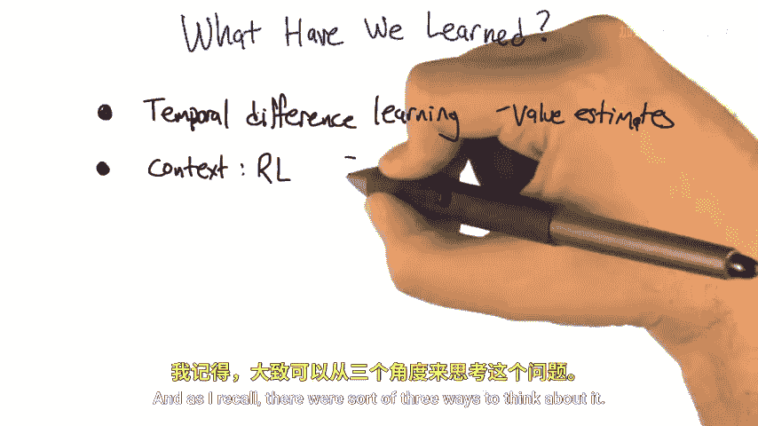
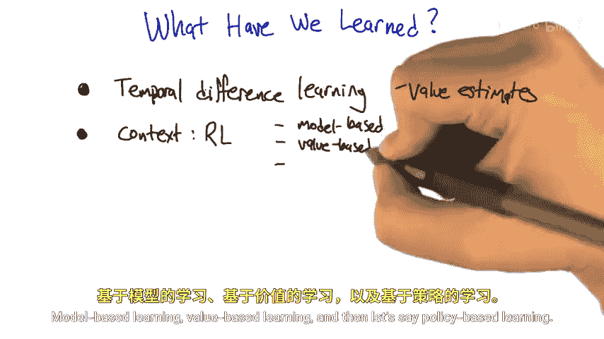
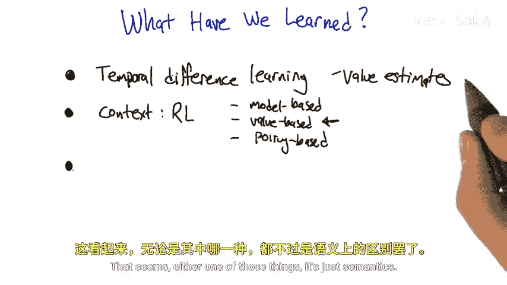

# 佐治亚理工【中英⚡强化学习导论｜CS8803 Introduction to Reinforcement Learning】 p94 P94 What Have We Learned_ -BV1cJnfzTEBt_p94-

Okay， Charles， so we've been talking about temporal difference learning and in particular。

 various flavors of the TD Lambda algorithm， can you remember some of the important things that we touched on。

 Well， I think you you just said the big one that all this discussion has really been about temporal difference learning And in a nutshell。

 what's a temporal difference。

Well， it's the difference between things you see on different times， subsequent time steps。 Yeah。

 what kind of things in different time， reward。 So so some sort of the the difference in value estimates as we go from one step to another。

 right， That's exactly right， because value is just a nice summary statistic for long term reward。

 Good， All right， But actually， but actually， I think it was important that。

You know you started off talking about this is the thing that we wanted to do。

 but first you put it in context by talking about different ways that we could solve the reinforcement learning problem。

And as I recall， there were sort of three ways to think about it， model based learning。

 value based learning， and then let's say policy based learning That's right and TD methods kind of fall where。

And the value based。 All right， And then we dove into the， the update rules themselves。

 So what do we talk about there。Well， we actually。Droed derived that seems either one of those things。

 It's just semantics。 you know， this kind of incremental way of building up estimates or the values。

 And I think you called it outcome based。 And I suppose all that。

