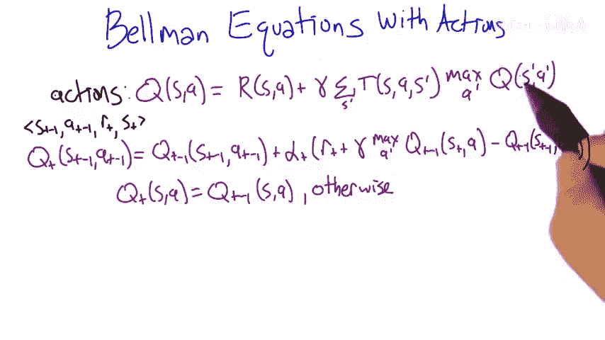
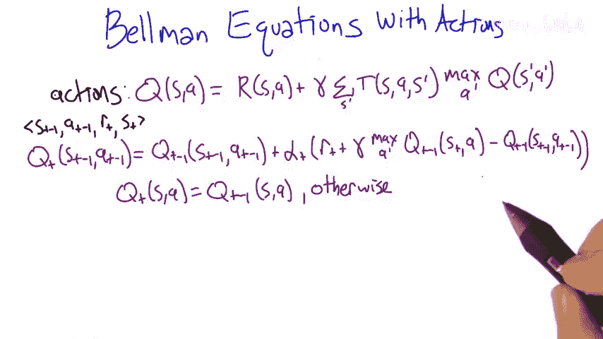
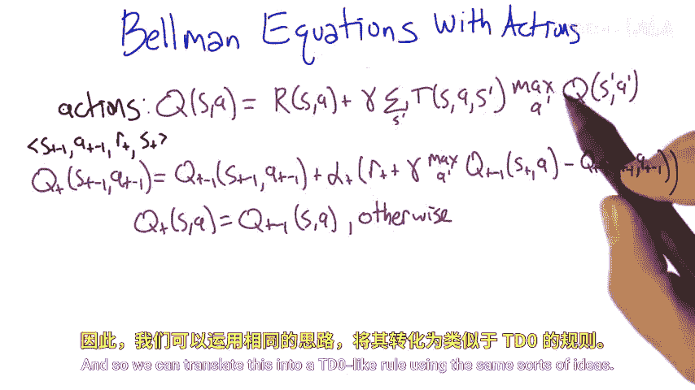
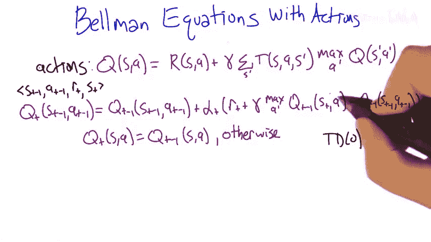
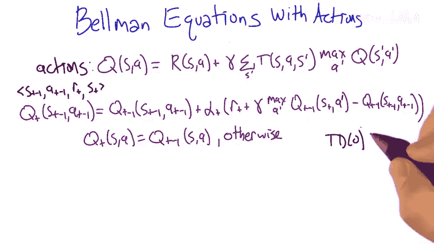
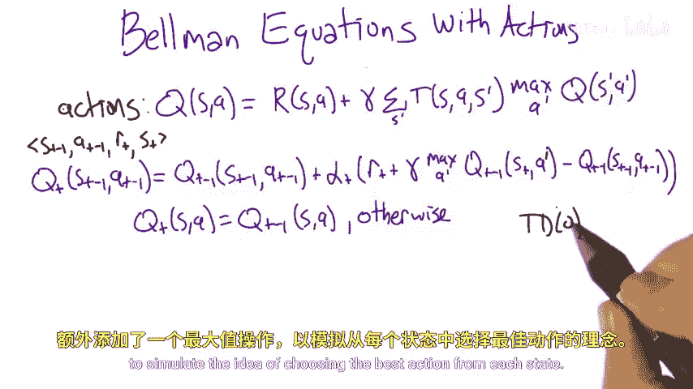

# 佐治亚理工【中英⚡强化学习导论｜CS8803 Introduction to Reinforcement Learning】 p96 P96 Bellman Equations with Actions -BV1cJnfzTEBt_p96-

So here's the same idea， the Belllman equations and a learning update rule。

 but this time with actions actions。So in the action form of it， we have this Belman equation。

 the Q form at the Belman equation， QSA equals the immediate reward plus the discounted expected value of the maximum action in the resulting state so when we actually land in that new state S prime。

 we choose the action that is best for that state。

Right。But otherwise， this is really the same kind of update as before。

 And so we can translate this into a TD0 like rule using the same sorts of idea so that the we're going to have a new estimate of the value function and the way that we're going to。

Change it as we go from one step， one time step to the next time step， is it's the same everywhere。

 except for the state in action that we just left， we just took action a sub t -1 and state S t -1。

And so that one we're going to update， we're going to move a little bit in the direction of the immediate reward。

 plus the discounted。Value of the state that we landed in S T， where the value is taken。

That better。It's taken with respect to the best action that we get from that state。 Okay。

 so this is again， the same update rule。 The only difference is we got this extra little max in here to simulate the idea of choosing the best action from each state。

 All right， so what I'd like to argue here is that this Q learning update rule is actually taking care of two different kinds of approximations all at one time。

😊。

