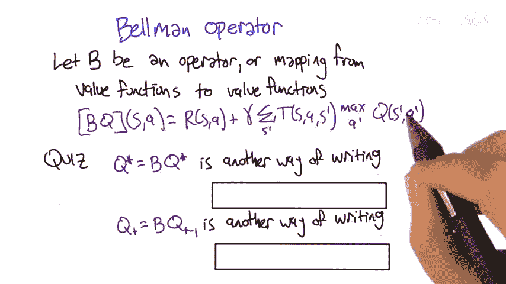
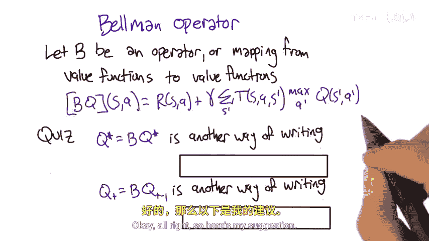
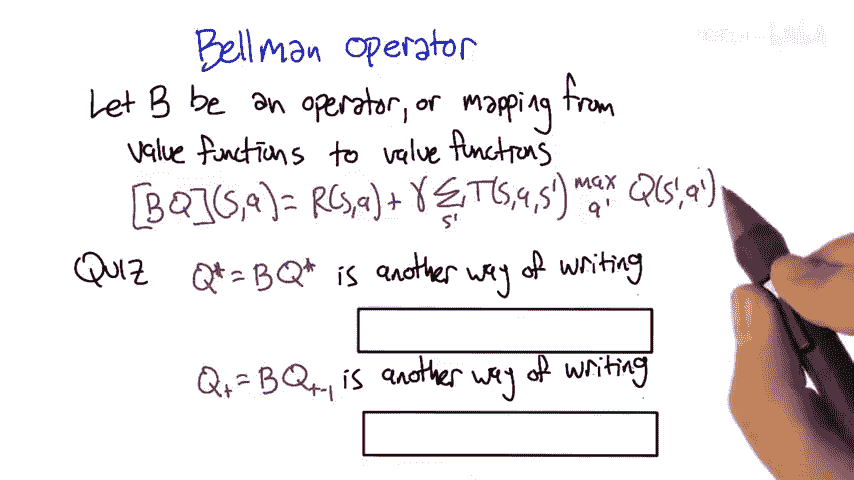
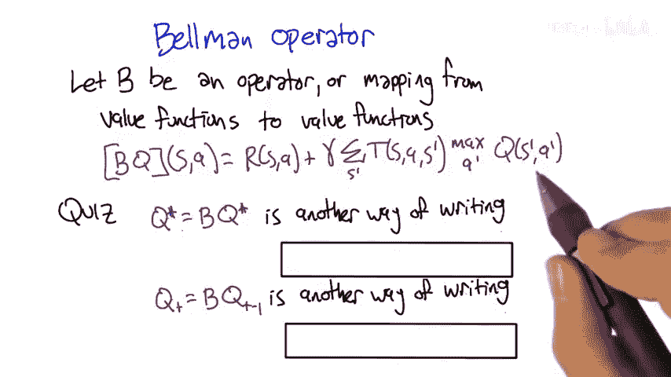
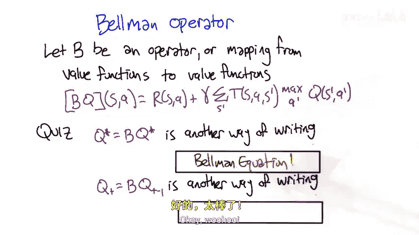
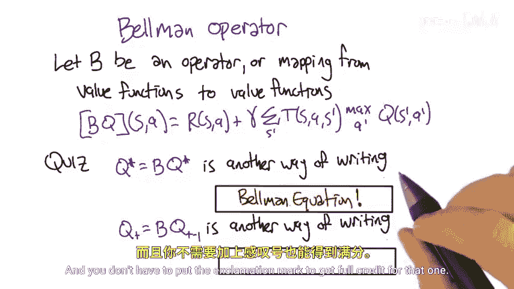
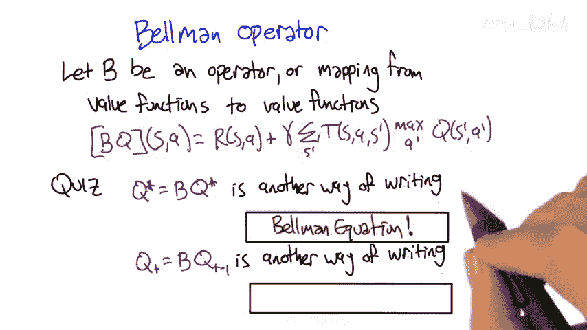
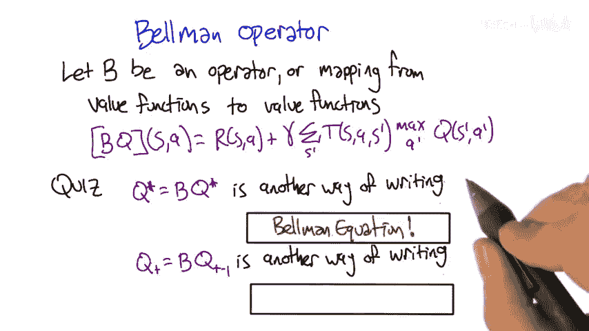
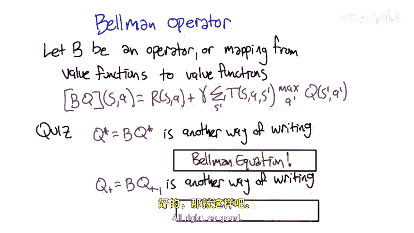

# 佐治亚理工【中英⚡强化学习导论｜CS8803 Introduction to Reinforcement Learning】 p99 P99 Bellman Operator - 2 Solution -BV1cJnfzTEBt_p99-

All right， so do you see what to do here， no。Okay， all right， so here's here's my suggestion。

 So remember this B thing is just a bit of notation here and what the notation is saying is that whatever value function you give it。

 you can replace this whole thing with a value function defined like this right and so imagine what happens if you actually plug all that in if you actually take this B Q star and replace it with the definition according to this operator definition above。

😡。

That says the Q star is actually equal to， Well， that's the definition of Q star。

 do we have a name for that， Q star， Sure， we have a name for Q star。

 but the equation that defines Q star。

What's the do equation？

Yeah。Oh， that was easy。Okay， and you don't have to put the exclamation mark to get。

Full credit for that one。 Oh， I don't know。 I think these you should require they put the exclamation marker if they don't give full credit。

No， I think， I think it's okay。 In fact， anything that has bellmin in it should be fine。

Anything that has bellman in it？Yeah， like the Belman identity or。I don't know。

 I was trying to think of other sequels that have the the Bellllman ultimatum。Yes。

 Bellllman reloaded。Alright， so good。 So， so with that kind of thought process in mind。

 can you do the next one， So we have some， some Q function。 We apply the bellman operator to it。

 and we get some new Q function。 Bellllman update。😊。

