# 001：导论

## 概述

在本节课中，我们将介绍《GPU编程与视频游戏》这门课程。我们将探讨这门课程的起源、目标、涵盖的内容以及不涵盖的内容。同时，我们也会了解游戏行业的发展、GPU编程的重要性，以及学习本课程所需的工具和环境。

---

大家好，我是Aaron Laantterman，佐治亚理工学院电气与计算机工程系的教授。欢迎来到2020年夏季《GPU编程与视频游戏》课程的第一讲。

通常情况下，我会在现场观众面前进行讲座，但由于新冠疫情的影响，本学期我将录制讲座并发布在YouTube上，希望这些内容能对大家有所帮助。

大多数教授在成为某个深奥研究领域的专家后，会提议开设专题课程，通常是研究生课程。我的做法则不同：我会选择一些我想学习的内容，而唯一能让我腾出时间学习的方法，就是将其作为我工作的一部分——开设一门课程来教授它。幸运的是，我的同事们从未事先检查我是否了解我所讲的内容。因此，大约在2007年春季，我萌生了开设一门视频游戏编程课程的想法。

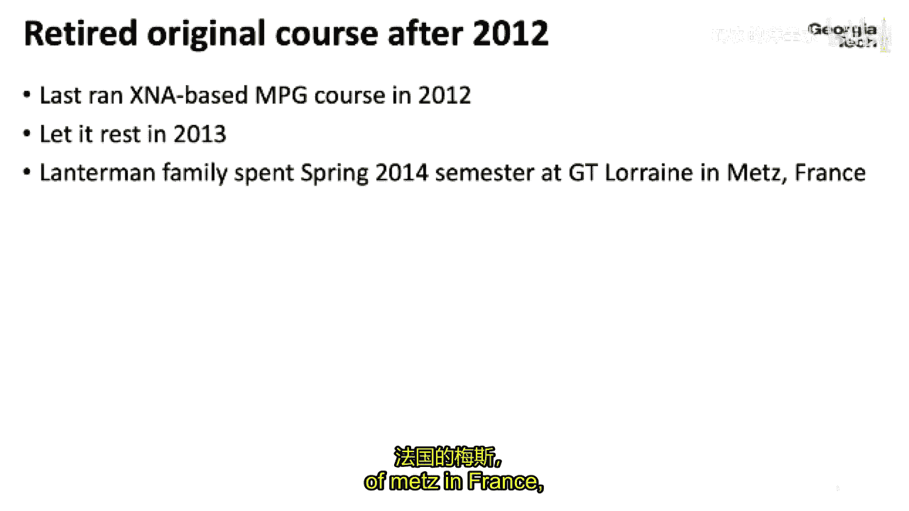

当时，佐治亚理工学院的计算机科学、文学、媒体和传播学系已经垄断了大部分与游戏相关的课程。因此，我需要找到一个能说服我所在EC系同事的角度。我想到的角度是高性能计算。我发邮件询问是否有同事愿意加入这次冒险，幸运的是，我的同事Sean Lee答应了。更幸运的是，他之前在英特尔工作时确实有一些图形硬件方面的经验。

当时，Xbox 360和PlayStation 3即将上市，特别是PlayStation 3配备了全新的Cell处理器。幸运的是，计算学院的David Bader和他的研究生们也加入进来，帮助我们处理这部分内容。此外，微软开发了一种方法，允许人们使用C#在零售版Xbox 360的.NET环境下以沙盒模式编写和运行代码，这在当时并不常见。

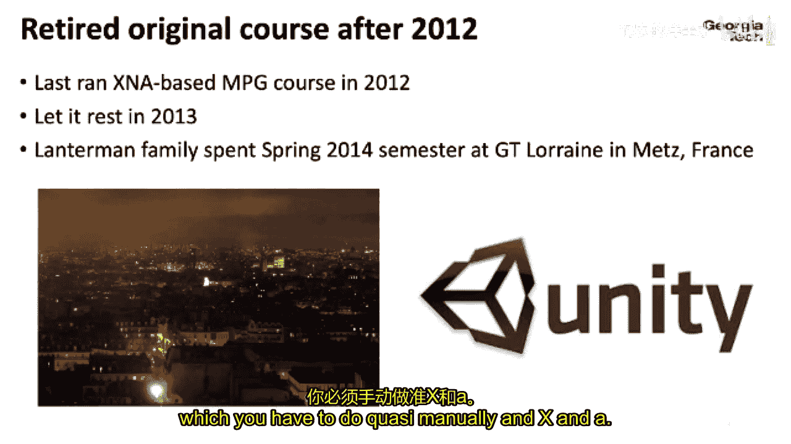

第二年，我和Sean独立开设了这门课程，由Sean负责Cell处理器的部分。我们在2009年再次开设了这门课。大约在2010年，Sean离开佐治亚理工学院回到工业界，课程就由我独自负责了。在原本讲授Cell处理器内容的那学期，我讲到一半时觉得内容有些枯燥，而且Cell处理器本身也不是一次成功的实验，所以我当场决定放弃这部分内容。

大约在2012年，迹象已经很明显了：XNA团队的许多关键成员已转向其他项目，微软最终也在那时停止了对XNA的支持。同时，Xbox 360本身也显得有些过时，而像Xbox One（我认为这个名字很荒谬，容易与初代Xbox混淆）和命名不那么有创意但更合理的PlayStation 4等新设备即将上市。因此，可以说是一个时代的更迭，我也应该开始重新思考这门课程。

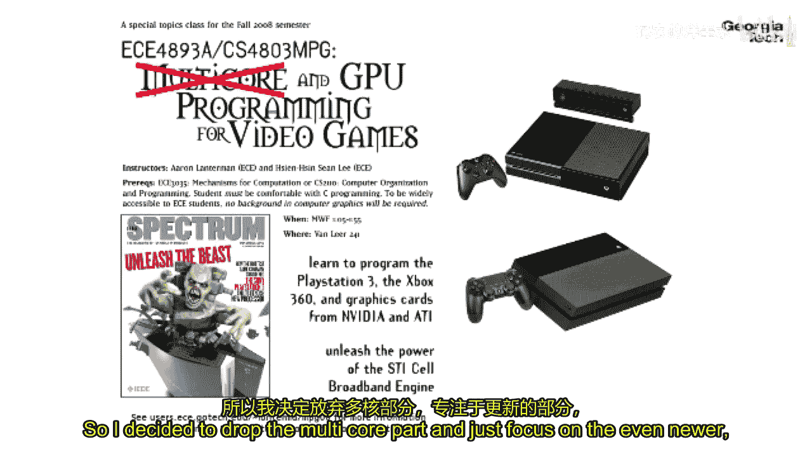

由于我一直使用XNA，并开发了一系列XNA示例，所以研究MonoGame（一个本质上是.NET C# XNA框架的开源重写版）很有意义。不幸的是，当时我查看它时，它还相对较新，我无法在我的Macintosh上运行它。显然，在过去的八年里，它已经取得了巨大的发展，但当时看来并不值得投入，所以我决定暂时不再深入研究MonoGame，并在2012年秋季最后一次授课后，决定暂时搁置这门课程。

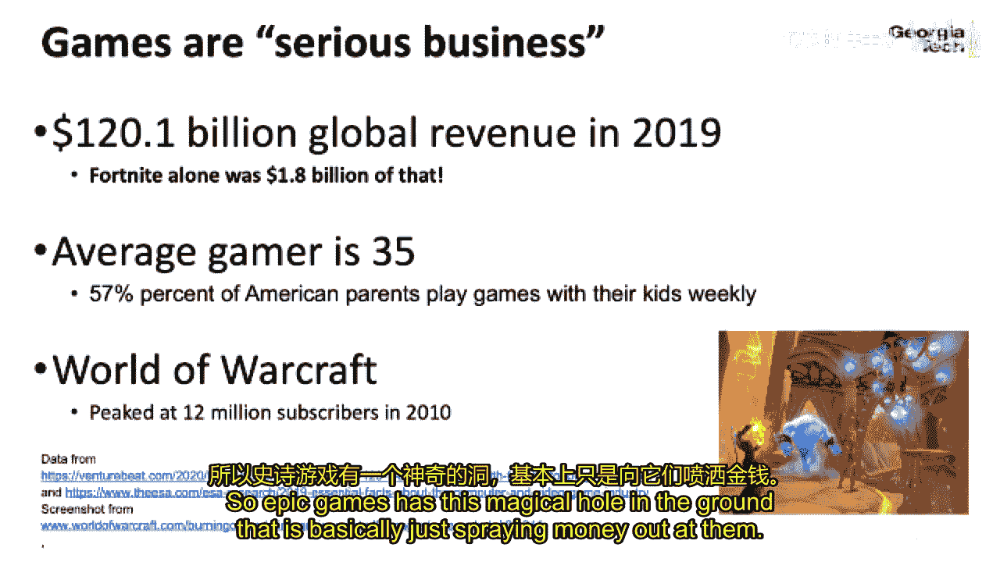

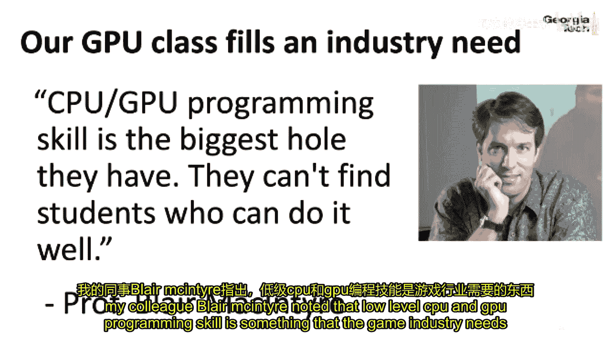

2013年过去了，没有开设任何此类课程。于是，2014年春季学期，我在法国梅斯市的佐治亚理工学院洛林校区任教。这是一张从圣母圣殿拍摄的城市照片，景色非常壮观。当时我和儿子一起玩《最终幻想6》，这款游戏有一种蒸汽朋克的氛围，我觉得这看起来非常酷。除了在佐治亚理工学院洛林校区度过时光，或者跟着我精通法语的妻子到处走，我大部分时间都待在公寓里。我接触了Unity，并开始尝试使用它，意识到这是一个可以快速运行着色器代码的好框架，我们甚至可能比原课程更深入地研究着色器内容，因为原课程花了很多时间在搭建基础框架上，以在屏幕上显示3D图形，这在XNA中需要半手动完成。

原课程很大程度上受到了PlayStation 3的Cell处理器和Xbox的三核Power PC等特别奇怪的多核架构的启发。而在Unity中，许多传统上由额外CPU核心处理的任务都由Unity在幕后处理了。但Unity也提供了对GPU的大量直接访问，你在那里编写的着色器代码与为任何这些游戏机编写专业开发工具包代码是一样的。因此，我决定放弃多核部分，专注于在这些更新、更酷的GPU上可以做的更新、更好的事情。于是，当前版本的课程——《GPU编程与视频游戏》诞生了。

如果有人想知道游戏编程是否是一项值得的智力追求，至少它在经济上是值得的。2019年全球游戏收入约为1201亿美元（取决于统计方式）。平均游戏玩家年龄为35岁，这可能与我小时候的情况不同。这个数字偏向年轻群体，现在新一代玩家是与他们小时候玩过游戏的父母一起玩游戏。

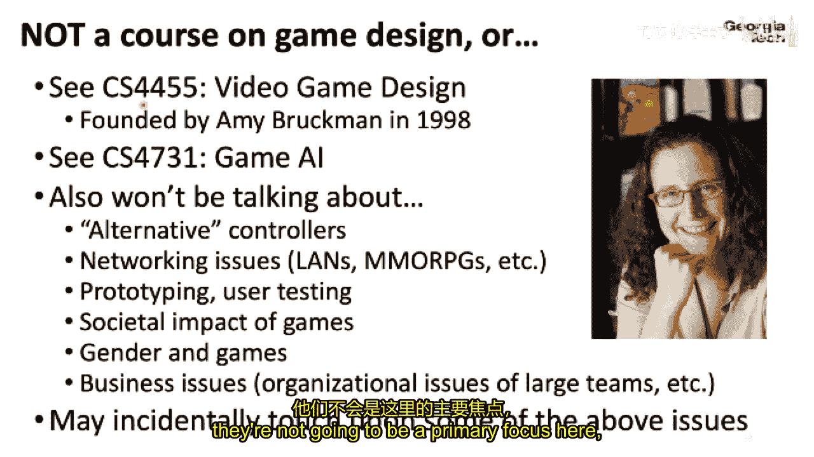

当我2007年首次开设这门课程时，《魔兽世界》刚刚推出，当时看起来规模巨大，但后来发生了《堡垒之夜》的现象。需要澄清的是，这有点偶然，我其实非常不擅长玩《堡垒之夜》。但那1201亿美元中的18亿仅仅来自《堡垒之夜》这一款游戏。因此，Epic Games仿佛有一个神奇的聚宝盆，不断喷涌出金钱。

当我首次提议开设这门课程时，我的同事Blair McIntyre指出，低层级的CPU和GPU编程技能是游戏行业所需且难以找到的。

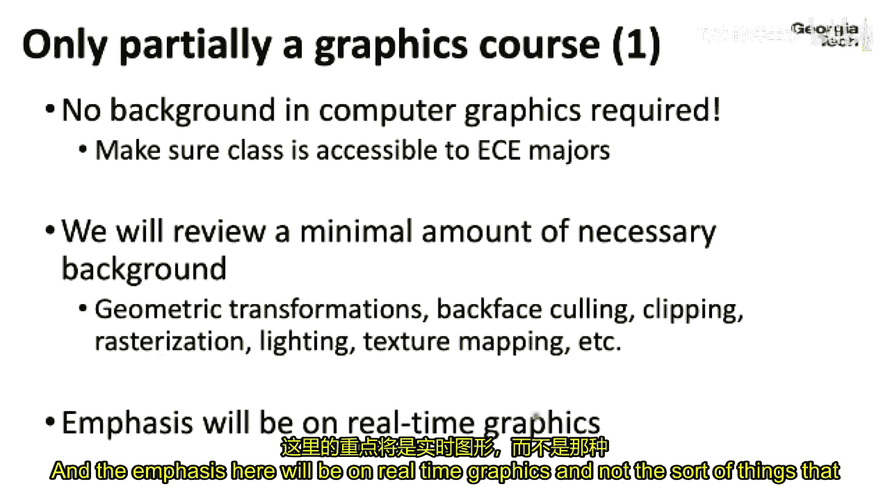

---

## 游戏编程的特点

上一节我们介绍了课程的背景，本节中我们来看看游戏编程与通用编程有何不同。

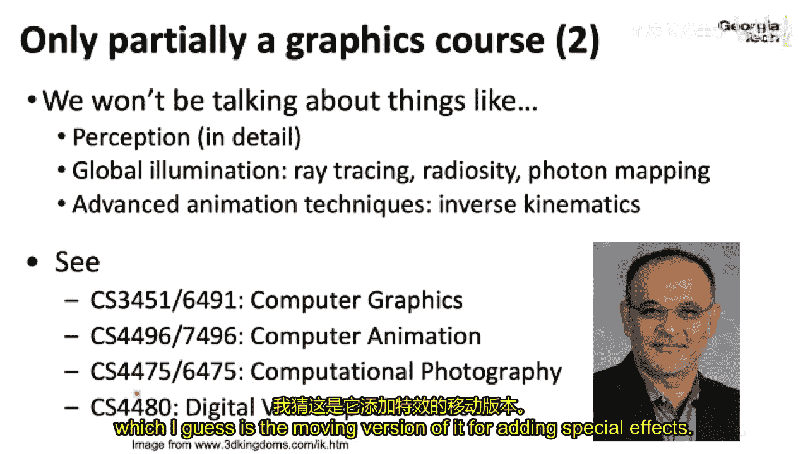

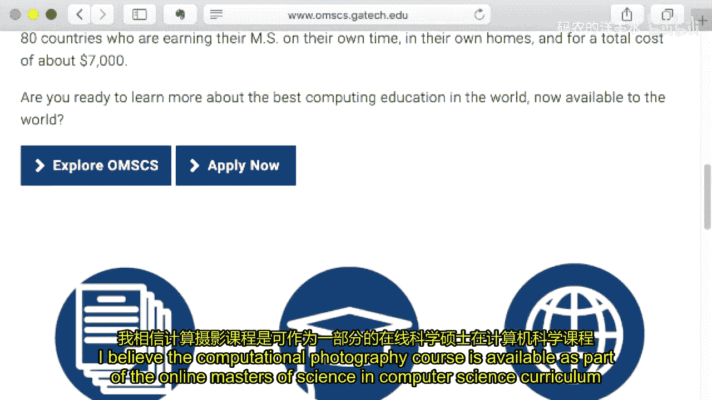

游戏编程和实时图形模拟编程与通用编程有很大不同。在游戏编程中，假设你试图达到每秒60帧的帧率，那么你大约有16.7毫秒的时间来完成下一帧出现前需要做的所有事情。即使游戏大部分时间性能极佳，但如果在少数地方游戏变得卡顿，所有人都会在论坛上谈论你的游戏有多糟糕。这与进行天气模拟等任务非常不同，在后者中，你可以输入大量信息，然后等待一段时间获取结果。在那种情况下，你可能有一台每秒能进行数万亿次浮点计算的计算机，但如果它每运行一秒就需要停下来冷却四分之一秒，这对游戏来说就毫无用处。

---

## 本课程不涵盖的内容

在明确了本课程是什么之后，我也想明确它不是什么。

有些人可能会失望，因为我没有要求你们在这门课中从头开始设计和编写一个视频游戏。我不这样做是因为这本身很容易占用一整门课程的时间，例如我的同事Amy Bruckman在1988年首次开设的CS 4455课程，最近主要由Jeff Wilson和Mary Guandique讲授。如果你想专门学习游戏人工智能，我们有CS 4731课程。虽然我偶尔会涉及更通用的视频游戏课程中出现的许多问题，但它们不是这里的重点，所以你不应期待这些内容。

这也不是一门完整的计算机图形学课程。如果这是一门计算机科学课程，我可能会将计算机图形学设为先修课。但我身处EC系，并希望它对EC专业的学生开放，而他们中的大多数没有上过计算机图形学课程。因此，我将回顾传统计算机图形学课程中的各种主题，但仅限于本GPU编程课程所需的部分，特别是与计算机图形学光栅化模型相关的内容。在光栅化模型中，你基本上会遍历构成场景的所有三角形，并将它们绘制到屏幕上。本课程的重点将是实时图形，而不是用于电影CGI等离线计算的图形。

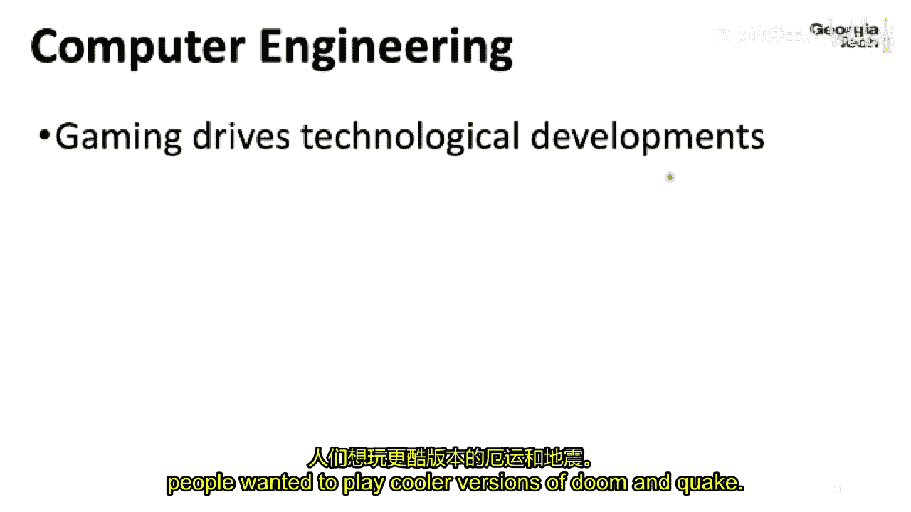

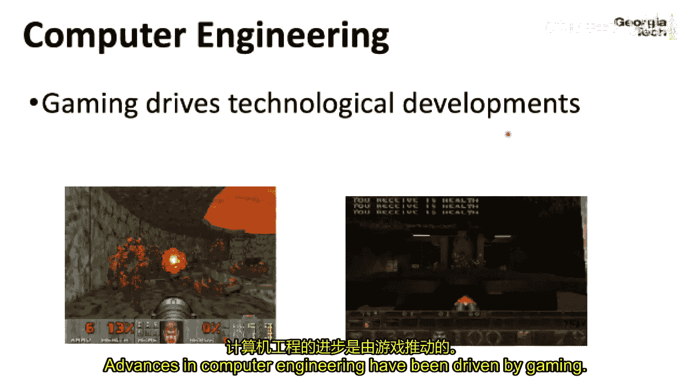

传统CS系图形学课程中的一些主题我们不会深入探讨。例如，大多数此类课程会花时间讨论人类如何感知光和颜色。它们还会讨论一种不同于光栅化的图像生成模型，称为光线追踪。在光线追踪中，主循环不是遍历场景中的所有三角形，而是遍历所有像素。虽然人们已经在GPU上进行光线追踪有一段时间了，但传统上GPU是以更偏向科学超级计算的GPGPU模式运行，不一定是实时的。目前，AMD和Nvidia的最新显卡确实内置了一些实时光线追踪功能。我尚未在本版本课程中包含这部分内容，因为我认为它还不够普及，不足以让许多游戏采用，使其值得纳入课程。但未来版本的课程可能会包含它。

此外，还有关于高级动画技术（如逆向运动学）的完整课程。如果你想了解更多，有一门完整的计算机动画课程。我的同事Efrenessa教授一门计算摄影学课程，还有一个扩展版本，我猜是关于添加特效的动态版本。我相信计算摄影学课程是佐治亚理工学院在线计算机科学硕士课程的一部分。

---

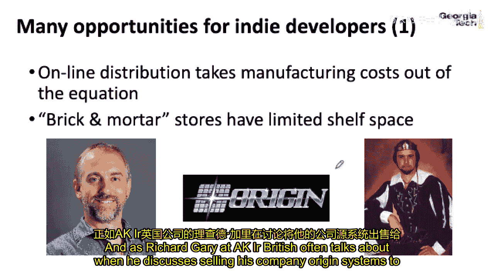

## 本课程涵盖的内容

我们已经花了很多时间讨论这门课程不涉及什么，现在让我们谈谈它涉及什么。

你并不一定需要最新、最强大、最昂贵的GPU显卡来完成本课程的作业。我所有的课程演示都是在2015年的15英寸MacBook Pro上完成的。回顾本课程的早期版本，我可能会说手机和平板电脑还不够强大，无法充分利用我们正在研究的所有技术，但这种情况肯定已经改变了。

计算机游戏产业在过去40年里发生了巨大变化。早期，一个人设计游戏、编程游戏、为游戏创作美术和音乐（如果当时游戏中有美术和音乐的话）。如今，这些通常是专业化的角色，团队规模可达100人，有些人的工作就是管理他人，他们不一定做任何技术性工作。也就是说，如果你既具备编程技能又具备美术技能，并能成为艺术家和程序员之间的桥梁，那么你将是一种稀有且有价值的资源。

现在，趋势又有点往回走了。目前有工具和基础设施可供个人和小团队制作游戏，即使不能与100人团队制作的游戏完全媲美，它们本身也相当出色。如果你是想进入游戏行业的学生，请意识到这可能有点残酷。据说大多数公司在工作与生活平衡方面比2004年时要好，但我不会说这种改善在所有公司都是一致的。除了工作本身需要相当长的时间外，这也是一个很难进入的行业，这也是人们工作时间如此长的部分原因。公司知道有年轻、渴望进入游戏行业的大学毕业生，他们可以进行一种“消耗与替换”的策略：如果你在三四年或五年后精疲力尽，他们总可以替换你。

你并不一定非要进入游戏行业才能从本课程中受益。如果你从事更通用的计算机工程，了解我们拥有如此强大的通用GPU处理能力用于科学超级计算的原因，是因为人们想玩更酷的《毁灭战士》和《雷神之锤》版本。计算机工程的进步确实是由游戏驱动的。理解游戏对计算系统施加的工作负载类型，将有助于你开发处理其他类型工作负载的计算系统。因此，虽然你可能不会为艺电工作，但也许你会为Nvidia或AMD设计新芯片，或者为英特尔、AMD或IBM工作（虽然它们主要被称为“CPU”供应商，但它们现在的许多CPU都集成了GPU）。当然，现在想起来，AMD和ATI在技术上是同一家公司。也许你不会编写游戏，但可能会设计新的PlayStation 5或Xbox Series X，或者任天堂为其下一代游戏机起的任何奇怪名字。

如果我们跳出传统游戏行业的框框思考，理解GPU在图形上下文中的应用，也能让你对在更通用的科学计算上下文中使用它们有所了解。即使你不专门编写游戏，时钟速度不再像以前那样快速增长的现实，也导致人们默认必须转向并行处理。话虽如此，当学生回来告诉我他们得到了游戏行业的梦想工作时，我仍然感到非常兴奋，这太棒了。

假设你不去商业游戏公司工作。现在你也有机会像70年代末80年代初那样，创建并发布自己的游戏，而在90年代你几乎没有这样的机会，那时如果你想分发游戏，必须通过磁盘和光盘，并且必须上架销售。这导致了很多问题，因为商店的货架空间有限。正如Richard Garriott（又名不列颠勋爵）在讨论将他的公司Origin Systems卖给艺电时经常谈到的那样，那些大公司不想与十几个不同的分销商打交道，他们真的只想与大约三家打交道。但如今，在电影和电视节目等领域，像亚马逊和Netflix这样的公司可以利用长尾效应，提供大量不同的产品，即使每个单独的产品销量不一定很高。当然，从环境角度来看，如果我们能用能量来传输比特，而不是移动装有这些比特的盒子，那是一件好事。

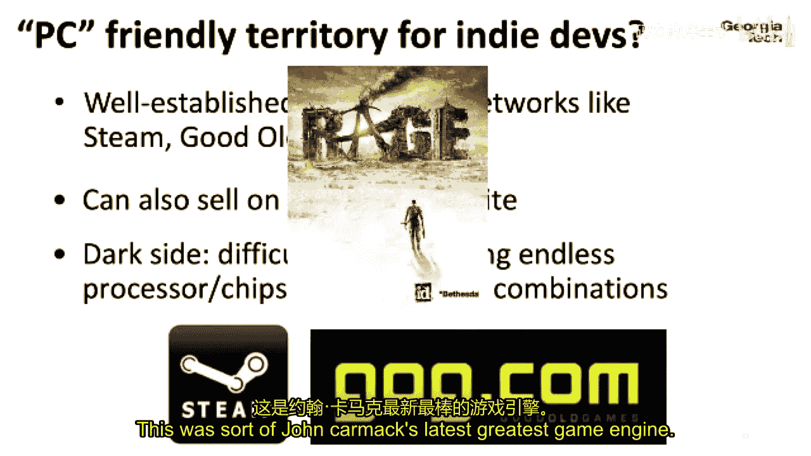

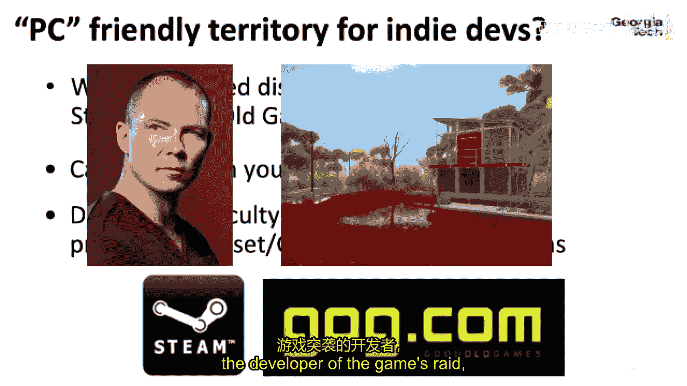

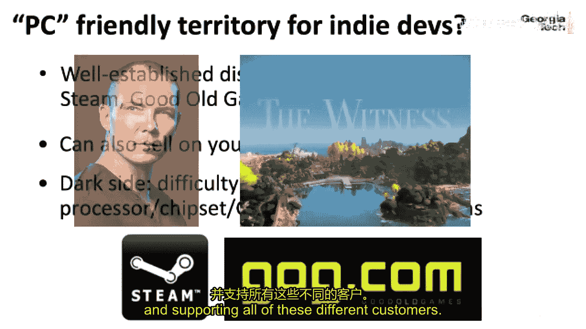

我必须向Jeff Vogel致敬，他在“独立游戏”这个术语成为标准之前，早在“共享软件”更常见的时代，就已经在开发成功的独立游戏了。他的游戏《Vernum 4》是我延迟三周提交终身教职文件的原因。幸运的是，我仍然获得了终身教职。我玩的第一款Spiderweb Software游戏是《Exile》，当时我还在读研究生。我记得我玩完演示版后，为了注册游戏，不得不打电话给Jeff，向他读出我信用卡上的数字。这让你感受到我们在在线支付游戏方面已经走了多远。尽管对于任何开发者来说，将游戏上架到三大主机平台已经变得更容易，但这仍然不是一件轻而易举的事。你仍然需要通过各家公司的审核，你创建的代码必须经过他们的程序才能上架这些游戏机。这部分是为了帮助防止盗版，但很大程度上也是因为游戏机制造商希望确保，如果有人正在PlayStation、Switch或Xbox上玩游戏，那是在一个安全的区域内运行，用户不必担心程序崩溃、机器出问题等等。你真的不想绕过这些程序，在没有他们允许的情况下将自己的游戏放上去。

以前，当游戏必须通过CD或特别是卡带等物理介质分发时，游戏机制造商确实对此控制得很严。例如，任天堂会基本上向你收取所有制造的卡带费用，无论卡带是否售出，他们都能赚钱。如今，通过在线分发，你不需要担心需要制造多少ROM卡带或压制多少光盘，所以这对很多事情来说肯定是最好的方式。微软曾有一段时间有一个有趣的计划，允许使用XNA开发游戏的人通过Xbox平台销售他们的游戏，这是独一无二的。PlayStation 3没有类似的东西，任天堂也没有。这个计划有过几个不同的名字，在Xbox菜单系统中的位置也经常变动。我对此抱有很大希望，但这些希望并未在现实中实现。许多希望是基于独立开发者开发的移动游戏销售情况良好这一事实，但我认为在手机上玩游戏和在Xbox 360上玩游戏的心理是不同的。如果你在杂货店排队，你可能会拿出手机，翻看商店，看看首页有什么酷的新游戏来打发时间。但如果你坐在Xbox 360前玩游戏，通常心里已经想好了要玩什么游戏，你很少会说“让我浏览一下Xbox Live Indie Games”，即使你知道Xbox Live Indie Games的存在。

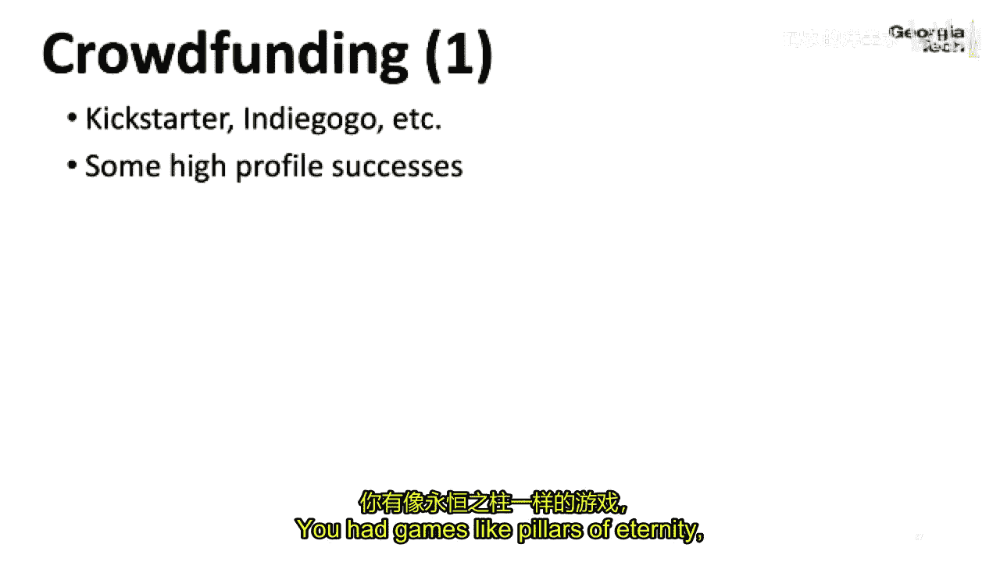

你可能会自动认为，像微软、索尼或任天堂这样的公司设置的所有障碍，会自动意味着Windows、Macintosh和Linux的PC领域对独立开发者更友好。但你仍然有审核者，比如Steam和GOG。尽管如今你几乎可以很容易地将游戏上架到这些平台，但它们不再是以前那种审核者了。例如，Steam不再试图成为过去那种审核者。你正在与大量其他同样在这些平台上开发的游戏竞争。你可以在自己的网站上销售游戏，但除了竞争激烈的问题外，你还面临着支持各种CPU和GPU变体、操作系统和主板芯片组的困难。我知道这是id Software在发布《Rage》时遇到的问题，这是Carmack最新的伟大游戏引擎。如果你关注《见证者》游戏的开发者Jonathan Blow的Twitter，你会经常听到他大声抱怨让游戏在所有不同平台上流畅运行并支持所有不同客户的困难。

那么移动市场呢？当然，人们对审核者（特别是苹果）有意见，但我认为移动领域的主要问题只是有数百万款游戏像每微秒一样在iPhone等平台上发布。结果，你基本上需要在某个时候开始为你的游戏收取负数的费用，最终你会得到那些除了广告什么都没有的游戏，然后人们抱怨你所有的微交易。我不会在这里深入讨论。

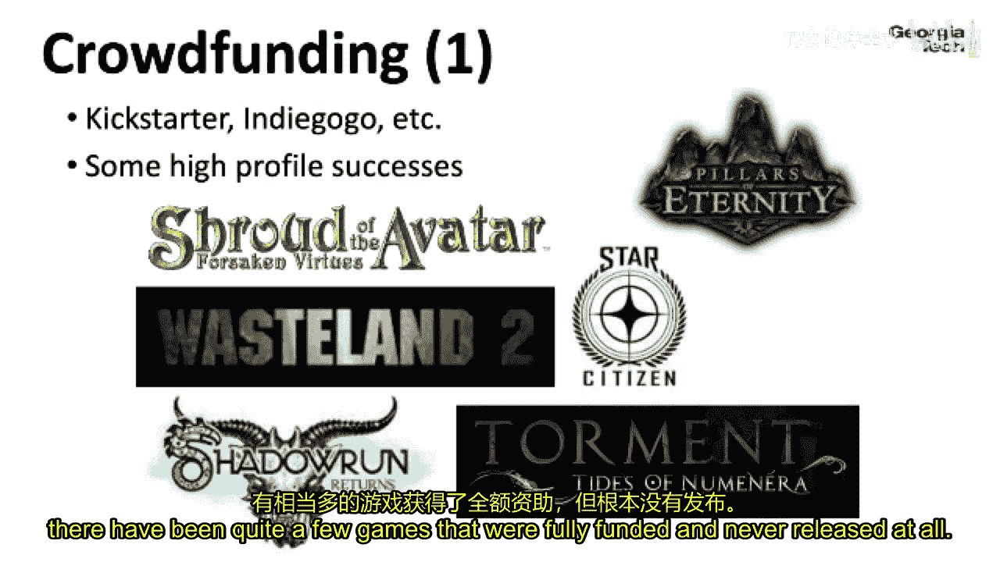

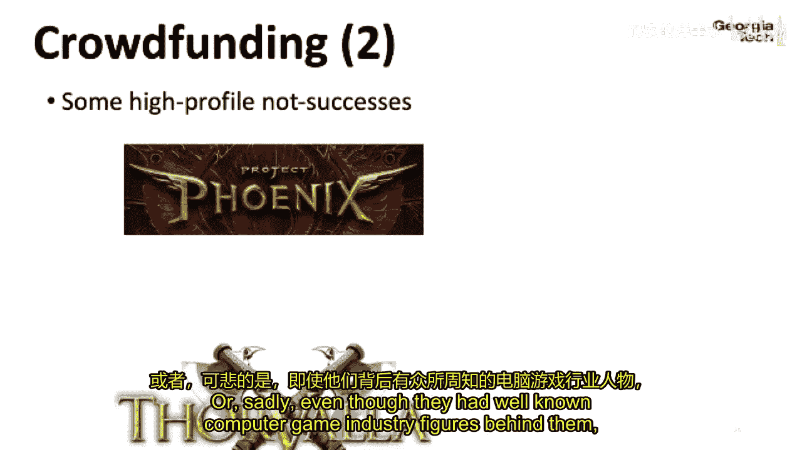

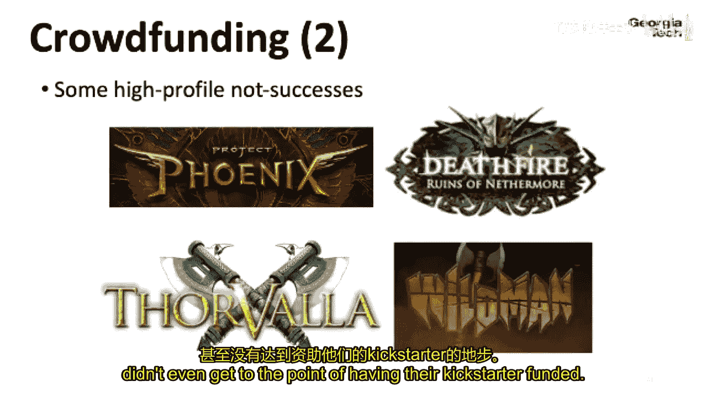

关于为你的游戏筹资。像Kickstarter和Indiegogo这样的平台已经变得流行起来。我认为它们在早期有点饱和了。早期有像《永恒之柱》、《废土2》、《折磨：纽蒙拉之潮》这样的游戏筹集了大量资金，并且通常被视为评论界的成功。我必须特别提一下《Shadowrun Returns》，因为在所有这些项目中，我认为这个项目在明确定义范围、保持在该范围内并按时发布方面做得最好。还有一些其他游戏获得了全额资助，并且或多或少被视为成功发布，但由于某种原因仍然存在争议。我知道《Shroud of the Avatar》受到了一些批评，尽管我和儿子非常喜欢玩它。然后是典型的案例，即高度资助、或多或少已发布但极具争议的游戏，即Chris Roberts的《星际公民》。在所有获得全额资助并或多或少发布的游戏中，也有相当多的游戏获得了全额资助但从未发布，或者可悲的是，即使背后有知名的电脑游戏行业人物，甚至没有达到Kickstarter筹资的目标。

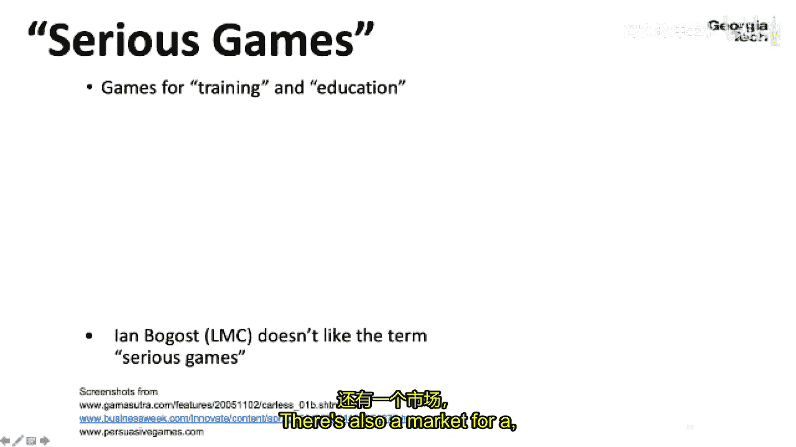

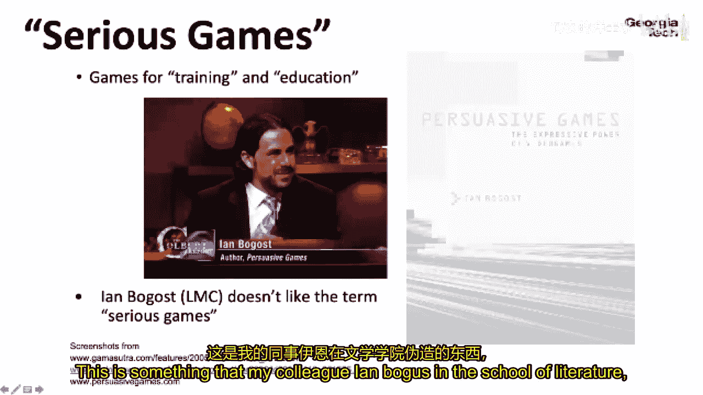

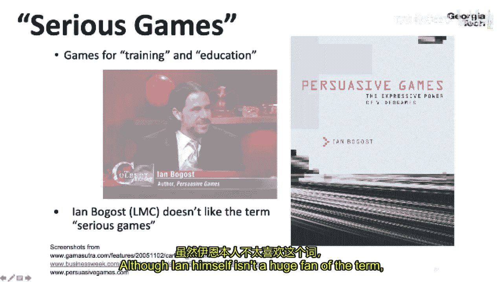

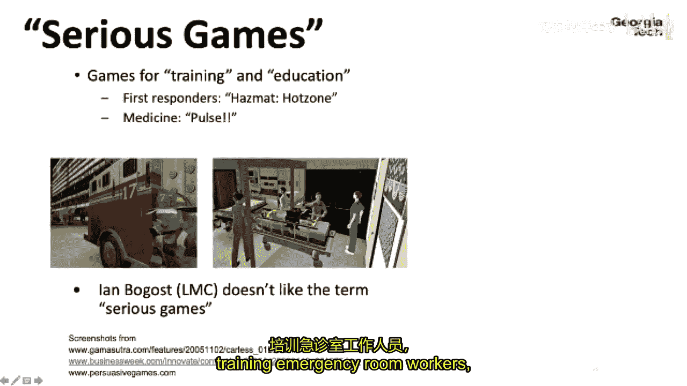

我主要谈论的是为了“娱乐”的游戏，但也有“严肃”游戏的市场。这是我的同事Ian Bogost（文学、媒体与文化学院）经常写到的，尽管Ian自己并不太喜欢这个术语。有用于培训急救人员和灾区响应者的游戏，用于培训急诊室工作人员的游戏。Ian甚至为一家乳品店创建了一个游戏，让你学习如何经营商店，实际上还包括一个冰淇淋勺模型，以学习如何正确地挖冰淇淋球。Ian还为Howard Dean的总统竞选（如果你年纪够大还记得的话）开发了一款游戏，他还创建了一款游戏，在游戏中你是金考公司的员工，基本上顾客和金考的其他员工试图让你的生活变得悲惨。需要承认的是，这实际上并未引起金考公司的注意。

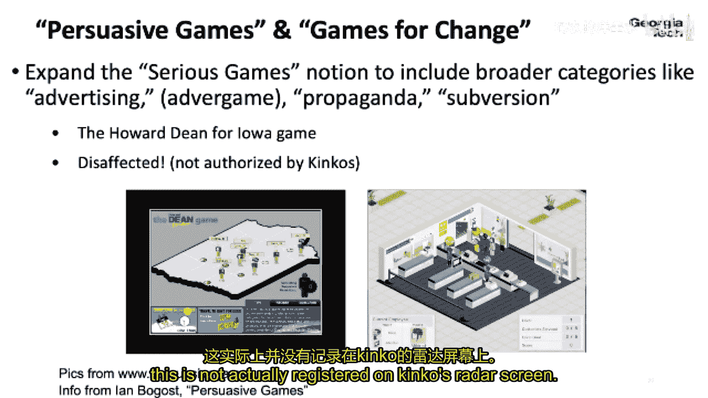

Ian还写过关于《美国陆军》游戏的文章，该游戏由美国政府资助。这里展示的第一个版本使用了当时最先进的原始Unreal Tournament引擎。游戏中有两支队伍：美国陆军和坏人。我相信军方不希望人们真正扮演坏人，所以根据Ian的《Persuasive Games》一书，如果我没理解错的话，每个人都会将自己视为好人，而将另一支队伍视为坏人。我将留给你们自己对这些事情做出判断。

除了娱乐或严肃的游戏之外，实时图形还有很多应用。例如，外科医生可能受益于手术室中的实时图形，能够获取各种设备收集的数据，并更好地观察他们正在手术的人。东芝在Cell处理器还是热门事物时，曾用它进行运动跟踪。东芝还在他们的一些电视机中安装了Cell处理器。我特别感兴趣的是，PlayStation 3中的Cell处理器实际上是某种略有缺陷的版本。基本上，他们会制造一批Cell，如果所有八个协同处理单元都正常工作，它们会作为科学超级计算设备以溢价卖给像Mercury Computing这样的公司。如果其中一个SPE失效，那个失效的SPE会被屏蔽掉，然后如果你为PlayStation 3编写程序，实际上只能访问七个SPE，尽管我认为其中一个实际上被主操作系统占用了，你实际上只能编程六个左右。

实时图形也被用于好莱坞电影的前期制作中。你最终的CGI通常是由一堆计算机（无论是在机架中还是放在桌子上，形成所谓的“渲染农场”）离线渲染的，使用的技术比实时更复杂。但实时图形的能力让电影制作人能够以不同的方式试验和布置场景，本质上变成了3D动态故事板。我将在下面的链接中放一些这方面的例子。还有一些人使用游戏引擎制作有趣的电影，比如使用《光环》引擎的《红 vs 蓝》。如果你想从学术角度了解更多，我的同事Michael Nitsche在文学、媒体和传播学领域写过关于Machinima的文章。

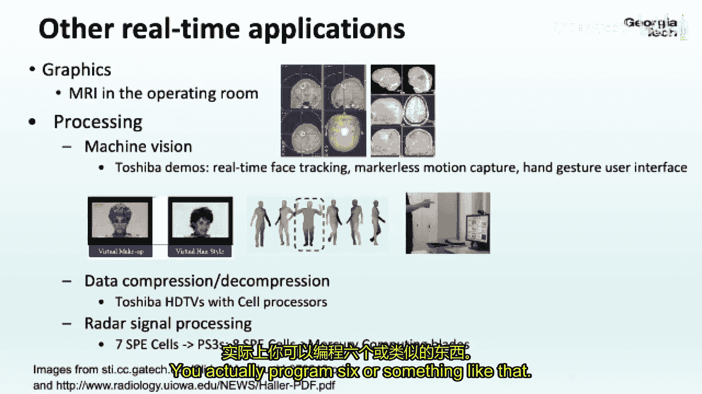

---

## 硬件与工具的发展

上一节我们探讨了游戏编程的广泛应用，本节中我们来看看硬件和游戏开发工具的发展趋势。

回顾过去的40年，我们看到在早期，不同的计算机和不同的游戏机之间存在显著差异。雅达利2600和任天堂娱乐系统各有独特的外观。但随着时间推移，游戏机之间的差异变得越来越小。如今，PlayStation 4和Xbox One基本上都是标准的PC硬件，带有标准的PC芯片组，就像MacBook的内部结构与戴尔Windows笔记本电脑没有太大区别一样。

这主要是件好事，但我认为也失去了一些有趣的东西。在过去，像Apple II游戏和Atari 800游戏的外观会有很大不同，当时游戏设计的一个有趣部分是不同的开发者如何处理不同平台提供的创造性限制。如今，硬件本身没那么有趣了。这是一个近期的趋势：如果你看PlayStation 4和Xbox One，它们基本上是一样的。而就在上一代，你还有Xbox 360的三核Power PC和PlayStation 3的奇怪Cell处理器。但现在，进行这种大型、花哨的定制开发工作已经不值得了，使用现成的部件，或者至少是像ARM这样的公司的现成IP核更容易。

这样做的好处是，比如说，迁移到下一代Xbox，或者从PlayStation 4迁移到5，不会太困难。不像80年代，人们用汇编语言编程游戏，从6502或Z80迁移到68000是一件大事。另一个积极的方面是，硬件基本上已经趋同。并不是计算机不再变快，而是你作为程序员与硬件交互的方式确实已经稳定下来。在桌面端，你有Windows、Mac和Linux，在它们之间移植软件相当容易。在移动平台，你有iOS和Android。甚至与GPU交互的方式，Vulkan（OpenGL的后代）和微软的DirectX，开发者不再处于像80年代初那样的境地，那时你可能需要将一个流行游戏移植到十几个不同的平台，即使共享类似CPU（如6502或Z80）的平台，也常常有非常不同的支持声音硬件、图形硬件、存储机制等。

另一个近期的积极发展是现成的、价格合理的游戏引擎的兴起。Unity曾一度通过向独立开发者提供合理的定价占据了大部分市场。我认为Epic可能花了太长时间才回应Unity，但当他们回应时，他们做得相当积极。当他们首次推出Unreal 4时，你只需20美元就能获得完整的源代码。请记住，像Unreal 3这样的源代码许可证，就在大约12年前，那是六位数的许可证，我们说的是10万美元或更多，即使你能让Epic回你的电话。同样，CryEngine一度也相当昂贵。亚马逊最终收购了它，现在整个源代码都可用，这基本上是亚马逊销售亚马逊网络服务的一种方式。

另一个新出现的参与者是Godot引擎。虽然Unreal和Lumberyard的源代码可用，但Unity的源代码不可用，除非你支付大量额外费用。而且Unity的商业模式是，你真的不想去弄乱Unity的底层源代码。而对于Unreal，有些地方你不得不去弄乱底层源代码。Unreal和Lumberyard可能是“开源”的，因为你可以访问源代码，但它们不是免费的，在使用方式上存在各种许可问题。我认为Unreal在收入超过一定金额后会收取一定比例的费用。另一方面，Godot是一个完全免费和开源的引擎。它可能最接近Unity，但这对Unity或Godot都不公平，Godot确实在做自己的事情。

正如我之前提到的，本课程将主要使用Unity，但你不应该把它看作一门Unity课程。事实上，我要求你们做的一些事情，如果你们在标准的游戏开发环境中开发标准游戏，可能会违背使用Unity的最佳实践。我将使用Unity作为一种运行着色器代码的方式，但我想教授通用的GPU编程原则，这些原则也适用于Unreal、Godot或像艺电某些团队使用的Frostbite这样的专有内部引擎。同样，当我使用XNA教授早期版本的课程时，学生偶尔会称其为XNA课程，但我们同样是将XNA作为工具，试图教授一些更通用的原则。

Unity的主要API语言是C#。我不会假设你有任何C#经验，通常我会给你模板来填充内容。基本上，任何有Java、C++、C或任何其他使用花括号编译的语言的经验，都会没问题。我们实际用来与GPU对话的着色器语言将是HLSL（高级着色器语言），至少微软是这么叫的。它本质上等同于Nvidia过去称为Cg的语言。我不会假设你对此有任何了解。它的语法看起来像C，但底层语义不同，因为GPU核心本质上比标准CPU简单得多。

我还应该提到，这是一门编程课程，将完全使用现成的纹理和3D资源。如果你想发展一些自己的3D美术技能，Blender在过去几年里有了很大改进。Epic用他们从《堡垒之夜》获得的那笔巨款所做的一件事，就是为一些开源项目做出贡献，包括Blender，有趣的是，还有另一个游戏引擎Godot。另外，如果你是佐治亚理工学院的学生，或者我认为一般的大学生，Autodesk有一个非常好的教育许可系统，所以你可以免费获得Maya、3D Studio Max和其他很酷东西的教育许可来尝试。你应该利用这一点，在学生时期学习一些东西。

截至我制作这个视频的5月8日，Unity的当前版本是2019.3。我原本希望2020.1现在已经发布了，但还没有。我不能真的抱怨Unity，因为像大多数其他地方一样，他们可能因为新冠疫情而人手不足。我将开始使用2019.3开发今年的材料，并可能在课程的其余部分坚持使用这个版本。如果2020.1退出测试版并有一些我非常想使用的很酷的功能，我们可能会切换到2020.1，希望升级过程相对无痛。

我应该提到，无论你何时观看此视频，特别是在未来，我展示的一些主题可能会过时。我展示的一些截图和演示可能看起来与你的Unity版本不完全一样，要么是因为你看视频时Unity已经改变了一些东西，要么可能有些情况下我稍微作弊，使用了一两年前截取的截图。Unity在做出破坏性更改方面并不害羞，所以我展示的任何代码可能都需要一些更新才能在您使用的任何Unity版本中工作。同样，我们可能在少数地方偷懒，使用一些旧代码，这些代码可能需要修复，因为Unity的变化如此剧烈。

通常，如果你去谷歌、DuckDuckGo或必应搜索，你会发现很大一部分内容已经过时，甚至可能包括Unity自己的文档。以下两个陈述都是真的：Unity的文档相当糟糕。Unity也是迄今为止文档最完善的游戏引擎。你可以自己算算。

无论如何，如果你找到一个2013年的搜索结果，它很可能是错误的。一些底层想法可能仍然适用，但有时Unity可能已经彻底改变了他们的思维方式，试图将2013年旧博客文章或论坛帖子中的一些信息应用到当前的Unity中，常常会导致挫败感。所以当我搜索信息时，我会输入我正在寻找的内容，输入“Unity”，输入我正在寻找的更多信息，然后我会在搜索字段中加上“2020”，然后再试“2019”，再试“2018”，看看还有什么出现。我会意识到，随着我往回搜索，我可能更有可能找到不适用于当前Unity版本的信息。

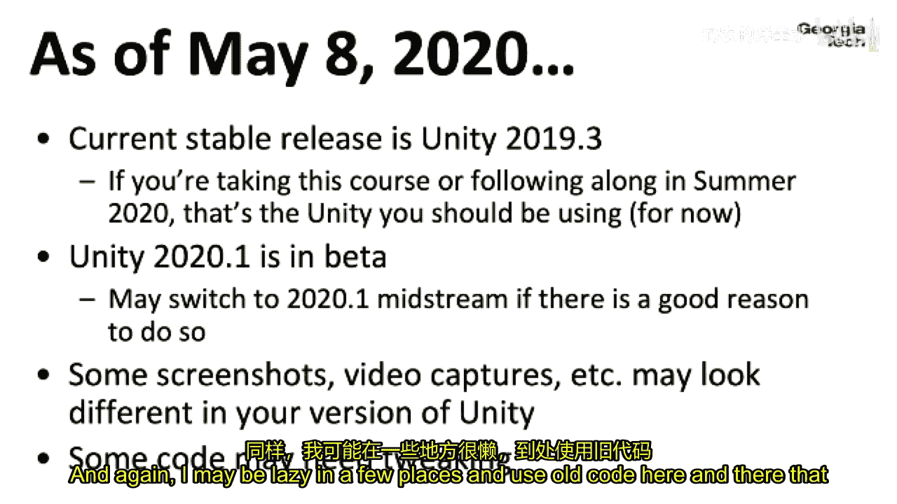

---

## 总结

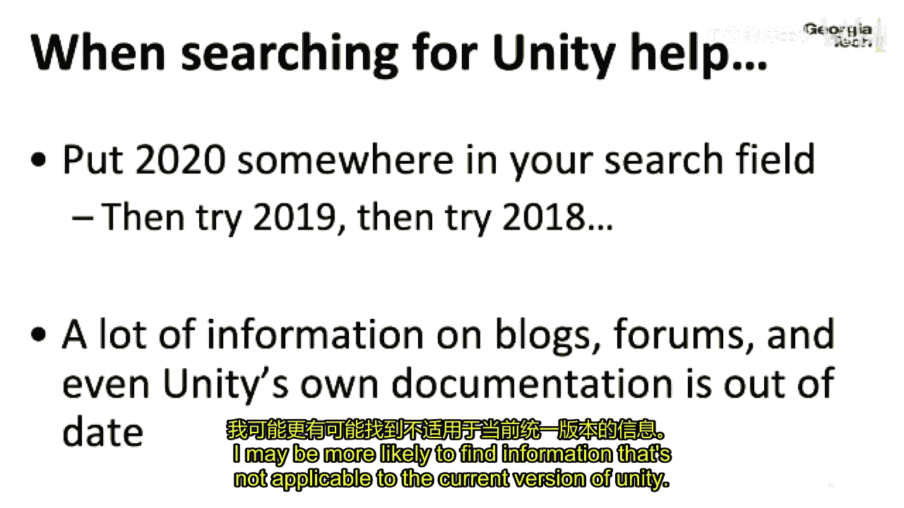

本节课中，我们一起学习了《GPU编程与视频游戏》课程的导论部分。我们了解了课程的起源和发展，明确了本课程专注于利用Unity环境进行GPU着色器编程，教授通用的GPU编程原理，而非完整的游戏设计或计算机图形学课程。我们还探讨了游戏行业的经济规模、技术特点以及独立开发者面临的机遇与挑战。最后，我们介绍了学习本课程所需的工具和注意事项，为后续深入学习GPU编程打下了基础。