# 002：3D坐标系 📐

在本节课中，我们将学习计算机图形学中3D坐标系的基础知识，包括不同的坐标系统约定、3D模型的表示方法以及图形渲染管线中涉及的坐标变换概述。

## 坐标系的不一致性 🤔

上一节我们介绍了光栅化模型的基本流程。本节中，我们来看看定义3D空间的基础——坐标系。

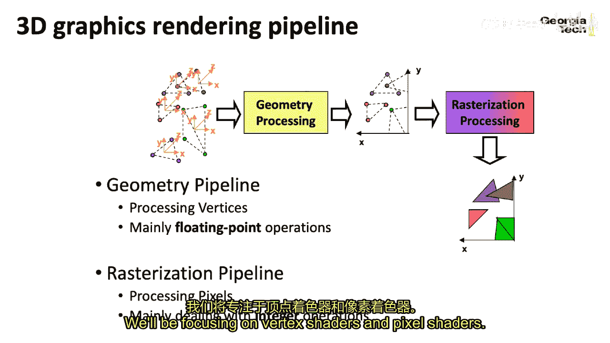

在二维坐标系中，定义通常没有太大争议。通常，X轴表示左右方向，Y轴表示上下方向。然而，进入三维图形领域后，情况开始变得非常混乱，因为业界没有形成一套统一的符号约定。

大多数数学教科书会将XY平面置于水平面，并使用Z轴表示上下方向，且采用**右手坐标系**。这意味着，如果你伸出右手，拇指指向X轴正方向，食指指向Y轴正方向，那么中指（在亚特兰大400号公路上行驶的手指）则指向Z轴正方向。

## 计算机图形学中的坐标系统 🖥️

当我们进入计算机图形学领域时，情况变得更加复杂。通常，人们可能仍使用右手坐标系，但Y轴向上。在这种情况下，拇指指向右侧（X轴），食指指向上方（Y轴），中指则指向观察者（Z轴）。

OpenGL API以及微软开发的用于Xbox 360编程的XNA框架都使用这种系统。

也存在使用**左手坐标系**的工具，例如微软的Direct3D以及我们将在本课程中使用的Unity软件。在左手坐标系中，伸出左手，拇指指向X轴正方向，食指指向Y轴正方向，中指则指向远离观察者的方向（Z轴正方向）。

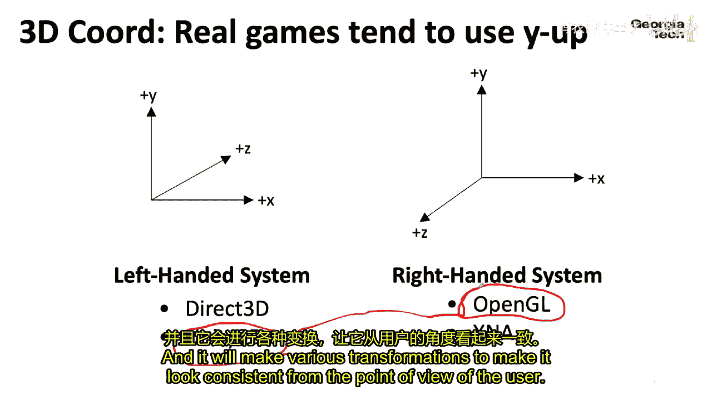

微软创建了基于左手坐标系的Direct3D，然后又在其之上创建了使用右手坐标系的XNA，这看起来有些奇怪。Unity最初是Mac专属产品，因此它不使用Direct3D，而可能使用OpenGL。如今，Unity 3D内部会使用Direct3D、OpenGL或Vulkan等，并进行各种变换，以从用户角度呈现一致的效果。

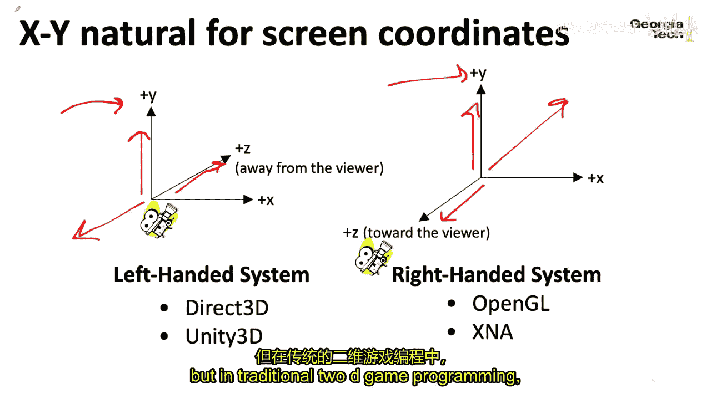

这里的主要区别在于：在一种系统中，**正Z值朝向观察者**，负Z值远离观察者；而在另一种系统中，**正Z值远离观察者**，负Z值朝向观察者。

## 垂直轴的选择：Y向上 vs Z向上 ⬆️

决定使用Y轴向上而非像大多数数学书那样使用Z轴向上，并非完全凭空而来。因为这通常与屏幕坐标的定义方式相匹配。不过需要注意的是，在这些系统中，Y值增加是向上移动，但在传统的2D游戏编程中，Y值增加是向下移动。

以下是使用Z轴向上方法的工具，这更接近典型的数学教科书：
*   **虚幻引擎**（至少在我上次查看时）使用Z轴向上的左手坐标系。
*   **id Tech引擎**（Quake使用）使用Z轴向上的右手坐标系。我在这里提到Radiant，这是与Quake引擎一起使用的编辑器。
*   **Source引擎**使用相同类型的坐标系，这是合理的，因为它最初基于Quake。其编辑器被称为Hammer，我的儿子经常用它来制作各种模组。
*   **C4引擎**（由Eric Lengyel开发）也使用这种系统。Eric写了一本优秀的书叫《3D计算机图形学的数学》。C4引擎的最新版本实际上被称为Tombstone引擎。这是一个不太知名的引擎，但具有有趣且清晰的架构，我推荐了解一下。

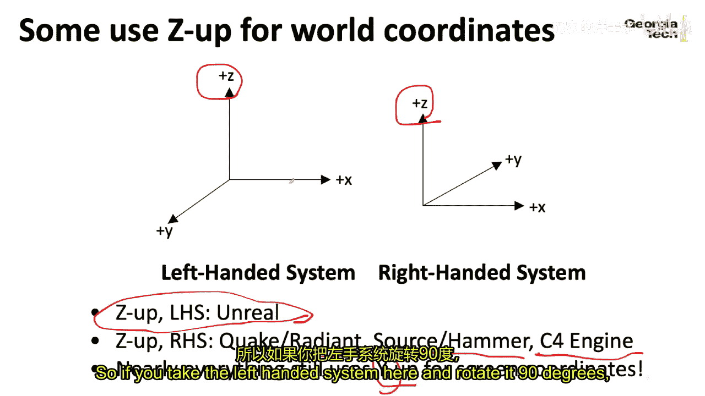

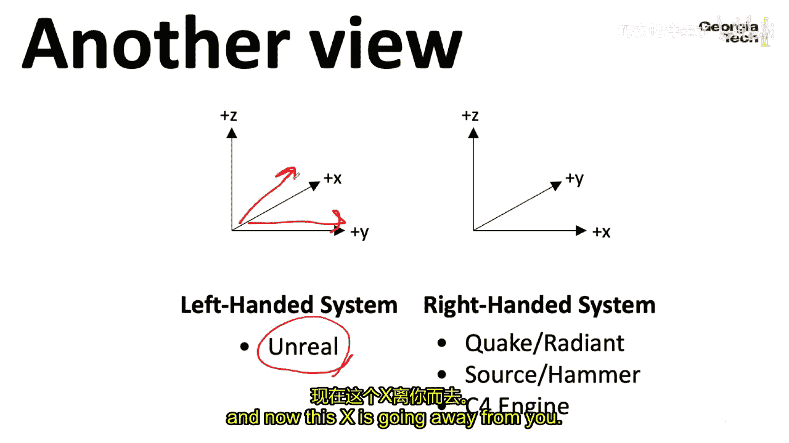

需要记住的一点是，尽管这些工具在涉及3D坐标时通常使用Z作为垂直轴，但当它们进行最终投影到2D屏幕时，仍然会使用Y作为垂直坐标。如果你将这里的左手坐标系旋转90度，可以像这样重绘它，这可能就是你在打开虚幻编辑器时会看到的情况。在这种情况下，我们现在认为Y是向右，而不是我们通常书写的方式中的X，而现在的X是远离你的方向。

## 3D模型与顶点数据 🎨

游戏中的底层3D美术资产通常是在某种建模软件中制作的，就像游戏引擎一样，这里也没有一致性。

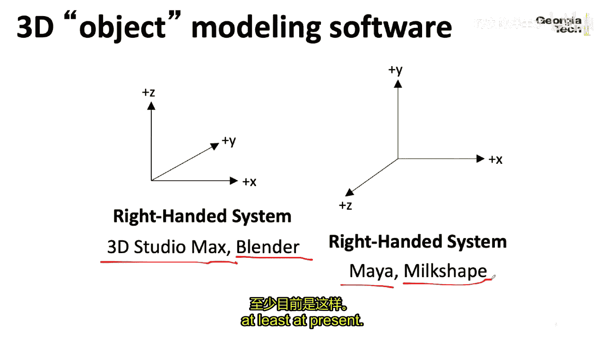

有趣的是，Maya和3D Studio Max都是Autodesk的产品，一个使用Y向上系统，另一个使用Z向上系统，但两者都是右手坐标系。Blender是一个开源产品，自2007年我第一次开设这门课程以来，它已经有了巨大的改进，它使用右手坐标系。MilkShape曾是一个相对廉价的3D建模软件解决方案，在制作《半条命》模组等人群中相当流行。

目前，3D游戏中使用的模型由三角形构成。这些三角形上的每个点都有一个XYZ坐标来定义这些3D顶点。通常，每个顶点还有一个关联的**单位法线**，这源于3D艺术家从其3D建模软件中导出的过程。

以下是3D模型创建和处理的典型流程：
1.  艺术家通常会创建某种高分辨率的光滑参数化表面。
2.  他们会运行一个导出程序，将其分割成具有不同分辨率的多边形面。
3.  这些可能用于不同目的，例如，一个具有大量顶点的非常高分辨率的模型可能用于生成预渲染的过场动画，而一个较低分辨率的模型则用于实时游戏玩法。

当表面被分割成具有不同顶点的三角形时，会计算一些法向量信息，试图感知由这些三角形表示的底层表面的曲率。这对于计算逼真的光照效果极其重要。没有这些信息，你会得到所谓的“平面着色”外观，可以清楚地看到构成物体的多边形。但是，如果在进行光照计算时使用这些法线信息，结果看起来会平滑得多。

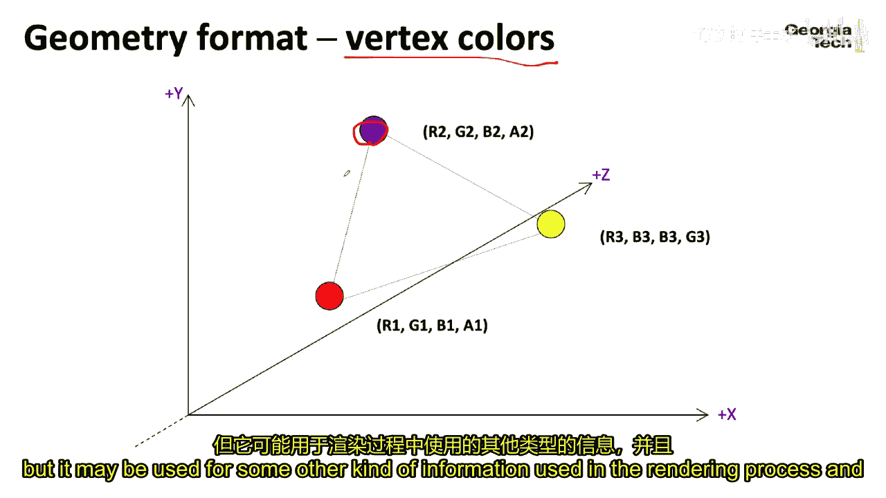

一些3D模型可能还具有与不同顶点关联的颜色信息，你可以在渲染对象时在这些颜色之间进行插值。但如今，顶点颜色实际上并不常用，因为通常颜色信息（正如我们稍后将看到的）被嵌入到某种二维纹理中，用于查找该纹理。有时你会看到这个颜色槽被使用，但它可能用于渲染过程中的其他类型信息，而不是典型的颜色信息。

## 顶点列表与索引列表 📝

通常，你会有一个顶点列表，包含XYZ坐标，例如V1, V2, V3...，然后你会有一个三角形列表，这些三角形是顶点列表的索引。这可以节省大量内存使用。

列出这些顶点的顺序可能很重要。一个避免不必要计算的常用技术称为**背面剔除**，其本质是只渲染朝向观察者的三角形，而不渲染背向观察者的三角形。实现这一点的一种方法是使用多边形面的法线。

用于剔除的这些法线与之前讨论的用于光照的顶点法线不同。对于顶点法线，不同的顶点有不同的法线；而对于一个特定的三角形，只有一个法线。我们通过选择某种顺序列出顶点来嵌入这种信息。

在左手系统中，我们会按照V1, V3, V2的顺序列出。我们所做的是想象法线是你的拇指，然后你的手指沿着顶点顺序弯曲，所以我们有V1, V3, V2。

你也可以为此使用右手系统。现在的问题是，你为这些法线向量使用的是左手还是右手弯曲约定，这可能完全独立于你的引擎中实际的3D坐标系是左手还是右手。

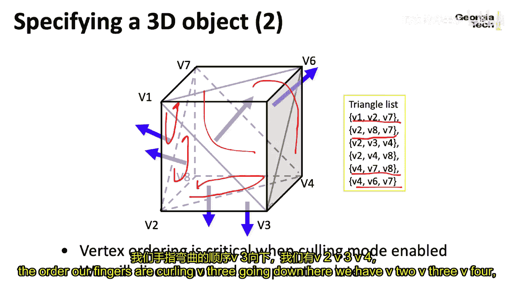

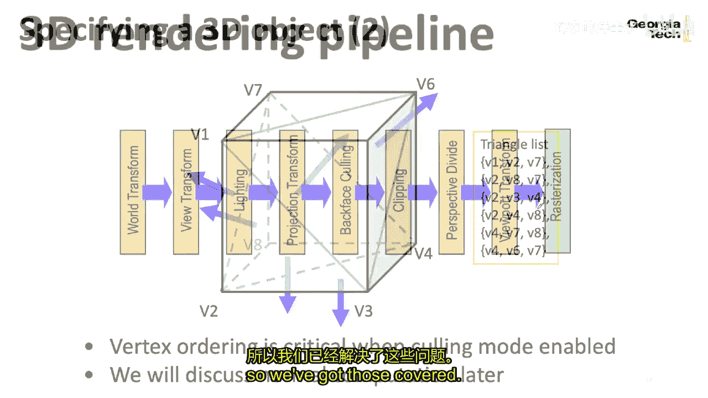

## 图形管线与坐标变换 🔄

计算机图形学中有很多计算可以按不同顺序进行。图形管线每个阶段执行的确切计算可能因你选择如何排序而不同，特别是例如我们决定在哪里进行光照。但在很多情况下，你可以用不同的方式重新排列这些计算。你希望如何重新排列通常取决于你进行计算的具体硬件。

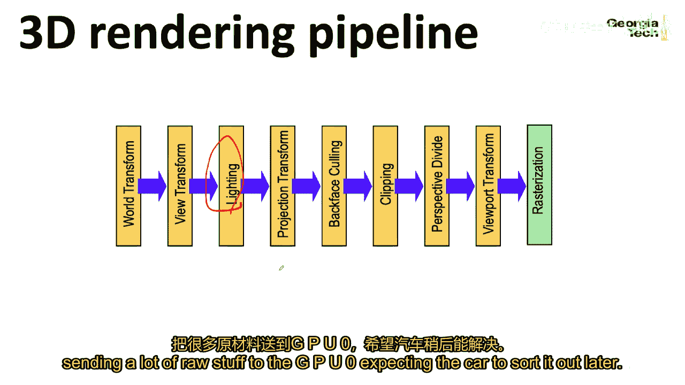

在过去，GPU功能不强，你必须在CPU上完成大部分计算，那时你安排这些计算的方式与现代情况非常不同。在现代情况下，你最终会向GPU发送大量原始数据，并期望GPU稍后进行整理。

我们已经讨论了使用不同3D坐标系表示3D对象的一般方法。实际上，在进行3D图形处理时使用了几个坐标系。

以下是3D图形中涉及的主要坐标空间：
*   **模型坐标系**：你的艺术家工作时使用的坐标系，这是他们在Blender、Maya或其他3D建模软件中使用的坐标系。
*   **世界坐标系**：关卡编辑器中的视图空间。这是你在关卡中放置对象（例如，在不同位置放置相同的敌方坦克模型）时所看到的空间。世界变换的任务是将你从艺术家空间带到关卡设计师空间。
*   **观察坐标系**：观察变换将我们从关卡设计师工作的世界坐标空间带到相机实际使用的空间。这将是第一人称游戏中玩家的视点，或者是第三人称动作游戏中稍远的视点，或者是老式RPG或某种实时战略游戏中更远的视点。
*   **投影变换**：是从相机视图到实际将物体投影到屏幕二维表面的最终过程的一部分。

我们将使用矩阵代数的语言来描述这些变换，因为这是组合各种变换的便捷方式。但你不需要上过完整的线性代数课程或记住太多线性代数知识也能学好这门课，因为我们将只使用线性代数中相当小的一个子集。这门课并不真正侧重于3D图形的理论方面，而将更侧重于实际实现问题。所以，如果你没有学过线性代数，你仍然大致可以跟上。这些变换将构成接下来几讲的基础。

## 总结 📚

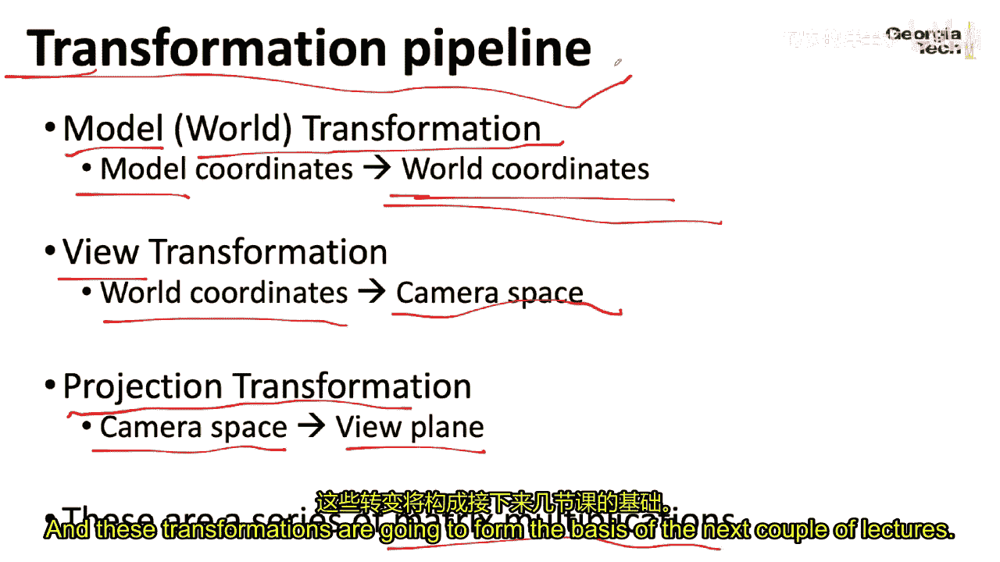

本节课中，我们一起学习了3D图形学中坐标系的基础。我们探讨了左手与右手坐标系、Y向上与Z向上系统的区别，了解了3D模型如何由顶点和三角形构成，并初步认识了从模型空间到最终屏幕空间的一系列坐标变换。理解这些概念是后续学习3D变换、光照和渲染的基础。