# 003：3D顶点变换 🎮

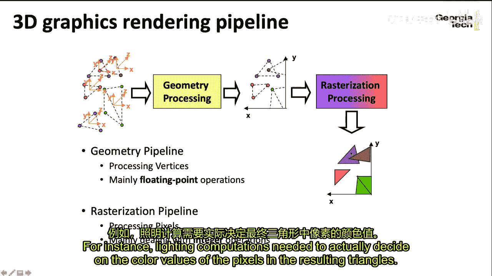

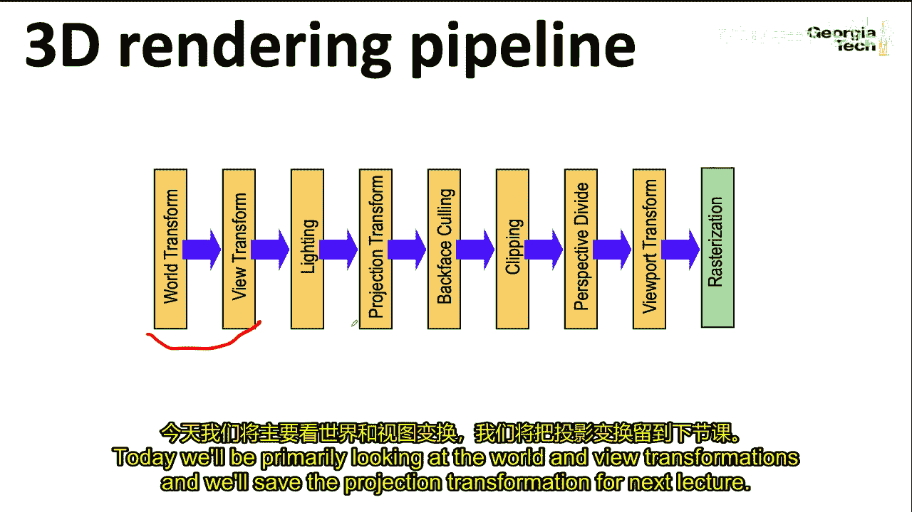

## 概述

在本节课中，我们将学习3D图形渲染管线中的第一步：3D顶点变换。这是将艺术家创建的3D模型（由大量三角形构成）转换为玩家最终在屏幕上看到的图像的关键过程。我们将重点探讨如何通过矩阵运算，将模型从自身的局部坐标系转换到游戏世界坐标系，再转换到摄像机视角下的观察坐标系。

## 从模型到世界：世界变换

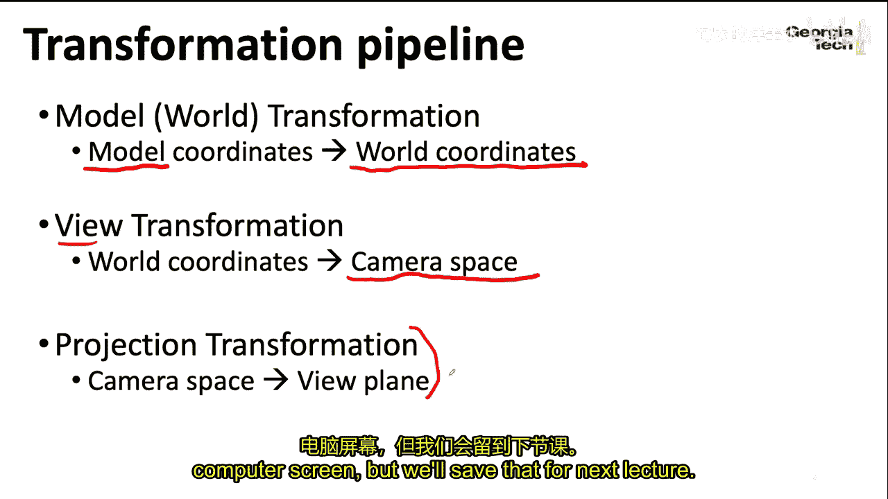

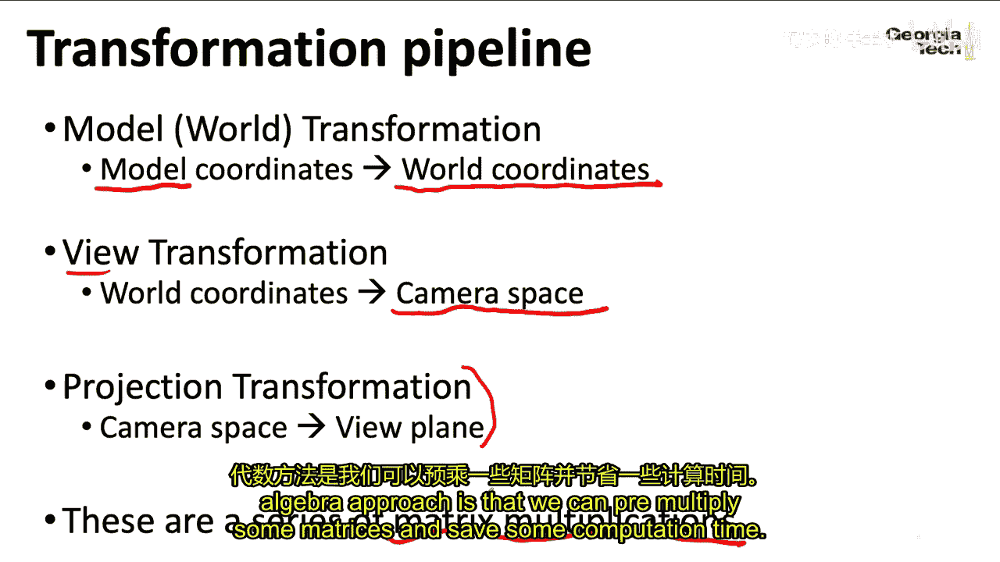

上一节我们概述了顶点变换的流程，本节中我们来看看第一步：世界变换。

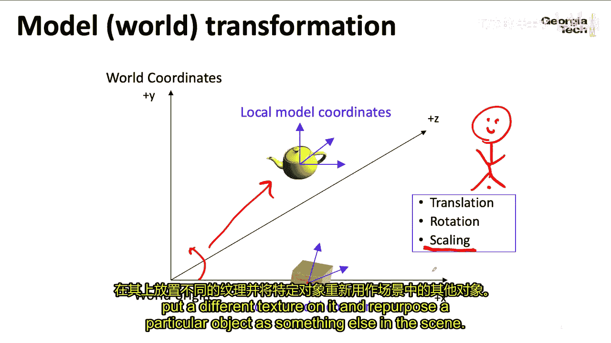

艺术家在Maya或Blender等软件中创建3D模型时，使用的是模型自身的局部坐标系。世界变换的任务是将这些模型放置到游戏世界的正确位置和方向上。这个变换过程通常包含旋转、缩放和平移操作。

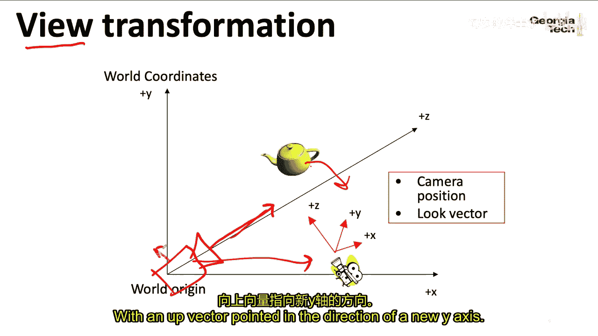

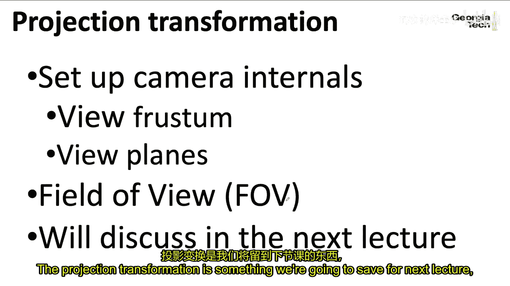

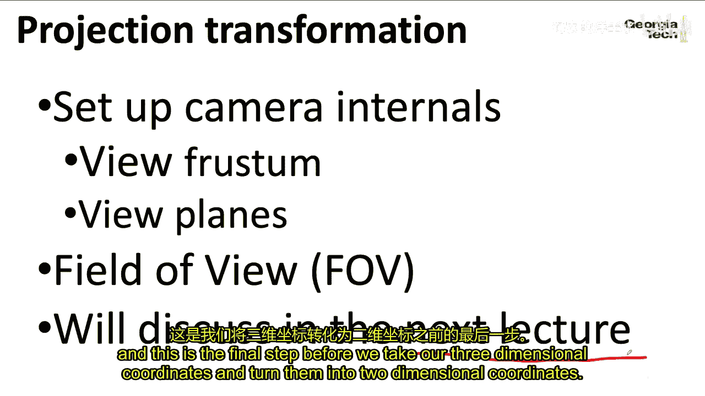

以下是世界变换的核心步骤：

1.  **旋转**：首先将模型旋转到正确的朝向。
2.  **缩放**：根据场景需要，对模型进行缩放（例如，将一个箱子模型放大或压扁）。
3.  **平移**：最后将模型移动到世界空间中的指定位置。

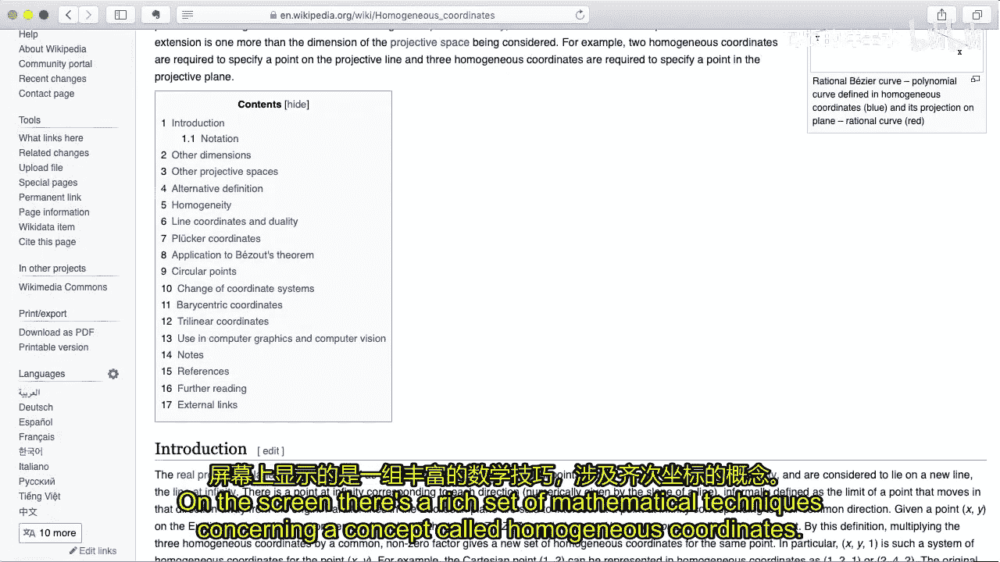

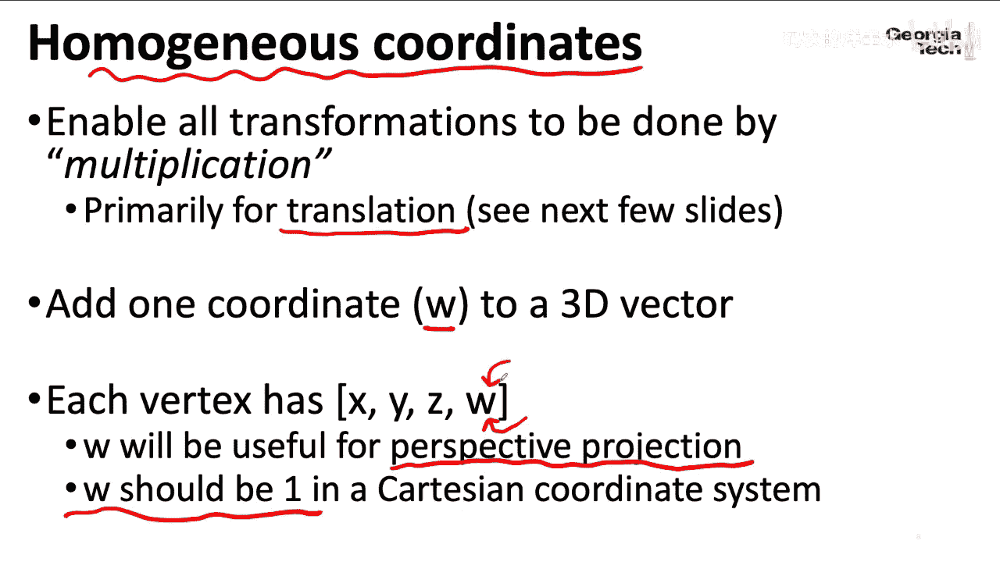

**注意**：操作的顺序至关重要。通常，我们按照“缩放 -> 旋转 -> 平移”的顺序进行，以确保变换结果符合预期。

为了统一用矩阵乘法表示所有变换（包括平移），我们引入**齐次坐标**。我们将一个3D顶点 `(x, y, z)` 扩展为4D齐次坐标 `(x, y, z, 1)`。这样，平移操作也能用4x4矩阵表示。

*   **平移矩阵**：将点 `(x, y, z)` 平移 `(tx, ty, tz)`。
    ```
    [1, 0, 0, 0]
    [0, 1, 0, 0]
    [0, 0, 1, 0]
    [tx, ty, tz, 1]
    ```
*   **缩放矩阵**：将点沿各轴缩放 `(sx, sy, sz)` 倍。
    ```
    [sx, 0, 0, 0]
    [0, sy, 0, 0]
    [0, 0, sz, 0]
    [0, 0, 0, 1]
    ```
*   **旋转矩阵（绕Z轴）**：将点绕Z轴旋转角度 `θ`。
    ```
    [cosθ, sinθ, 0, 0]
    [-sinθ, cosθ, 0, 0]
    [0, 0, 1, 0]
    [0, 0, 0, 1]
    ```
    （绕X轴和Y轴的旋转矩阵结构类似，但正弦项的位置会变化，以保持坐标系手性一致）。

最终的世界变换矩阵 `WorldMatrix` 是这些基本变换矩阵按顺序相乘的结果：`WorldMatrix = TranslationMatrix * RotationMatrix * ScaleMatrix`（注意：在行向量左乘约定下，变换按从右到左的顺序应用）。

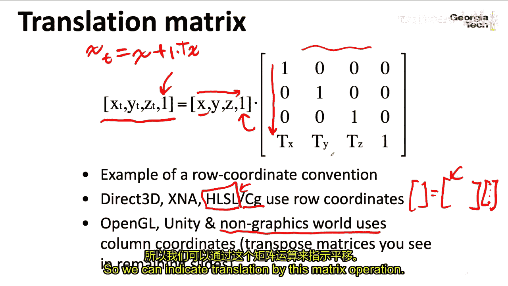

## 从世界到视图：观察变换

完成了世界变换后，所有物体都位于统一的世界坐标系中。接下来，我们需要考虑摄像机的影响，这就是观察变换。

观察变换的目的是根据摄像机的位置、观察方向和“向上”方向，将所有世界坐标转换为以摄像机为原点的观察坐标系。一种直观的理解方式是：想象摄像机本身也是世界中的一个物体。如果我们有一个矩阵能将摄像机从其局部坐标系变换到世界中的某个位置和朝向（即摄像机的“世界矩阵”），那么观察矩阵就是这个矩阵的逆矩阵。

应用这个逆矩阵到所有场景物体上，效果等同于将整个场景进行反向变换，使得摄像机位于新坐标系的原点，通常看向Z轴负方向，Y轴指向“向上”方向。

在实际开发中，我们通常不需要手动计算这个复杂的逆矩阵。图形API提供了便捷函数，只需指定摄像机位置、观察目标点和上方向量，即可生成观察矩阵。

*   **Direct3D**：使用 `D3DXMatrixLookAtLH`（左手坐标系）或 `D3DXMatrixLookAtRH`。
*   **OpenGL**：通常使用右手坐标系，有类似的 `gluLookAt` 函数（旧版）或自行构造。
*   **Unity**：通过 `Matrix4x4.LookAt` 方法或直接使用Camera组件内置功能。

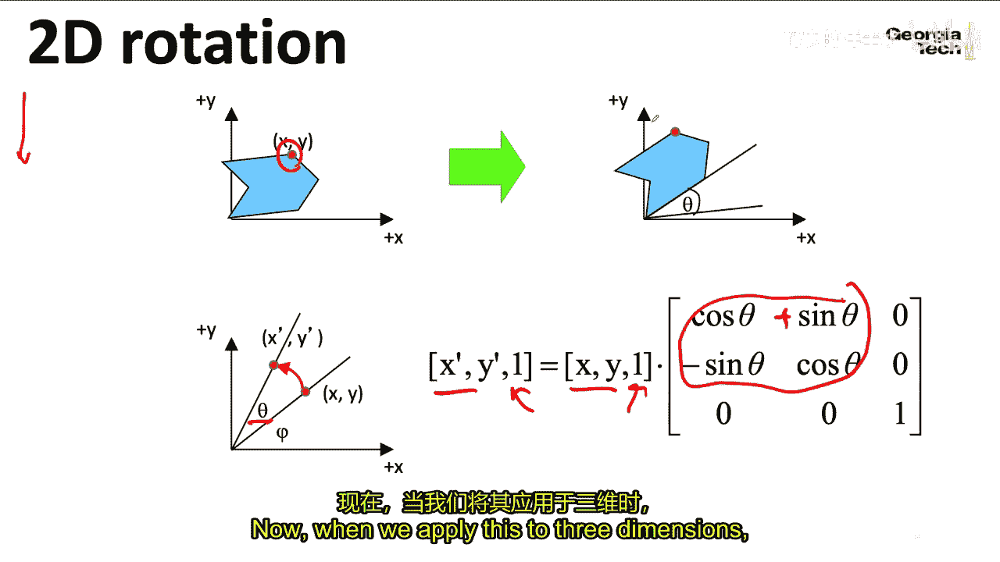

## 矩阵乘法的顺序与约定

在组合多个变换矩阵时，顺序不同会导致完全不同的结果。例如，先平移后缩放，缩放因子会同时作用于物体和其位移；而先缩放后平移，则只缩放物体本身。

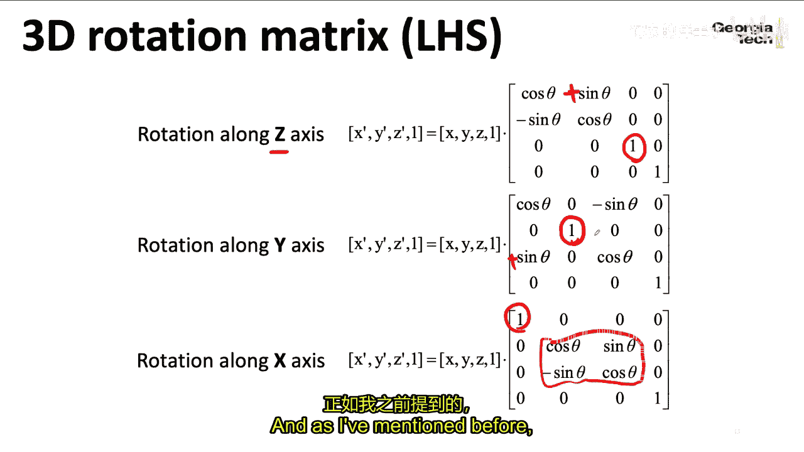

此外，不同的图形库可能使用不同的数学约定，主要体现在向量的表示上：

*   **行向量约定**：向量表示为行 `[x, y, z, 1]`，变换矩阵右乘。变换顺序为从右到左：`v' = v * M_scale * M_rotate * M_translate`。Direct3D常用此约定。
*   **列向量约定**：向量表示为列 `[x, y, z, 1]^T`，变换矩阵左乘。变换顺序为从左到右：`v' = M_translate * M_rotate * M_scale * v`。OpenGL、Unity常用此约定。

两种约定下的变换矩阵互为转置关系。在编写着色器代码（如HLSL）时，语言本身不关心约定，只需确保传入的矩阵和向量的乘法顺序与你选择的约定一致即可。

## 总结

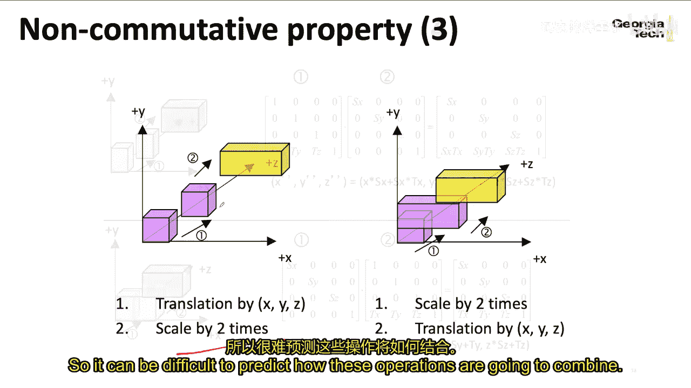

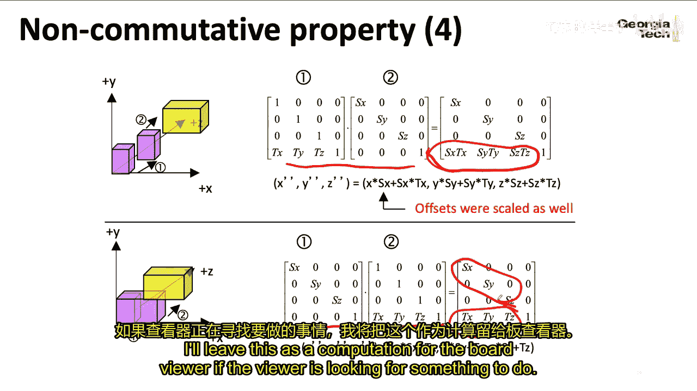

本节课中我们一起学习了3D顶点变换的前两个核心阶段。

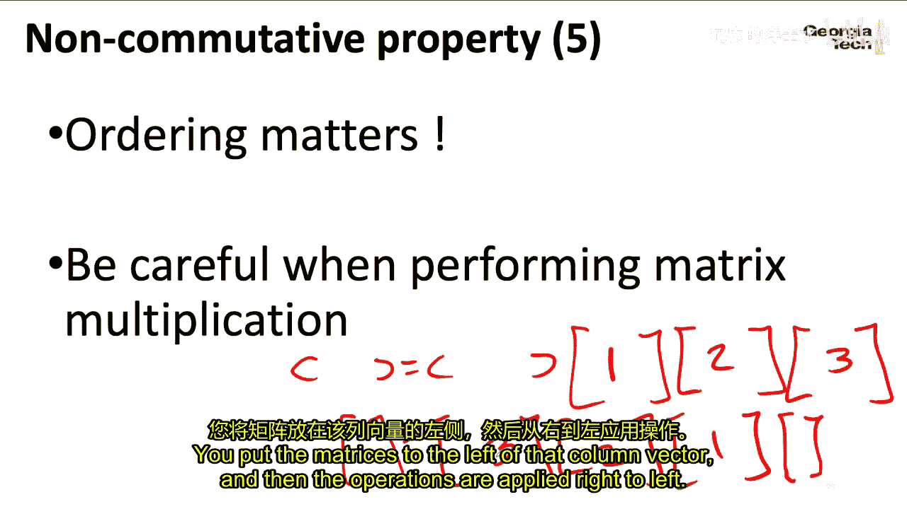

我们首先介绍了**世界变换**，它通过旋转、缩放和平移矩阵，将模型从其局部坐标系安置到游戏世界坐标系。我们使用齐次坐标将平移也纳入矩阵乘法体系，并强调了变换顺序的重要性。

接着，我们探讨了**观察变换**，其本质是将世界坐标系下的所有物体，转换到以摄像机为中心的观察坐标系。这可以通过计算摄像机世界变换矩阵的逆矩阵来实现，在实际中通常由图形API的辅助函数完成。

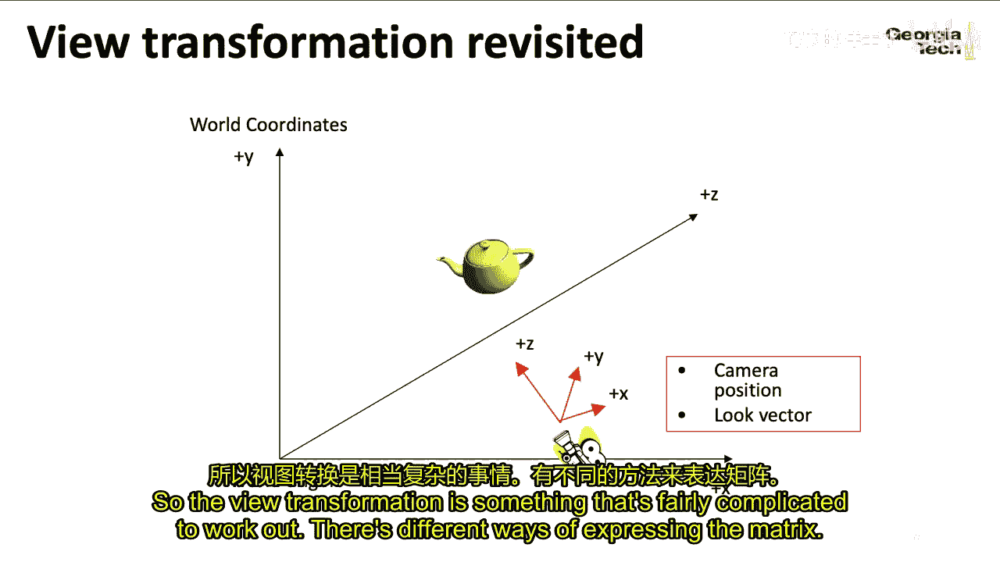

最后，我们辨析了矩阵运算中的**顺序问题**和**行/列向量约定**，这是理解不同图形API代码的关键。

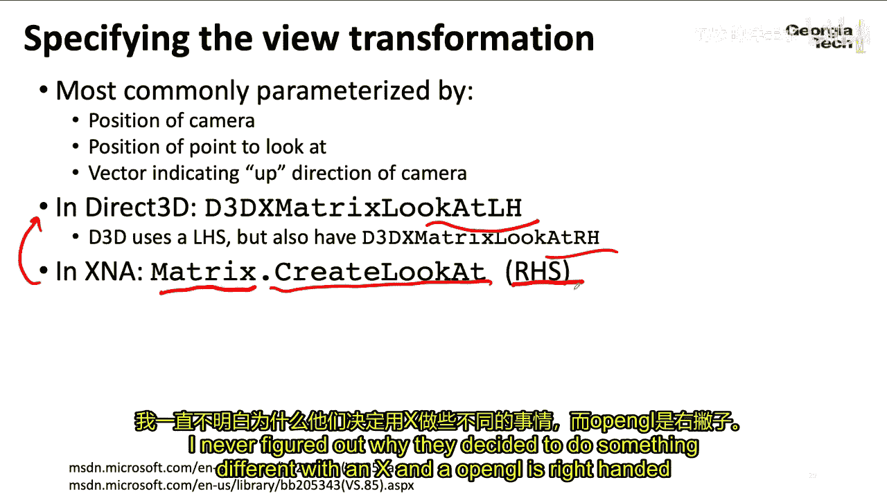

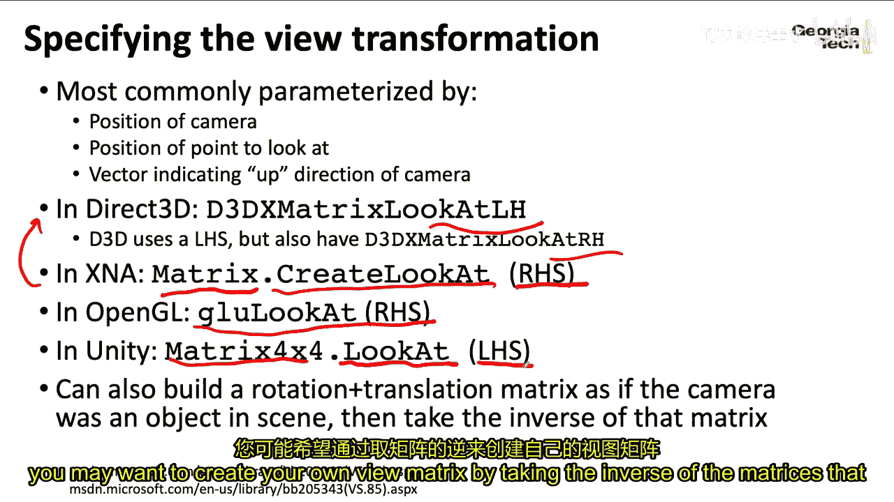

下一讲，我们将继续学习顶点变换的最后一步：**投影变换**，它将3D观察坐标最终映射到2D屏幕空间，为光栅化阶段做好准备。