# 004：正交投影 📐

## 概述

在本节课中，我们将学习顶点变换流水线中的最后一个关键步骤：将三维场景投影到二维屏幕上。我们将重点介绍**正交投影**，这是一种不考虑物体远近、所有投影线都平行的投影方式。理解正交投影是学习更复杂的透视投影的基础。

---

## 从世界空间到裁剪空间

上一节我们介绍了世界变换和视图变换，它们将物体从模型坐标系转换到了摄像机坐标系（视图空间）。本节中，我们来看看如何将视图空间中的三维物体“压扁”到二维屏幕上。

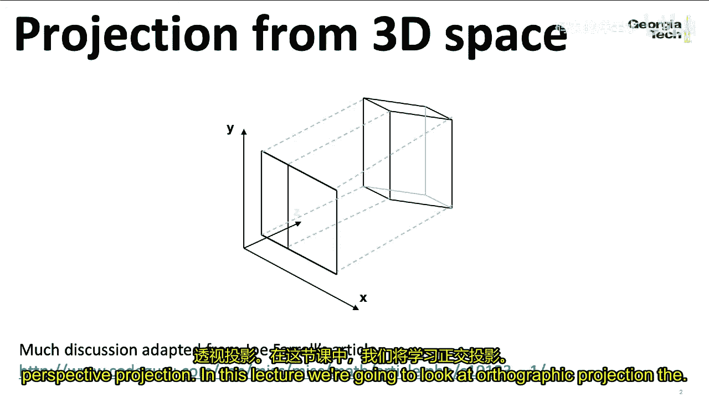

这个最终变换的任务是将一个三维视锥体映射到一个**标准化**的体积中，这个体积被称为**裁剪空间**。后续的硬件（如光栅化器）会期望接收裁剪空间中的顶点数据，以便将三角形转换为像素。

不同的图形API（如Direct3D和OpenGL）对裁剪空间的定义略有不同。下图展示了Direct3D使用的裁剪空间，它是一个从`(x: -1, y: -1, z: 0)` 到 `(x: 1, y: 1, z: 1)` 的立方体。


*   **X和Y坐标**决定了三角形在屏幕上的最终位置。
*   **Z坐标**虽然不直接影响位置，但至关重要，它用于：
    1.  判断物体的前后遮挡关系（深度测试）。
    2.  为景深、雾效等后期处理效果提供深度信息。

> 注：本讨论的大部分内容参考自Joe Farrell的优秀文章。

---

## 坐标系惯例的差异

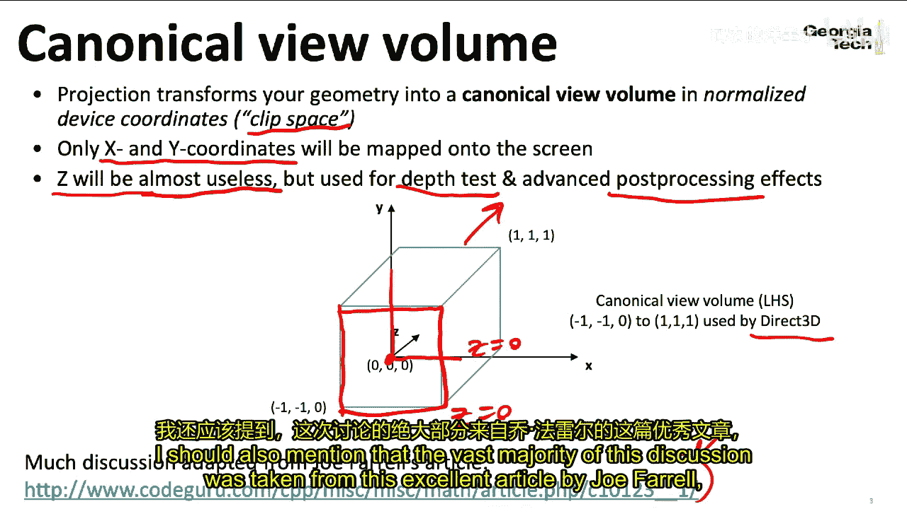

所有裁剪空间惯例本质上都是**左手坐标系**（Z轴正方向远离观察者）。然而，不同API在从视图空间转换到裁剪空间时，处理方式不同，这可能导致混淆。

以下是Direct3D和OpenGL/Unity的主要区别：


*   **X和Y范围**：两者都是从`-1`到`1`。
*   **Z范围**：这是关键区别。
    *   **Direct3D**：Z从`0`（近平面）到`1`（远平面）。上图中立方体的前表面位于`z=0`。
    *   **OpenGL**：Z从`-1`（近平面）到`1`（远平面）。此时，立方体的中心位于`z=0`。
*   **视图空间的手性**：
    *   Direct3D和Unity的视图空间是**左手坐标系**，转换到裁剪空间时**不改变**手性。
    *   OpenGL的视图空间是**右手坐标系**，转换到裁剪空间时会**切换**为左手坐标系。

理解这些差异非常重要，因为书籍和教程通常只使用一种惯例，而不明确说明，这会给交叉参考带来困难。

---

## 什么是正交投影？📦

我们将要学习的正交投影是最简单的投影模式之一。它假设所有从场景射向观察者的光线都是**平行**的。

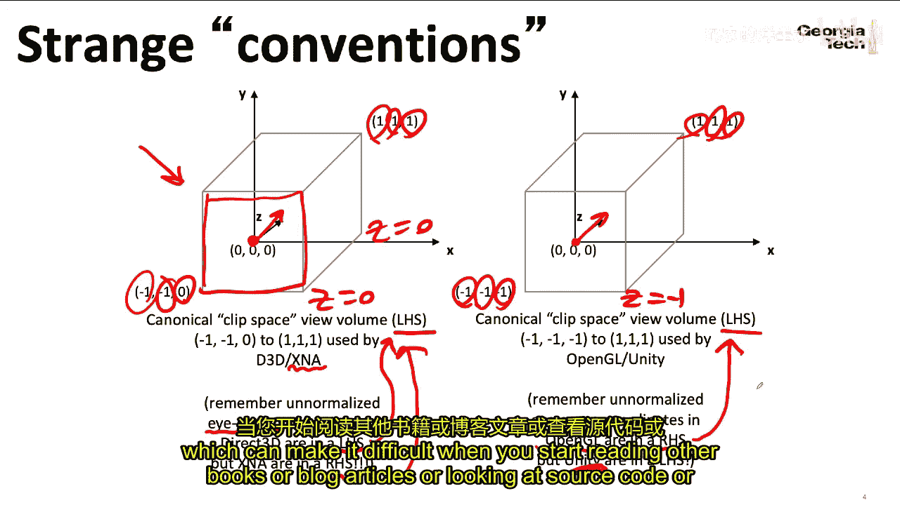

正交投影的过程是：在空间中选取一个平面（投影平面），然后将场景中的物体沿着平行线方向“投射”到这个平面上。物体的大小不会因为距离的远近而改变。


如果物体部分位于可视范围（视锥体）之外，硬件或软件渲染器会进行**裁剪**。它会检查与视锥体边界相交的三角形，并将其分割，只保留位于裁剪空间内部的部分。

> 下一讲我们将学习**透视投影**，它会模拟现实，让近处的物体看起来比远处的大。

---

## 正交投影的应用与历史

正交投影风格相当流行，尤其在2D游戏或需要保持物体比例不变的场景中（如策略游戏、建模软件的顶视图/前视图）。

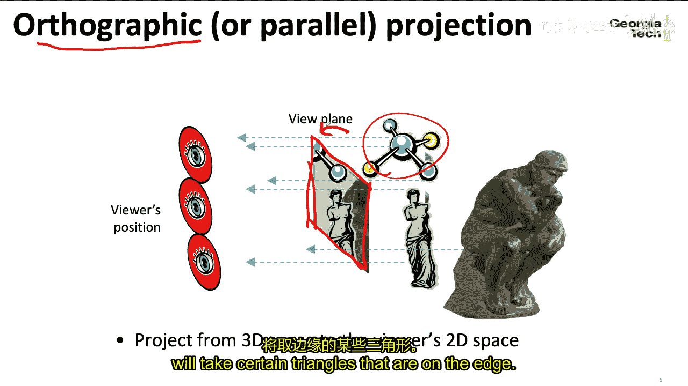


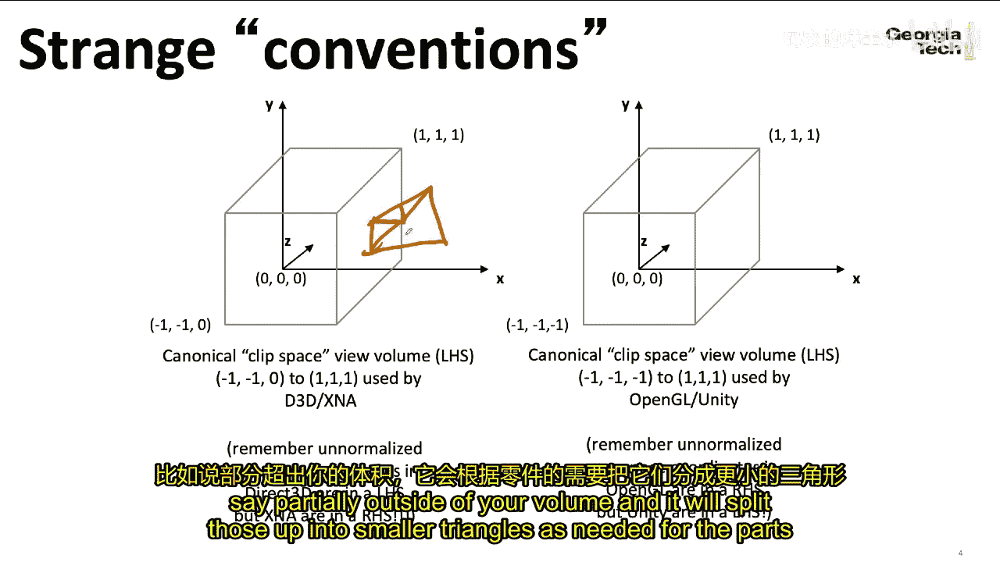
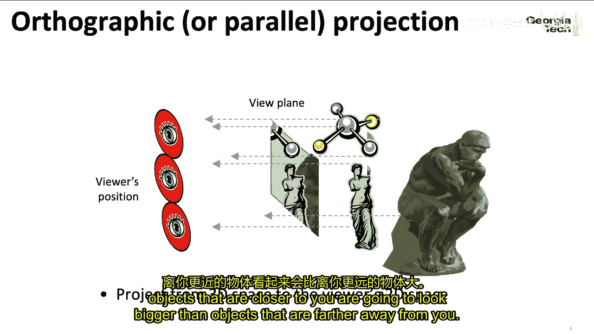


在早期没有快速3D硬件支持的游戏中，开发者常常使用手绘的2D图块来“伪造”3D效果，这本质上是一种正交投影。

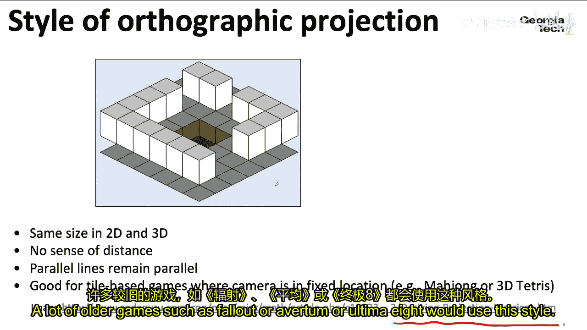

但这种做法可能导致视觉悖论（例如《纪念碑谷》就利用了这种悖论）。许多经典游戏如《辐射》、《博德之门》、《奥秘》都使用了这种等轴测或斜二测投影风格。


---

## 正交投影矩阵的推导 🧮

假设我们已经完成了世界变换和视图变换，所有物体都位于摄像机坐标系（视图空间）中。我们定义了一个需要渲染的立方体区域，其边界为：
*   X轴：左(`L`) 到 右(`R`)
*   Y轴：底(`B`) 到 顶(`T`)
*   Z轴：近(`N`) 到 远(`F`)

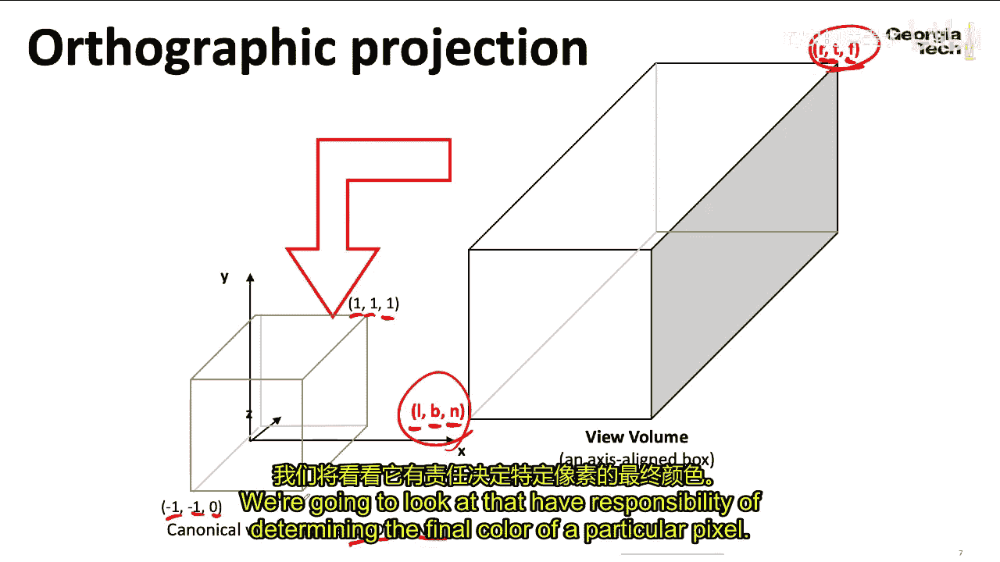

我们的目标是将这个区域映射到Direct3D风格的裁剪空间：从`(L, B, N)`映射到`(-1, -1, 0)`，从`(R, T, F)`映射到`(1, 1, 1)`。

### X坐标的映射

我们希望将X从区间`[L, R]`映射到`[-1, 1]`。推导步骤如下：

1.  平移使左边界对齐0：`x' = x - L`
2.  缩放至[0, 1]范围：`x'' = (x - L) / (R - L)`
3.  缩放至[0, 2]范围：`x''' = 2 * (x - L) / (R - L)`
4.  平移至[-1, 1]范围：`x_clip = 2 * (x - L) / (R - L) - 1`

整理后得到：
**`x_clip = (2/(R-L)) * x - (R+L)/(R-L)`**

这是一个仿射变换：`常数A * x + 常数B`。

### Y坐标的映射

Y坐标的推导与X坐标完全类似，结果为：
**`y_clip = (2/(T-B)) * y - (T+B)/(T-B)`**

### Z坐标的映射（Direct3D惯例）

对于Direct3D，我们需要将Z从`[N, F]`映射到`[0, 1]`。

1.  平移使近平面对齐0：`z' = z - N`
2.  缩放至[0, 1]范围：`z_clip = (z - N) / (F - N)`

整理后得到：
**`z_clip = (1/(F-N)) * z - N/(F-N)`**

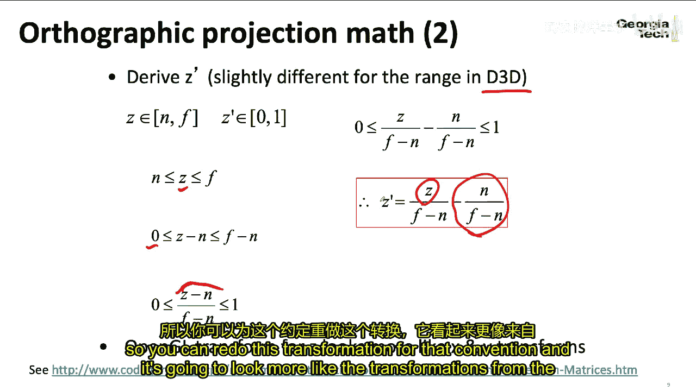

> 对于OpenGL惯例（映射到`[-1, 1]`），推导过程类似X坐标，结果为：`z_clip = (2/(F-N)) * z - (F+N)/(F-N)`。

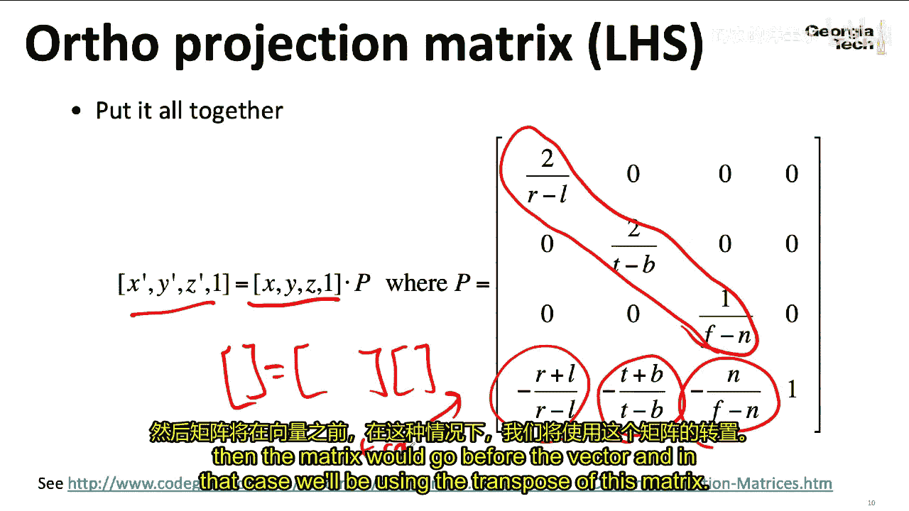

---

## 组合成变换矩阵

我们可以将上述三个变换组合成一个4x4齐次坐标变换矩阵。假设使用Direct3D的行向量惯例（向量在右，矩阵在左），矩阵形式如下：


**正交投影矩阵（行向量，Direct3D惯例）**：
```
[ 2/(R-L),       0,           0,      0 ]
[    0,       2/(T-B),         0,      0 ]
[    0,           0,       1/(F-N),    0 ]
[-(R+L)/(R-L), -(T+B)/(T-B), -N/(F-N), 1 ]
```

如果使用OpenGL的列向量惯例（向量在右，矩阵在左），则需要使用这个矩阵的**转置**。


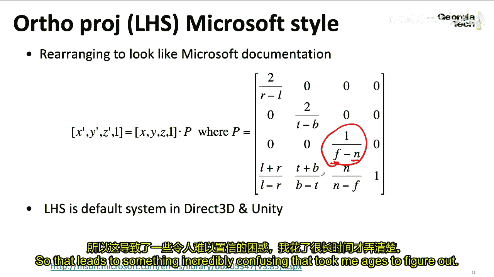

---

## 在API中的使用

我们通常不需要手动计算这个矩阵，主流图形API都提供了内置函数。

### Direct3D

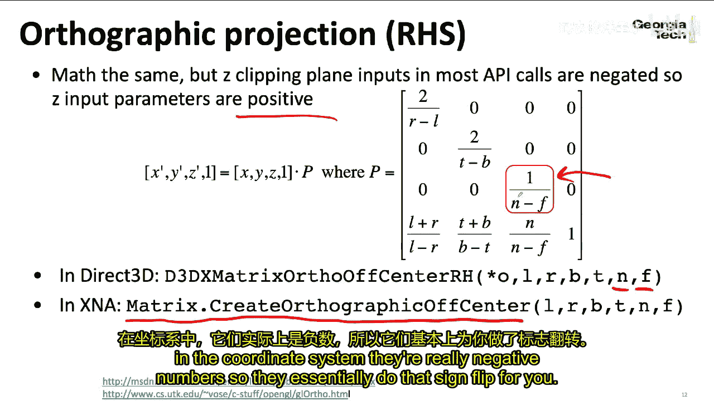

Direct3D使用左手坐标系。它提供了`D3DXMatrixOrthoOffCenterLH`函数。有趣的是，这个函数生成的矩阵在数学上适用于任何Z轴方向（左手或右手），只要你正确输入`N`和`F`的值。

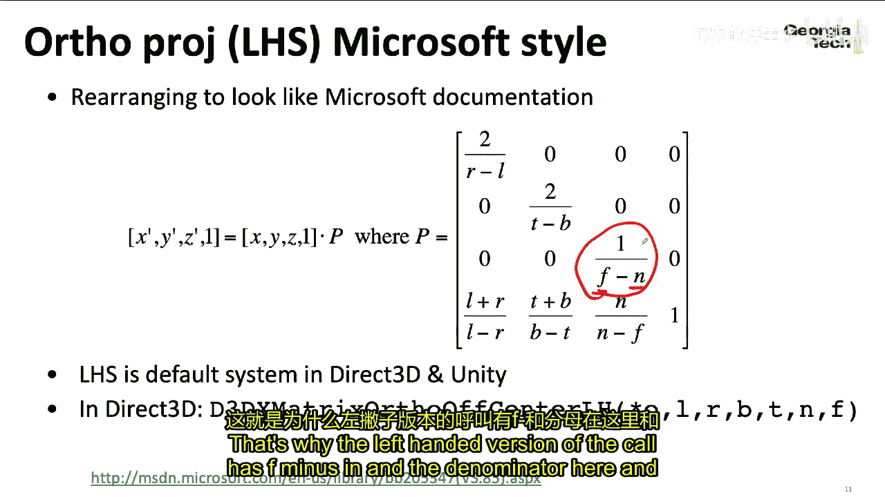

但Direct3D API为了用户方便，做了特殊处理：即使你在右手坐标系中`N`和`F`是负数（例如N=50， F=-100），API也期望你输入**正数**（50和100）。它内部会帮你处理符号翻转。因此，它提供了两个函数：
*   `...LH`：用于左手系，分母为`(F - N)`。
*   `...RH`：用于右手系，分母为`(N - F)`，即内部乘了一个-1。

### XNA / MonoGame (C#)

作为面向对象的框架，它的`Matrix.CreateOrthographicOffCenter`方法直接创建并返回一个矩阵对象，无需传递指针。

### OpenGL

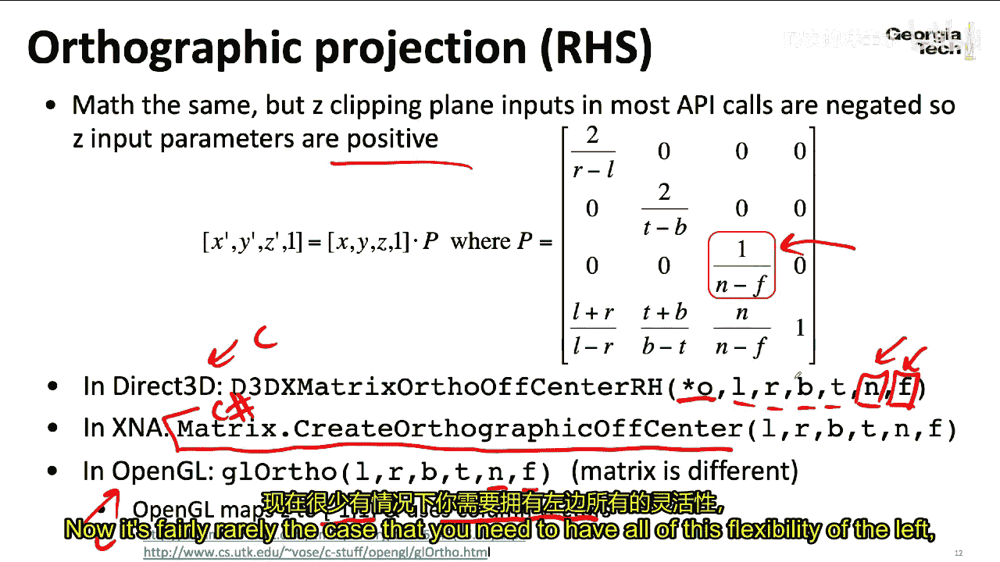

OpenGL使用右手视图坐标系，裁剪空间Z范围为`[-1, 1]`，且使用列向量。因此其函数`glOrtho`生成的矩阵更像是Direct3D矩阵的转置，并且缩放值不同。OpenGL也采用传统的C风格和独特的基于栈的矩阵操作模式。

---

## 简化版正交投影

通常，我们的视口是关于原点对称的。因此可以定义宽度(`W`)和高度(`H`)，而不是左右上下边界。此时，投影矩阵可以简化。


简化后的矩阵为（Direct3D左手系）：
```
[ 2/W,   0,       0,      0 ]
[  0,  2/H,       0,      0 ]
[  0,    0,   1/(F-N),    0 ]
[  0,    0,   -N/(F-N),   1 ]
```

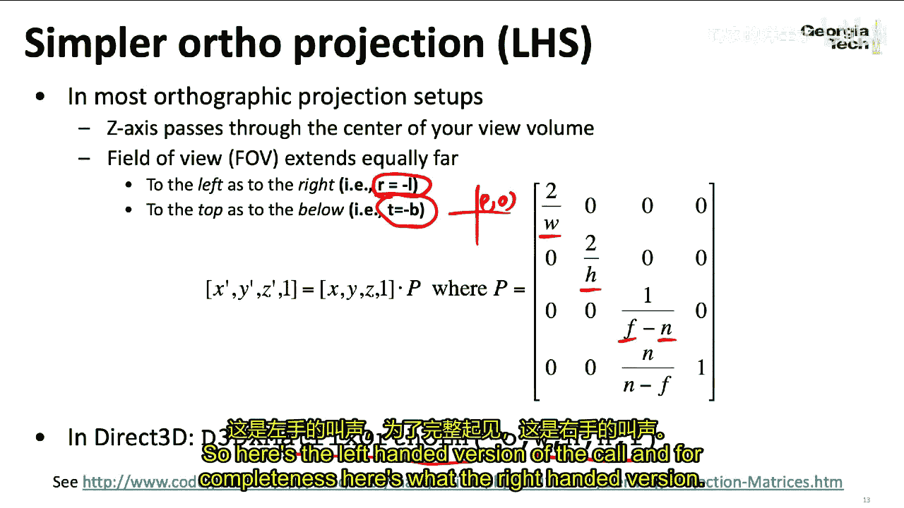

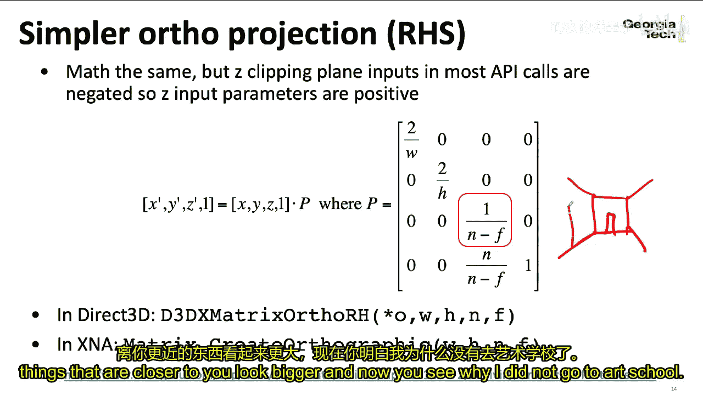

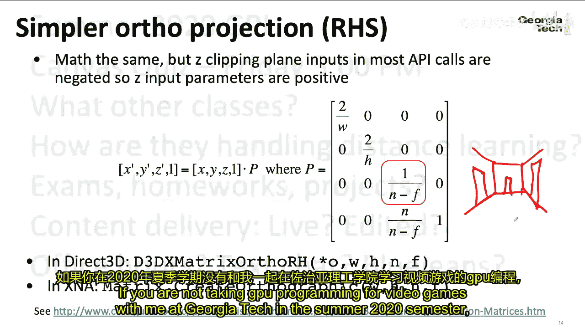


相应的，API也提供了简化版的函数，如`D3DXMatrixOrthoLH`。

---

## 总结

本节课我们一起学习了**正交投影**的核心内容：

1.  **目标**：将视图空间中的三维物体映射到标准化的裁剪空间，为光栅化做准备。
2.  **原理**：使用平行线进行投影，不改变物体因距离而产生的视觉大小。
3.  **数学推导**：通过平移和缩放，将自定义的视景体边界映射到裁剪空间的标准立方体。
4.  **矩阵形式**：推导并得到了一个4x4的齐次坐标变换矩阵。
5.  **API差异**：了解了Direct3D、OpenGL等不同API在坐标系惯例（左手/右手，Z范围）和矩阵生成函数上的区别。
6.  **应用**：认识了正交投影在游戏历史中的广泛应用及其视觉特点。


正交投影是理解投影变换的基础。下一节课，我们将探讨更符合人眼视觉的**透视投影**，它会模拟“近大远小”的效果。