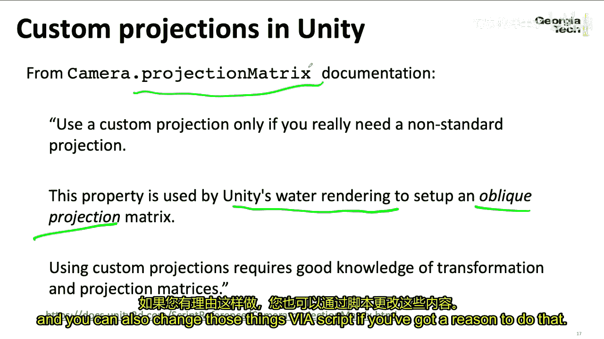
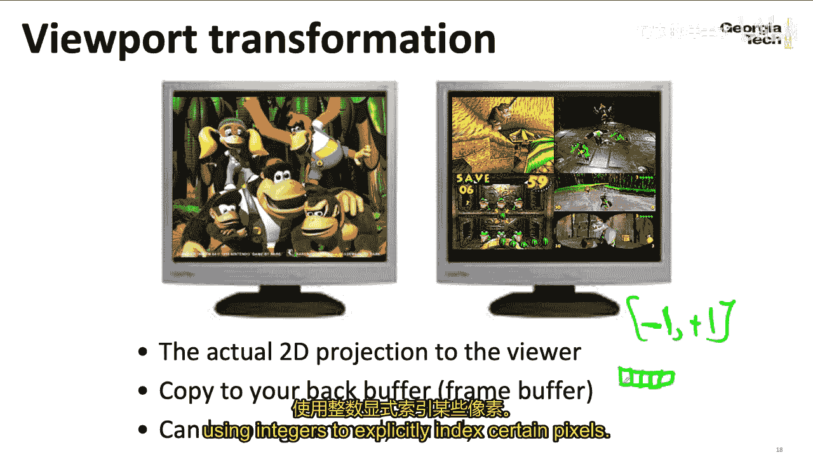
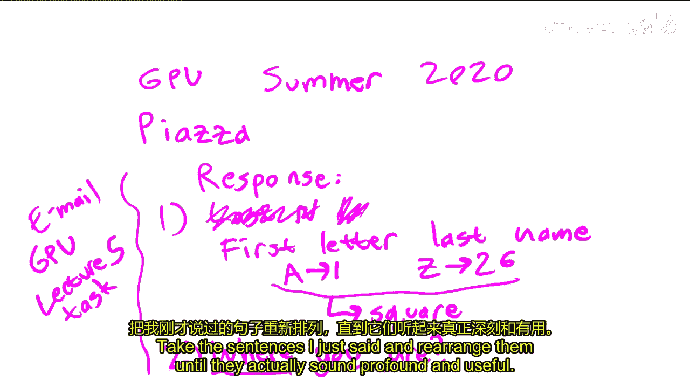

# 005：透视投影 👁️

## 概述
在本节课中，我们将要学习透视投影。上一节我们介绍了正交投影，本节中我们来看看透视投影，这是一种让近处的物体看起来比远处物体更大的投影方式。

## 透视投影与正交投影的区别
在正交投影中，物体无论距离相机多远，其显示大小都相同。透视投影则不同，距离相机较近的物体会显得比较大，而距离较远的物体则显得比较小。

## 视锥体与投影过程
目前我们讨论的所有投影变换都假设我们已经完成了视图变换。此时，我们本质上拥有一个沿X轴观察、所有物体居中的相机。正交投影会将这个视图空间（也称为相机空间或眼空间）中定义的三维体积，变换为一个归一化的三维裁剪空间体积。

透视投影则截然不同。我们处理的是一个类似截头金字塔的形状，称为**视锥体**。其顶部在近平面处被截断。我们的目标是将这个视锥体投影到一个矩形体积中。

此时，我们本质上已超出了线性变换的范畴。为了实现这种变换，我们需要新的数学方法。

## 近平面与远平面的重要性
你可以想象自己在一个黑暗的房间里，透过一扇窗户观察外面的物体。这扇窗户就是近平面，所有物体都将被投影到这个平面上。

无论是正交投影还是透视投影，选择近平面和远平面都有一些实际影响：
*   任何超出远平面的物体都将不可见。
*   如果物体位于远平面附近，当你靠近它时，它可能会突然“弹出”视野。如果你玩过任天堂64上的《007：黄金眼》，可能见过类似问题。
*   对于近平面，如果你悄悄靠近一个守卫，近平面可能会“切掉”守卫的后脑勺，让你看到他的后脑内部，这看起来相当奇怪。

对于物体在远平面处“弹出”视野的情况，有时人们会添加雾效来试图掩盖，但这仍然会发生。

此外，从实际角度出发，在正交投影和透视投影中，选择合适的近平面和远平面都很重要。因为Z轴信息用于确定哪些物体比其他物体更近（即哪些物体遮挡了其他物体）。如果你将近平面和远平面设置得相距太远，Z轴可能没有足够的分辨率来很好地处理这个问题，从而导致一种称为**Z-fighting**的奇怪闪烁效果。

## 透视投影的数学原理
我们将把这个本质上不是三维矩形体积的视锥体，映射到一个三维矩形体积中。

左、下、近和右、上、近坐标在这个“窗口”（近平面）中是有意义的，我们将把三维空间投影到这个平面上。请注意，在远平面处，我写的是z = 远平面，因为那里的右、上、左、下坐标会有所不同，具体取决于此处的各种角度。

我根据Direct3D的惯例绘制了此图。如果是OpenGL，左下角的坐标实际上会是-1。本推导中展示的矩阵是D3D风格的，但你可以稍微修改推导过程，得到OpenGL风格的矩阵（如果需要的话）。

我们将获取此空间中的物体，并将它们投影到这个近平面上。一旦它们位于近平面上，我们就可以像处理正交投影一样，将左到右映射为-1到1，将下到上映射为-1到1。但请记住，这现在只适用于近平面上的点。在正交投影中，这种映射适用于整个三维体积，但透视投影将从根本上不同。

## 相似三角形与坐标变换
我们有一个三维空间中的点，假设是(x, y, z)，并且我们确定它位于我们要变换的体积内。我们希望空间中的所有点都通过原点(0,0,0)（再次假设相机已移动到此点）。我们基本上将沿着通过该点的直线运行空间中的所有点，并查看它们与近平面相交的位置。

此处的核心思想是，所有物体都需要构成相似三角形，所有角度都需要匹配。例如，如果我取近平面上一个新x坐标（我称之为x''）与原始x坐标的比值，它需要等于近平面z坐标与我正在变换的实际z坐标的比值。稍作整理，我可以用正在变换的x、近平面和z坐标来表示这个新的x''。请注意，这个变换本质上是非线性的，我们需要小心处理。

我们希望尽可能将计算保持在线性矩阵代数空间中，以便可以将其与我们正在进行的其他矩阵操作结合。但在某个时刻，我们将不得不进行除法运算，而这无法仅通过直接的矩阵乘法完成。

我们构建的相似三角形必须在所有坐标中都成立。例如，y''与x''的比值应与y与x的比值匹配。因此，我可以推导出与上面类似的表达式，或者直接应用此逻辑，得到y''的表达式：`y'' = n * y / z`，正如我们上面得到的`x'' = n * x / z`。

## 映射到裁剪空间
完成该变换后，我们现在得到一个x''，它应该位于左极限到右极限的空间内；而y''则位于从底部坐标到顶部坐标的空间内。

此时，我们可以使用上一讲中推导出的正交投影公式，将这些坐标映射到-1到+1的裁剪空间中。

因此，我们可以这样做。我们在这里得到的是X'（实际上是X''），在这里得到的是Y'（实际上是Y''）。需要说明的是，本讨论大部分基于Joe Farrell的一篇精彩文章。他使用了略有不同的符号，他在这里使用x'，而我想使用x''来使某些区别更清晰。总之，我们这里得到的东西开始看起来像我们之前做过的变换，这感觉不错，但这里有一个z，这是我们无法用矩阵表示的。

然而，如果我们将所有项都乘以z，并说好吧，我们处理的将不是x'和y'，而是`x' * z`和`y' * z`。我们只是说所有项都会带有一个z，我们稍后会处理掉这个z。因为这样我就可以将其表示为包含`x*z`和`y*z`的项，并且可以用矩阵计算来表达它。

## 处理Z坐标
现在我们需要考虑如何处理Z'。我们已经弄清楚了如何变换X和Y。我们确实需要对Z做一些处理，因为它将包含一些深度信息，我们需要确定遮挡关系。让我们保持一致，我们将取Z并将其映射到新的`Z' * z`，并尝试找出一些合理的方案。

我们将假设近平面将映射到0（即Z' = 0），而远平面将映射到Z' = 1（如果我想使用OpenGL惯例，我可以让Z' = -1，但这里我们使用Direct3D惯例）。

因此，如果我想进行这种映射，我知道可以在这里代入n。如果我希望近平面映射到零，我可以将其代入并得到第一个方程。现在，让我们看看另一种情况。如果我将F代入Z，我希望Z'输出1。如果我这样做，就会得到这个表达式。如果需要，我可以为Z' = -1重写这些表达式，并运行相同的逻辑，但目前我们不需要这样做。

我有两个方程和两个未知数，很容易求解出所需的P和Q（以及R）。我可以通过代入这些P、N、Q来写出完整的表达式，然后得到另一个类似于之前的公式，其中我们将所有内容映射到包含Z的项。

## 齐次坐标与透视除法
如果我将前面几张幻灯片中的三个表达式结合起来，就得到了这个。我稍后会解释为什么这里有`W' * Z`。

我将把所有内容放入一个矩阵中。因此，我将把一个(x, y, z)映射到`(x'*z, y'*z, z'*z)`，这很好，这些由这里的各项处理。现在的问题是，我到底想用这个W'坐标做什么？

惯例是，我们最终希望将所有项除以Z，即摆脱这个Z。通常的处理方式是，我们将取这个第四坐标，它应该是`W' * Z`，并将Z放在那里。然后，在显卡的某个部分，会有一块硬件基本上取这个向量中的所有项，并将其除以第四坐标。

因此，我们要做的是取那个第三坐标Z，并将其放入第四坐标W中。这就是这里这个1的作用：它取那个Z并将其放入这个第四W坐标。所以现在，当我将所有项除以这个`W' * Z`时，我实际上是在除以z，然后我就得到了我的x'、y'和z'，并且在W坐标中留下一个1。

## 简化与常用参数
正如我们在正交投影中看到的，我很少需要拥有独立L、R、T、B、N、F的完全灵活性。通常我可以假设存在某种对称性，因此我可以只定义一个宽度和一个高度，而不是拥有独立的L、R和T、B。在这种情况下，上一张幻灯片上的矩阵会以你预期的方式简化。

但即便如此，用W和H来表达通常也不是这类矩阵的表达方式。通常有一个以弧度或度数为单位的**视野**（通常是度数，从关卡设计师设置相机的角度考虑）。这个视野是在这个垂直方向上定义的。然后你定义一个**宽高比**来确定宽度。我正在以16:9的宽高比制作此演示文稿，你可能在YouTube上也是以此观看。较旧的标准清晰度视频通常具有4:3的宽高比，这是原始电视的标准。这是一种现代显示器和笔记本电脑基本都支持的宽屏标准，用于观看电影。当然，我们还需要定义近平面和远平面。

涉及一些三角学来计算视野如何映射到高度和宽度，我不打算详细讲解所有三角学，如果你愿意可以深入研究，但目前我们可以先相信这一点。

## 3D API中的矩阵创建
不出所料，3D API中内置了创建这些矩阵的命令。Direct3D和Unity默认都使用左手坐标系。正如我们上次提到的，由于Direct3D有一个C基础，你需要传递一个指向矩阵数据的指针，但像Unity这样的东西并不真正需要这个，你可以创建一个矩阵然后返回它，而无需显式传递指针。Unity有一个4x4矩阵库，特别包含一些像这样的矩阵创建例程。

当然，在某些API中也有此函数的右手坐标系版本。这有点奇怪，因为这里的底层数学本应适用于右手系统，你只需要为F和N输入负数，而不是正数。但即使右手系统中的远平面和近平面应该用负坐标定义，所有API都假设你传入的是正数。这就是为什么你在这里看到的`n - f`看起来与上一张幻灯片上的`f - n`不同的原因，它只是为你执行了取反操作。

Direct3D XNA有它自己的版本，OpenGL也有一个版本。因为OpenGL本质上是右手坐标系，并且这里有一个C基础，但正如我上次提到的，OpenGL有一个堆栈计算模型，所以这被推送到堆栈上供以后使用，因此即使在C上下文中，你也不需要指定指针。

## Unity中的自定义与默认处理
你可以在Unity中使用我们讨论过的例程创建自己的投影矩阵，或者你可以编写一些执行非常奇怪的定制矩阵的东西。你的相机有一个不可访问的投影矩阵，你可以为其赋值，但你通常只有在做一些相当特殊的事情时才需要这样做。

文档提到了**斜投影**，这是一种奇怪的、非标准的投影，超出了我们研究的范围，显然被水渲染系统使用。同样，你通常只有在做一些特别奇怪的事情时才需要这样做。

Unity会根据你相机在检视器中的设置，根据需要创建这些矩阵。你也可以通过脚本更改这些设置，如果你有理由这样做的话。

## 从裁剪空间到屏幕空间
还有一个最终的变换，那就是将-1到1映射到屏幕上实际的像素数量（整数）。在使用现代硬件进行3D图形编程时，如果你习惯于使用整数显式索引特定像素的2D图形编程，需要一段时间来适应这一点。

当然，这最终会发生。你的操作系统和你调用的API中可能还有其他东西，根据像素定义屏幕上各个窗口的位置，然后将这些-1到1映射到各个位置。正如我们稍后将看到的，这可能更加复杂，因为你可能正在进行抗锯齿处理，或者实际上渲染到一个比你实际显示的像素更多的缓冲区中。如今，很多这些都在幕后为你处理，所以本质上，我们暂时将其留给API和显卡中的“魔法”来处理。

## Unity中的坐标约定
Unity定义了几种坐标约定。这些是Unity特有的，如果你使用其他引擎，可能会有不同的命名规则。它定义了一个**视口系统**，左下角为(0,0)，右上角为(1,1)。视口系统没有任何Z坐标的概念。

还有**屏幕空间坐标**，从左下角(0,0)到更像整数像素的东西。因此，我们有一个像素宽度和像素高度。在这种设置中，还有一个Z坐标，这是从相机出发的“世界单位”坐标。请注意，这些具有不同的单位。

对于Unity内置的图形用户界面设施，坐标(0,0)现在位于左上角，你有了这些相机像素坐标，现在位于右下角。因此，前两种更接近我们迄今为止一直在研究的关于如何映射2D坐标的惯例，其中Y坐标增加意味着你在屏幕上向上移动。而这个GUI坐标空间，更接近传统的2D图形编程，其中Y坐标增加意味着你在屏幕上向下移动。

## 总结
本节课中我们一起学习了透视投影的核心原理。我们了解了它与正交投影的区别，认识了视锥体，并推导了将三维空间点通过相似三角形原理投影到近平面，再映射到归一化裁剪空间的数学过程。我们还探讨了齐次坐标与透视除法的作用，以及在实际应用（如Unity引擎）中如何通过API简化矩阵创建。最后，我们简要了解了从裁剪空间到最终屏幕像素的转换过程以及Unity中的坐标系统。理解透视投影是掌握3D图形渲染中物体如何根据距离正确显示大小的关键一步。