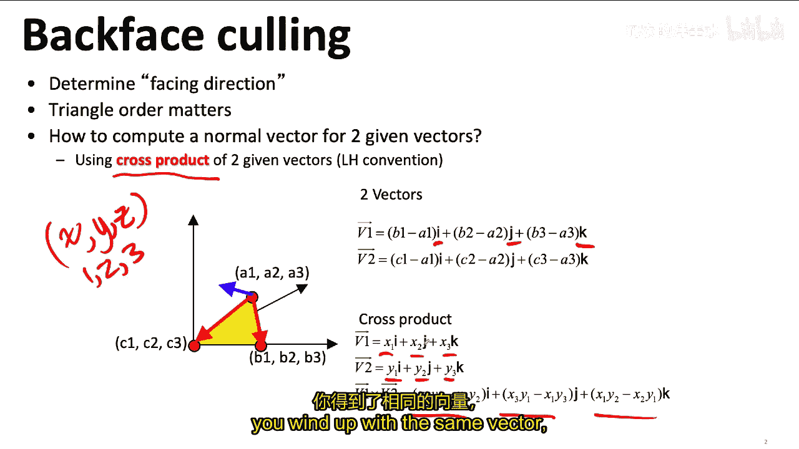
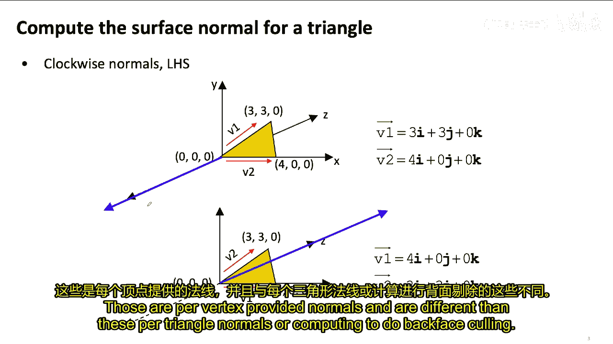
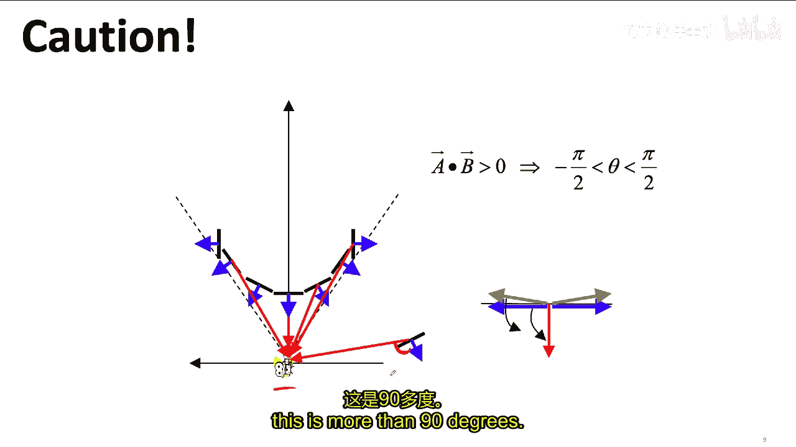
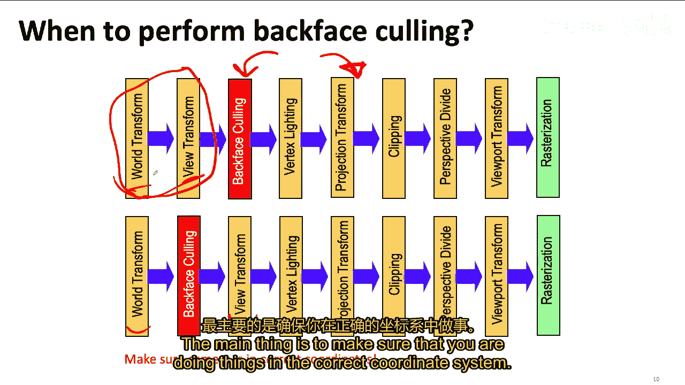
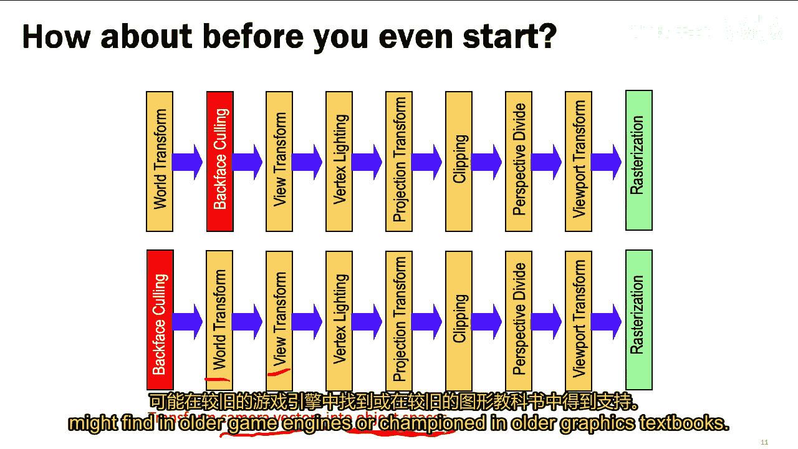
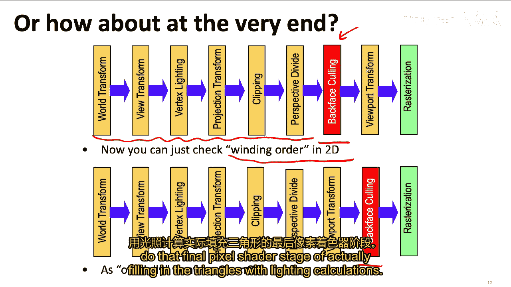
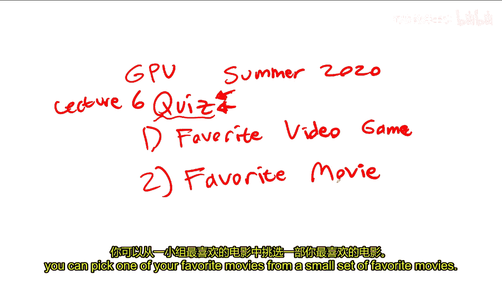

# 006：背面剔除 🎮

在本节课中，我们将学习一种名为“背面剔除”的图形渲染优化技术。其核心思想是，我们观察的物体大多是封闭表面，那些背对我们的三角形面片会被正对我们的面片遮挡。因此，我们无需浪费计算资源去渲染这些看不见的背面三角形。

## 计算三角形法线 📐

上一节我们介绍了背面剔除的基本概念。为了判断一个三角形是否背对观察者，我们需要计算每个三角形的法线向量。

这里使用的法线，与我们之前讨论的、用于光照计算的**逐顶点法线**不同。那些法线由3D建模软件导出，旨在模拟比三角形网格本身更光滑的表面曲率。而背面剔除使用的，是**逐三角形法线**，它是一个垂直于三角形平面本身的简单向量。

我们可以通过计算两个边的向量的**叉积**来得到这个法线。假设三角形有三个顶点 \( P_1 \)、\( P_2 \)、\( P_3 \)，我们可以计算两个向量：
\[
\vec{V_1} = P_2 - P_1
\]
\[
\vec{V_2} = P_3 - P_1
\]
然后，三角形的法线 \(\vec{N}\) 可以通过叉积求得（注意叉积顺序影响方向）：
\[
\vec{N} = \vec{V_1} \times \vec{V_2}
\]

## 法线方向与坐标系惯例 🧭

叉积运算不满足交换律，因此向量顺序至关重要。3D模型通常遵循特定的顶点环绕顺序惯例（左手定则或右手定则），这决定了计算出的法线是指向模型外部还是内部。

例如，在左手定则下，如果你用左手握住，手指从 \(\vec{V_1}\) 方向弯向 \(\vec{V_2}\) 方向，拇指所指方向即为法线方向。如果你的游戏引擎启用了背面剔除，但导入的模型却消失了，这很可能是因为模型使用的坐标系惯例与引擎预期的不一致。

## 判断三角形朝向 🔍

现在我们已经有了三角形的法线，接下来如何判断它是否朝向摄像机呢？

我们可以比较两个向量：三角形的法线 \(\vec{N}\)，以及从三角形中心指向摄像机位置的向量 \(\vec{V}\)。通过计算这两个向量的**点积**，我们可以判断它们之间的夹角。

点积公式为：
\[
\vec{A} \cdot \vec{B} = |\vec{A}| |\vec{B}| \cos\theta
\]
其中 \(\theta\) 是两向量夹角。

我们只关心夹角是否大于90度：
*   如果 \(\vec{N} \cdot \vec{V} > 0\)，则夹角小于90度，三角形**面向**摄像机，需要绘制。
*   如果 \(\vec{N} \cdot \vec{V} < 0\)，则夹角大于90度，三角形**背向**摄像机，应被剔除。

**注意**：在光照计算中，所有方向向量通常需要归一化（长度为1）。但在这里，我们只关心点积的正负号，因此无需对法线或观察向量进行归一化处理，这简化了计算。

一个常见的误区是，在视图变换后，仅通过检查法线向量的Z分量正负来判断朝向。这在物体完全位于摄像机前方时可行，但如果一个三角形位于侧面，其法线的Z分量可能为正，但实际上它与观察向量的夹角可能已超过90度，此时仅凭Z分量判断就会出错。因此，使用点积判断更为可靠。

## 背面剔除的执行时机与位置 ⏱️

背面剔除可以在图形渲染管线的不同阶段进行：

*   **视图空间**：这是最自然的位置。在世界-视图变换之后进行，此时空间仍保持距离和角度关系，计算直接。
*   **裁剪空间**：在投影变换之后也可以进行，但由于投影会扭曲空间，需要一些额外的技巧。
*   **世界空间**：在世界变换之前进行理论上可行，但需要将摄像机参数逆变换到模型原始空间（对象空间），这通常没有优势，且计算更复杂。
*   **屏幕空间**：现代GPU功能强大，一种常见做法是将几何体发送到GPU，在顶点着色器阶段计算法线和点积，然后在光栅化之前决定是否剔除该三角形。甚至可以根据最终2D屏幕上顶点的环绕顺序进行快速判断。

如今，得益于GPU的强大算力，将剔除工作放在GPU端，在顶点着色器或几何着色器阶段进行，已成为高效且主流的方法。

## 特殊情况与注意事项 ⚠️

并非所有物体都适合进行背面剔除。以下是需要考虑的特殊情况：

以下是两种主要情况：
1.  **非封闭物体**：例如飘动的旗帜、单薄的布料或透明物体。玩家有时需要看到其背面。简单地为此类物体关闭背面剔除可能导致后续光照计算出错。
2.  **解决方案**：更稳健的做法是，对于需要双面可见的物体，复制其所有三角形，并将复制品的法线方向反转。这样，无论从哪一侧观察，都有一组法线正确的三角形被渲染。

## 总结 📝

本节课我们一起学习了背面剔除技术。我们了解到，通过计算三角形的法线向量，并与观察方向进行点积运算，可以高效地识别并剔除背对摄像机的三角形，从而节省宝贵的渲染资源。我们探讨了法线的计算、朝向的判断、不同执行阶段的优劣，以及处理双面可见物体的特殊方法。掌握背面剔除是优化实时图形应用性能的重要一步。

---

**附：课程测验（示例）**
1.  你最喜欢的电子游戏是什么？（可以是任何平台）
2.  你最喜欢的电影是什么？（如果难以抉择，可以列举一部你喜爱的）