# 007：基础光照 🎮

在本节课中，我们将学习计算机图形学中的基础光照模型。我们将从局部光照的概念开始，逐步介绍现代游戏开发中广泛使用的物理渲染（PBR）技术，并详细讲解漫反射和镜面反射的计算方法。课程内容旨在让初学者理解光照的基本原理及其在GPU编程中的应用。

## 局部光照与全局光照

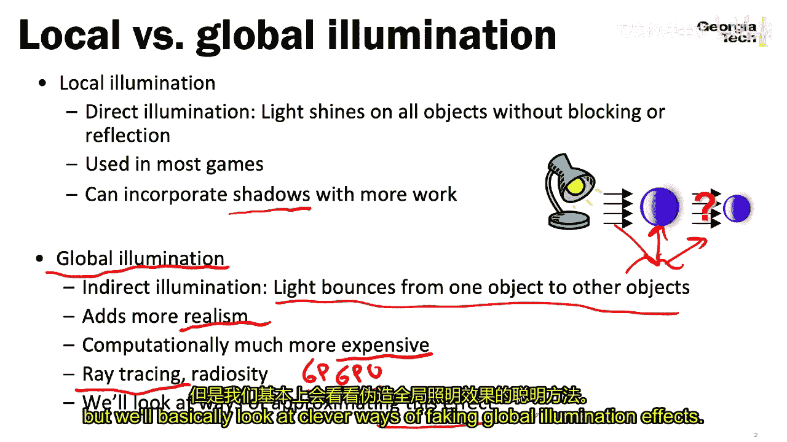

上一节我们介绍了课程的整体框架，本节中我们来看看光照的基本分类。

我们在这门课中主要关注的光照方法是**局部光照**。这意味着我们只考虑光源直接照射在物体上的光线，而不考虑光线从其他表面反射后的间接光照。值得注意的是，我们暂时不处理物体与光源之间存在遮挡物（即阴影）的情况。虽然存在生成阴影的技术，但它们实现起来相当复杂，我们将在后续课程中探讨。

**全局光照**则包含了光线在其他物体间反弹的效果。这能创造出更加真实的场景，但计算量也显著增加。一个完整的全局光照方案会使用类似**光线追踪**的技术。大约十年前，人们开始利用GPU的科学计算能力进行光线追踪，但那些计算通常无法实时完成。如今，英伟达和AMD的最新显卡已内置了某种程度的实时光线追踪能力，但其应用仍有限制，且很少有游戏完全依赖它。在本课程中，我们将探讨全局光照，但主要关注的是模拟全局光照效果的巧妙方法。

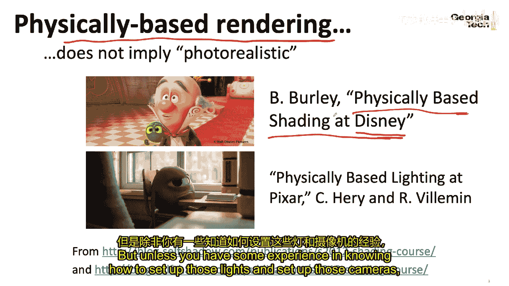

## 物理渲染（PBR）的兴起

在了解了基础分类后，我们来看看现代游戏图形学的一个重要趋势。

2012年的一次会议上，迪士尼的一位研究员发表了他们在电影中使用的**基于物理的渲染**技术成果。此后，几乎每一位游戏行业的图形程序员都阅读或观看了那份报告，并开始尝试将PBR技术应用到视频游戏中。这是一项极具影响力的工作。

需要明确的是，使用物理渲染并不一定意味着要达到照片级的真实感。例如，一些风格化的角色本身在现实中并不存在，但构成其表面的各种材质对光线的反应方式，却与真实材质类似。PBR技术带来的主要好处是，当改变场景的照明方式时，无需回头修改物体上材质属性的定义。同样重要的是，物理渲染并不自动保证游戏场景看起来就“好看”。就像即使你拥有相机和灯光，但若缺乏布光和摄影的经验，作品依然不会显得专业。

以下是使用PBR技术的一个绝佳例子，即《合金装备5》中使用的Fox引擎。请花点时间观察下图，尝试分辨哪个场景是科乐美制作公司会议室的真实照片，哪个是由引擎渲染的。

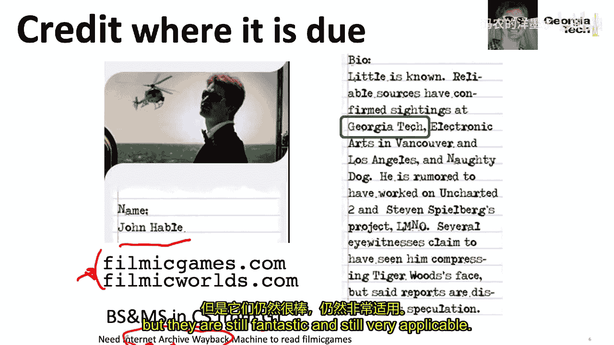

有几个关键线索：一是海报的反射，它们被某种涂层覆盖，产生了更光滑的反射；二是光线作用的微妙之处，例如右侧场景中光源反射的模糊效果。实际上，这是一个陷阱问题——**所有场景都是由引擎创建的**。他们并没有真的把一匹马带进会议室。虽然像物体漂浮在空中这样的场景显然不真实，但其渲染效果依然令人印象深刻。

这里要感谢佐治亚理工学院的前学生John Hable，他曾任职于顽皮狗公司，从事游戏图形工作。他有两个非常出色的博客。你会发现，图形学和游戏领域最新、最棒的信息通常不在科研论文或教科书中，而是在那些致力于实现这些技术的人们的博客文章里。

## 物理渲染的核心概念

理解了PBR的重要性后，我们来深入探讨其包含的一系列核心概念。

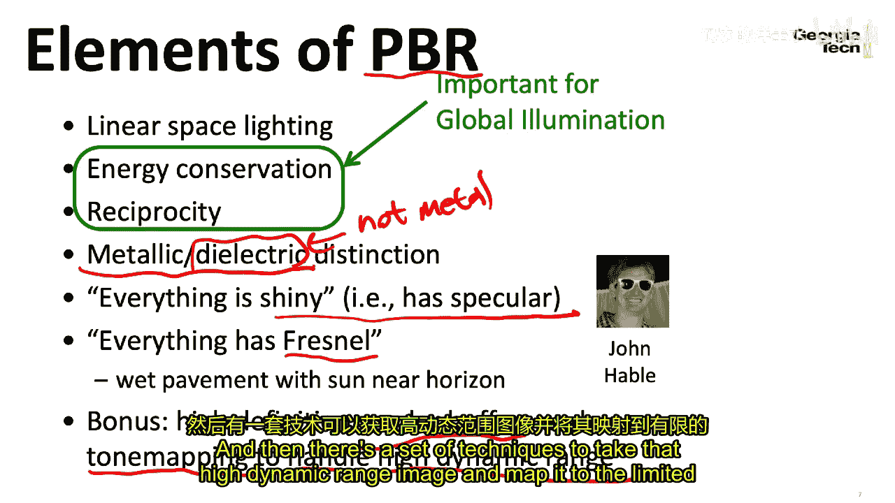

当人们谈论物理渲染时，它并非单一技术，而是多种因素的结合。以下是其关键组成部分：

*   **线性空间光照**：这与纹理的创作和存储方式有关，我们将在后续课程中讨论。
*   **能量守恒**与**互易性**：这两个属性对于尝试进行全局光照计算尤为重要。
*   **金属与非金属（电介质）的区分**：PBR模型严格区分金属和非金属材质。在计算机图形学早期，基于启发式的技术没有这种区分。
*   **所有物体都有镜面反射**：创建一个物理上合理的模型意味着**所有物体**都有镜面反射，即使是像纸板这样你认为不反光的东西。
*   **菲涅尔效应**：所有材质都存在菲涅尔效应。例如，干燥的柏油路看起来不反光，但雨后，在太阳接近地平线的掠射角下，路面会变得像镜子一样反光。
*   **高动态范围（HDR）**：为了充分发挥PBR的优势，最好能在视频缓冲区中拥有足够的分辨率和动态范围，以处理真实光源的高动态范围。早期游戏图形技术受限于存储图形计算结果的缓冲区动态范围，通常只能处理非常有限的光照强度范围。而物理上合理的真实场景则可能包含非常宽广的光照强度范围。人眼通过对数尺度感知光强来处理这一问题。然后，再通过一系列色调映射技术将HDR图像映射到显示器的有限范围内，这些我们也会在后续课程中讨论。

## 光源类型与关键向量

在开始具体计算前，我们需要定义场景中涉及的基本元素。

现代游戏引擎可以实时处理各种复杂光源，但本课程大部分内容将使用最简单的几种模型。

*   **平行光**：可以想象为一束来自极远处明亮光源（如太阳）的平行光线。在场景范围内，其强度被认为没有衰减。
*   **点光源**：能量向所有方向辐射，但其强度会随距离增加而衰减。太阳其实也有此效应，但由于距离极远，在地球尺度的场景中，其光线可视为平行。
*   **聚光灯**：可以看作是点光源的精细化版本，它强调特定方向的照明。

接下来，我们定义光照计算中用到的一些关键向量。假设空间中有一个表面，其上有：

*   **法向量**：垂直于该表面的向量，记为 **n**。注意，这里的法向量不同于背面剔除中为单个三角形计算的法线。这里的法向量通常由3D美术软件（如3D Studio Max, Maya）为每个顶点生成，它们试图封装底层曲面（三角形网格是对该曲面的粗糙镶嵌）的信息。
*   **光源方向向量**：从表面点指向光源的向量，记为 **l**。
*   **观察方向向量**：从表面点指向摄像机（眼睛）的向量，记为 **v**。
*   **半程向量**：是 **l** 和 **v** 的角平分线方向向量，记为 **h**。可以通过将两向量相加后归一化得到：**h** = normalize(**l** + **v**)。

**一个非常重要的前提是**：在进行计算前，所有这些向量都必须被**归一化**，即长度为1。忘记归一化是图形编程中一个极其常见的错误。

## 漫反射光照计算

现在，我们进入具体的计算环节，首先从较为简单的漫反射开始。

光照分为**漫反射**和**镜面反射**两部分。镜面反射较为复杂，我们将在单独的课程中讲解。本节我们只讨论漫反射。

漫反射表面是指相对于照射光波长而言显得粗糙的表面。从光的视角看，它可能对人眼来说并不粗糙。由于表面粗糙，入射光线会被随机散射，能量被均匀分散。因此，对于漫反射，只要表面在摄像机可见范围内，反射光的强度**与摄像机的位置无关**。

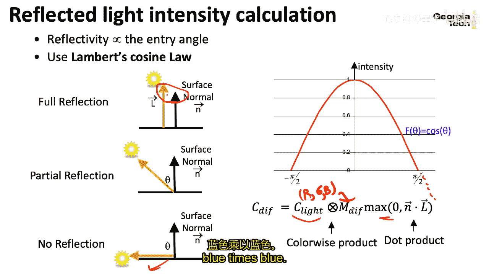

其工作原理基于物理定律。如果光线方向 **l** 与表面法线 **n** 完全对齐（夹角为0°），则反射光最强。随着夹角增大，反射光强度按余弦定律衰减。当光线与表面平行（夹角90°）时，几乎没有反射。

这个余弦衰减的好处是，你不需要实际计算角度的余弦三角函数值。根据三角学，两个单位向量的点积就等于它们夹角的余弦值。因此，漫反射光强系数可以计算为：

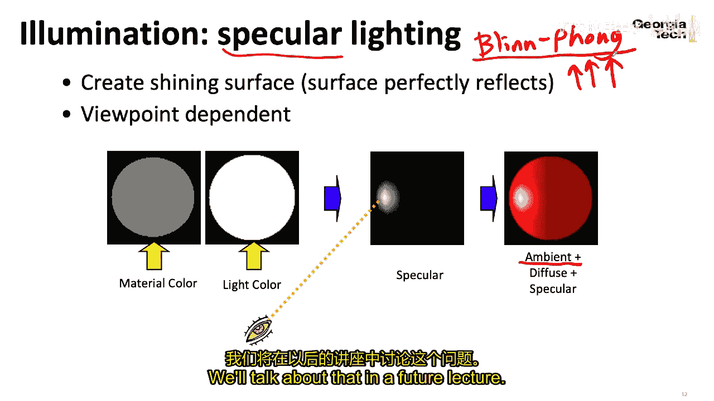

`漫反射系数 = max(0, dot(n, l))`

这里使用 `max` 函数是为了避免点积为负值（意味着光线从背面照射，不会产生反射）。

最终，该点的漫反射颜色由光源颜色和材质漫反射颜色共同决定：

`最终漫反射颜色 = C_light ⊗ M_diff * max(0, dot(n, l))`

其中：
*   `C_light` 是光源的RGB颜色值。
*   `M_diff` 是材质漫反射颜色的RGB值。
*   `⊗` 符号表示逐分量乘法（即 `R*R, G*G, B*B`），结果是一个新的RGB颜色值。

## 双向反射分布函数（BRDF）

为了更通用地描述光照，我们引入一个核心概念。

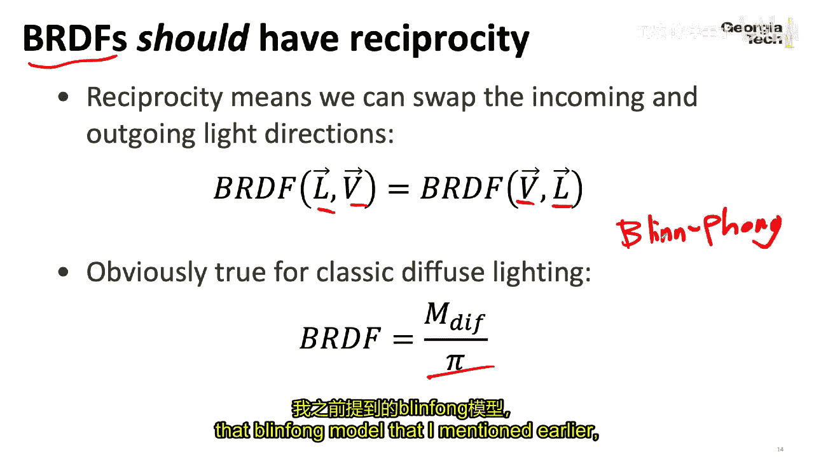

前面给出的公式可以纳入一个更通用、更复杂的框架中，即**双向反射分布函数**。

BRDF是一个函数，它描述了从某个方向（**l**）入射的光，在另一个方向（**v**）上反射的比例。对于漫反射，其BRDF非常简单，是一个常数（即材质的漫反射颜色 `M_diff` 除以 π）。这允许我们以后通过添加更复杂的镜面反射项来扩展模型。

你可能会问公式中的 π 是怎么回事。这涉及到计算机图形学背后更复杂的数学物理基础。BRDF定义中的 π 是一个归一化因子。幸运的是，对于大多数我们考虑的光源，物理公式中会出现一个 π 因子，当与漫反射BRDF中的 π 结合时，它们常常会相互抵消。因此，在着色器代码中，有时你会看到 π，有时则不会，这取决于人们采用的约定和优化。

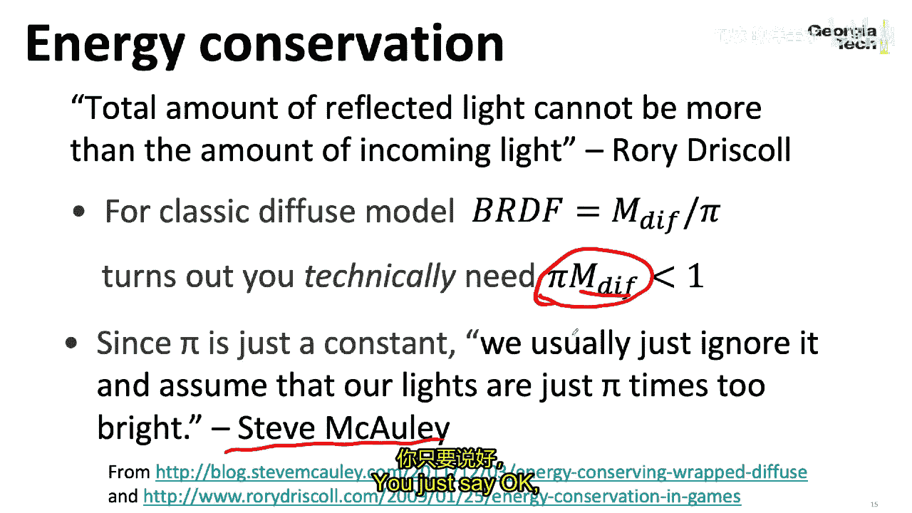

一个“正确”的、物理上合理的BRDF需要满足一些属性，例如**互易性**（交换光源和观察者位置，结果应相同）和**能量守恒**（表面反射的光不能超过入射光）。我们之前提到的**Phong镜面反射模型**就不满足互易性。对于漫反射模型，能量守恒要求 `M_diff` 的每个分量必须小于1/π，这通常通过让美术师确保材质颜色值在0到1之间来自然满足。

## 光源衰减与聚光灯

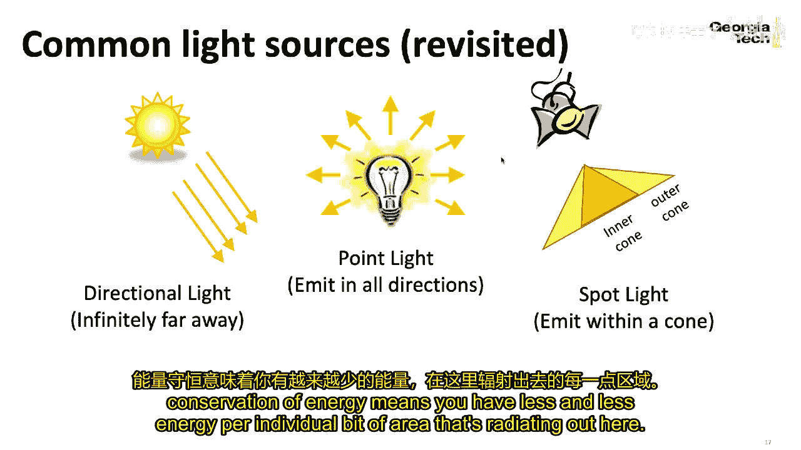

最后，我们补充关于点光源和聚光灯衰减的具体计算。

对于**平行光**，我们假设在场景范围内强度无衰减。但对于**点光源**和**聚光灯**，我们需要考虑能量随距离扩散而导致的衰减。人们有时使用物理模型（强度与距离平方成反比），有时使用类似以下的模型以获得艺术效果：

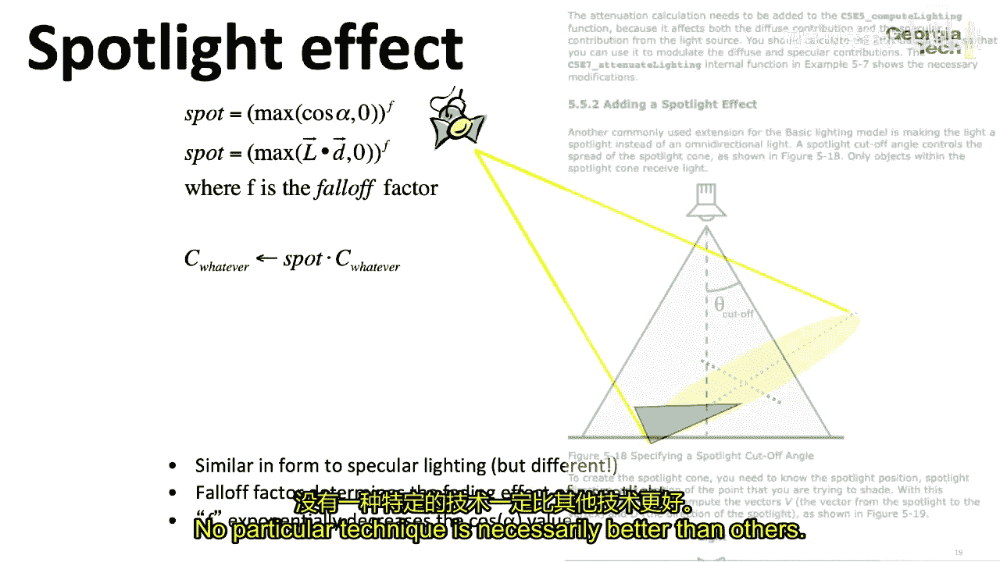

`衰减因子 = 1.0 / (Kc + Kl * d + Kq * d²)`

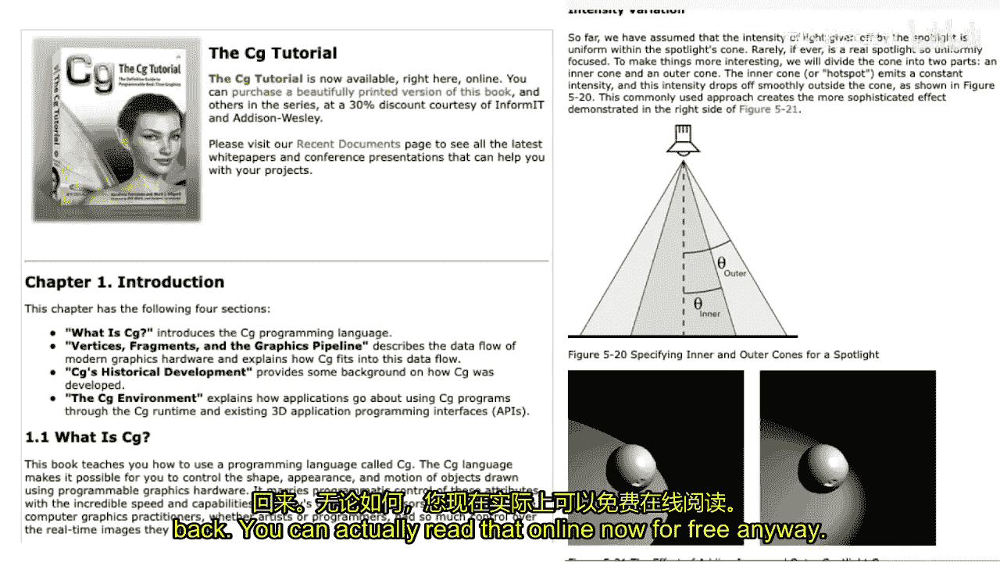

其中 `d` 是距离，`Kc`, `Kl`, `Kq` 是常数。

对于**聚光灯**，有多种实现方式。这里介绍一种常见的方法。设 **l** 为从聚光灯指向被照射点的向量（注意方向与之前相反），**d** 为聚光灯的照射方向向量（均已归一化）。衰减基于这两个向量之间的夹角。

首先计算 `cosθ = max(0, dot(l, d))`。然后，衰减因子可以定义为：

`聚光灯衰减因子 = (cosθ)^f`

其中 `f` 是控制聚光灯束宽度的指数因子。`cosθ` 的值在0到1之间，取幂次 `f` 会改变衰减曲线的形状。增大 `f` 会使光锥更集中，边缘更锐利；减小 `f` 则会使光锥更宽，边缘过渡更平滑。

---

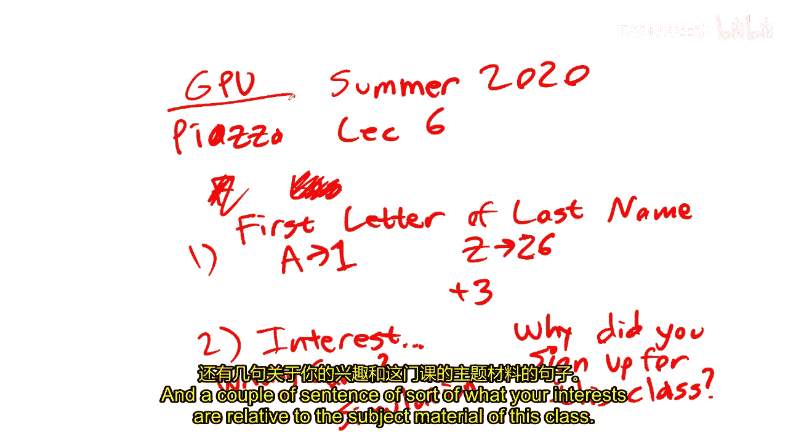

本节课中我们一起学习了计算机图形学的基础光照知识。我们从局部光照与全局光照的区别讲起，了解了物理渲染（PBR）技术的核心思想及其重要性。我们详细探讨了漫反射的计算原理，引入了双向反射分布函数（BRDF）的概念，并简要介绍了点光源衰减和聚光灯效果的实现方法。这些基础概念是理解更复杂GPU着色器编程和现代游戏渲染管线的关键。在接下来的课程中，我们将深入探讨镜面反射模型、阴影技术以及全局光照的模拟方法。