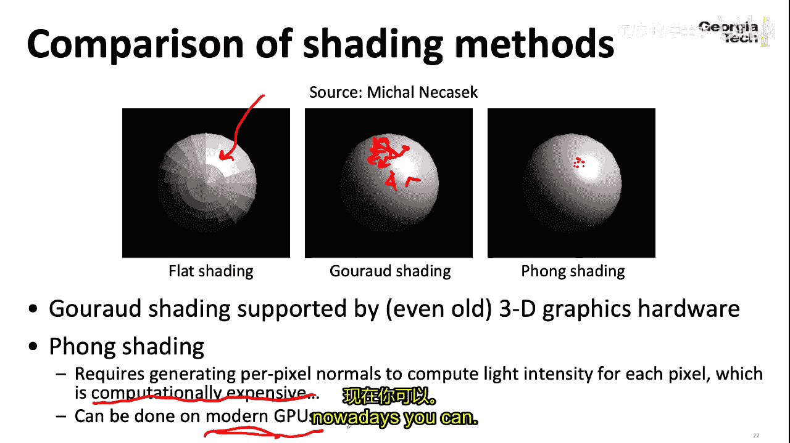
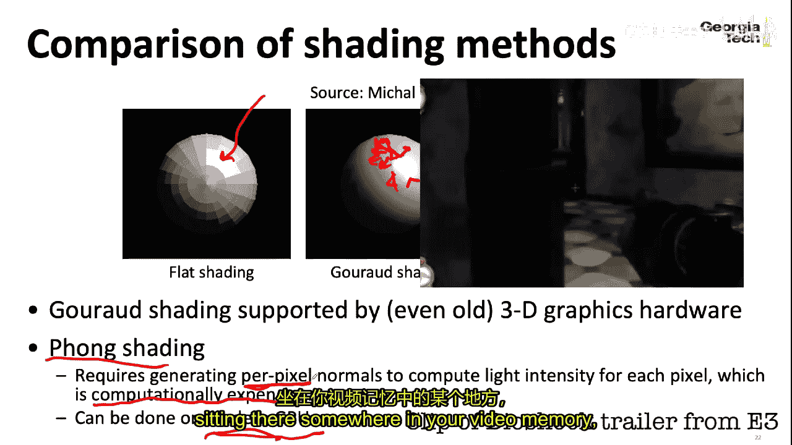
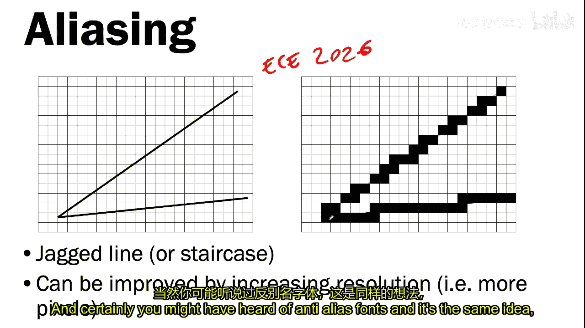
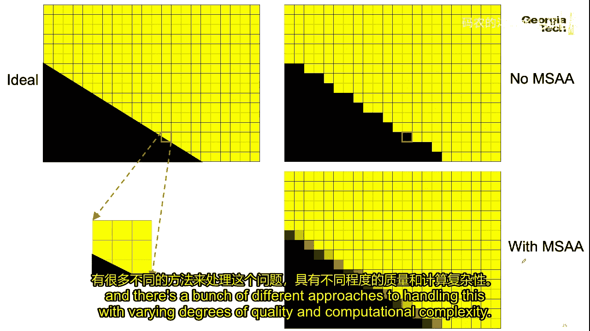

# 008：光栅化 🎮

在本节课中，我们将学习光栅化的基本概念。光栅化是GPU确定屏幕上哪些像素需要为特定三角形着色的过程。我们将探讨颜色插值、深度缓冲以及抗锯齿等关键技术。

大家好，我是佐治亚理工学院电气与计算机工程系的教授。欢迎来到“视频游戏GPU编程”课程。

上一节我们讨论了光照，本节中我们来看看光栅化。你的GPU需要计算出屏幕上哪些像素对应需要为特定三角形绘制的像素。这里我们有一个简化的例子，三角形的顶点分别是红色、绿色和蓝色。

## 颜色插值（Gouraud着色）🌈

确定如何填充这些像素的最简单技术之一，是计算每个顶点的颜色，然后在它们之间进行插值。这被称为**Gouraud着色**。与其他技术相比，这种方法效率较高，因为我们只在顶点进行光照计算，然后在它们之间进行插值。

在实际实现中，你可以想象首先沿着这条线插值，以确定线上的颜色，然后扫描插值各个像素。如果在20世纪80年代，你可能需要学习计算机图形学课程并亲自编写实现这些功能的例程。但现在，我们只需假设显卡上的“魔法”会为我们处理这一切。

## 着色技术的比较 🎨

我们讨论的Gouraud着色存在一些局限性，但至少比平面着色要好。

以下是平面着色的说明：
*   你可以计算整个三角形相同的颜色，例如基于背面剔除时使用的相同法线来计算颜色。
*   但这会产生明显的刻面外观。
*   如今，你通常只在刻意追求复古外观或明显的计算机生成效果时才会使用它。

Gouraud着色无疑是一种改进。在这里，虽然主题看起来平滑了，但你仍然可以看到表面被分解为三角形的方式所产生的一些效果。然而，从计算角度来看，这仍然相当高效，因为你只对每个顶点进行复杂的光照计算，然后在它们之间插值最终的光照值。

## 逐像素光照（Phong着色）💡

较新的图形硬件可以为场景中的每个像素执行单独的光照计算。此时，被插值的是与各个三角形相关的单位法线，即插值法线信息本身，而不是光照计算的结果。

这显然在计算上密集得多，因为你需要为每个像素计算插值后的法向量与光源的点积。但它的视觉效果要好得多，并且现代GPU可以轻松实现。我记得第一个广泛使用逐像素光照（也称为Phong着色）的游戏可能是《毁灭战士3》。如今，几乎所有游戏都使用这种技术。这是一个重大的进步，例如虚幻引擎3就使用了逐像素光照，这也是《生化奇兵》看起来如此出色的原因之一。

## 深度缓冲（Z缓冲）📏

除了将光照信息绘制到显存中的某个缓冲区，我们还需要填充一种叫做**Z缓冲**的东西。这是你写入的另一个图像，但它不包含颜色信息，而是包含深度信息。

其基本过程是：当你试图确定图像中某个像素的颜色时，首先查看深度缓冲，检查该像素是否已经被写入过。如果没有，你就写入该像素，同时将距离信息写入Z缓冲。之后，当你处理另一个物体的颜色时，会先检查深度缓冲中是否已存在一个比当前物体更近的像素颜色记录。如果是，则可以丢弃当前计算。

Z缓冲显然会占用大量内存。通常，你需要为场景中每个需要计算颜色的像素分配一个Z缓冲像素，这可能占用大量内存。例如，PlayStation 1就没有Z缓冲，它基本上会尝试对你绘制的物体进行排序，然后从后往前绘制（这称为画家算法），但这在某些情况下会产生看起来有点奇怪的结果。

另一个问题是如何表示这些距离。为了生成一个合理的Z缓冲（而不是完全混乱），你至少需要16位的分辨率，尽管实际上你需要比这更高的分辨率，而现代大显存显卡可以提供这一点。这里存储距离的方式通常不是简单的线性映射，我们将在后续课程中查看一些处理这类深度值的实际像素着色器时再讨论。

现代GPU的一个优点是，这种“检查我们正在绘制的像素是更近还是更远”的Z缓冲检查，全部由硬件自动处理。你只需设置一些标志或API，告诉硬件以某种方式处理这些Z缓冲。

## 抗锯齿 🔍

最后我想提到的问题是，我目前假设你会为屏幕上的每个像素进行光照计算（如果是逐像素光照或Phong着色）。当然，即使你有一个拥有海量像素的巨大屏幕，分辨率仍然是有限的。如果你只是简单地将三角形的边缘绘制到屏幕上，就会得到这些被称为**锯齿**的小锯齿状效果。

解决这个问题的一个相当简单的方法是，以高于实际显示的分辨率计算图像，然后以某种方式平均相邻的像素。这样你会得到一个边缘略微模糊的图像，但不会出现这种阶梯效应。有多种处理此问题的方法，它们在质量和计算复杂度上各不相同。

## 总结 📚

本节课中，我们一起学习了光栅化的核心概念。我们介绍了通过**Gouraud着色**进行颜色插值的高效方法，探讨了更逼真但计算量更大的**逐像素光照（Phong着色）**。我们还了解了**深度缓冲（Z缓冲）** 如何帮助确定像素的可见性，以及**抗锯齿**技术如何平滑边缘锯齿以提升视觉质量。这些技术共同构成了现代GPU渲染图像的基础。