# 009：纹理导论 🎮

在本节课中，我们将学习计算机图形学中一个核心概念：纹理。我们将了解纹理是什么、为什么需要它们、它们如何映射到3D物体表面，以及在处理纹理时可能遇到的技术挑战和解决方案。

## 概述

纹理是为了解决一个效率问题而设计的。如果试图用大量微小的三角形来构建物体，并为每个三角形的顶点定义特定颜色，这将非常浪费内存和计算资源。例如，一个广告牌只需两个三角形就能渲染其表面，但若要用三角形表现其上的所有颜色变化，则需要海量的三角形。因此，纹理应运而生。

纹理本质上是2D图像，我们将其“包裹”在3D物体表面。图像中的基本单元称为“纹素”，它们就像最终显示在屏幕上的“像素”，但存在于纹理图像中。

## 纹理坐标与映射

上一节我们介绍了纹理的基本概念，本节中我们来看看如何将纹理应用到物体上。

之前我们讨论过，构成物体的顶点拥有三维空间位置（物体空间坐标），以及用于光照计算的法线向量。历史上顶点也包含颜色信息，但如今颜色信息主要存储在纹理中。因此，我们为每个顶点新增一个属性：一个二维向量坐标，它代表指向2D纹理图像特定部分的索引，我们称之为纹理坐标。

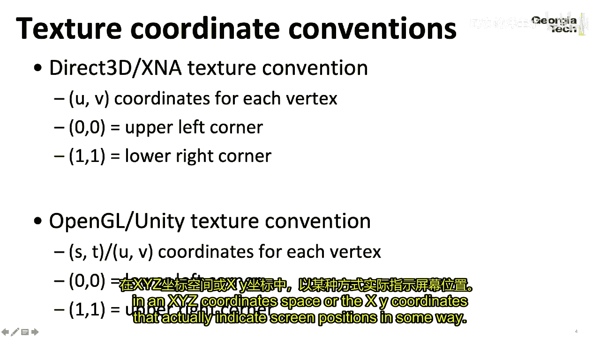

与所有坐标系一样，纹理坐标也没有统一的约定：
*   **Direct3D / XNA**：使用左上角为(0,0)，右下角为(1,1)。
*   **OpenGL / Unity**：使用左下角为(0,0)，右上角为(1,1)。

通常，我们用`(u, v)`来表示纹理坐标，以区别于3D空间中的`(x, y, z)`坐标或屏幕空间坐标。

*（图示：一个矩形表面被映射了一张人脸纹理）*

定义好的顶点将包含指向纹理的坐标。通常，我们可以想象在顶点之间对纹理坐标进行线性插值，以确定每个片段（像素）应从纹理的哪个位置采样。不过，在进行透视投影时，简单的线性插值会导致问题。幸运的是，存在一个修正方法，并且现代显卡会自动处理这个细节。

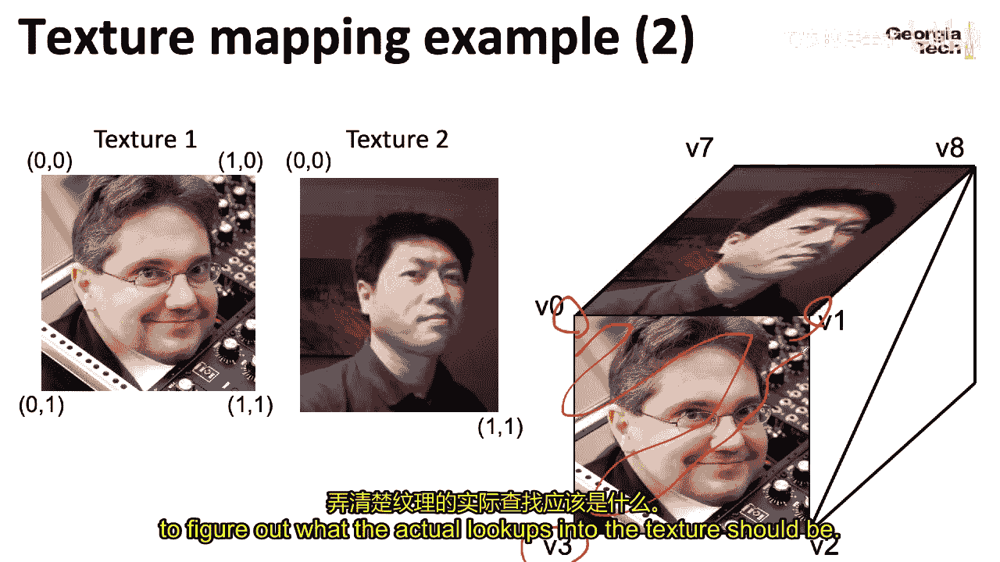

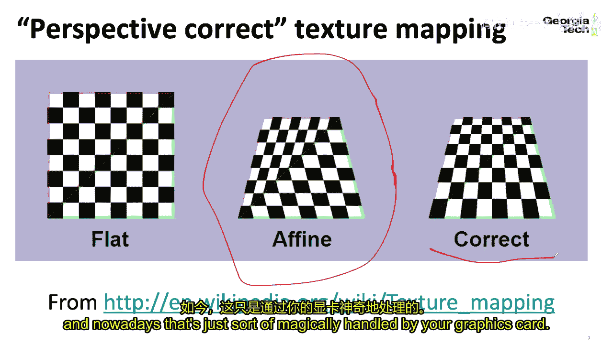

## 纹理寻址模式

了解了基本的纹理映射后，我们来看看如何处理超出标准[0,1]范围的纹理坐标。

纹理坐标通常以模1的方式被引用。如果提供的纹理坐标大于1或是负数，可以在图形API中设置不同的寻址模式：
*   **钳位模式**：将坐标限制在纹理边界，并重复边缘的纹素。这种模式使用场景不多。
*   **重复模式**：让纹理平铺重复。这在游戏中很常见，例如用于墙面纹理。

然而，简单的重复可能导致玩家注意到不真实的重复图案。一个常用的技巧是叠加多个不同尺寸的纹理，让它们以不同的速率重复，从而相互交错，打破明显的重复感。

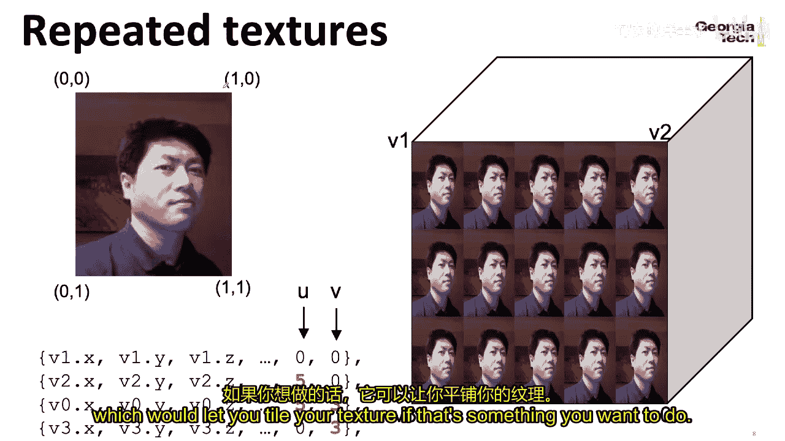

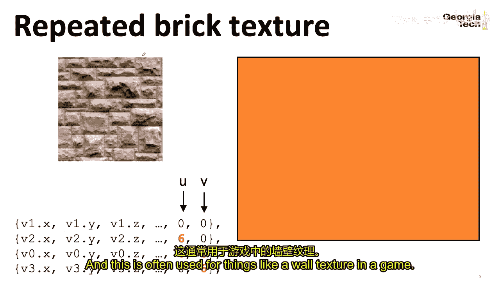

## 纹理过滤：放大

处理纹理时会遇到许多实际的技术问题。我们先从简单情况开始：假设我们正对着一个正方形表面观察。

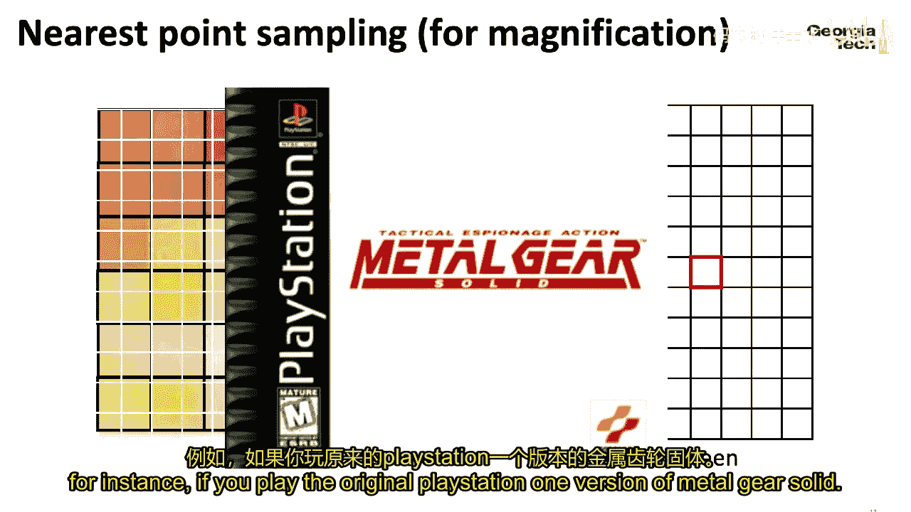

常常会遇到将纹理放大的情况，即屏幕上的像素密度远高于底层纹理图像的纹素密度。处理这种放大效应有不同的方法：

以下是几种常见的纹理放大过滤方法：
*   **最近邻采样**：为屏幕上的每个像素，直接抓取纹理坐标对应的、最近的单个纹素。这是90年代游戏中常见的做法，但效果通常不佳。
    *   **伪代码示例**：`color = texture[texel_floor(uv * texture_size)]`
*   **双线性插值**：取与目标像素重叠的四个纹素，并计算其加权平均值。这比最近邻采样效果更好，计算量也稍大，但现代GPU都能轻松处理。这也是Photoshop等软件调整图像大小时的一个选项。
    *   **概念公式**：在u和v两个方向上进行线性插值。

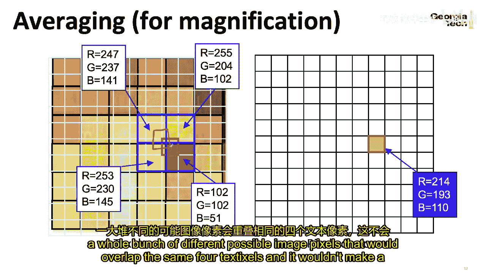
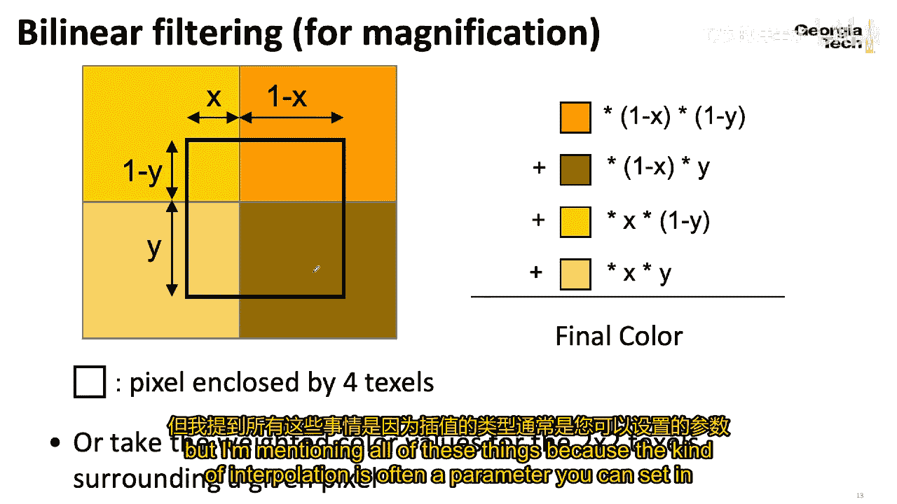

## 纹理过滤：缩小

比放大更棘手的问题是缩小。当你将视角拉远，物体在屏幕上占据的像素很少，但纹理图像本身非常精细。此时，屏幕上的一个像素可能对应纹理中的一大片纹素区域。

如果只是简单地抓取离像素中心最近的那个纹素，可能会因为采样问题导致严重的走样效应。想象一辆涂有垂直红白条纹的汽车：
*   如果采样点全部落在红色条纹上，车看起来是红色的。
*   如果汽车稍微移动，采样点全部落在白色条纹上，车看起来是白色的。
*   如果汽车以特定速度移动，它可能会在红白之间闪烁。

这种使用最近邻采样导致的奇怪视觉效果称为“摩尔纹”，在90年代的老游戏中，尤其是在远处的纹理上经常能看到。

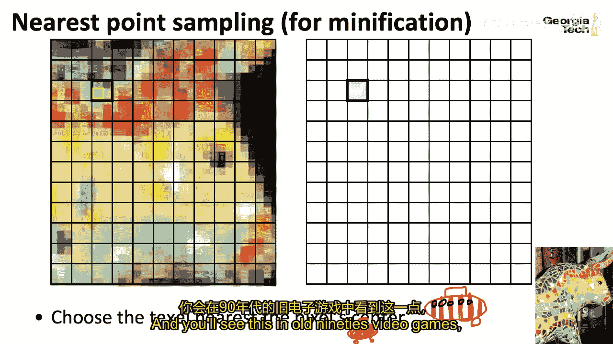

与放大情况类似，简单的平均（如双线性插值）可以缓解一些走样问题。但请注意，在API中通常为纹理设置统一的过滤方式，它同时适用于缩小和放大。对于包裹在物体表面的同一纹理，可能某些部分在缩小，而另一些部分在放大。

## Mipmapping 技术

即使使用了双线性插值，当视角拉得非常远时，仍然可能遇到走样问题。解决这个问题的一种关键技术称为Mipmapping。

Mipmapping的核心思想是预先创建一系列尺寸递减的纹理，通常是原纹理的1/2、1/4、1/8等。每一层都是上一层的降采样版本。在渲染时，根据屏幕上像素对应纹理区域的大小，自动选择细节层次最合适的Mipmap层级进行采样。

这样做的好处是：
1.  **抗走样**：使用合适尺寸的纹理能有效减少摩尔纹。
2.  **提升性能**：避免为远处物体使用高分辨率纹理而浪费显存和带宽。

在Unity等现代引擎中，导入纹理时可以自动生成所有Mipmap层级。

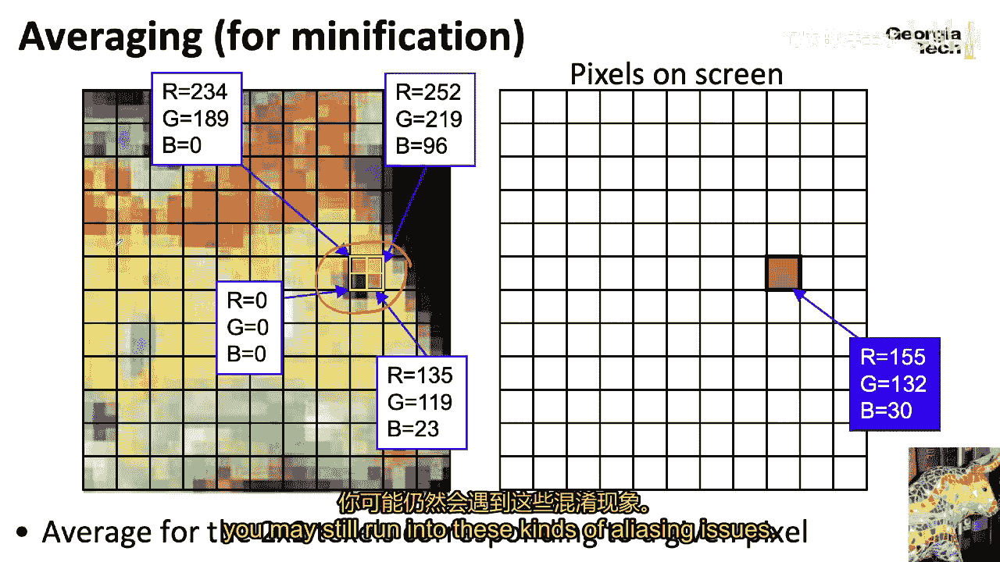
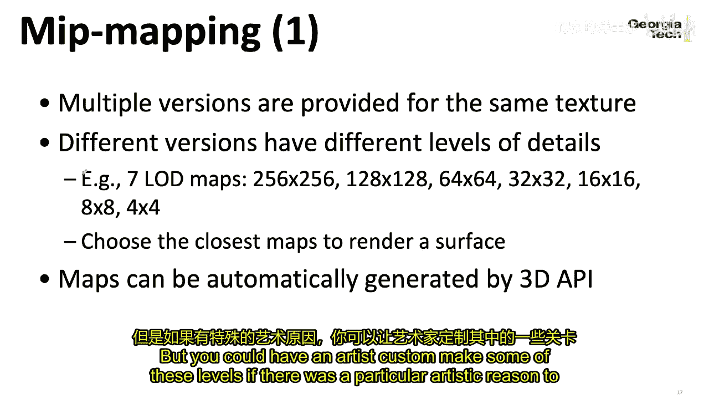

## 高级过滤：三线性与各向异性

我们甚至可以在不同的Mipmap层级之间进行插值，这称为**三线性过滤**。其过程是：
1.  找到与目标像素最匹配的两个Mipmap层级。
2.  分别在两个层级上进行双线性插值，得到两个颜色值。
3.  根据像素与两个层级的匹配程度，对这两个颜色值再进行一次线性插值。

然而，所有这些基于二维插值的方案本质上都会模糊纹理。更先进的技术，如**各向异性过滤**，会尝试检测边缘，并避免沿着边缘进行模糊，从而在保持锐利边缘的同时平滑纹理。这需要更强大的GPU支持。

“各向异性”意为“非各向同性”。“各向同性”的操作在所有方向上效果相同（如旋转不变的模糊），而各向异性过滤则不是。

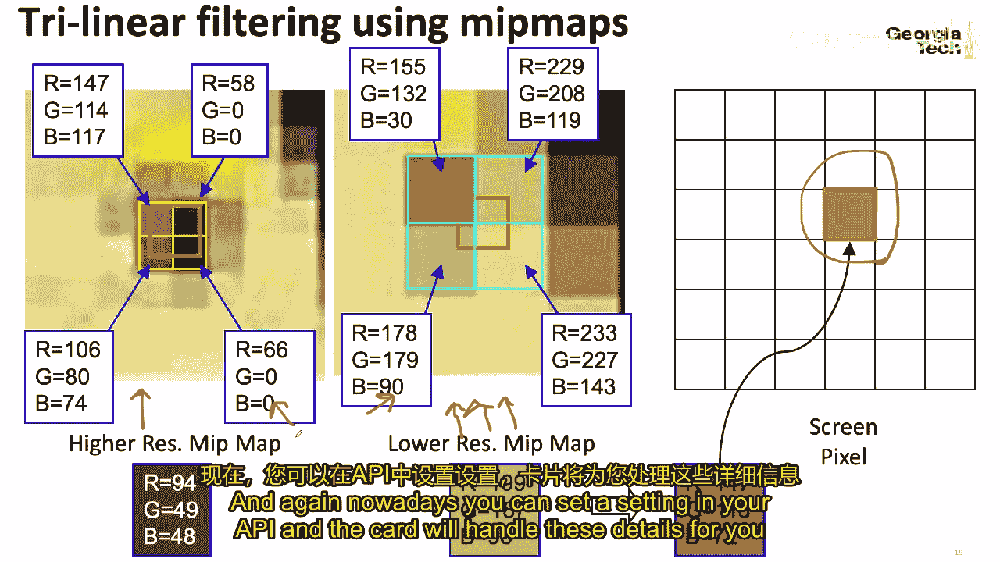

## 总结

本节课中，我们一起学习了纹理的基础知识。我们了解到纹理是应用于3D模型表面的2D图像，通过纹理坐标进行映射。我们探讨了纹理的寻址模式（如重复和钳位），并深入研究了纹理过滤这一核心课题，包括处理放大时的最近邻和双线性过滤，以及处理缩小时面临的走样挑战。我们介绍了Mipmapping作为解决远处纹理走样和优化性能的关键技术，并简要提及了三线性过滤和各向异性过滤等更高级的过滤方式。现代图形API和硬件为我们处理了大部分复杂细节，但理解其背后的原理对于进行图形编程和性能优化至关重要。

---

**（课程互动部分）**

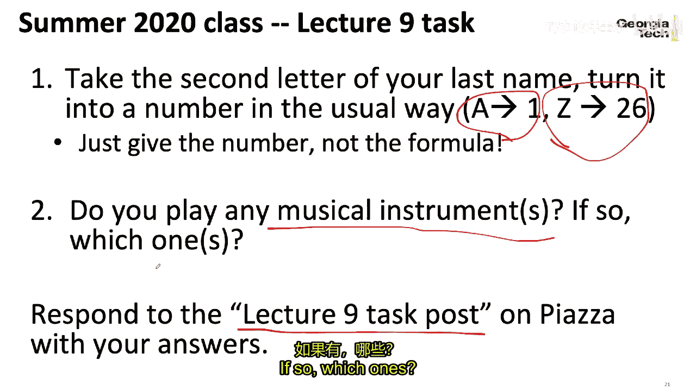

