# 010：高级纹理技术 🎮

在本节课中，我们将学习如何超越简单的颜色贴图，利用纹理存储和计算其他类型的信息，例如表面法线、环境反射和透明度。这些技术是现代3D游戏和图形应用中的核心组成部分。

大家好，我是Er Lanchman，佐治亚理工学院电气与计算机工程系的教授。欢迎来到2020年夏季的“视频游戏GPU编程”课程。

这里的标题可能有些误导，我们今天要看的这些技术并不特别奇特。几乎所有现代3D引擎都会使用它们，任何现代GPU都能轻松处理。但这些技术展示了如何将纹理用于物体基本RGB漫反射颜色之外的其他用途。

## 法线贴图技术 🧭

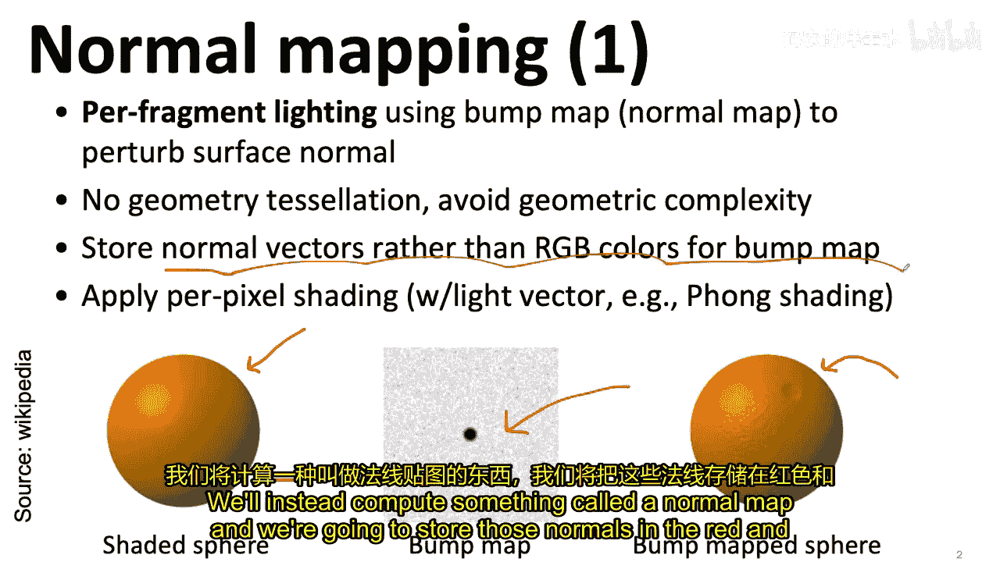

上一节我们介绍了纹理的基本概念，本节中我们来看看如何用纹理来模拟复杂的表面细节，而无需增加模型的几何复杂度。游戏中最常用的技术之一称为法线贴图。你也会看到凹凸贴图这个术语，虽然有人认为两者有细微差别，但我倾向于互换使用它们。其核心思想是，仅由顶点定义的物体看起来可能有些单调。

我们希望能在物体表面添加额外的细节，例如，在不增加三角形数量的情况下表现出粗糙的表面。这里我们指定了一个凹凸贴图，也称为高度图。此处的灰度值表示表面上方的高度扰动。然后，我们可以使用该高度图来渲染物体，从而得到例如这个看起来很酷的橙子。这个橙子的几何形状与球体的几何形状相同，这里没有额外的顶点，这完全是利用凹凸贴图信息在光照计算中实现的一种技巧。

如今渲染算法中实际使用的并不是原始的凹凸贴图，而是会计算一种称为法线贴图的东西。我们将把这些法线存储在纹理的红色、绿色和蓝色通道中。

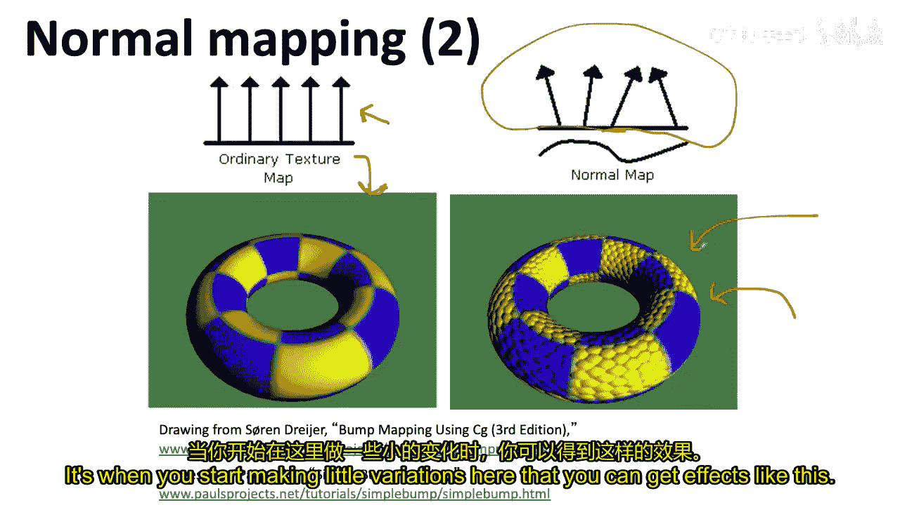

以下是另一个例子。我有一个漂亮的小环面，也就是甜甜圈。它上面有一个漫反射纹理，但看起来有点单调。所以，在右边这里，顶点几何形状完全没有改变。这是使用法线贴图在光照计算中实现的效果。

法线贴图表示对顶点法线插值得到的原始向量的一种扰动。如果你使用一个看起来像左边这样的法线贴图（所有法线都笔直向上），你会得到这个基础物体，看起来就像完全没有应用法线贴图一样。法线贴图中各个纹素上的箭头如果笔直向上，你可以认为它们是指向表面正外的，因此不会扰动任何法线。只有当你开始在这里制造微小的变化时，才能获得像这样的效果。

## 法线贴图的生成与原理 🛠️

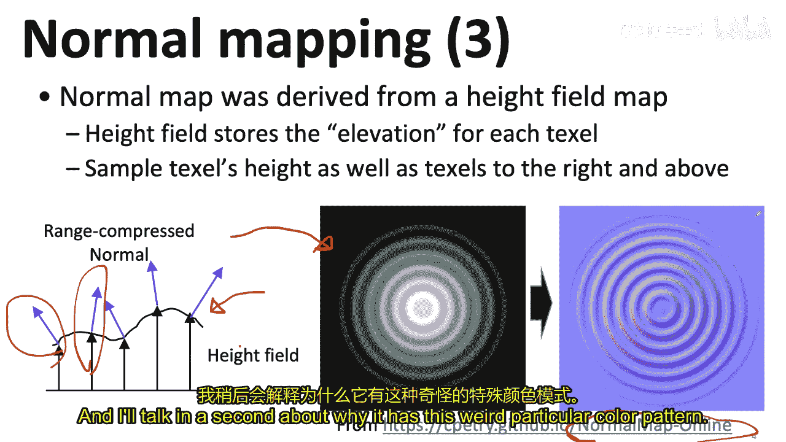

上一节我们看到了法线贴图的效果，本节中我们来看看它们是如何生成的。法线贴图可以通过不同的方式创作。通常，艺术家会先创建一个高度图，即用灰度表示高度的图像，例如在Photoshop中。左边这里有一个二维概念示例，其中纹理的灰度值表示高度变化。然后，你可以通过一个软件来处理它，该软件将使用高度信息，并推测表面各点法线的扰动方向。

像Unity这样的游戏引擎，以及许多其他引擎，都提供了在其编辑软件中从高度图创建法线贴图的功能。你也可以编写自己的工具或使用他人的工具。让我们看一个可以在网上找到的法线贴图示例。你可以加载其中一个高度图，它会为你提供一个法线贴图，如右图所示。我稍后会解释为什么它具有这种奇怪的特殊颜色模式。

要计算法线，你基本上需要沿着各个方向获取高度场的偏导数。这里我们本质上是在使用一种微积分技巧，利用水平和垂直方向的一阶差分来计算这些偏导数的近似值。

我们需要将得到的法线归一化，使其具有单位长度。如果你推导一下数学公式，你会发现你真正需要做的就是设置Z坐标为1（即向上的坐标），然后除以它的长度即可。

因此，在法线为 (0, 0, 1) 的地方，对应没有红色、没有绿色，全是蓝色。这表示没有扰动，即围绕你物体的光滑表面。

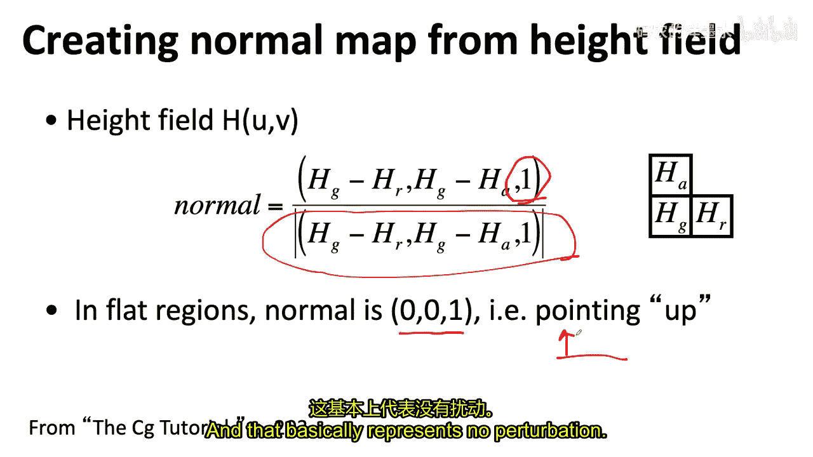

这就是为什么你通常会在法线贴图中看到这些大的蓝色区域。你会看到红色出现在像这样的区域，因为它代表了水平方向的变化。你会看到绿色出现在像这样的区域，因为它代表了垂直方向的变化。

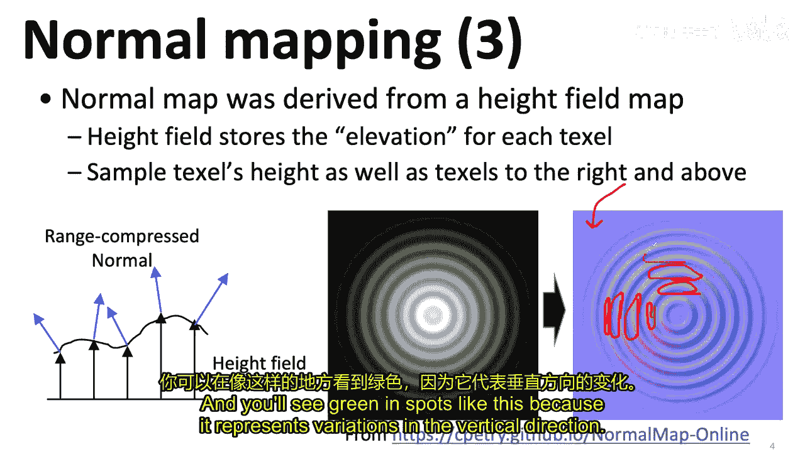

## 法线贴图的实际应用 💡

上一节我们了解了法线贴图的原理，本节中我们来看看它在实际渲染中如何提升效果。在过去，你没有太多的计算能力来进行复杂的光照处理，所以艺术家们经常在像Photoshop这样的软件中创建的纹理里包含阴影效果。你会看到90年代的很多游戏都有特定的外观，但这些阴影并不十分真实。

如今，你希望用于漫反射光照的主颜色贴图本身不包含任何光照信息。如果你使用照片作为主要来源，你确实希望获得一种场景光线均匀、物体正面朝向的情况。这样，你就可以将不同位置灯光的效果放入实时计算中，而不是已经烘焙到纹理里。

但即使你这样做了，如果你只是把它贴在墙上并移动灯光，它看起来就像有人给这面墙贴了墙纸。你真正想要的效果是，当灯光移动时，能看到所有这些角落和缝隙的变化。我们可以在进行光照计算时加入法线贴图信息。

这里你看到了类似的一般效果。所有深蓝色的地方都相对平坦。但在你会看到红色和绿色的地方，你会看到光照因为法线向量被扰动而发生变化。

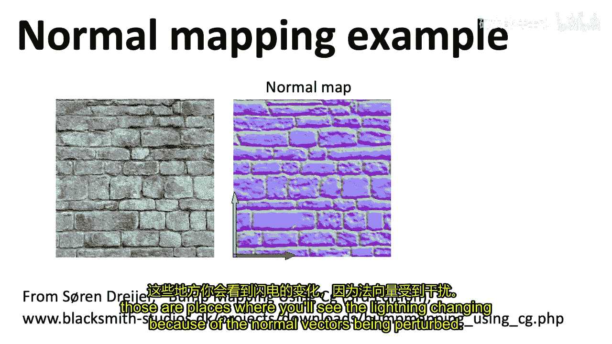

然后，如果我们加入这些信息，就可以得到像右边这样的图像，如果我们移动灯光，效果会更加显著。本讲座基本上是对我们稍后将详细研究的一些技术的预览。我稍后会向你展示如何在着色器代码中实现这一点，并使用Unity进行一些物体旋转和灯光飞行的演示。这只是对我们稍后将详细研究的技术的一个小预告。

这是一个使用纹理的RGB颜色条目来表示非RGB颜色信息的例子。这里有一个小难点，虽然我们法线的Z值将是正的（在0到1之间，不能为负，因为那将指向物体内部），但即使总长度需要等于1，X和Y值本身也可能向下摆动到-1。而我们的RGB颜色必须是正的，特别是现代着色器硬件可能期望它们在0到1之间。

我们可以在着色器代码中轻松处理这个问题。我们还没有看过着色器代码，但我假设使用C++、C#、JavaScript等具有花括号和分号的语言。我们将取法线值，然后乘以0.5，这样我们就得到了从-0.5到0.5的值，然后再加上0.5，得到0到1之间的值。这就是我们在创作这些法线贴图纹理时需要做的。然后，在着色器代码中，当我们读回该值时，我们将减去0.5以将其放回-0.5到0.5的范围，然后乘以2以恢复-1到1的范围。这只是使用纹理中的颜色通道来表示渲染中实际颜色之外的某种信息的一个例子。

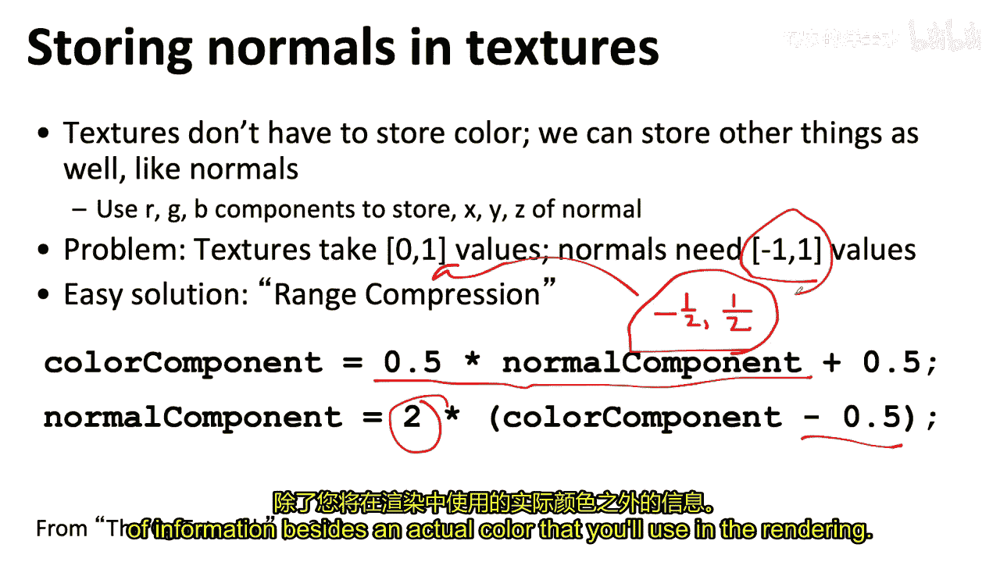

## 立方体贴图与环境反射 🌐

上一节我们探讨了用纹理存储法线信息，本节中我们来看看另一种完全不同的纹理类型。这是另一种技术，这里的纹理值确实是RGB颜色，但这是一种非常不同的纹理，称为立方体贴图。你可以想象走到户外，拿起相机，分别指向上下、左右、前后，每次指向一个方向时拍一张照片。然后把这些照片加载到Photoshop中，花大量时间试图让边缘完美对齐。这样你就构建了一个对场景整体光照环境的描述。这是基于图像的照明的基础，我们稍后会详细研究。

目前，最主要的是这使我们能够制作一些非常酷的反射效果。你可以通过拍照或以其他方式创作自己的立方体贴图，也可以在3D渲染软件中完成，不一定受限于游戏引擎的能力。Unity和其他游戏引擎可以为你创建这些立方体贴图，可以在场景开始时创建并使用，也可以在游戏过程中更新它们。现在，这将非常耗费计算资源，唯一能真正节省资源的是你可以以较小的分辨率渲染这些立方体贴图，仍然可以获得不错的效果。你也可以使用一些技巧，比如不每帧都更新，或者循环更新六个方向，每帧只更新其中一个。但如果你愿意花费额外的计算时间，那么你的立方体贴图就可以反映环境中物体移动、进入和离开场景的动态变化，并可以反映在你的反射效果中。

这里的茶壶以镜面反射的方式对光做出反应。这与我们目前看到的漫反射光照非常不同。

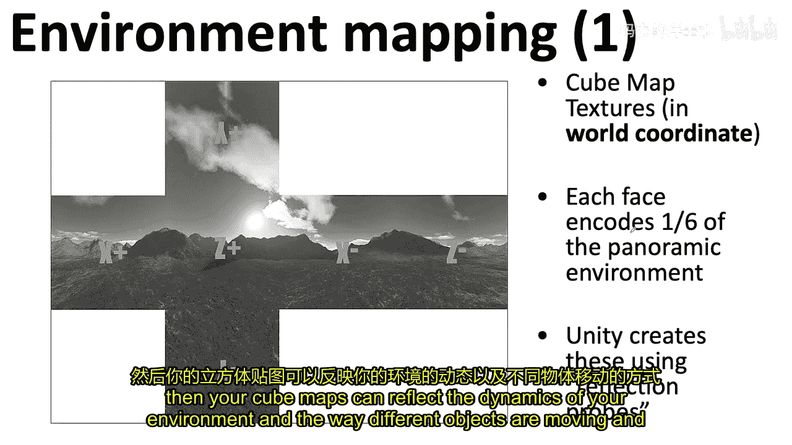

现代游戏中用于镜面反射的模型相当复杂，所以我们稍后会花一整节课来讨论。但现在，让我们只做一些完美的镜子，并假设你的物体完美地反射来自立方体贴图的环境光。

这与漫反射光照非常不同。这里不是指定特定的光源，光线可以说是来自所有方向，并且相机的位置与最终效果的外观非常相关。对于漫反射光来说并非如此。漫反射光照背后的整个思想是，光线无论从哪个方向入射，都会在表面反弹，并大致均匀地射向各个方向。在这里，要确定我们在特定点看到什么，我们需要取这条光线，围绕表面的法线反射它，以确定我们想在立方体贴图中查找的位置。我不打算在这里做几何推导，着色器语言中通常内置了计算反射光线的命令。如果没有，你可以用这个公式来实现。

要查找立方体贴图中的内容，着色器语言通常也有一个特定的命令来处理。

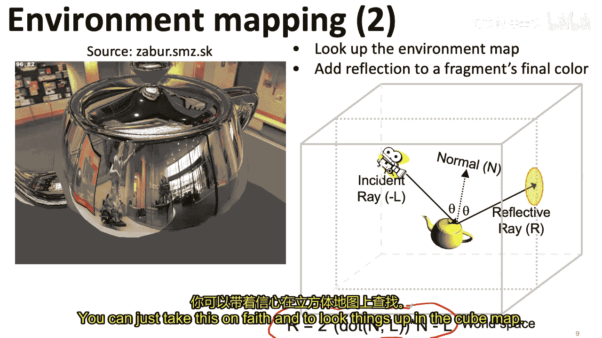

我们稍后会看到，要进行通常的纹理查找，我们会使用类似 `tex2D` 的东西，并给它纹理坐标（根据你的特定约定，指定为 `(u, v)` 或 `(s, t)`）。但 `texCube` 不同，你实际上要给出一个3D向量。这个向量不需要归一化，只要它指向正确的方向，它就会为你找出它击中了六个纹理中的哪一个，哪个面是相关的，然后从该特定图像中获取适当的纹素（如果需要，可以进行插值）。这种效果在詹姆斯·卡梅隆的电影如《深渊》和《终结者2》中得到了推广。这两部电影都有大量闪亮反射表面的CGI。在当时，这些是离线计算的，无法实时进行这类计算，因为没有足够的计算能力。

这是我们展示的第一个立方体贴图纹理示例，你可以在这里同时看到背景中的立方体贴图图像以及它在球体上的反射。如果你想更有趣，实际上可以组合这些技术。你可以在球体上放置法线贴图，给它一个粗糙的表面，那看起来会非常棒。我们稍后会做类似的事情。

## Alpha通道与透明度 ✨

上一节我们介绍了立方体贴图，本节中我们来看看纹理的第四个通道——Alpha通道。我一直在使用RGB这个术语，但GPU喜欢以四为一组处理所有事情，当我们使用齐次坐标时，我们有XYZW作为第四维。因此，继续为我们的RGB添加一个分量是合理的，这第四个分量称为Alpha。

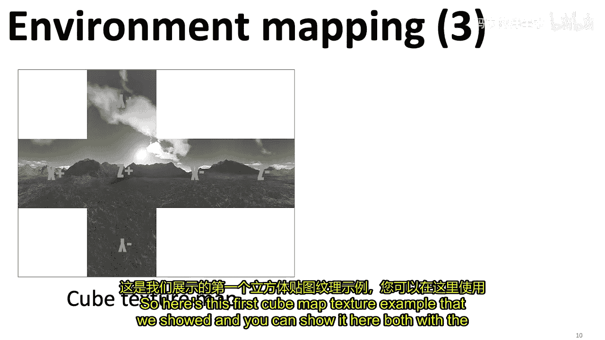

你可以将这个Alpha通道用于各种信息。例如，稍后当我们研究镜面反射模型时，我们会看到定义镜面反射如何工作的光滑度参数，你可以把它放入Alpha通道，并让它随物体表面变化。但在大多数实际应用中，Alpha用于透明度信息。

在这个特定情况下，如果我们只有这些黑白线条的RGB纹理，你只会渲染并看到黑白线条。但你可以以不同的方式使用Alpha信息，你可以使用该Alpha来决定纹理的哪些部分应该实际被渲染。你会发现人们使用这类效果不仅是为了把超级反派关进监狱，还用于像栅栏这样的东西。因此，与其为栅栏的每个柱子单独建立一个3D物体，你实际上可以有一个大的栅栏墙，并指定柱子之间的区域被“镂空”。

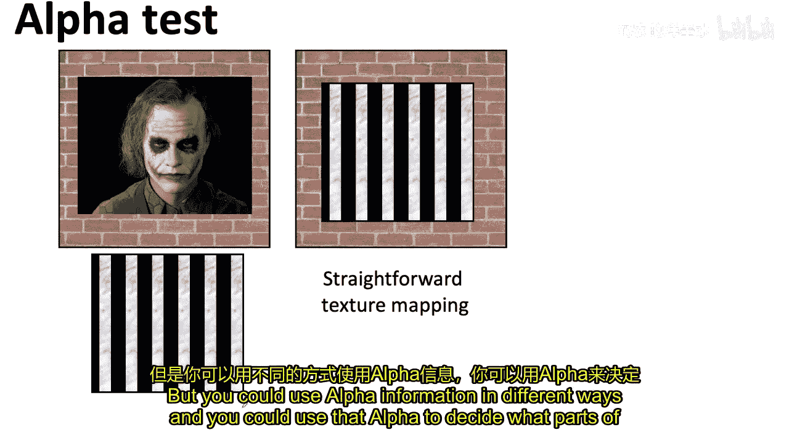

这样，那些部分就不会被渲染。你也看到这个技巧用于植被，比如草。如果你仔细观察草，他们可能没有为每一片草叶单独建立一个3D物体，你可能只是有一块草的贴图，使用Alpha来透过纹理中的单个草叶。Alpha不一定非要是全开或全关的东西，你也可以用它来表示透明度程度，你可以部分地看到后面被写入的对象。你需要确保透明物体在渲染过程中比不透明物体更晚绘制。

## 烘焙光照贴图 🍞

作为纹理创造性使用的最后一个例子，像《雷神之锤》这样的老游戏通常会有一个预先制作的光照贴图，你可以将其与一些基本纹理结合，以将静态灯光在静态表面上的效果烘焙进去。这对于漫反射反射是合理的，显然无法处理镜面反射，因为那是随着相机移动而变化的动态效果。这也是我们将在以后的讲座中研究的内容。它也无法处理可能移动的灯光或可能移动的物体。

你可以通过混合来获得不同的效果。我应该澄清，这不一定只是老游戏才使用的技术。现代游戏也会使用大量烘焙的光照贴图。当你进行这种烘焙时，可以节省实时计算，并且还可以融入一些复杂的间接光照效果，这些效果即使使用相当强大的GPU也无法实时实现。我们稍后会研究其中一些问题。

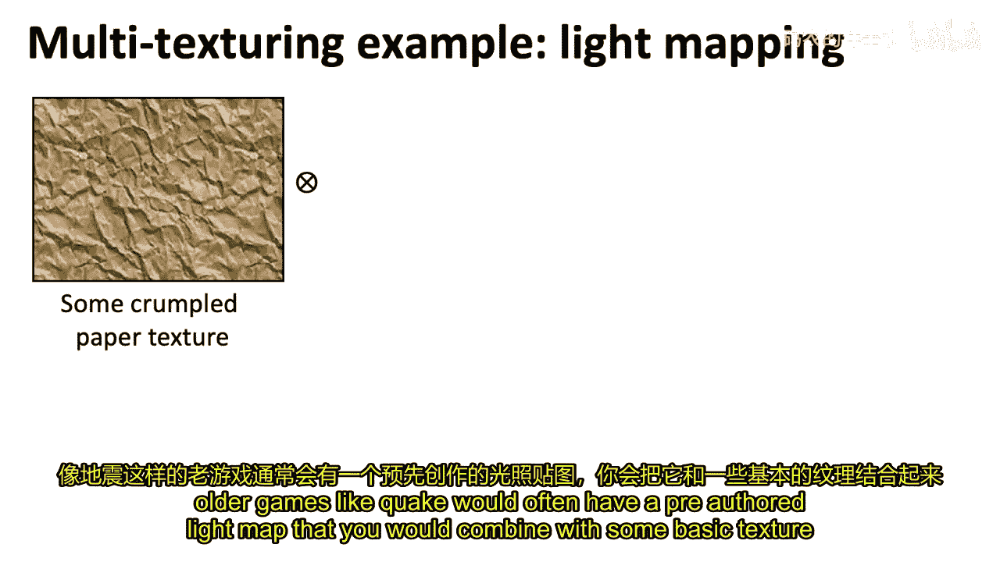
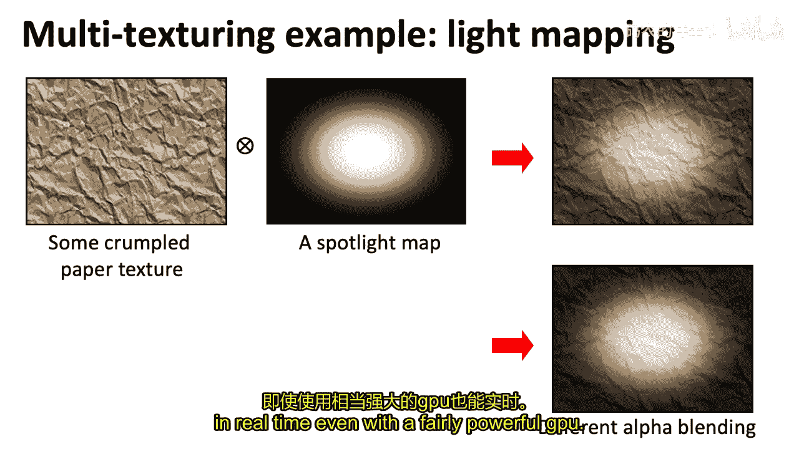

特别是，我们将研究将预烘焙光照与动态光照结合的不同方式，并使它们协同工作，产生合理的效果。

## 总结 📚

在本节课中，我们一起学习了多种高级纹理技术。我们从**法线贴图**开始，了解了如何利用纹理的RGB通道存储表面法线扰动信息，从而在不增加几何复杂度的前提下模拟丰富的表面细节。其核心是将高度图转换为法线向量并编码到纹理中，在着色器中通过公式 `normal = (texColor * 2.0 - 1.0)` 进行解码和归一化后用于光照计算。

接着，我们探讨了**立方体贴图**，它用六张纹理构成一个包围盒，用于模拟环境反射。通过计算视线在表面的反射向量，并使用 `texCube` 指令进行采样，可以实现逼真的镜面反射效果。

然后，我们介绍了纹理的 **Alpha通道**，它最常见的用途是定义像素的透明度，从而实现如栅栏、植被叶片等部分的镂空或半透明效果。渲染时需要确保透明物体在不透明物体之后绘制。

最后，我们提到了**烘焙光照贴图**，这是一种将静态光照效果预先计算并存储到纹理中的技术，可以显著提升视觉质量并节省运行时开销，常与动态光照结合使用。

这些技术展示了如何创造性地利用纹理存储远超颜色本身的信息，是现代实时图形渲染的基石。