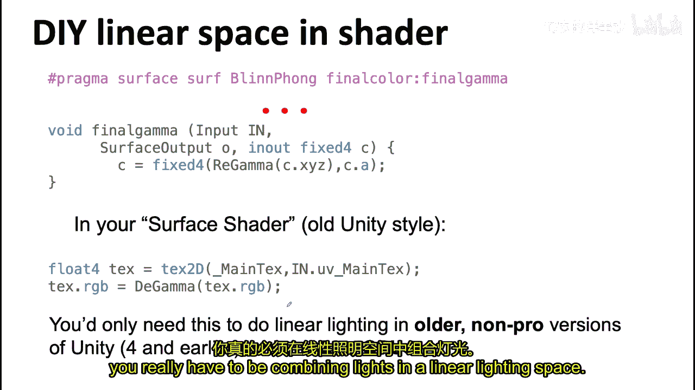
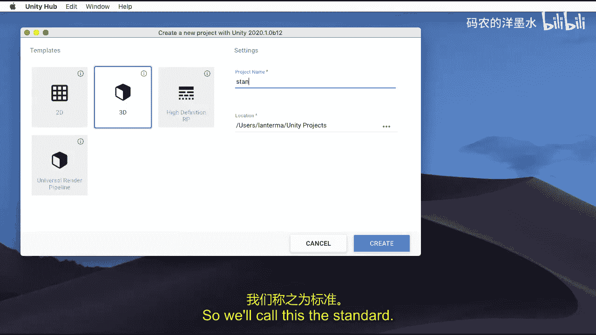
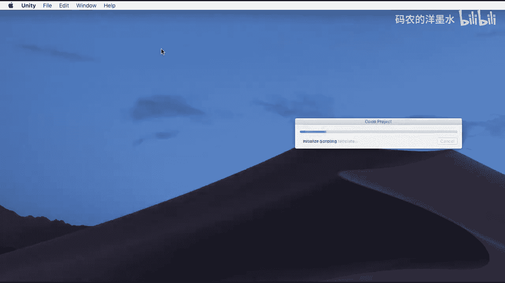
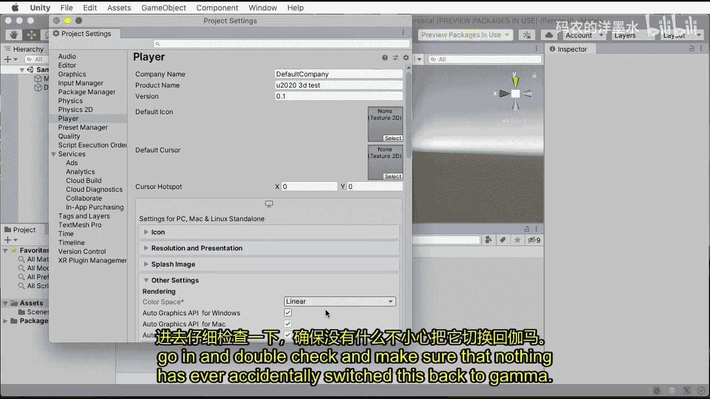
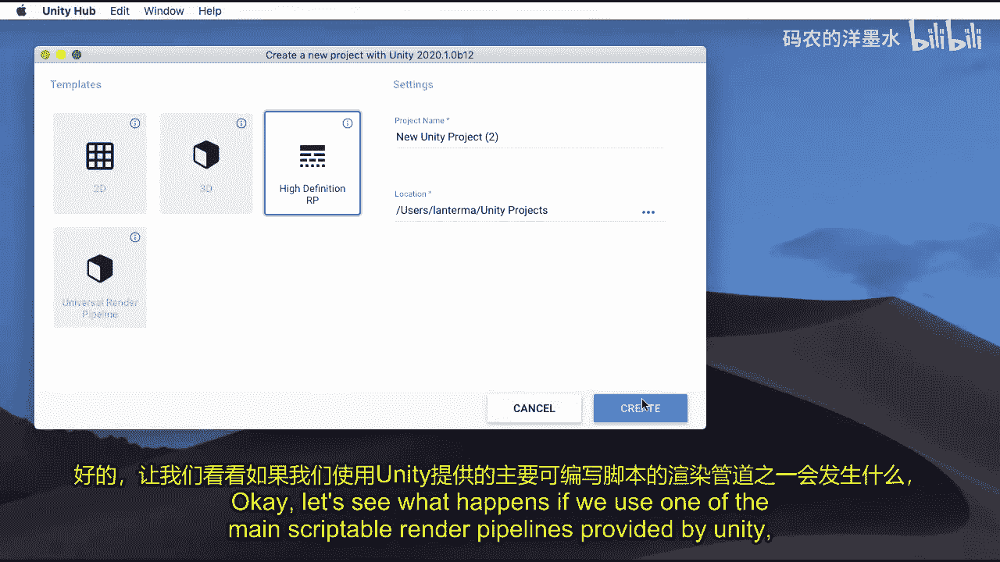
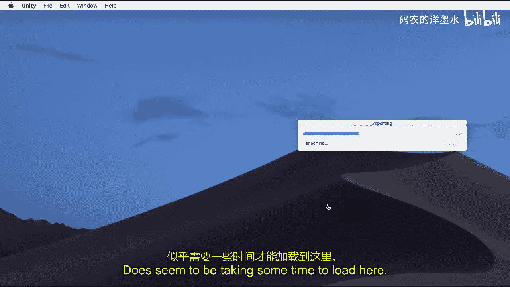
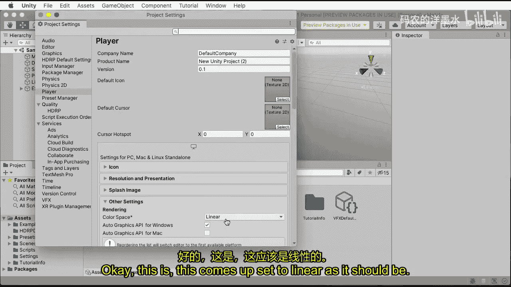
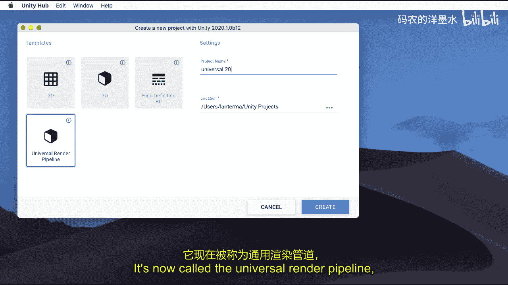
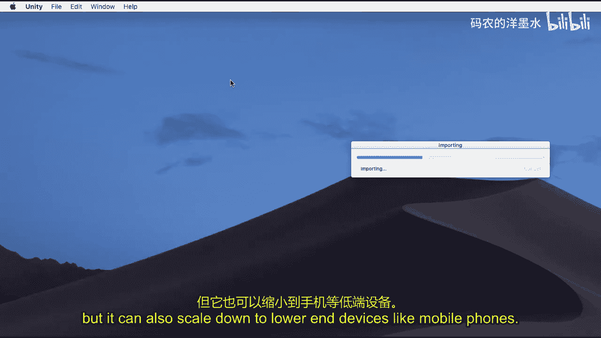
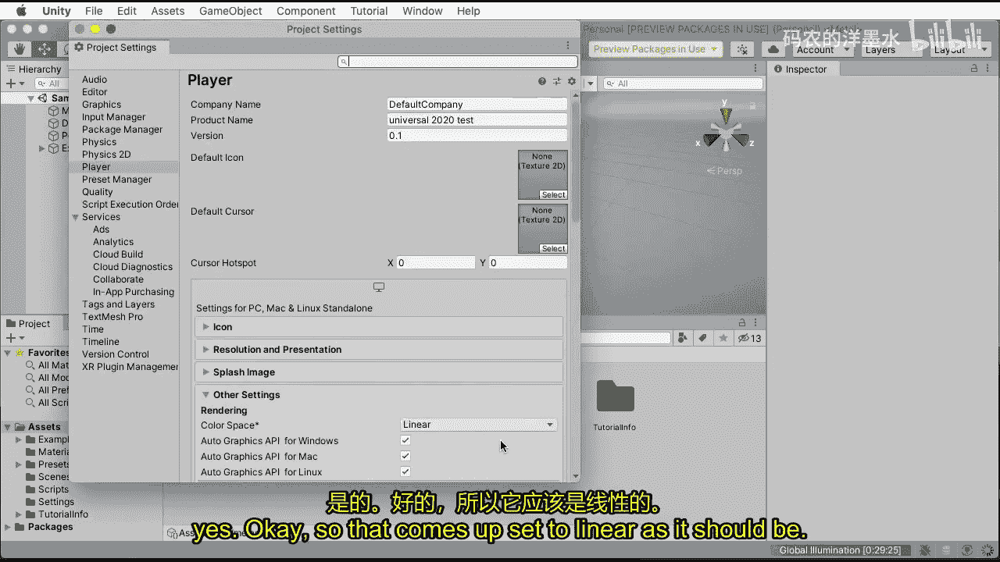

# 011：色彩空间 🎨

## 概述
在本节课中，我们将学习计算机图形学中一个关键但常被误解的概念：色彩空间。我们将探讨为何图像存储和显示的方式并非线性，以及这如何影响游戏和图形应用中的光照计算与图像混合。理解并正确处理色彩空间，对于实现逼真的渲染效果至关重要。

---

## 历史背景与核心问题
上一节我们概述了色彩空间的重要性，本节中我们来看看其历史成因。早期的阴极射线管（CRT）显示器和电视，其显示亮度与输入的数值（如电压或8位值）并非呈线性关系。

你可以将其输出亮度的关系近似理解为对输入值进行**幂运算**，例如取输入值（范围0到1）的**2.2次方**。为了简化讨论，我们常使用**平方**（即2次方）来类比。由于输入值小于1，平方运算会使其变得更小。

这意味着，如果直接将记录原始光强度的图像显示在旧式CRT上，图像会显得过暗。因此，几乎所有的消费级相机在存储图像前，都会预先应用一个校正，这个校正近似于对输入的光强度值进行**开方**运算（例如平方根）。这样，相机的校正（开方）与显示器的非线性响应（平方）相互抵消，最终输出正确的亮度。

当然，这里简化了许多细节，并且没有涉及人类感知光线的复杂方式。但在大多数情况下，这不会造成问题。我们可以用一个公式来描述这个理想过程：
```
存储值 = sqrt(实际光强度 A)
最终输出亮度 = (存储值)^2 = A
```

---

## 混合图像时的问题
上一节我们介绍了在简单显示场景下色彩空间的工作原理，本节中我们来看看当需要混合或叠加图像时会出现什么问题。这个问题不仅存在于3D计算机图形学中，也出现在像Photoshop这样的图像处理软件中（常被称为sRGB色彩空间，这也是一个简化说法）。

回到计算机图形学的案例。假设你有一个3D物体，并用一盏灯照亮它，这没有问题。但如果你用两盏灯照明呢？纹理通常以经过校正（即开方后）的值存储。

如果我们在着色器代码中直接以这种“伽马空间”下的值进行光照叠加计算，例如将 `sqrt(A)` 和 `sqrt(B)` 相加，然后显示器再对这个和进行平方运算，就会得到：
```
最终输出 = (sqrt(A) + sqrt(B))^2 = A + B + 2 * sqrt(A * B)
```
我们得到了期望的 `A + B`，但也引入了一个额外的交叉项 `2 * sqrt(A * B)`，这会导致渲染结果不准确。

多年来，许多游戏使用这种“伽马空间”进行光照计算，玩家也能接受。但主要问题在于，场景中的一组灯光参数只对那个特定场景有效。美术师需要花费大量精力调整灯光，以掩盖这种不准确性。如果有人后来尝试在场景中添加一盏新灯，或者专业的电影灯光师来操作，他们会发现游戏引擎中的灯光叠加方式不符合他们的物理直觉和行业惯例。

> 注：为了简化数学描述，我们使用了平方和平方根。实际上，真实世界使用的幂值更接近 **2.2** 和 **1/2.2**。

---

## 解决方案：线性空间光照
上一节我们看到了在伽马空间下混合光源的问题，本节中我们来看看标准的解决方案。核心思路是：在读取纹理时，立即进行“平方”运算（即从sRGB转换到线性空间），然后在**线性空间**下进行所有的数学计算（如光照叠加），最后在将最终像素值写入帧缓冲区（准备显示）之前，再进行一次“开方”运算（即从线性空间转换回sRGB）。

以下是实现此流程的步骤：
1.  **纹理读取时转换**：从纹理中读取颜色值时，将其从伽马空间转换到线性空间。
2.  **线性空间计算**：所有着色器计算（光照、混合等）均在线性空间中进行。
3.  **输出前转换**：将最终计算出的线性空间颜色值转换回伽马空间，以便正确显示。

现代GPU通常内置硬件支持这种转换。你可以在图形API（如Vulkan、DirectX）中设置，让GPU在采样纹理时自动进行到线性空间的转换，并在写入帧缓冲区时自动转换回伽马空间。这节省了宝贵的着色器指令周期。



---





## Unity引擎中的色彩空间设置
上一节我们介绍了线性空间光照的原理，本节中我们来看看如何在流行的Unity游戏引擎中配置它。

在Unity的早期版本（如Unity 4）中，正确的线性空间光照是“专业版”独有的功能。如果使用免费版，开发者必须在自己的着色器代码中手动编写转换函数，这会消耗额外的着色器性能。从Unity 5开始，Unity大幅统一了免费版和付费版的功能，线性空间光照成为所有版本的标准支持功能，这对于推行基于物理的渲染至关重要。

以下是检查与设置Unity项目色彩空间的步骤：





1.  打开 **Project Settings**。
2.  选择 **Player** 设置面板。
3.  在 **Other Settings** 部分找到 **Rendering** 子项。
4.  将 **Color Space** 从默认的 **Gamma** 更改为 **Linear**。



> **重要建议**：对于任何涉及3D图形和光照的项目，都应使用 **Linear** 色彩空间。仅在某些纯2D精灵游戏且无动态光照的情况下，才考虑使用Gamma空间。



Unity目前提供了不同的渲染管线，它们对色彩空间的处理方式如下：
*   **内置渲染管线（旧版）**：如上所述，需在Player设置中手动将色彩空间从默认的Gamma改为Linear。
*   **高清渲染管线（HDRP）**：专为高端平台设计，默认使用Linear色彩空间。
*   **通用渲染管线（URP，原名轻量级渲染管线）**：面向多平台，可缩放，默认也使用Linear色彩空间。



---





## 总结
本节课中，我们一起学习了色彩空间这一核心概念。我们了解到，由于历史原因，图像的存储和显示过程存在非线性转换（伽马校正）。直接在存储值（伽马空间）下进行光照混合计算会导致错误。正确的做法是**在线性空间中进行所有光照和颜色计算**，这需要我们在读取纹理时进行转换，并在输出到屏幕前再次转换。现代GPU和Unity等引擎已提供硬件和软件支持来高效处理这些转换。确保你的项目设置为线性色彩空间，是实现逼真、正确渲染效果的基础步骤。