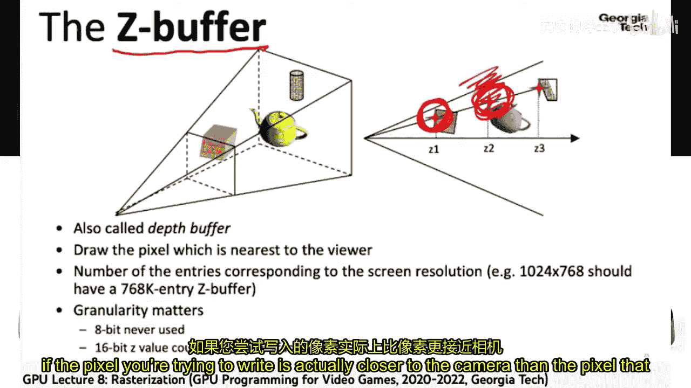
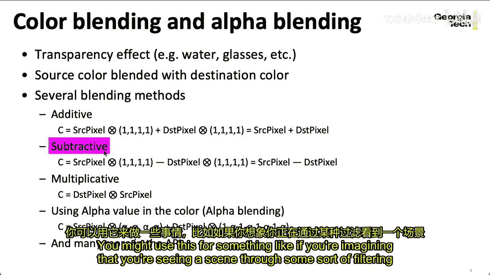
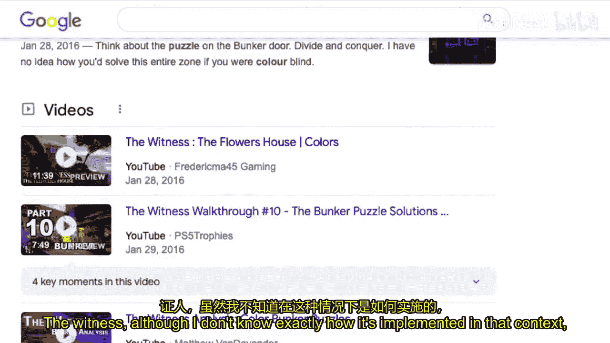
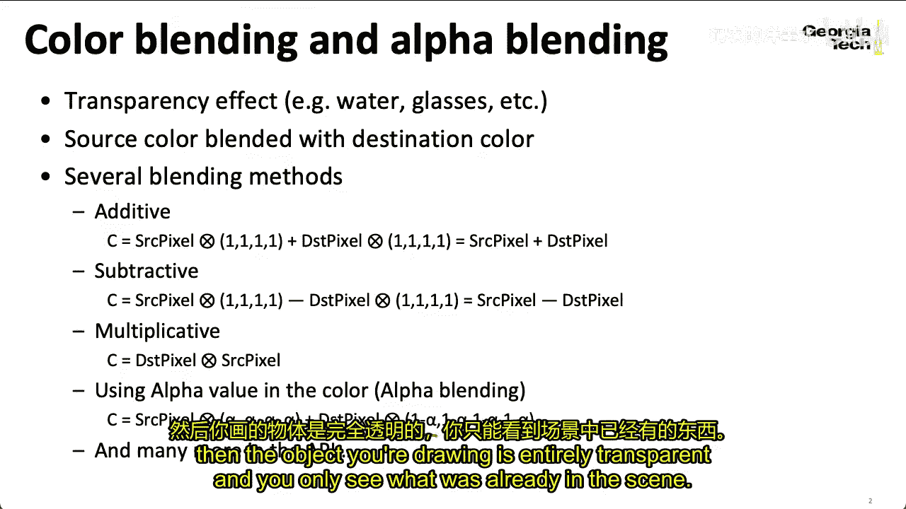
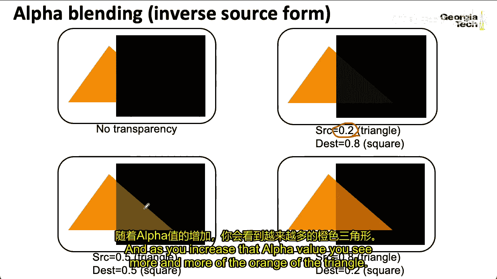
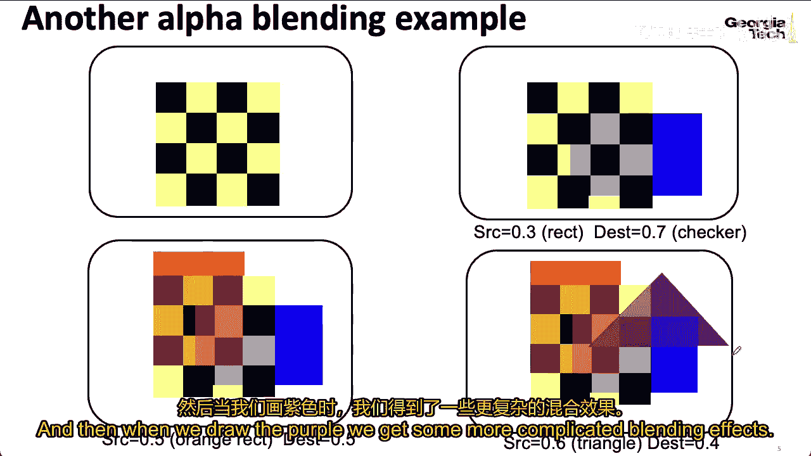
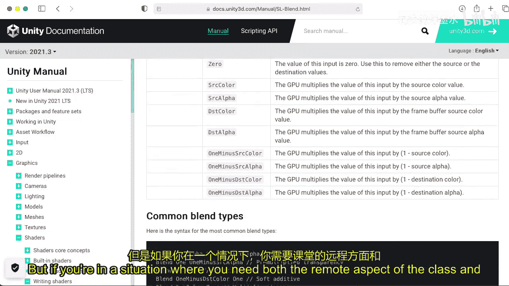
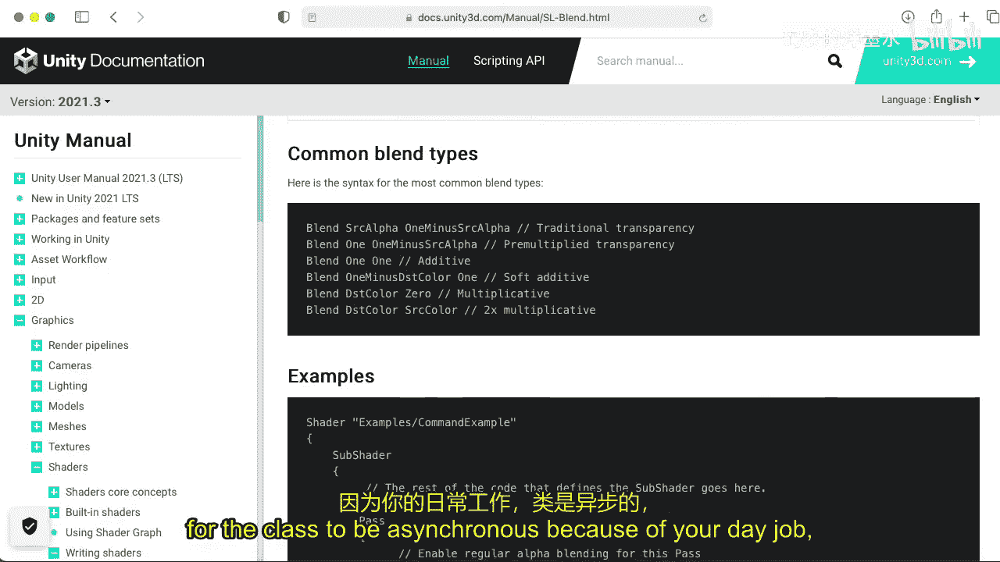
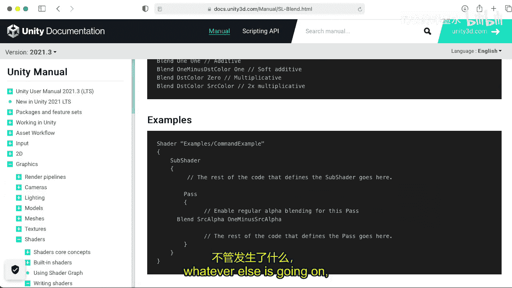
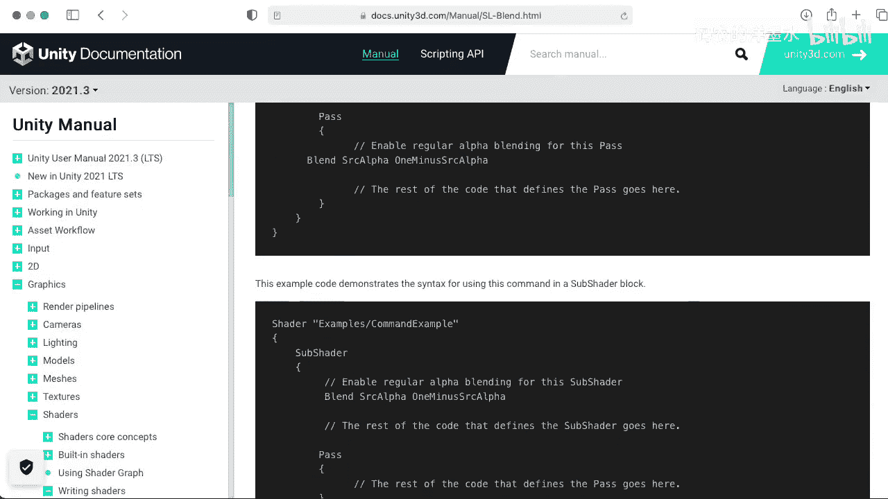

# 012：混合技术

在本节课中，我们将要学习GPU编程中的混合技术。混合技术允许我们将新绘制的像素颜色与帧缓冲区中已有的颜色进行组合，而不是简单地覆盖，这对于实现透明度、用户界面元素等视觉效果至关重要。

---

在之前的GPU编程课程中，我们通常假设，当你向帧缓冲区写入一个像素时，你会将当前像素的深度与Z缓冲区中已存储的深度值进行比较。如果该像素位置之前已被写入过，你通过比较来决定是否写入。基本上，只有当新像素比缓冲区中已有的像素更靠近摄像机时，你才会写入新的颜色值和深度值。因此，你总是在覆盖已有的颜色值。

但有时，你可能不希望简单地强制覆盖已有的颜色。你可能希望将当前要写入的像素颜色与已写入的某种颜色值进行混合，以实现诸如透明效果等功能。这可以用于渲染某种幽灵般的人物，或者渲染可以看透的着色窗户。这类技术也常用于用户界面元素。

通过使用API中的不同调用，你可以设置不同的混合模式，例如相加颜色、相减颜色。相减模式我见到的使用频率不高，它可能用于模拟通过某种滤镜镜头观察场景的效果。如果我没记错，在Jonathan Blow的游戏《见证者》中有一个类似的谜题，尽管我不清楚其具体实现方式。你也可以将像素值相乘，但据我所知，这些模式并不常用。

最常用的混合模式是**Alpha混合**。在这种模式下，新的颜色值是源像素和目标像素的加权组合，其权重由一个介于0到1之间的混合因子**alpha**决定。通常，这个alpha值就是纹理的实际Alpha通道分量。

以下是Alpha混合的核心公式：

**`新颜色 = (源颜色 * 源Alpha) + (目标颜色 * (1 - 源Alpha))`**

如果alpha值为1，那么你正在绘制的物体完全不透明，你将看不到它背后已有的任何内容。如果alpha值为0，那么你正在绘制的物体完全透明，你只能看到场景中已有的内容。

多年前，我的同事Sha Lee仅用PowerPoint就创建了这个演示。这里没有使用任何花哨的3D API。想象一下，如果你在没有Alpha混合的情况下，将黑色方块绘制在橙色三角形之上，你会得到类似这样的结果。但如果你以0.2的alpha值绘制它，那么在三角形和方块重叠的地方，你会看到一点三角形与方块混合的颜色。随着你增加alpha值，你会看到越来越多的三角形橙色。这再次说明了这个概念。

以下是另一个例子，也是Sean用PowerPoint制作的。想象你有一个黄黑相间的棋盘格图案。如果你在不使用任何透明效果的情况下绘制一些额外的物体，你可以在它上面画一个蓝色矩形，然后在上面画一个橙色矩形，最后在上面画一个紫色矩形。

如果我们进行同样的绘制，但使用透明效果呢？如果我们混合那个蓝色矩形和之前已有的内容，注意我们最终在这里得到了一些灰色，这是黄色和蓝色重叠并混合的结果。蓝色和黄色是互补色，当它们结合时，你会得到灰色。然后，如果我们绘制橙色，橙色会与黄色部分结合，给你一些带黄色调的橙色。当我们绘制紫色时，我们会得到更复杂的混合效果。你应该明白了大致的概念。

---

本节课中我们一起学习了GPU中的混合技术。我们了解到，混合允许我们通过加权组合源像素和目标像素的颜色来实现透明度等效果，而不是简单地覆盖像素。核心的Alpha混合公式 `新颜色 = (源颜色 * 源Alpha) + (目标颜色 * (1 - 源Alpha))` 是实现这些视觉效果的基础。掌握混合技术对于创建逼真的透明物体、用户界面叠加层和各种屏幕后处理效果至关重要。