# 013：模板缓冲区 🎮

在本节课中，我们将学习GPU中的另一个重要缓冲区——模板缓冲区。我们将探讨它的基本概念、工作原理以及在游戏图形渲染中的实际应用，例如实现镜面效果和阴影。

## 概述

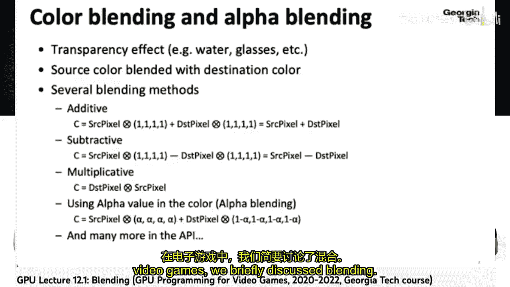

上一节我们简要介绍了混合技术，本节中我们来看看模板缓冲区。模板缓冲区是GPU内存中的另一个帧缓冲区，它允许你选择性地绘制屏幕的某些部分，同时屏蔽其他部分。这在实现特定视觉效果（如驾驶舱遮罩、镜面反射）时非常有用。

## 模板缓冲区的基本概念

我们已经讨论过主颜色缓冲区（最终显示给玩家的画面）和Z缓冲区（用于确定遮挡关系）。模板缓冲区是另一个帧缓冲区，它让你能够选择屏幕的哪些部分需要绘制，哪些部分不需要绘制。

例如，在飞行模拟器中绘制外部场景时，你可以使用模板缓冲区来遮罩掉驾驶舱部分。

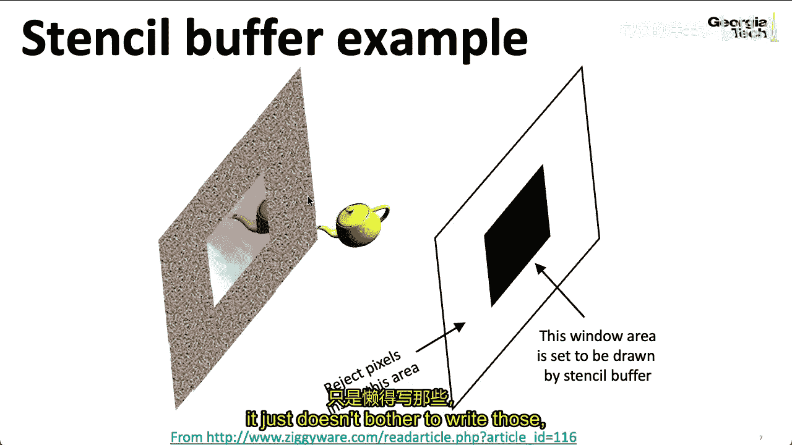

这个示意图来自Zggyware网站（该网站已不存在，但文本内容可在互联网档案馆找到）。其核心思想是：如果你希望最终图像呈现特定效果，你可以预先知道某些部分（如墙壁）会遮挡其他物体（如茶壶）。与其为那些最终不可见的茶壶部分计算Z缓冲区值，不如利用模板缓冲区提前标记出遮挡区域，从而节省计算资源。

以下是其工作流程：
1.  将已知的遮挡结构（如墙壁）信息写入模板缓冲区。
2.  绘制茶壶时，GPU会检查模板缓冲区。
3.  对于与标记为“不绘制”区域重叠的茶壶部分，GPU会直接跳过写入操作。

## 使用模板缓冲区实现镜面效果

模板缓冲区可以用来模拟镜面反射效果。虽然要实现精确的镜面反射，光线追踪是更好的解决方案，但实时光线追踪计算量依然很大。因此，模板缓冲区提供了一种高效的替代方案。

以下是实现镜面效果的基本步骤：

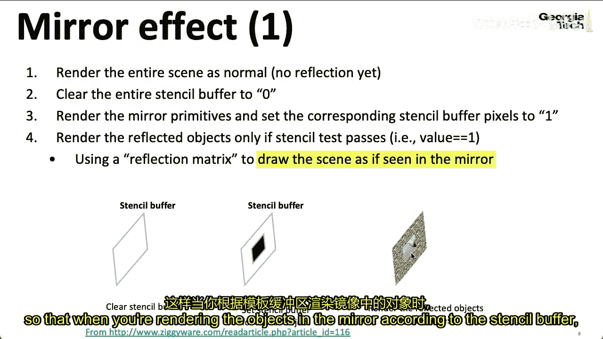

1.  **渲染标准物体**：首先，渲染所有非镜面的常规物体。
2.  **准备模板缓冲区**：清空模板缓冲区，然后渲染镜面本身。但此阶段不写入镜面的实际颜色值，而是向模板缓冲区写入一个特定值（例如1），标记出镜面所在的屏幕区域。
3.  **渲染反射场景**：进行第二次渲染。这次，你使用模板缓冲区，只对标记为镜面的区域绘制颜色。关键技巧在于，在模型到世界、世界到视图的变换矩阵序列中，插入一个**反射矩阵**。这个矩阵能沿着镜面平面对场景进行翻转。因此，当你在模板缓冲区标记的区域内渲染物体时，你实际上渲染的是场景的反射影像。

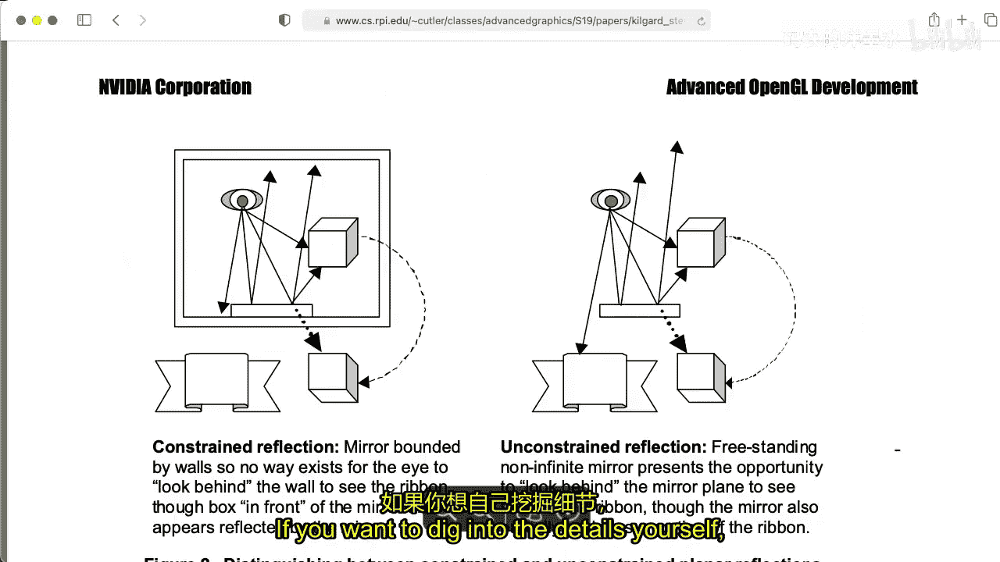

你也可以采用相反的顺序：先完整渲染镜面，再渲染场景中不在镜面内的部分。如果镜面占据了图像的大部分区域，这样做可能出于性能考虑。

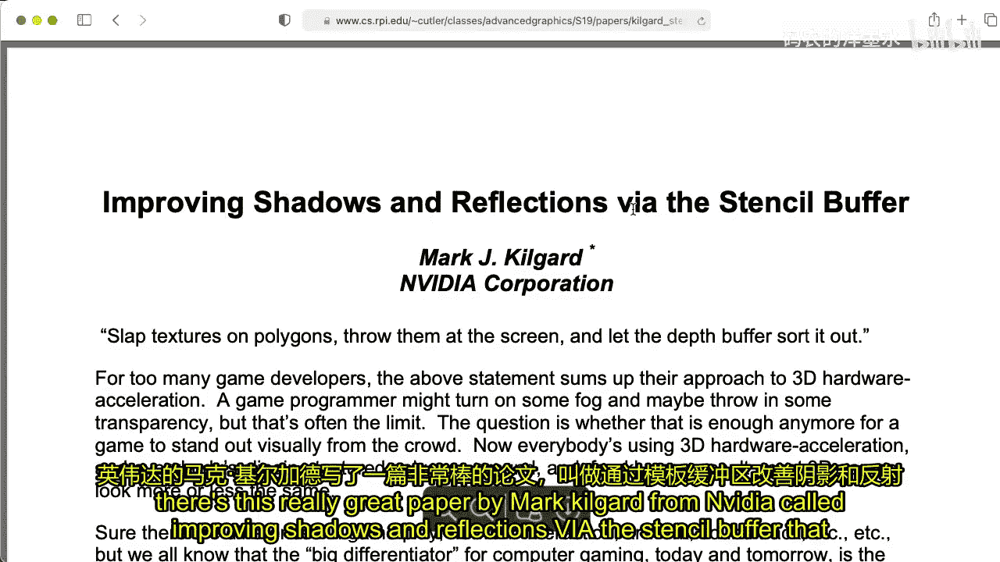

如果你想深入了解此技术，建议查阅NVIDIA的Mark Kilgard所著的优秀论文《*Improving Shadows and Reflections via the Stencil Buffer*》。

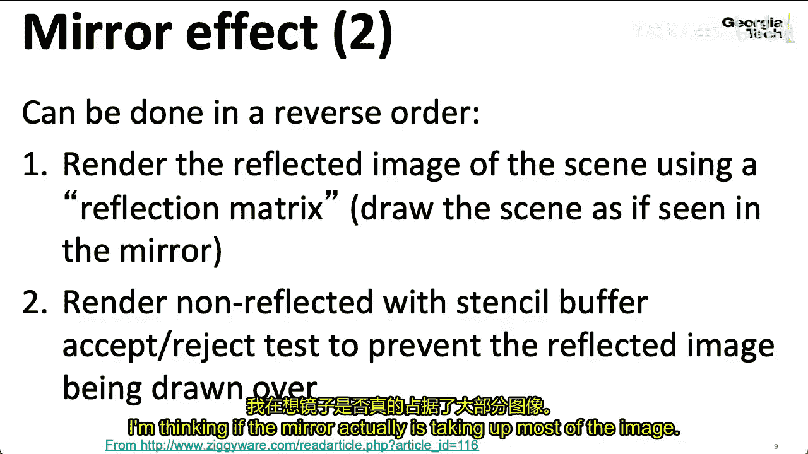

## 模板缓冲区的其他应用：阴影

模板缓冲区还可用于处理阴影，特别是通过一种称为**阴影体**的技术。

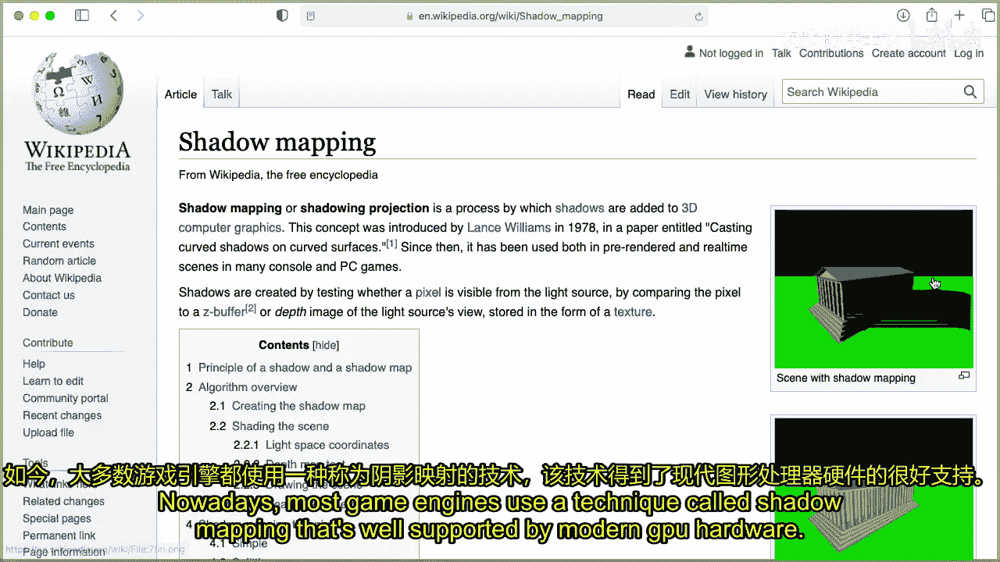

阴影体技术（曾在《毁灭战士3》的引擎中使用）能产生边界清晰的优质阴影。它的一种具体实现称为“深度失败算法”，也称为“Carmack反转”。（注：该算法的专利过程揭示了美国专利系统的一些问题，相关荒谬之处可在其他地方读到。）

然而，阴影体技术需要大量的CPU计算，现已不再流行。目前大多数现代主流游戏引擎（如Unity和Unreal）都使用另一种得到现代GPU硬件良好支持的技术——**阴影映射**。

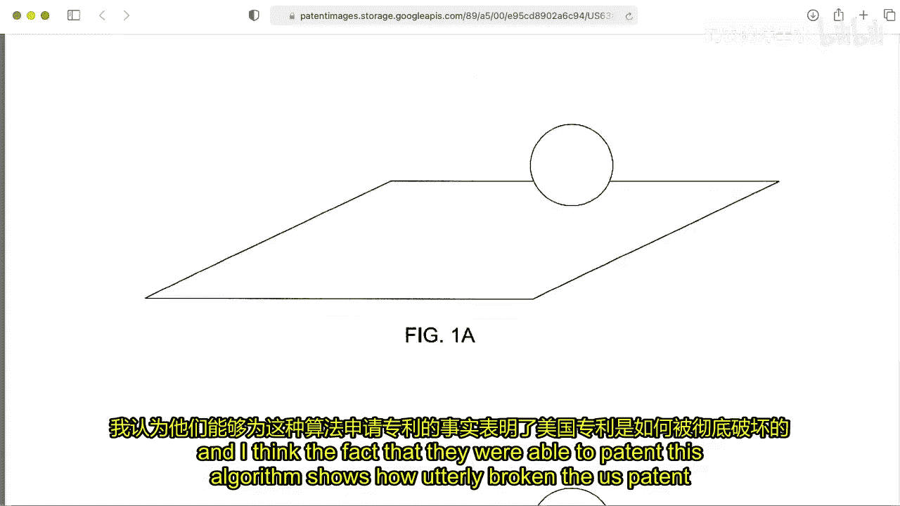

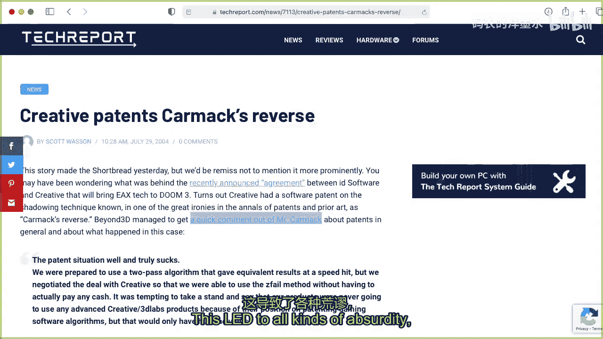

如果你想了解更多关于阴影体的知识，强烈推荐阅读NVIDIA《GPU Gems》中相关的优秀章节，该书现已免费提供在线版本。本课程后续将重点讲解阴影映射技术。

## 总结

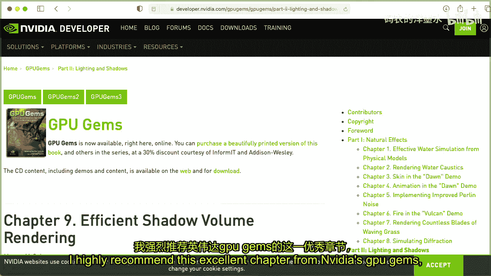

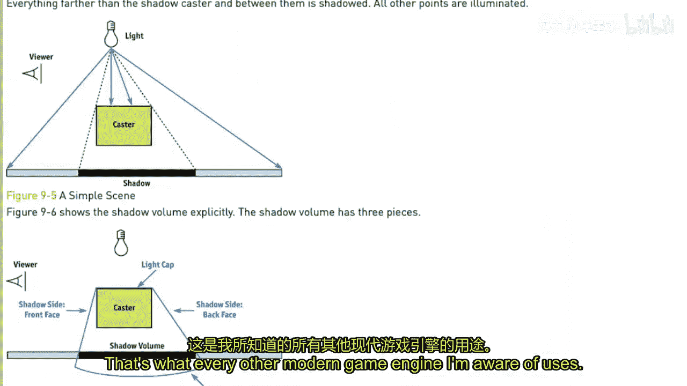

本节课我们一起学习了模板缓冲区。我们了解了它是GPU中用于选择性绘制的另一个缓冲区，探讨了其实现镜面反射效果的基本原理，并简要介绍了它在阴影体技术中的应用及其被现代阴影映射技术取代的原因。掌握模板缓冲区的概念，有助于理解游戏引擎中多种视觉特效的实现基础。