# 014：GPU架构与汇编语言 🎮

在本节课中，我们将学习GPU架构的基础知识，特别是着色器模型、寄存器以及汇编语言层面的操作。我们将了解顶点着色器和像素着色器如何工作，以及GPU如何通过其独特的指令集（如“Swizzling”操作）高效地处理图形数据。

---

## 概述

GPU（图形处理单元）是现代视频游戏和图形应用的核心。与通用CPU不同，GPU专为大规模并行处理而设计，尤其擅长处理浮点运算和向量操作。本节课将深入探讨GPU的编程模型，包括着色器语言、寄存器架构以及底层汇编指令。我们将重点关注顶点着色器和像素着色器，这是3D图形渲染中最常用的两种着色器。

---

## 什么是着色器模型？ 🤔

着色器模型定义了GPU支持的一组寄存器类型和指令。它是一份规范，规定了程序员可以通过API（如Direct3D或OpenGL）向GPU发送哪些命令。然而，GPU具体如何执行这些指令，则由GPU硬件和驱动程序决定。

随着时间推移，GPU承担了越来越多原本由CPU处理的任务。例如，早期的PC图形硬件可能只有一个绘制三角形的命令。如今，GPU几乎处理所有图形计算，从顶点变换到像素着色。

---

## 顶点着色器与像素着色器 🖥️

在GPU流水线中，顶点着色器和像素着色器扮演着关键角色。

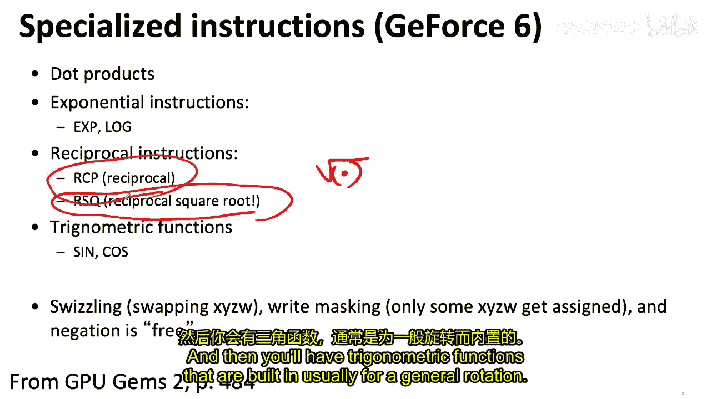

上一节我们介绍了着色器模型的概念，本节中我们来看看这两种核心着色器的具体职责。

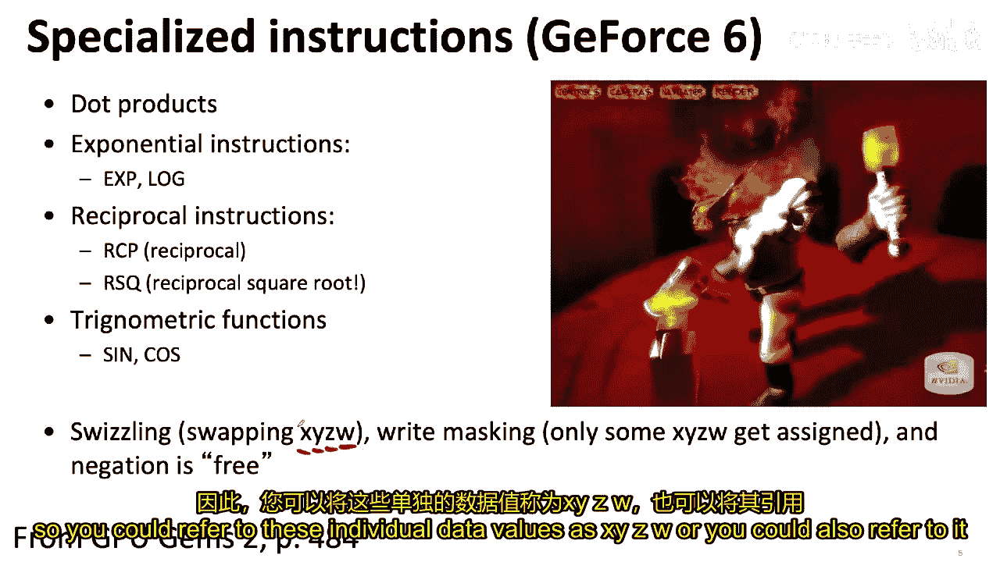

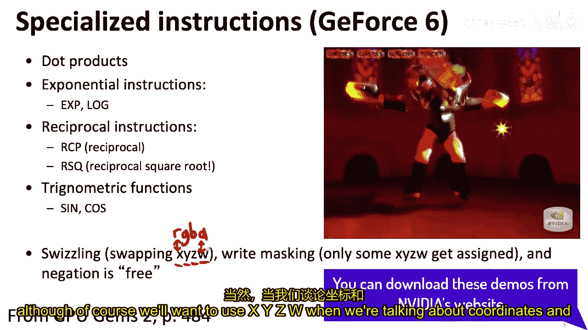

### 顶点着色器

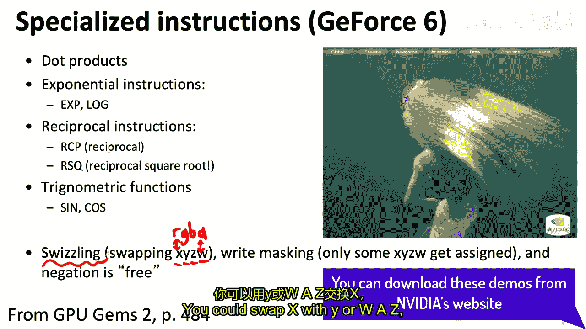

顶点着色器负责处理3D模型的每个顶点。它的主要任务包括：
*   **坐标变换**：将顶点从模型空间转换到屏幕空间。
*   **法线变换**：为光照计算准备法线向量（通常使用逆转置矩阵）。
*   **传递数据**：为后续的像素着色器计算并输出数据，如纹理坐标、颜色或光照信息。

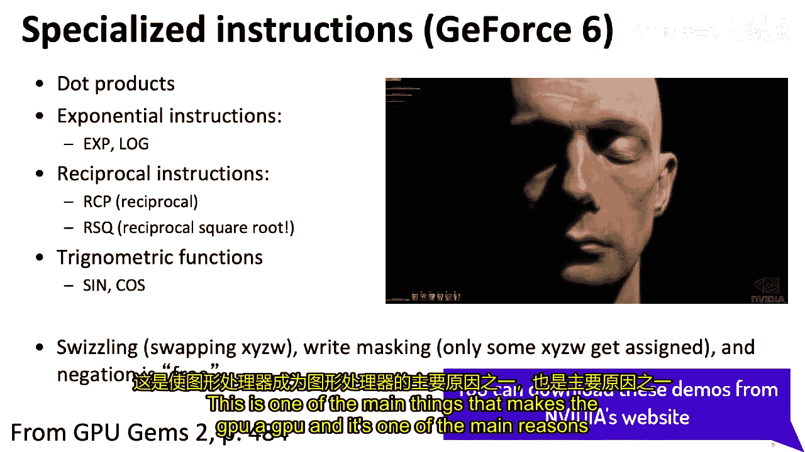

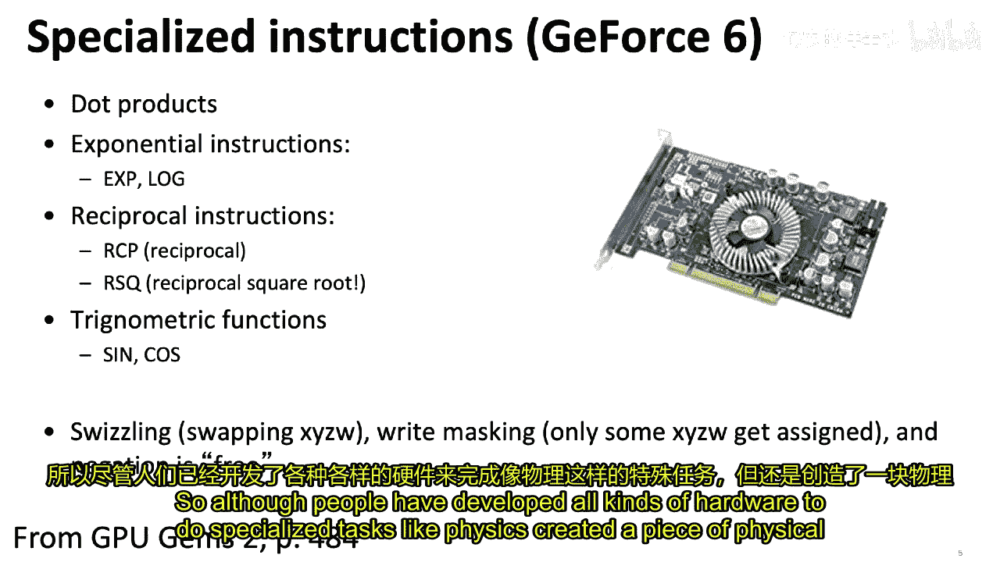

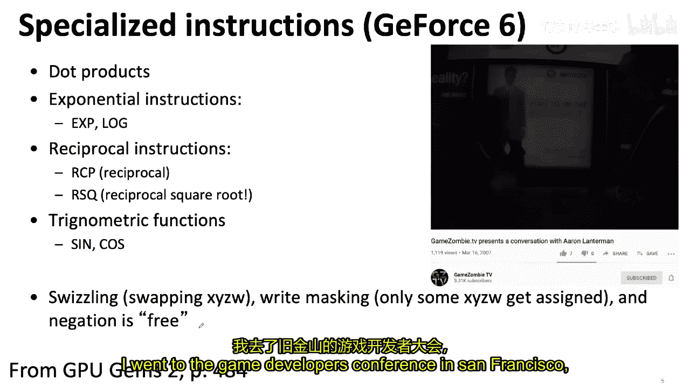

顶点着色器在独立的并行计算单元上运行，每个单元只处理一个顶点，不知道其他顶点的信息。

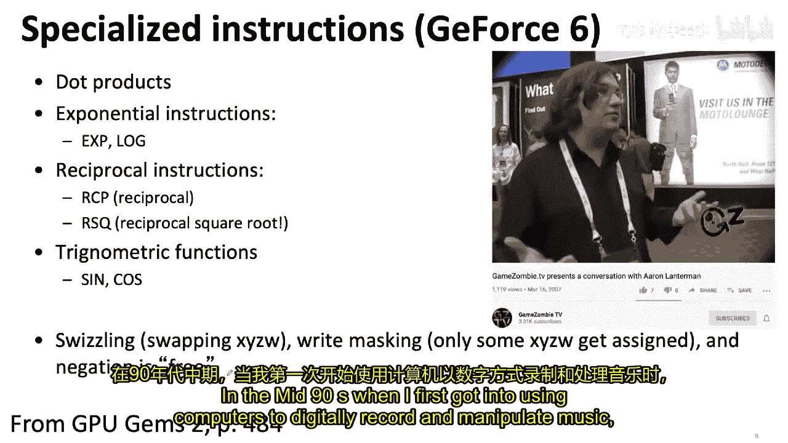

### 像素着色器（片段着色器）

顶点着色器处理完后，GPU会组装三角形，并确定哪些像素属于这些三角形。接着，像素着色器开始工作。

像素着色器（也称为片段着色器）负责计算每个像素的最终颜色。它的主要任务包括：
*   **纹理采样**：根据插值后的纹理坐标从纹理中获取颜色。
*   **逐像素光照**：使用插值后的法线等信息进行更精确的光照计算。
*   **特效应用**：实现如模糊、阴影等后期处理效果。

“片段”一词常与“像素”互换使用，但它更精确地指代可能被丢弃或合并的中间数据。

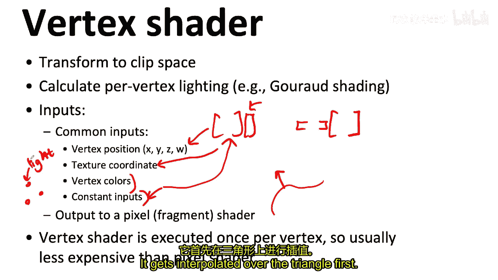

---

## GPU数据与运算特性 🔢

从传统编程转向GPU编程时，需要适应其以浮点数运算为核心的特点。

以下是GPU编程中需要了解的核心数据与运算特性：

### 数据类型
*   **浮点数为主**：在着色器模型4.0之前，GPU甚至没有原生的整数类型，整数需用浮点数表示。
*   **向量与矩阵**：核心数据类型是浮点向量（如 `float4`）和矩阵（如 `float4x4`）。它们可被解释为行向量或列向量，具体取决于运算。
*   **寄存器**：所有数据（输入、输出、常量、临时变量）都存储在四分量寄存器中。

### 核心概念：Swizzling 与 内建指令

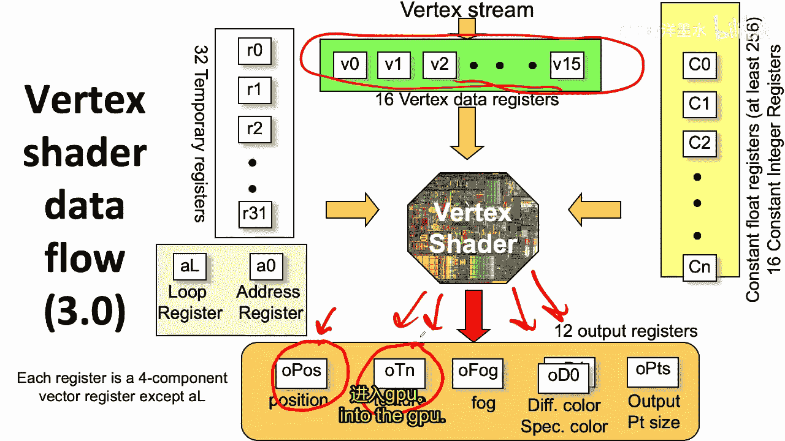

GPU的强大之处在于其能高效处理四元组数据。

**Swizzling** 是一种在指令级别重组向量分量的强大技术。它允许你在执行操作（如加法、乘法）的同时，自由地交换、复制或选择向量的特定分量。

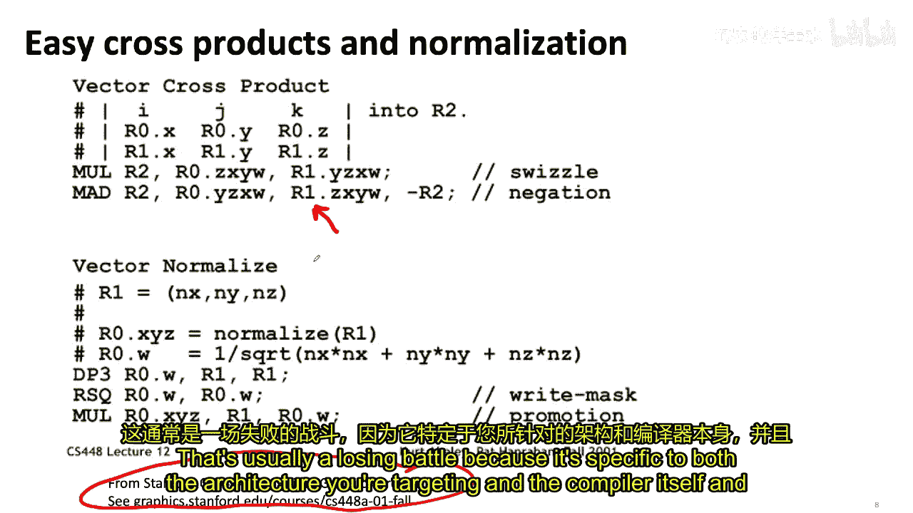

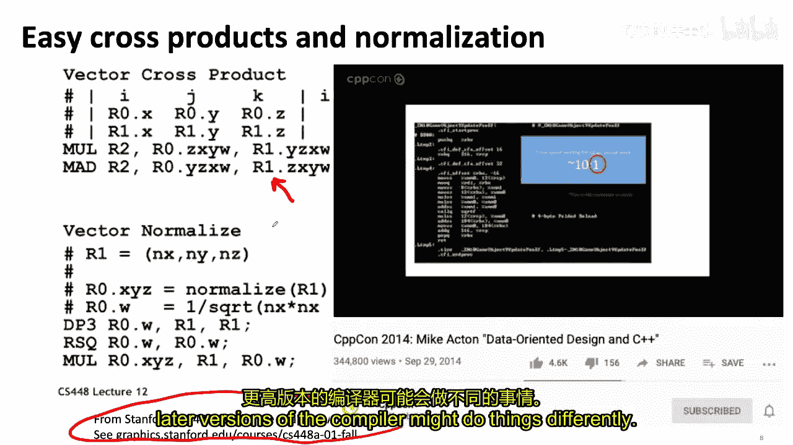

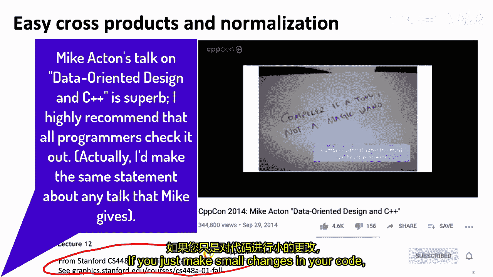

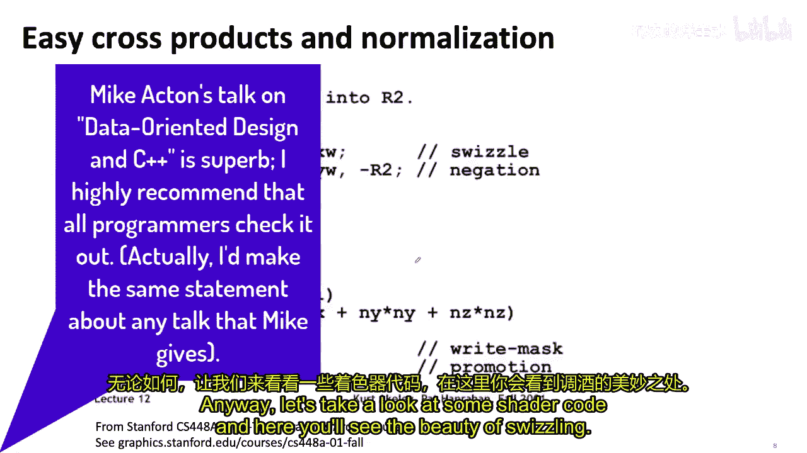

**公式示例**：假设有一个四维向量 `V = (x, y, z, w)`。
*   `V.xyzw` 表示其本身。
*   `V.yxzw` 交换了x和y分量。
*   `V.xxxx` 将x分量“扩散”到所有四个分量。
*   `V.rgb` 在颜色语境下等同于 `V.xyz`。

**内建指令**：GPU指令集包含许多针对图形运算优化的指令，例如：
*   `dot`：点积。
*   `rsqrt`：倒数平方根（用于向量归一化，`normalize(v) = v * rsqrt(dot(v, v))`）。
*   `mad`：乘加运算（`a * b + c`）。
*   三角函数（`sin`, `cos`等）。

值得注意的是，没有直接的“开平方”指令，但可以通过 `rsqrt` 的倒数来实现。

---

## 着色器汇编代码示例 💻

虽然我们不会手动编写汇编代码，但了解其结构有助于理解GPU的高效性。以下是一些关键示例：

### 示例1：向量叉积
仅用两条指令即可完成三维向量的叉积计算，这得益于 `mad`（乘加）指令和Swizzling操作。

**伪代码逻辑**：
```
// 计算 R0 和 R1 的叉积，结果存入 R2
// 使用 mad 指令同时进行乘法和加法/减法
R2 = mad(R0.zxy, R1.yzx, -R0.yzx * R1.zxy)
```
实际汇编指令会利用Swizzling精确控制分量的组合与运算顺序。

### 示例2：向量归一化
仅用三条指令即可完成向量的归一化。

**代码逻辑**：
1.  `DP3 R0.w, R1, R1` // 计算点积 `dot(R1, R1)`，结果存入R0的w分量。
2.  `RSQ R0.w, R0.w`   // 计算倒数平方根 `1/sqrt(R0.w)`。
3.  `MUL R0.xyz, R1, R0.w` // 将R1的xyz分量乘以归一化因子，结果存入R0。

**公式**：`normalized_vector = vector * rsqrt(dot(vector, vector))`

这些示例展示了GPU汇编如何通过高度集成的指令和Swizzling，用极少的步骤完成复杂运算。现代驱动程序会将我们看到的着色器模型汇编代码，进一步编译成GPU硬件真正执行的、更底层的微码。

---

## 现代着色器语言 🚀

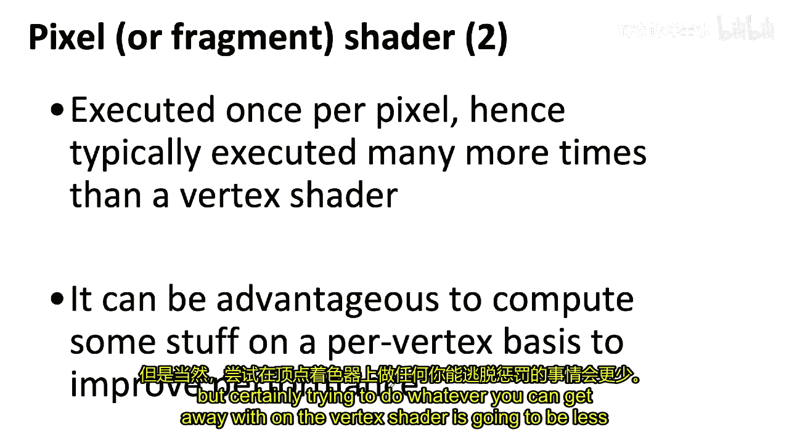

直接编写汇编代码既繁琐又难以维护。因此，高级着色器语言应运而生。

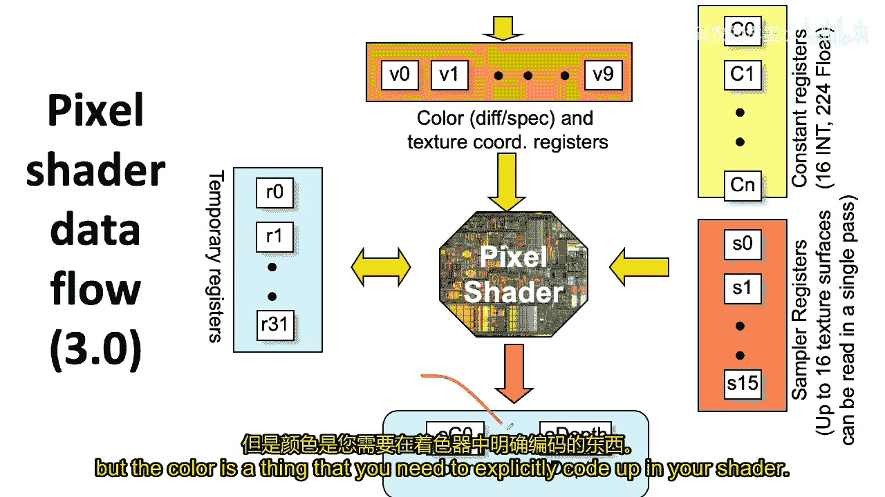

上一节我们领略了汇编的高效与复杂，本节中我们来看看更友好的编程方式。

目前主流的高级着色器语言包括：
*   **HLSL**：微软DirectX系列使用的语言。
*   **GLSL**：OpenGL使用的语言。
*   **Cg**：NVIDIA早年推出的语言，现已与HLSL基本融合。

这些语言语法相似（类似C语言），它们会被编译器翻译成我们之前讨论的着色器模型汇编代码，进而被驱动编译成GPU硬件指令。使用高级语言的好处是代码更易读、易写、易维护，并且可以借助引擎（如Unity）实现跨平台编译。

---

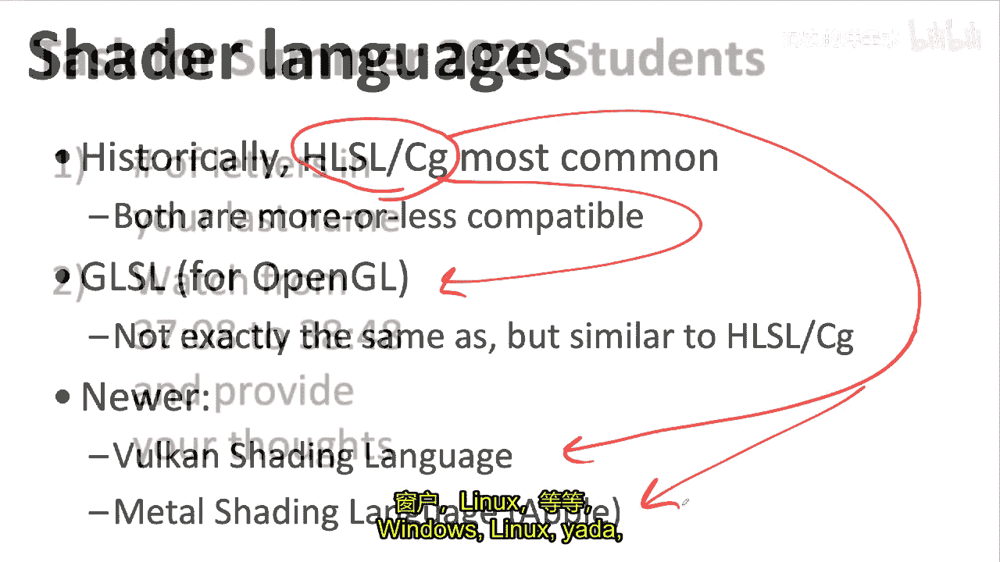

## 总结

本节课我们一起学习了GPU架构与汇编语言的基础知识。我们了解了：
1.  **着色器模型**是GPU功能的抽象规范。
2.  **顶点着色器**处理每个顶点，负责坐标变换等任务。
3.  **像素着色器**处理每个像素，负责计算最终颜色和特效。
4.  GPU运算以**四分量浮点向量**为核心，并通过 **Swizzling** 和**专用指令**实现极高效率。
5.  虽然底层是汇编，但实际开发中我们使用 **HLSL/GLSL** 等高级着色器语言。


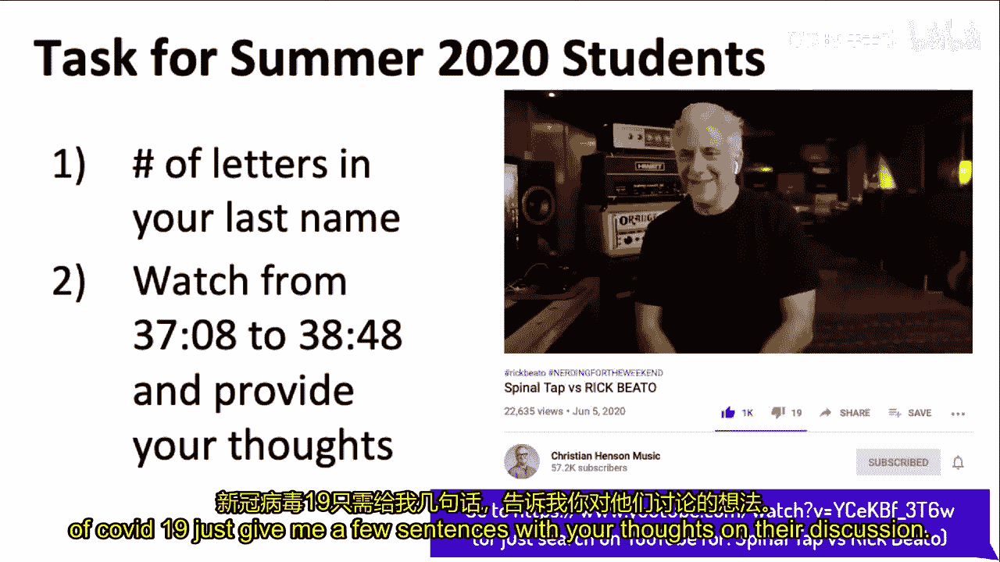


理解这些底层原理，有助于我们写出更高效、性能更好的着色器代码，为后续学习具体的着色器编程打下坚实基础。