# 015：HLSL导论 🎮

在本节课中，我们将学习高级着色语言（HLSL）。上一节我们介绍了着色器汇编代码，并指出没有人真正想写汇编代码，大家都希望使用高级着色语言来编写。本节中，我们将深入了解微软开发的一种特定高级着色语言——HLSL。

## 概述

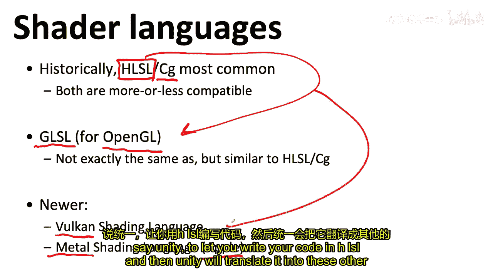

HLSL由微软开发，而NVIDIA开发的CG语言最初与之不同，但两者很快趋同，因此人们常将HLSL和CG互换使用。不过，HLSL现在是更常见的术语。OpenGL有自己的着色语言GLSL，其代码很容易适配到HLSL，反之亦然。Vulkan是OpenGL的后继API，它将许多由OpenGL驱动程序隐式处理的决策交给程序员，以实现更细致的优化，但这使得Vulkan API更具挑战性。苹果则开发了自己的Metal API。Vulkan和Metal都有各自的着色语言，但这些语言在语义上与GLSL或HLSL差异不大，主要区别在于语法。这意味着像Unity这样的引擎可以让你用HLSL编写代码，然后根据需要将其翻译成其他语言。

## HLSL基础

HLSL看起来像C语言，但更简单。尽管较新的着色器模型（如Shader Model 6.x）已经推出，但通常编写的代码最终会编译成相当简单的形式。着色器没有内存，只有寄存器，因此没有动态内存分配命令。较新的着色器模型支持显式跳转命令，但旧模型不支持，通常通过运行所有分支并进行条件赋值来模拟分支语义。此外，大多数函数调用实际上是内联的，编译后的代码直接插入需要的位置，而不是进行跳转。虽然最新的着色器模型可以模拟递归，但在常见的图形应用中很少需要。

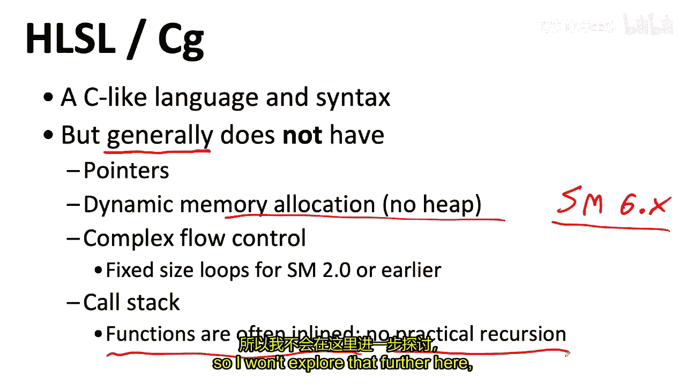

## 变量类型：Uniform与输入

在HLSL或CG中，与C、C++、C#或Java等语言不同，存在Uniform变量和变量输入的概念。Uniform变量对所有处理的顶点和像素都是通用的，例如从模型空间到世界空间、视图空间和裁剪空间的变换矩阵。这些变量需要在着色器代码外部（如C++或C#中）设置。定义Uniform变量时，不需要显式使用`uniform`关键字，只要在函数外部定义即可。这些变量通常位于代码顶部。

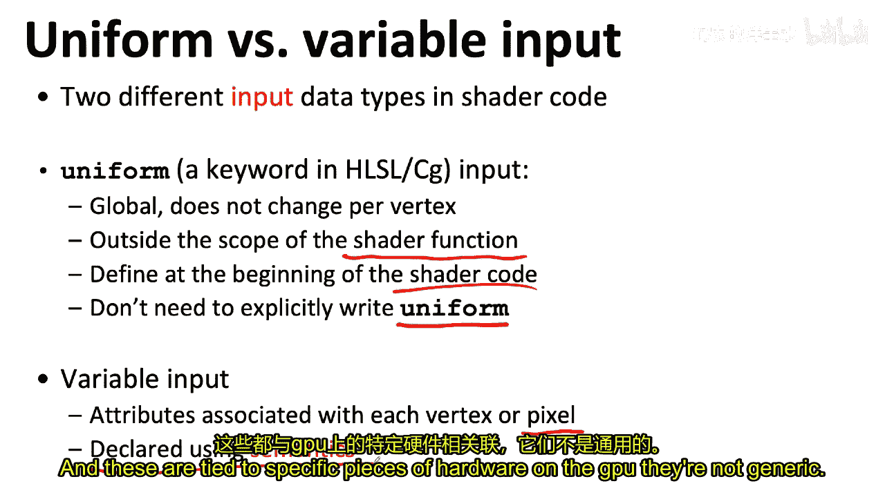

另一种输入是来自主内存发送到GPU的大型顶点缓冲区，以及由插值器生成的像素位置和颜色等信息。这些输入使用语义（Semantics）定义，这是HLSL和CG特有的概念，与GPU上的特定硬件部件相关联，不是通用的。

## Unity中的变量处理

使用Unity时，一个棘手之处在于它试图尽可能简化游戏开发，因此隐藏了许多细节。这与本课程关注GPU底层细节的目标有些冲突。Unity运行时会为我们定义许多变量，Unreal、Godot等引擎也是如此。一旦达到一定的复杂程度，你将需要通过自定义脚本创建自己的变量。

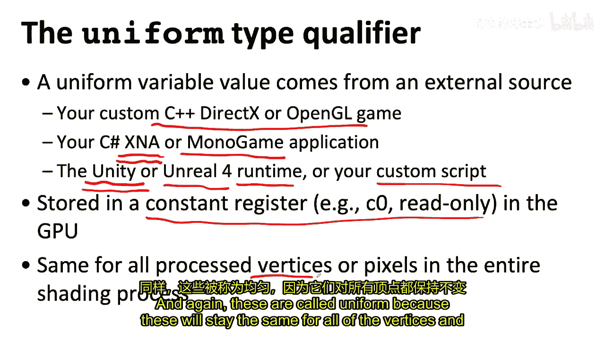

如果使用原始的DirectX、OpenGL、Vulkan或Metal编写代码（通常用C++），则需要自己处理所有这些变量。同样，XNA（或开源的MonoGame）虽然常被称为游戏引擎，但它实际上是一个专注于游戏的API，是一个位于DirectX或OpenGL之上的.NET层，并非完整的游戏引擎。在XNA中，你需要自己定义和分配所有Uniform变量。本课程前六年使用XNA时，我们必须进行所有这些显式分配。而在Unity中，许多工作由引擎处理。

存储在常量寄存器中的信息（如灯光的位置和颜色）称为Uniform，因为它们对于着色器代码处理的所有顶点和像素保持不变。

## 语义示例

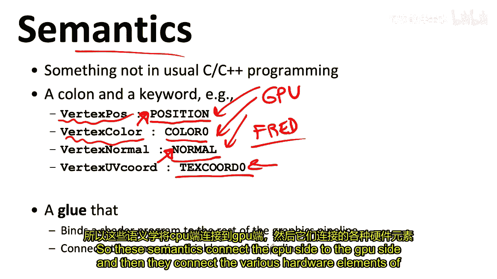

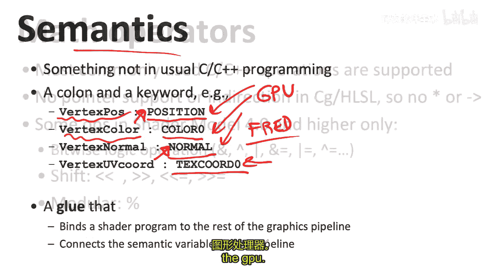

语义通过冒号后的关键字定义，这些关键字是大写的，且不能随意创建，因为它们与GPU上的特定硬件功能相关联。例如，`TEXCOORD0`、`TEXCOORD1`等与插值硬件相关联。当将大量顶点和索引数组传递到定义三角形的顶点表时，API调用会引用位置和法线等特定内容。Unity运行时内置的渲染器会为我们处理许多这些细节，但如果使用MonoGame或原始的C++与DirectX/OpenGL编写游戏，则需要自己定义这些缓冲区、加载顶点并进行所有API调用。语义连接了CPU端和GPU端，以及GPU的各种硬件元素。

## 数学运算与向量

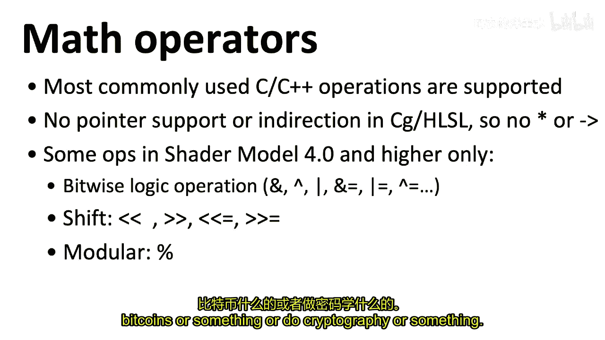

着色器代码中的大多数数学运算涉及浮点值或浮点值向量和数组。着色器代码的坏消息是没有指针，因此无法创建和使用复杂的数据结构；好消息也是没有指针，因此没有指针错误。我们没有任何与指针相关的常规语法。

Shader Model 4.0引入了整数及其各种操作，但在3D图形着色器代码中很少见到使用这些功能的例子，它们主要用于更通用的GPU编程框架（如挖矿或加密）。

在深入探讨之前，我们需要谈谈HLSL中的向量，特别是如何相乘。在像MATLAB这样的语言中，有列向量和行向量的概念，但在HLSL和许多其他着色语言中，没有相同的概念，只有向量和矩阵。如何解释行向量和列向量取决于使用乘法命令的方式。如果将向量放在矩阵前面，可以将其解释为行向量乘以矩阵；如果将矩阵放在向量前面，可以将其解释为矩阵后乘以列向量。如果想将向量视为列向量但放在第一个参数，则相当于将该列向量乘以矩阵的转置；如果想将向量视为行向量但放在第二个参数，则相当于后乘以矩阵的转置。这可能导致查看不同教科书和在线着色器代码示例时产生混淆，因为有时不清楚是行向量还是列向量，答案取决于你如何对待它。

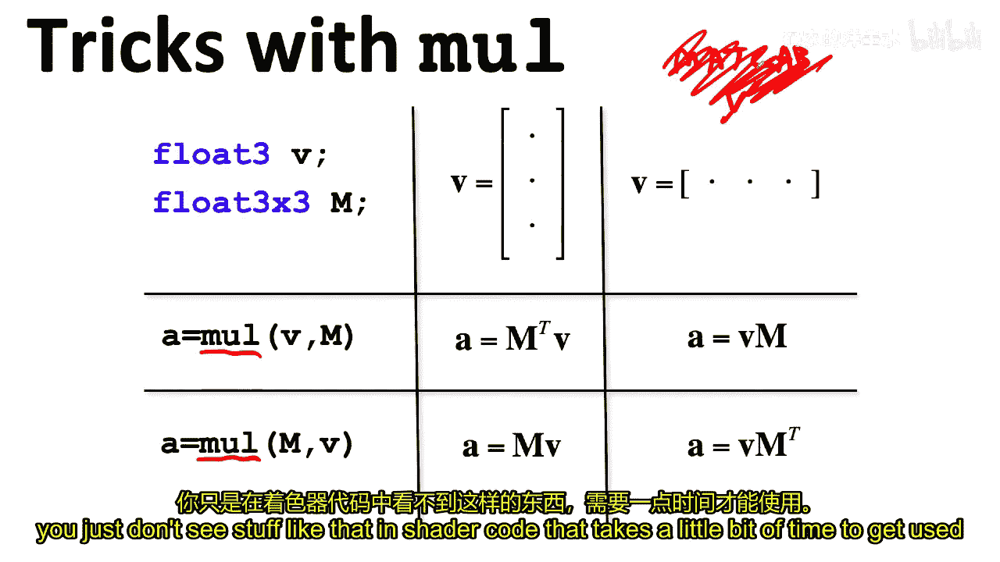

因此，在着色器代码中很少看到显式的转置命令。如果需要转置，要么在CPU端预计算并作为Uniform参数发送，要么通过特定方式使用乘法命令并解释结果。在HLSL中，你会看到许多内置命令，如点积、叉积、距离计算等。线性插值命令的一个有趣之处是，插值因子`f`不一定在0和1之间，因此可以进行一定程度的推断。`lit`命令有点奇怪，它映射到着色器模型汇编指令，用于计算旧式的Blinn-Phong光照模型，但实际实现Blinn-Phong的着色器代码通常直接编写方程而不使用该命令。`normalize`命令用于归一化向量，`saturate`命令是`min`和`max`操作的简写，用于将值限制在0和1之间。在环境映射中，我们需要使用`reflect`命令。`sincos`命令很有趣，因为它将输出赋值给参数列表中的`S`和`C`组件，而不是像函数那样返回输出。确实有一个特定的着色器模型汇编指令可以同时计算一个数字的正弦和余弦。

如果你想知道在哪里可能使用`sincos`，请记住旋转矩阵。如果考虑某个位置和方向的对象，这些正弦和余弦值可以预计算以创建应用于所有顶点的矩阵。但你可能想象在着色器代码内部进行某种旋转动画，这时`sincos`命令就会派上用场。

## 总结

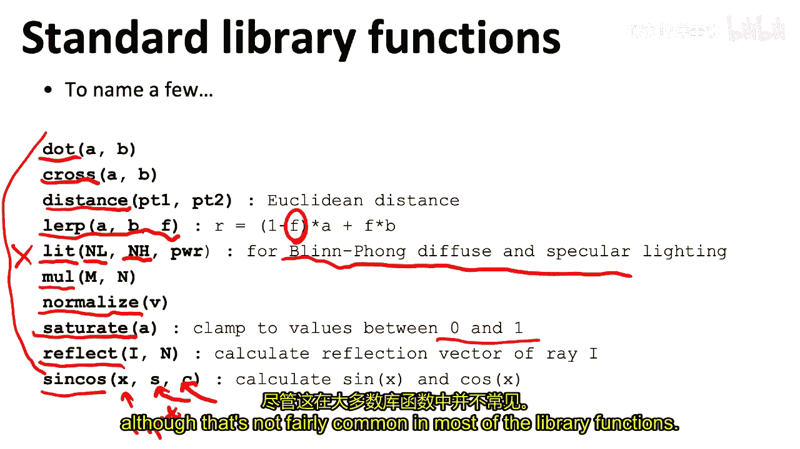

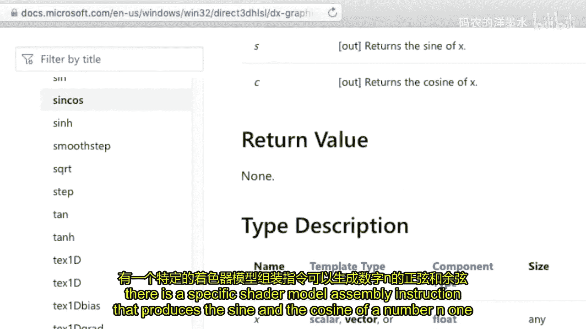

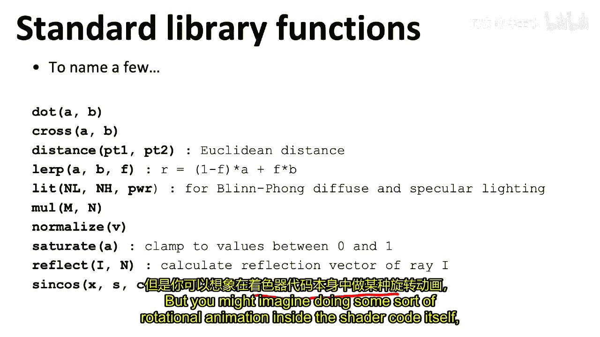

本节课我们一起学习了HLSL的基础知识，包括其与CG、GLSL等其他着色语言的关系，以及Uniform变量、语义、向量运算等核心概念。我们还探讨了在Unity等引擎中变量处理的方式，以及HLSL中常用的内置数学函数。理解这些内容对于编写高效的GPU着色器代码至关重要。