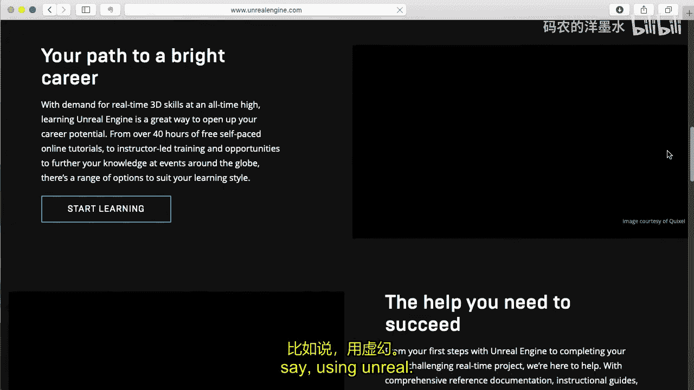
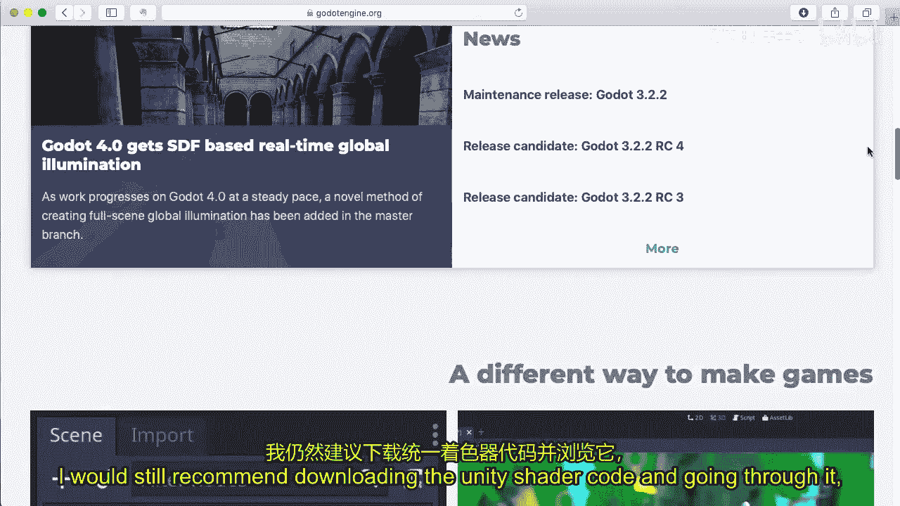
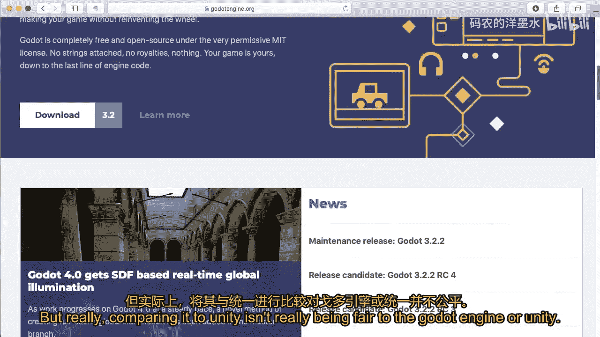
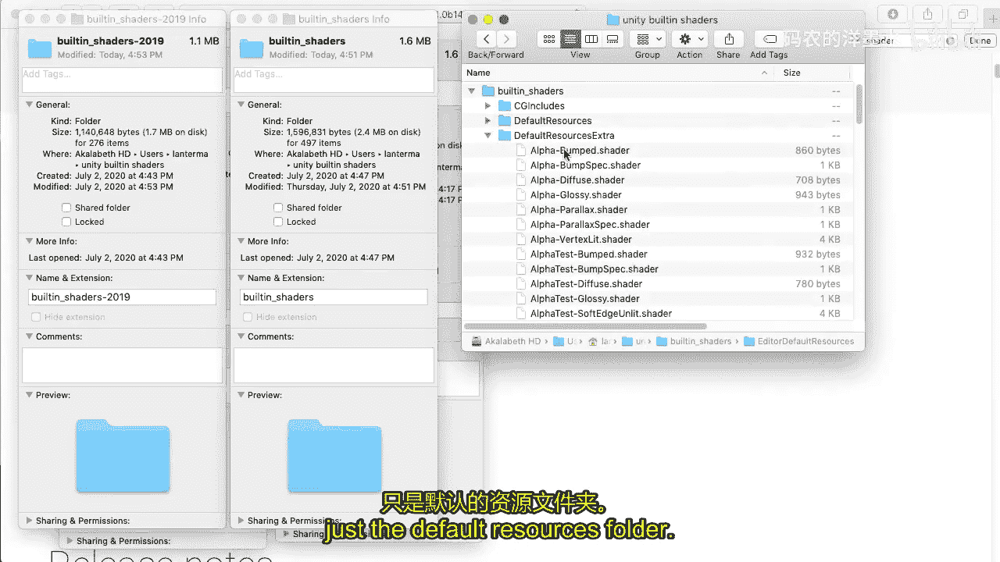
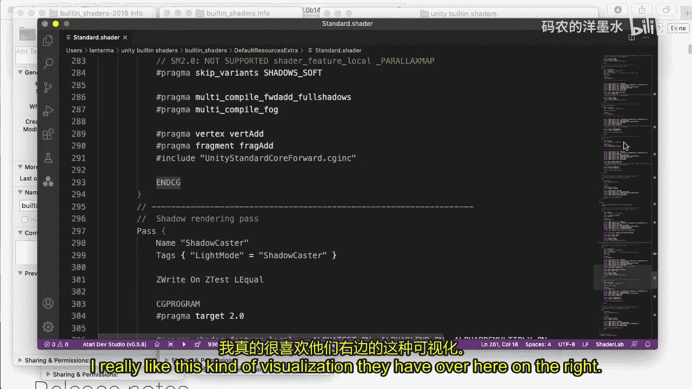
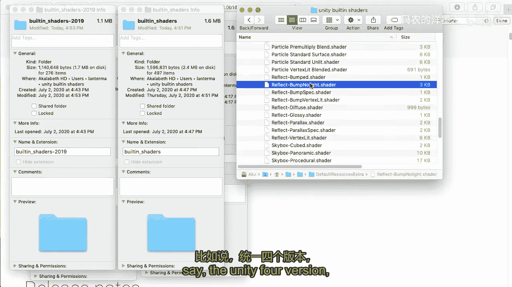
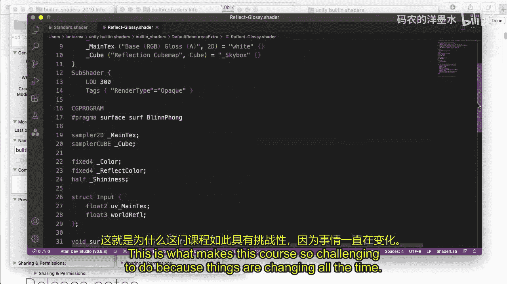
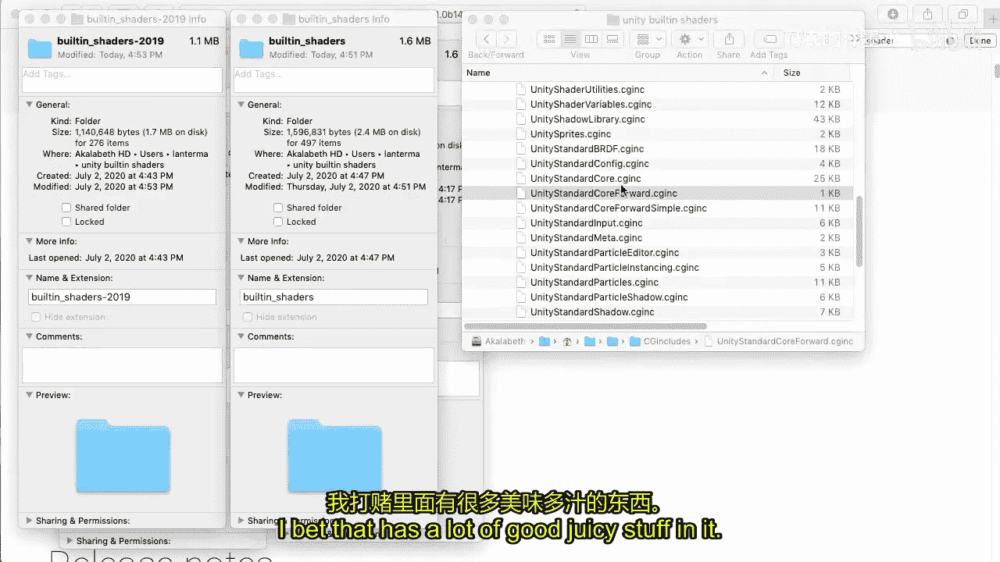
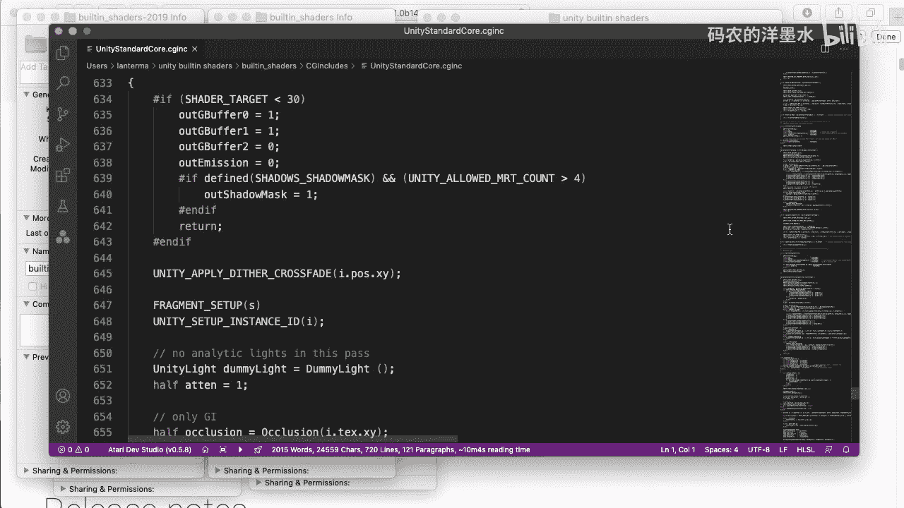

# 016：Unity内置着色器源代码分析 🎮

在本节课中，我们将学习如何下载并初步探索Unity引擎内置着色器的源代码。理解这些代码对于编写自定义着色器至关重要。

大家好，我是Sarah Lanchman，佐治亚理工学院电气与计算机工程系的教授。欢迎来到“GPU编程与游戏开发”课程。本节课的内容并不复杂，我们将从Unity官网下载一些着色器代码。

即便您因某些原因没有使用Unity，而是使用Unreal或Godot等其他引擎，我仍然建议您下载并浏览Unity的着色器代码。通过研究这些代码，您可以学到很多知识。

顺便一提，Godot引擎非常有趣，它完全免费且开源。在我研究过的众多引擎中，它的整体风格最接近Unity。但将两者直接比较对任何一方都不公平，因为每个引擎都在致力于实现自己的目标。

如果您正在使用Unity，那么花时间研究这些着色器代码是非常必要的。因为Unity的官方文档通常要么相当简略，要么存在错误。很多在线文档适用于Unity的早期版本，如果您通过网页论坛寻找问题答案，所看到的信息很可能是极具误导性的。

因此，如果您想做的不仅仅是使用内置的标准着色器，特别是希望您编写的着色器能与Unity内置着色器良好协作，就必须深入研究这些代码。

## 下载源代码

以下是下载Unity内置着色器源代码的步骤。

1.  打开您常用的搜索引擎，输入类似“Unity archive”的关键词进行搜索。
2.  Unity提供了其所有内置着色器的源代码。虽然着色器代码被嵌入在Unity可执行文件中，但实际的源代码需要单独下载。
3.  让我们下载2019年最新版本的源代码。如果您之前下载过2019.4.0版本的代码，可能不需要为2019.4.2版本再次下载。然而，在不同的小版本号之间，代码通常会发生变化。例如，如果您上次下载的是2019.3.15的代码，而现在使用的是2019.4，那么您需要重新下载。
4.  当然，Windows和Mac版本的Unity可执行文件是不同的，但下载着色器代码的链接在Mac和PC版本之间是相同的。这是合理的，因为Unity希望您的游戏能够部署到各种不同的平台。
5.  点击链接下载内置着色器压缩包。我还想获取最新测试版的着色器代码，但遗憾的是在这里找不到。因此，我们需要返回搜索引擎，搜索“2020.1”版本。
6.  在“Additional downloads”或“Additional resources”部分，我们可以找到“Built-in shaders”的下载链接。2019年的着色器文件带有“.2019”扩展名，而2020年测试版的着色器文件则没有扩展名。看起来2020年的着色器比2019年的源代码多了大约半兆字节。
7.  值得注意的是，2020年版本中有一个额外的“Default Resources Extra”文件夹，其中可能包含一些有趣的内容。

## 探索代码结构

上一节我们完成了源代码的下载，本节中我们来看看代码的组织结构。Unity有一些奇怪的文件夹命名约定。要弄清楚Unity着色器如何工作，主要需要查看两个地方：一个是“CGIncludes”文件夹，另一个是“Default Resources Extra”文件夹。

“Default Resources”文件夹本身并没有太多特别有趣的内容。理解标准着色器的工作原理并非易事，因为它被设计得非常庞大（Unity曾称之为“Uber Shader”）。它包含大量代码，并且不断延伸。使其特别难以理解的原因是，文件中并没有大量实际的代码，而主要是包含了一系列头文件。

以下是标准着色器包含的一些关键文件类型：

*   **标准核心文件**：包含核心的着色器功能和计算。
*   **前向渲染相关文件**：处理前向渲染路径下的光照计算。
*   **输入定义文件**：定义了着色器使用的属性和变量。
*   **元数据文件**：通常与预计算反弹光照（如光照贴图）的支持有关，我们将在课程后期讨论。

尽管这个文件看起来非常庞大，但它实际上采用了大量复制粘贴式的编程模式。从代码编辑器的可视化侧边栏可以快速看出，代码中存在许多重复的块状结构，这些块大部分相同，只有少数变体。

这种“Uber Shader”风格的编码方式与Unity 4版本截然不同。在Unity 4中，有大量独立的着色器文件，每个文件对应一种特定的光照效果，且每个着色器都相对较小。这也使得本课程具有挑战性，因为技术环境在不断变化，包括Unity每年的版本更新以及整个行业的发展趋势。本学期我将涵盖的一些主题，在十年前可能还属于研究范畴。

## 深入核心文件

除了“Default Resources Extra”文件夹，您主要需要查看的是“CGIncludes”文件夹。向下滚动，您会看到所有以“Unity”开头的文件。

“UnityStandardCore”、“UnityStandardCoreForward”、“UnityStandardInput”、“UnityStandardMeta”等是标准着色器主要包含的文件。如果我们查看“UnityStandardCoreForward”，就会发现它正在调用其他文件，例如导入“UnityStandardCoreForwardSimple”或“UnityStandardCore”。

让我们看看“UnityStandardCore”，我敢打赌这里面有很多有价值的内容。果然，它是一个26KB的源代码文件，里面包含了各种实质性的内容：关于切线的处理、金属度与光滑度的设置、粗糙度的计算等等。这看起来非常有趣，还包括全局光照相关的内容。

您可以在这里深入探索很久。猜猜怎么着？在本课程后续的相当一部分内容里，我们将一起深入这个“兔子洞”。请相信我，不要担心，不要惊慌，这将会很有趣。

本节课中，我们一起学习了如何下载Unity内置着色器的源代码，并初步探索了其核心文件结构。理解这些代码是掌握高级着色器编程和与Unity渲染管线协作的关键第一步。在接下来的课程中，我们将更深入地分析这些代码的具体实现。