# 017：IntroShaders Unity包预览 🎮

在本节课中，我们将预览一个专为后续课程准备的Unity示例包。这个包包含了多个着色器示例，我们将逐一探索其内容与结构。

## 概述

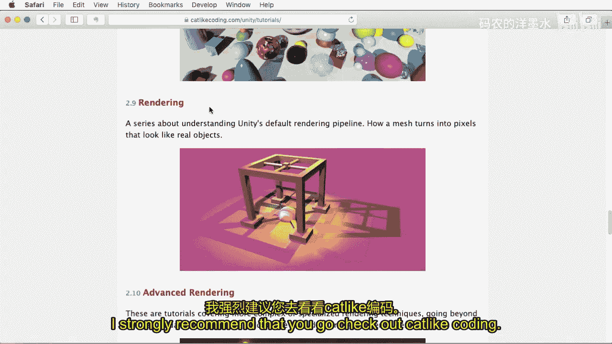

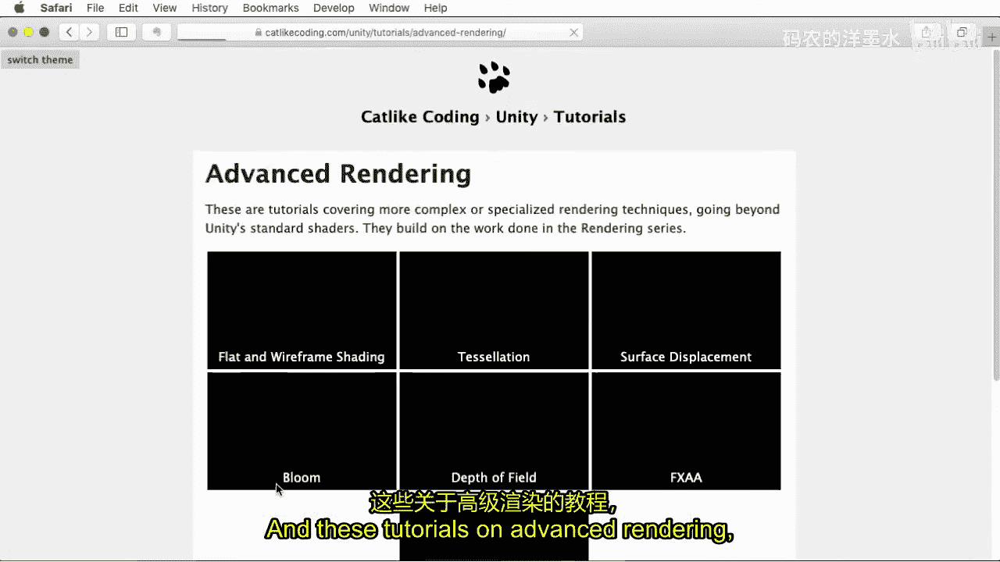

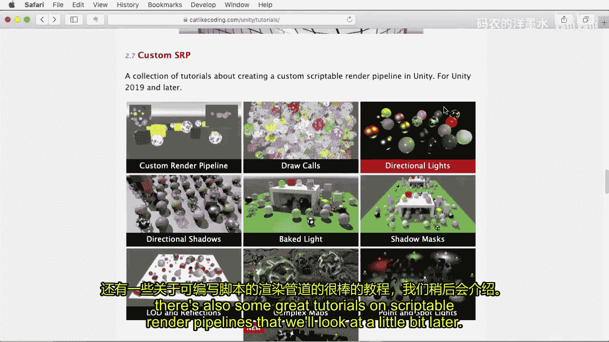

本节将介绍一个名为“IntroShaders”的Unity资源包。该包由佐治亚理工学院的Sarah Lanchman教授创建，旨在为后续的着色器编程课程提供实践示例。我们将学习如何导入此包，并预览其中包含的几个核心演示场景。

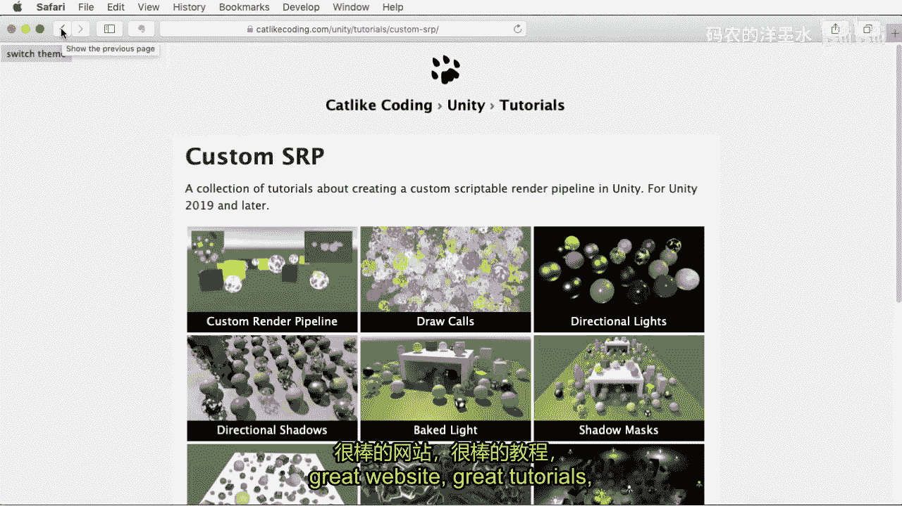

## 包内容与背景

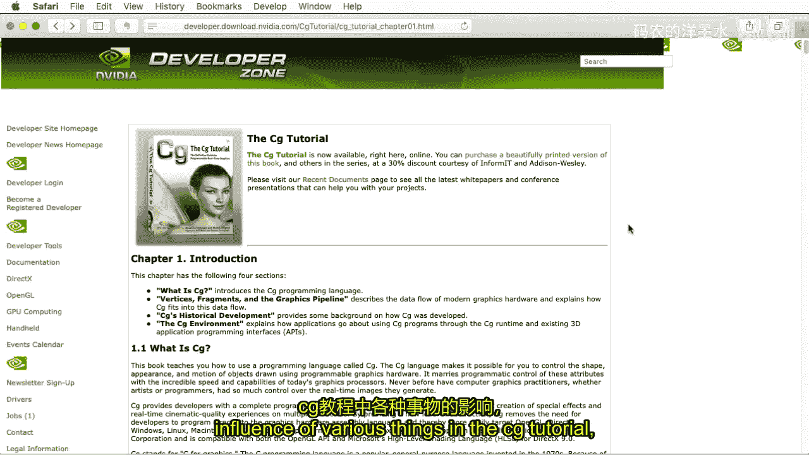

这个Unity包中的演示结构深受“Catlike Coding”网站教程的影响。该网站提供了非常出色的渲染教程，强烈建议学习者前往查阅，特别是关于渲染和高级渲染的部分。此外，网站还包含一些关于可编程渲染管线的优秀教程，我们将在后续课程中稍作了解。需要注意的是，Unity对可编程渲染管线的工作方式进行了多次更改，因此查阅最新教程至关重要。

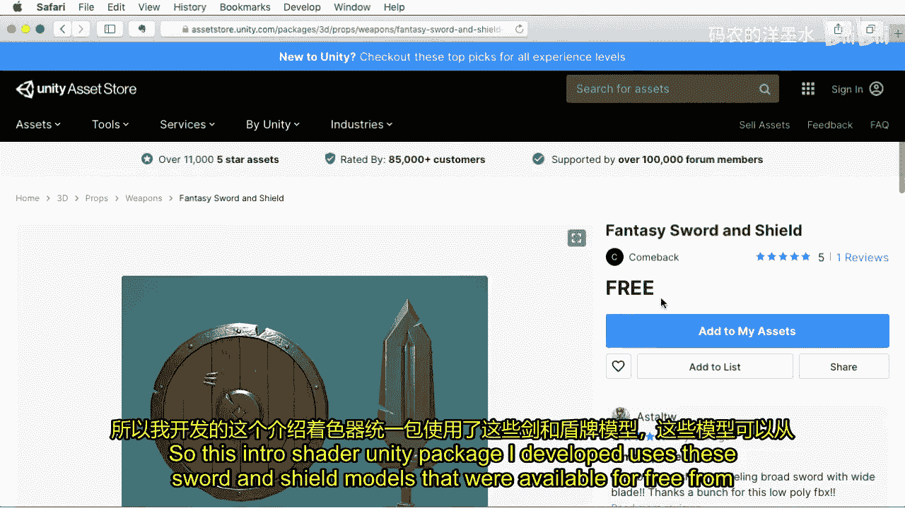

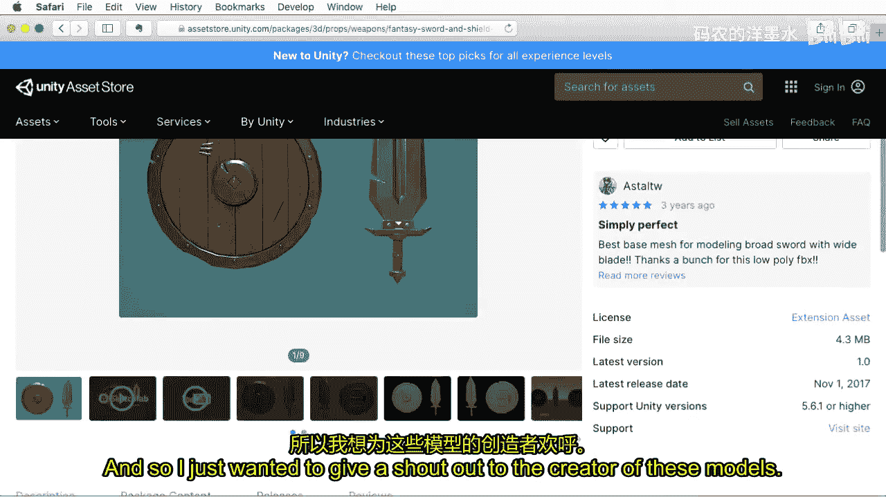

示例代码的渊源可以追溯到Unity 4时代。在Unity 5引入标准的基于物理的着色器之前，Unity 4提供了许多独立的小型着色器供选择。本演示代码中的一大部分尝试复现了这些着色器，其创作也受到了NVIDIA网站上免费提供的《CG教程》中各种建议和影响。

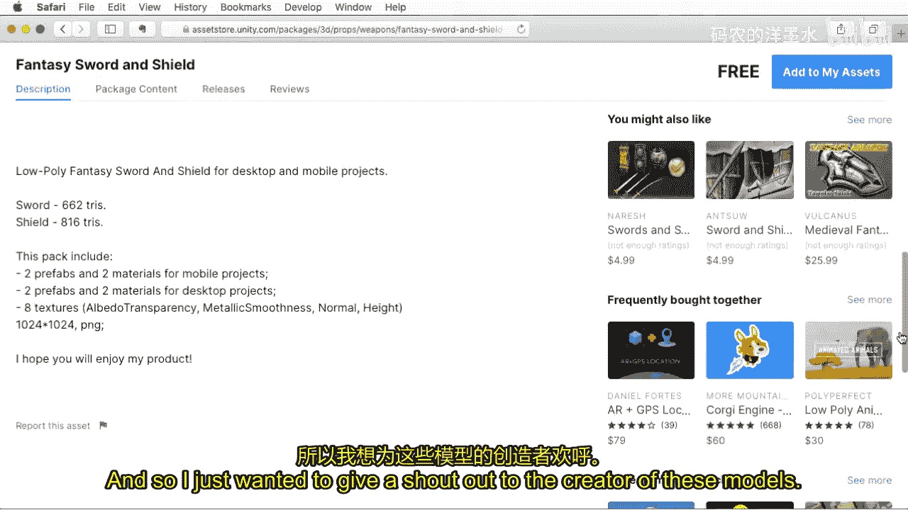

## 资源来源

本IntroShaders Unity包使用了来自Unity Asset Store的免费剑与盾模型。在此特别向这些模型的创作者致谢。他们来自俄罗斯图拉，创作了许多优秀的资源，值得大家去探索。

## 环境准备与导入

目前，我安装了两个Unity版本：一个是2019.4长期支持版，该版本会持续获得错误修复支持但不添加新功能；另一个是2020.1测试版，它包含最新功能但可能稳定性稍差。本IntroShaders包在两个版本中均可正常加载。

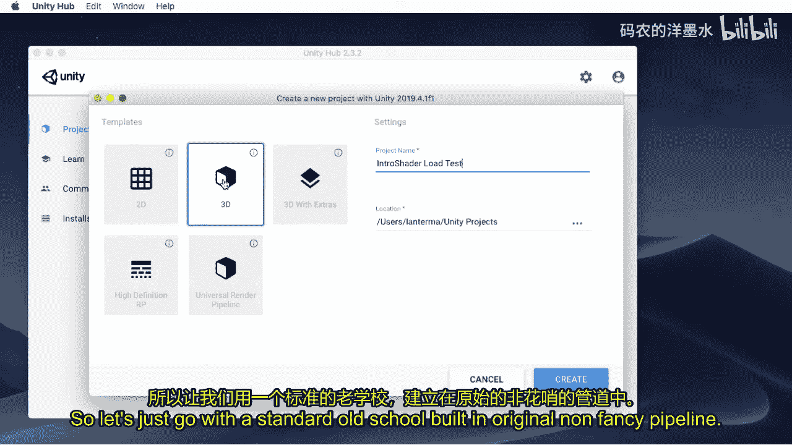

为了演示如何导入，我将创建一个新的Unity项目。我将使用2019.4版本。将项目命名为“IntroShaderLoadTest”，并选择不使用“3D with Extras”模板。同时，我们也不会使用HDRP或通用渲染管线这些新的可编程管线功能，因为本IntroShaders包不支持它们。因此，我们创建一个标准的、旧式的内置渲染管线3D项目。

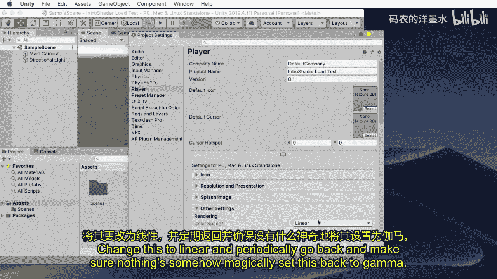

创建项目后，每次建立3D场景都需要进行一项关键设置：进入项目设置，点击“Player”，将色彩空间从“Gamma”更改为“Linear”。因为使用Gamma色彩空间运行效果不佳。请定期检查此项设置，确保其未被意外改回Gamma模式，始终保持在Linear色彩空间。

现在，将Unity包文件拖拽到Assets文件夹上。Unity会显示包内包含的所有内容。确认后点击导入。此操作在2020.1版本的Unity中同样有效。导入后，在场景文件夹中会出现五个场景。

## 演示场景预览

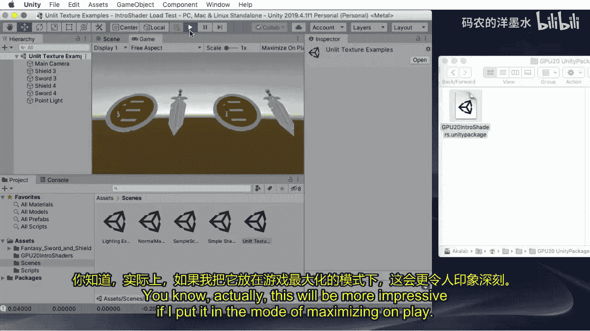

导入后，场景文件夹中除了创建项目时自动生成的示例场景外，还有一组我们将要查看的简单着色器演示场景。我们将用一节课的时间来讨论它们。

以下是包中包含的核心演示场景：

*   **简单着色器演示**：这是第一个演示，我们稍后会详细讨论其代码。
*   **无光照纹理演示**：这将是本系列的第二课，我们将深入代码，探讨如何处理纹理。
*   **光照与着色演示**：在这个场景中，除了旋转的剑和盾，我还放置了一些圆柱体，并设置了一个来回移动的光源。在第三课详细研究这些示例时，我们将讨论逐顶点光照与逐像素光照的区别，即高洛德着色与冯氏着色的区别。
*   **法线贴图演示**：本系列最后查看的示例将使用法线贴图来实现你所看到的粗糙度效果。当然，法线贴图只有在进行逐像素光照时才能正常工作。

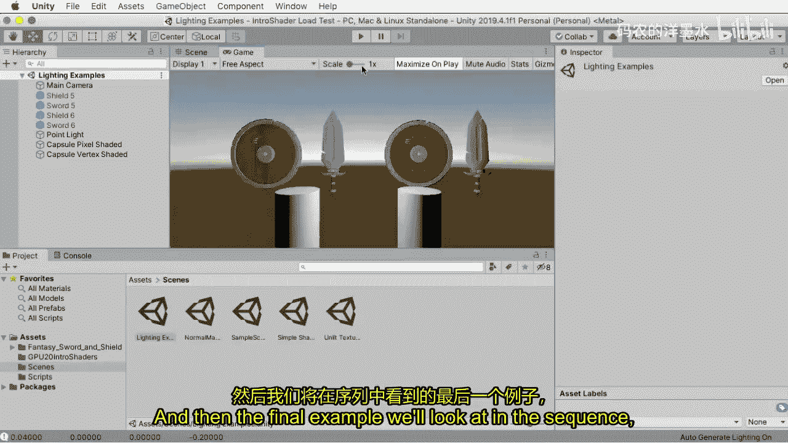

如果你之前没有使用过Unity，请注意区分场景视图和游戏视图。场景视图用于在编辑器中移动和操作物体（如光源、相机），而游戏视图才是实际运行游戏时看到的画面。需要说明的是，我提供的所有着色器代码，仅保证在场景中只有一个光源时正常工作。如果场景中有多个光源，它们可能工作正常，也可能不工作，这取决于一些具体细节。

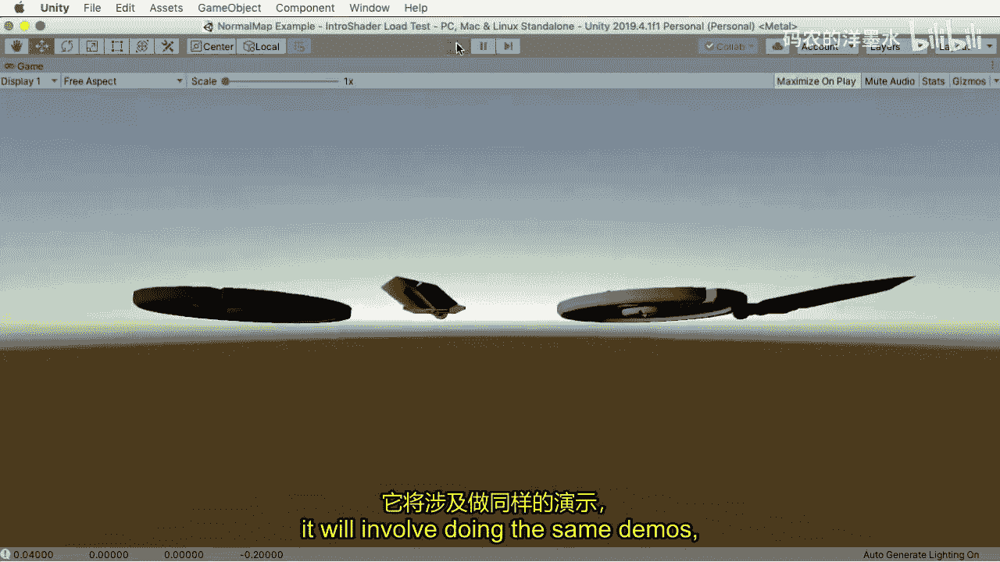

## 总结

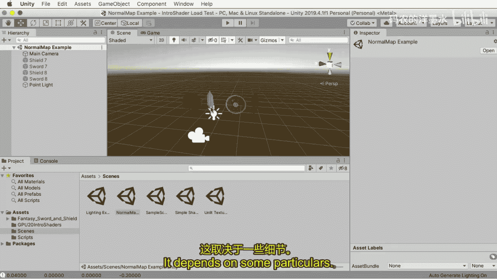

本节课我们一起预览了“IntroShaders”Unity资源包，了解了其背景、资源来源，并学习了在标准3D项目中导入该包的步骤。我们还快速浏览了包中包含的几个核心演示场景，为后续深入探讨着色器编程的具体实现做好了准备。