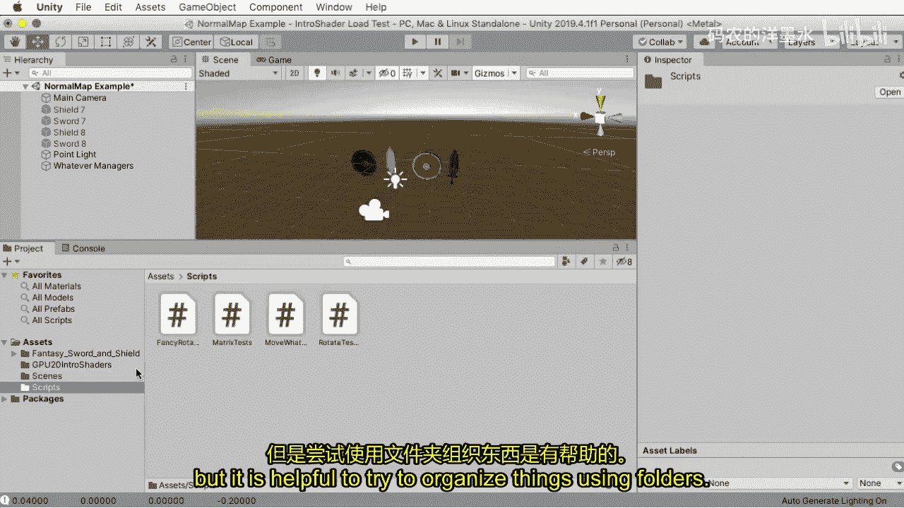
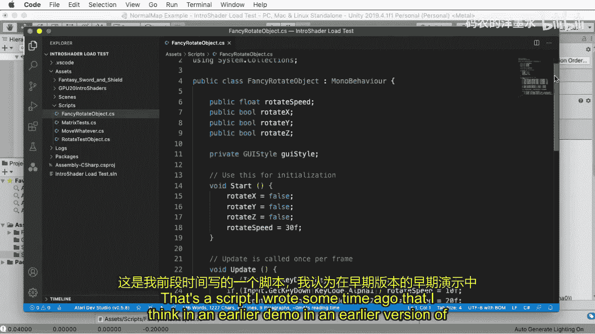
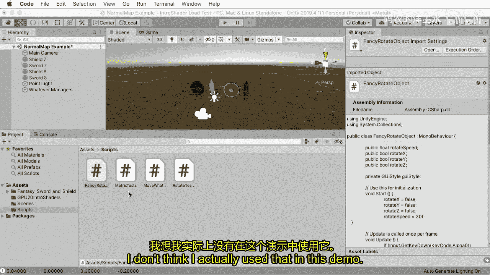
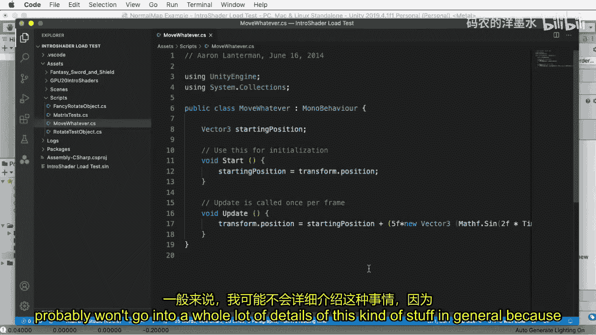
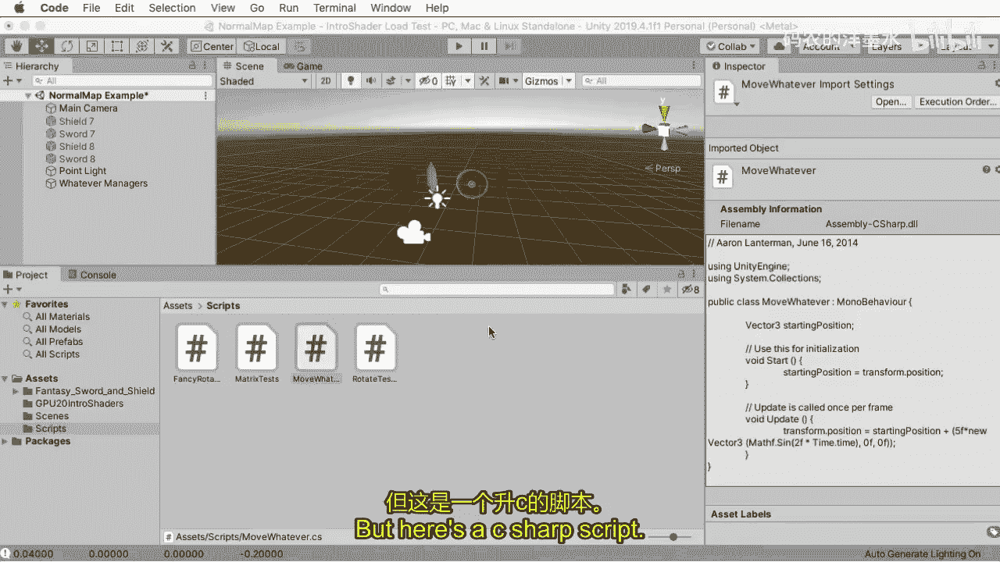
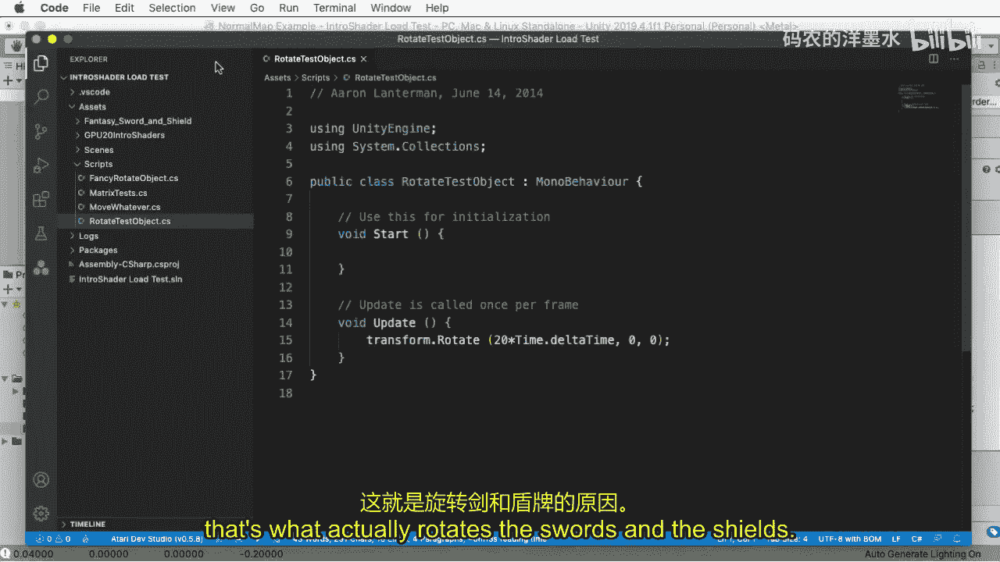
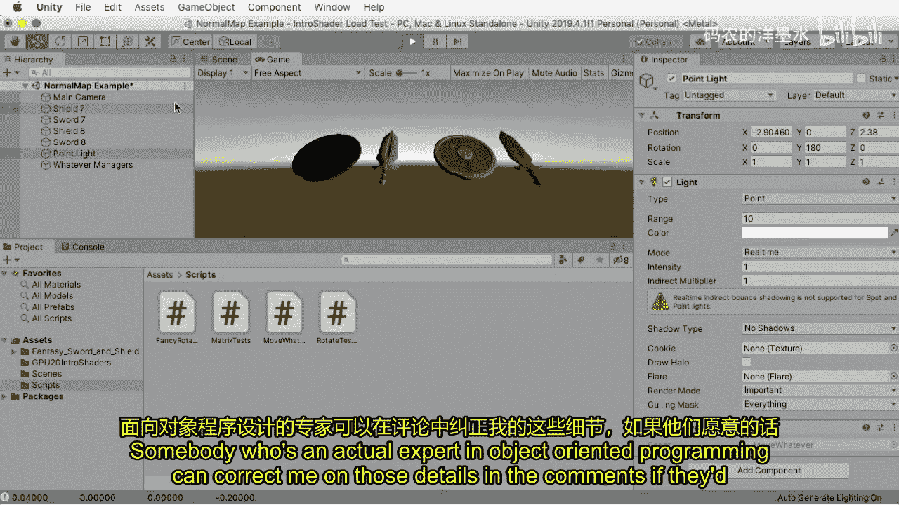

# 018：游戏对象与组件 🎮

在本节课中，我们将学习Unity游戏引擎中的核心概念：**资产**、**游戏对象**和**组件**。理解这些概念是有效使用Unity进行GPU着色器编程和游戏开发的基础。

## 概述

上一讲我们介绍了如何加载包含着色器代码的Unity包。本节中，我们将深入探讨Unity的基本架构，特别是资产、游戏对象和组件之间的关系。这些概念是组织和管理游戏内容的关键。

## 资产与游戏对象

在Unity中，你需要区分**资产**和**游戏对象**的概念。

*   **资产**是通用的资源文件，例如声音、脚本、3D模型等。
*   **游戏对象**是这些资产在游戏场景中的具体实例。

游戏对象可以代表场景中的物理实体，例如摄像机或点光源。但有时，游戏对象也可能仅用于承载游戏逻辑代码，而不直接对应场景中的可见物体。这类对象通常将位置设置为`(0, 0, 0)`，可以看作是Unity中的逻辑中心点。

## 组件系统

Unity的核心设计理念之一是**组件**。组件通过C#脚本定义行为。

*   一些组件是Unity内置的，与引擎深度集成。
*   你也可以创建自己的脚本，并将其作为自定义组件附加到游戏对象上。

以下是创建和附加组件的基本步骤：
1.  在项目窗口中组织脚本（例如，放入“Scripts”文件夹）。
2.  在检视窗口中，点击游戏对象的“Add Component”按钮。
3.  从列表中选择内置组件或你编写的脚本。

例如，在演示项目中，我创建了名为“RotateTestObject”的脚本。将其附加到盾牌游戏对象上，盾牌就会开始旋转。

```csharp
// 这是一个简化的旋转组件脚本示例
public class RotateTestObject : MonoBehaviour {
    public float speed = 50.0f;
    void Update() {
        transform.Rotate(Vector3.up * speed * Time.deltaTime);
    }
}
```







## 游戏对象的固有属性





Unity中的所有游戏对象都自动拥有一个**变换**组件。它定义了对象的位置、旋转和缩放。

```csharp
// 变换组件的基本属性
transform.position = new Vector3(0, 0, 0); // 位置
transform.rotation = Quaternion.identity;  // 旋转
transform.localScale = new Vector3(1, 1, 1); // 缩放
```



即使一个游戏对象不代表物理实体，它仍然拥有变换组件。例如，一个仅用于管理游戏状态的“GameManager”对象，其变换通常就设置在原点。

## 渲染相关组件

对于需要在屏幕上显示的对象，它们通常包含以下组件：

*   **网格过滤器**：持有3D模型数据。
*   **网格渲染器**：负责调用Unity渲染例程，将模型绘制到屏幕上。如果禁用此组件，对象就会消失。
*   **材质**：定义了物体表面的视觉属性（如颜色、纹理），我们将在后续课程中详细讨论。

## 组件与面向对象设计

在计算机科学的面向对象编程中，通常讨论“是一个”的继承层次结构。而Unity的组件模型更倾向于“有一个”的组合思想。

*   **“是一个”**：通过类继承实现（例如，`Enemy`类继承自`Character`类）。
*   **“有一个”**：通过为游戏对象附加多个独立的组件来实现（例如，一个游戏对象“有一个”渲染组件、“有一个”物理组件、“有一个”音效组件）。

这种组件系统提供了极大的灵活性和代码复用性。

## 总结

本节课我们一起学习了Unity的三个核心概念：
1.  **资产**：构成游戏的原始资源。
2.  **游戏对象**：场景中资产的具体实例，是组件的容器。
3.  **组件**：定义游戏对象行为的脚本或内置模块，通过“有一个”的关系附加到对象上。



理解资产、游戏对象和组件如何协同工作，是有效使用Unity进行任何类型开发（包括我们重点关注的GPU着色器编程）的第一步。在接下来的课程中，我们将更专注于着色器代码本身的编写与优化。