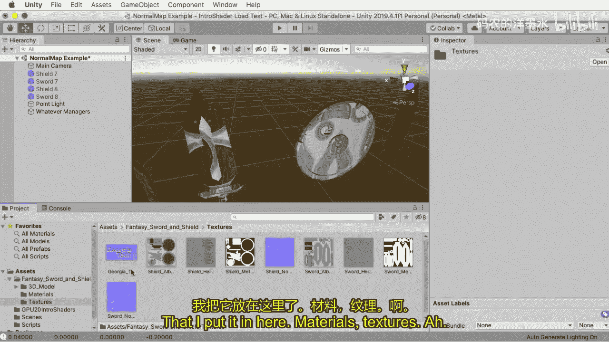
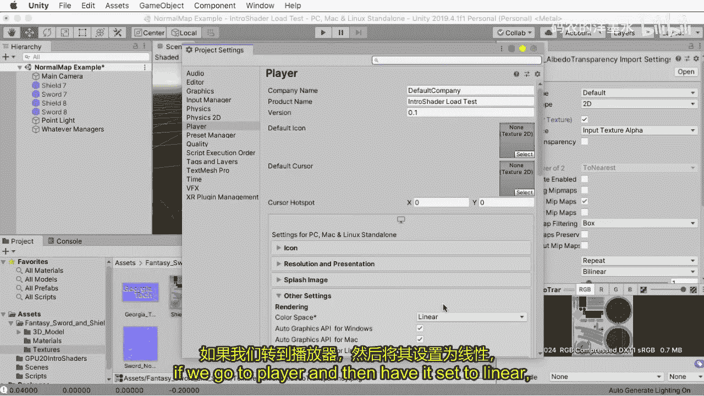

# 019：材质系统详解 🎨

## 概述
在本节课中，我们将学习3D图形编程中的核心概念——材质。材质是决定物体外观的关键，它结合了着色器代码与一系列参数。我们将以Unity引擎为例，讲解材质的基本构成、如何应用纹理与参数，以及颜色空间处理等关键知识。这些概念在绝大多数3D引擎中都是相通的。

## 材质的基本构成
上一节我们概述了材质的重要性，本节中我们来看看材质的具体构成。材质是着色器与一组参数的结合体。着色器是一段运行在GPU上的代码，它决定了如何计算物体表面每个像素的颜色。参数则可以是数字或纹理，用于调整着色器的具体表现。

例如，在材质中调整“衰减因子”这类数值参数，会改变光照强度随距离减弱的效果，从而使物体表面明暗发生变化。

## 纹理的应用
除了数值参数，纹理是材质中最常用的元素。以下是纹理应用的几种方式：

*   **基础漫反射贴图**：这是最常用的纹理，定义了物体的基本颜色和图案。
*   **非常规纹理应用**：你可以尝试将其他类型的纹理（如粒子效果纹理或法线贴图）用作基础贴图，但这通常会产生扭曲或非预期的视觉效果，因为它们并非为此目的设计。
*   **纹理替换**：可以将一个物体的纹理（如盾牌的纹理）应用到另一个物体（如剑）上，但这可能导致图案错乱，因为UV映射不匹配。

操作上，你可以通过点击选择或直接拖拽的方式将纹理资源赋予材质的对应参数槽。

## 着色器与参数的关联
现在让我们深入了解着色器与参数的协作方式。在Unity中，当你为材质更换不同的着色器时，引擎会智能地管理参数。

即使你从一个复杂的着色器（包含多个纹理参数）切换到一个简单的着色器（参数较少），当你再次切换回复杂着色器时，Unity通常会记住并恢复你之前设置的参数值。这个功能非常实用，避免了参数丢失的麻烦。

## 颜色空间与纹理导入设置
在处理纹理时，理解颜色空间至关重要。这关系到我们之前讨论过的伽马空间与线性空间。

显示器通常以伽马空间显示图像，这意味着纹理文件中的颜色值通常存储了近似平方根的映射。为了在着色器中正确进行光照计算，我们需要在线性空间中进行数学运算。

以下是关键设置步骤：

1.  在Unity项目设置的Player中，可以选择使用线性颜色空间。启用后，GPU会在读取纹理时自动进行“平方”操作（转换到线性空间），并在将最终颜色写入缓冲区时进行“平方根”操作（转换回伽马空间）。
2.  纹理导入设置中的“sRGB (Color Texture)”选项控制此行为。对于存储颜色信息的纹理（如漫反射贴图），应勾选此选项，启用自动转换。
3.  对于存储其他数据（如高度、金属度）的纹理，或**法线贴图**（存储的是方向向量而非颜色），则必须取消勾选此选项，避免错误的转换。幸运的是，将纹理类型设置为“Normal map”时，Unity会自动处理这一点。

## 总结
本节课中我们一起学习了材质系统的核心知识。我们明确了材质是**着色器**与**参数**的组合体。我们探讨了如何应用和替换纹理，了解了Unity如何在不同着色器间管理参数。最后，我们深入讲解了线性颜色空间的重要性，以及如何通过纹理导入设置中的**sRGB**选项来正确控制纹理数据的解读方式，确保光照计算的准确性。掌握这些是进行GPU编程和实现复杂视觉效果的基础。