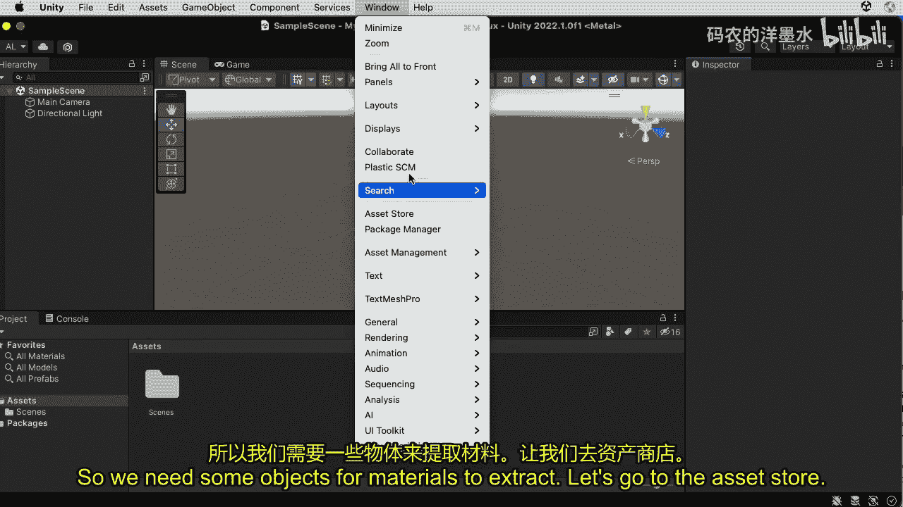
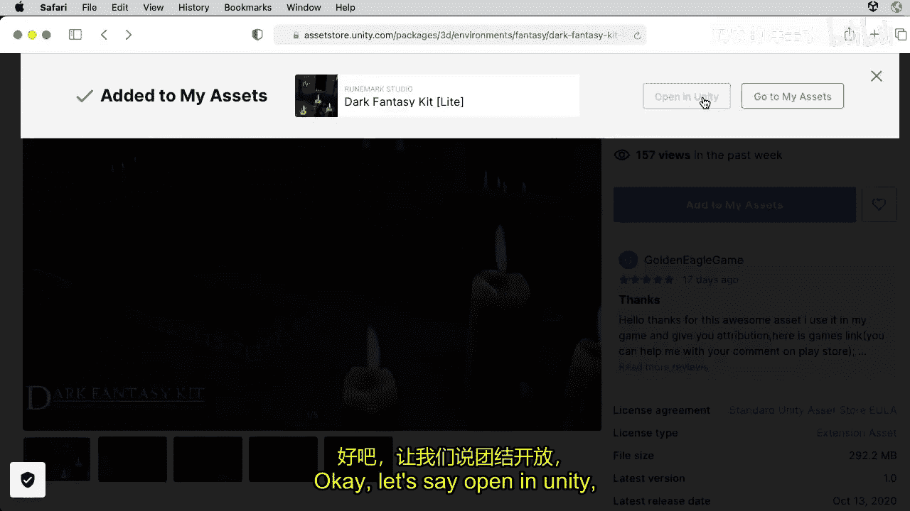
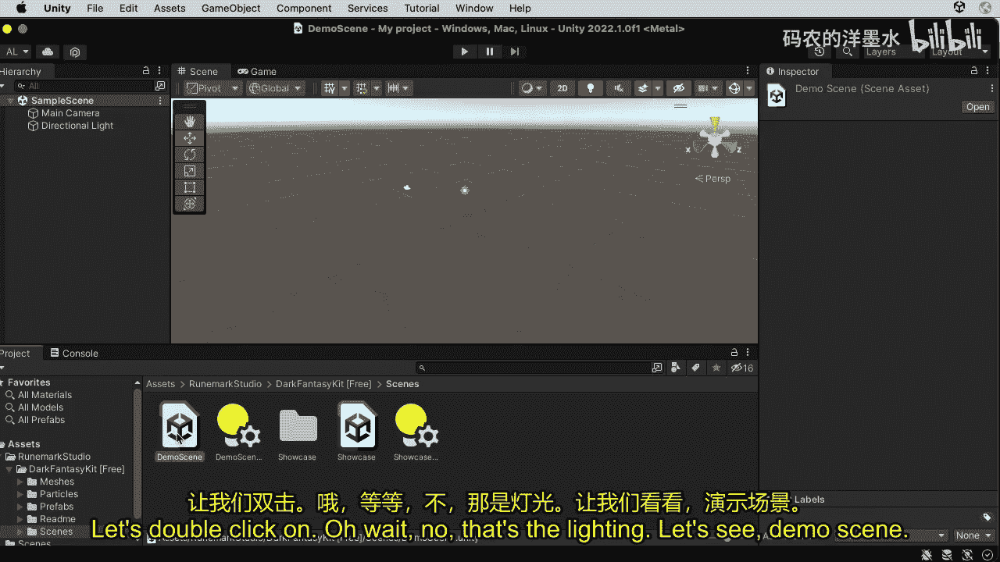

# 020：Unity中的材质提取 🎮

在本节课中，我们将学习如何在Unity中处理导入的3D模型，特别是当模型的材质被“嵌入”在网格内部而无法直接编辑时。我们将通过一个具体的例子，演示如何将这些材质提取出来，使其成为可独立编辑的资产。

---

## 概述

Unity处理导入模型的方式在不同版本中有所变化。过去，导入模型时会自动创建独立的材质文件。但在较新的版本中，为了保持项目整洁，材质默认被嵌入在模型网格内部。这虽然减少了文件数量，但也导致我们无法直接修改这些材质。因此，我们需要一个“提取”过程，将材质从网格中分离出来。

上一节我们介绍了Unity中材质的基本概念，本节中我们来看看如何从导入的模型中提取材质。

---

## 准备项目与环境

首先，我们需要一个Unity项目。本教程使用Unity 2022.1版本，但方法同样适用于2021及更早的版本。

开始前，请务必检查并设置正确的色彩空间：
1.  进入 **Edit > Project Settings**。
2.  在 **Player** 设置中，找到 **Graphics** 部分。
3.  将 **Color Space** 从默认的 **Gamma** 改为 **Linear**。

**代码示例：** 此设置在项目设置中完成，无直接代码。

---

## 导入示例模型

为了演示，我们从Unity Asset Store导入了一个免费的“黑暗幻想”资源包。这个包中的模型材质已经是独立的，便于我们理解标准工作流程。

然而，我们真正要处理的是另一种情况：从外部软件（如Blender、3ds Max）导出的FBX模型，其材质是嵌入式的。

以下是我们将导入的散热器模型步骤：
1.  将FBX模型文件拖入项目的 **Assets** 文件夹。
2.  同时导入模型附带的纹理图片文件夹。

将模型从项目视图拖入场景后，你可能会发现无法在检视面板中修改其材质属性，所有选项都是灰色的。这是因为材质被嵌入了。

---

## 提取嵌入材质

当材质被嵌入时，我们需要手动将其提取为独立文件。

以下是提取材质的步骤：
1.  在 **Project** 窗口中选择导入的模型文件（例如 `radiator.fbx`）。
2.  在 **Inspector** 窗口中找到 **Materials** 分页。
3.  点击 **Extract Materials** 按钮。
4.  系统会提示你选择或创建一个文件夹来存放提取出的材质。**注意：** Unity通常期望此文件夹名为 `Materials`，使用其他名称可能导致后续引用问题。

提取完成后，你会在指定文件夹中看到新的 `.mat` 材质文件。但此时场景中的模型可能仍在使用旧的嵌入材质。

---

## 应用提取后的材质

提取材质后，需要告诉模型使用新的外部材质文件，而不是内部的嵌入材质。

操作步骤如下：
1.  再次选中模型文件。
2.  在 **Inspector** 的 **Materials** 分页，将 **Location** 选项从 **Use Embedded Materials** 改为 **Use External Materials (Legacy)**。
3.  在 **Naming** 下拉菜单中，选择合适的命名规则（例如 **By Base Texture Name**）来帮助Unity匹配材质。
4.  点击 **Apply**。

现在，选择场景中的模型，你应该可以在 **Mesh Renderer** 组件下看到材质引用已更新为新提取的 `.mat` 文件，并且可以自由编辑其属性了。

**核心概念公式：**
`可编辑材质 = 提取(嵌入材质) + 应用(外部材质引用)`

---

## 组织项目结构

为了避免所有提取的材质都堆放在一个 `Materials` 文件夹中造成混乱，建议为每个模型创建独立的子文件夹进行管理。

以下是推荐的文件夹结构组织方法：
1.  在 **Assets** 下为模型创建一个专属文件夹（例如 `Radiator`）。
2.  将模型FBX文件、提取出的 `Materials` 文件夹以及纹理 `Textures` 文件夹都移入这个专属文件夹内。
3.  这样，所有相关资产都集中在了一起，便于管理和维护。

---

## 处理法线贴图等纹理设置

提取材质后，有时会遇到纹理导入设置不正确的问题，例如法线贴图未被正确识别。

解决方法如下：
1.  在 **Project** 窗口中选择被识别为普通图片的法线贴图。
2.  在 **Inspector** 中，将 **Texture Type** 从 **Default** 改为 **Normal map**。
3.  如果原图是灰度高度图，请勾选 **Create from Grayscale**。
4.  点击 **Apply**。

这样，材质就能正确使用法线贴图来表现表面细节了。

---

## 其他注意事项与命名规则

在 **Use External Materials (Legacy)** 设置中，**Naming** 选项决定了提取材质时的命名方式，这会影响材质的查找和创建。

以下是几种常见的命名规则：
*   **By Base Texture Name**： 根据纹理图片的名称来命名材质。
*   **Model Name + Model‘s Material**： 结合模型名称和模型内材质原名来命名。
*   **From Model’s Material**： 直接使用模型内嵌材质的原始名称。

不同的规则适用于不同的项目结构，你可能需要根据实际情况进行尝试和选择。

---

## 总结

本节课中我们一起学习了在Unity中处理嵌入材质的关键流程。我们了解到，新版本Unity默认将材质嵌入模型内部，需要通过 **Extract Materials** 功能将其分离。提取后，还需将模型的材质引用切换为 **Use External Materials (Legacy)** 并点击 **Apply** 才能生效。此外，合理的项目文件夹组织和正确的纹理导入设置（尤其是法线贴图）也是保证材质正常工作的关键步骤。掌握这些技巧，你就能自由地编辑任何导入模型的材质了。