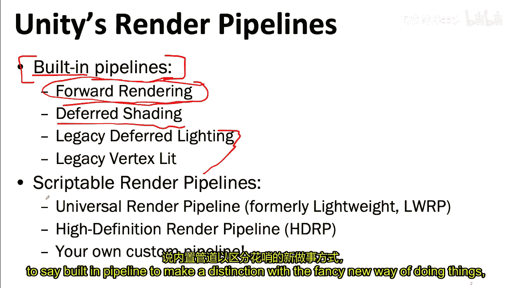
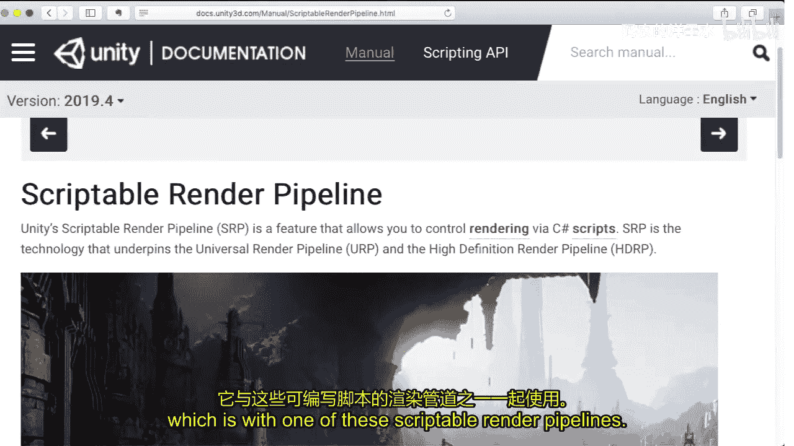
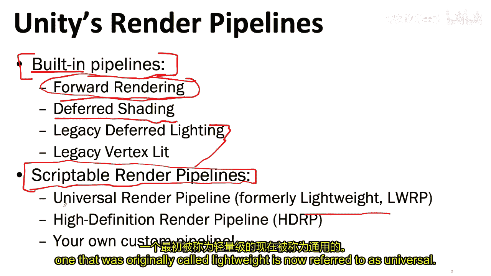
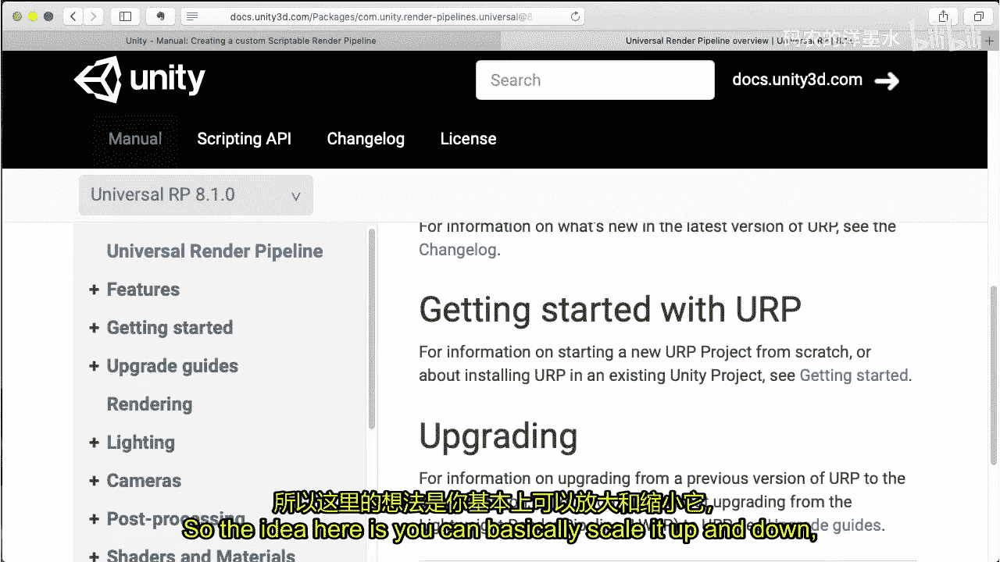
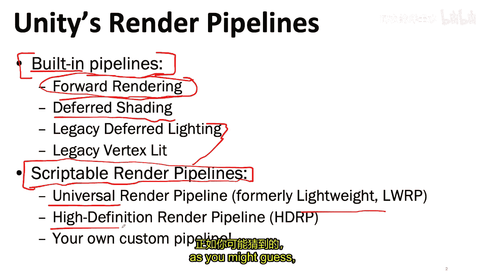
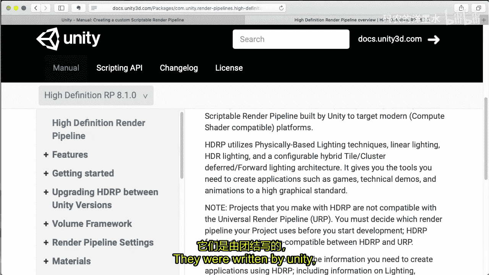
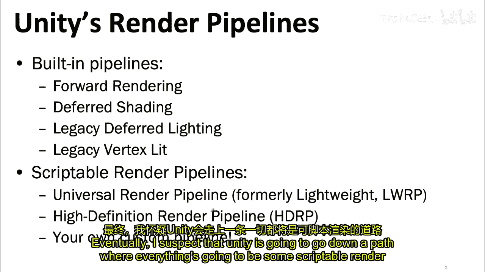
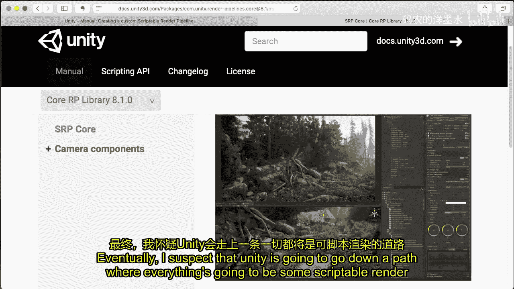
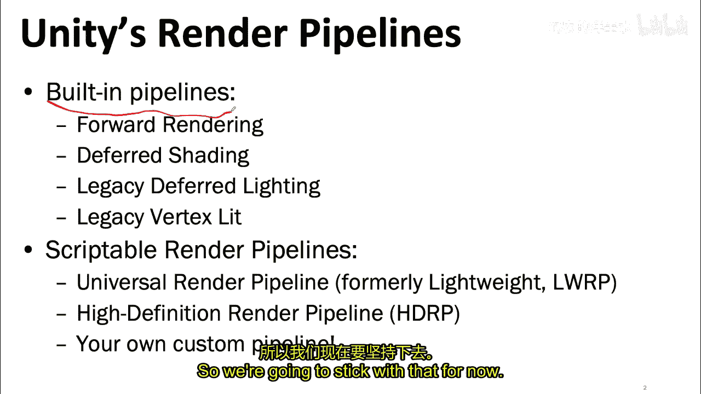

# 021：内置与可编写脚本渲染管线

在本节课中，我们将学习Unity中两种主要的渲染管线架构：内置渲染管线和可编写脚本渲染管线。我们将了解它们的基本概念、区别以及各自的适用场景。

在深入编写着色器代码之前，我们需要先了解Unity设置其图形系统的方式。多年来，Unity内置了多种用于渲染的管线，其基础是我们目前所学的光栅化模型。延迟渲染则更为复杂，它预先计算各种光照信息并存储在缓冲区中，然后运行一个特殊的着色器来处理所有像素，以确定最终的光照效果。这是一种更高级的技术，我们将在后续课程中探讨。目前，我所展示的所有代码都基于前向渲染范式。早期版本的一些管线现已不再使用。因此，接下来许多课程中展示的代码都将使用**内置渲染管线**。

过去，我们并不特别强调“内置管线”，因为当时只有这些管线。现在，为了与新的**可编写脚本渲染管线**区分，我们必须使用“内置管线”这个说法。

## 可编写脚本渲染管线简介

上一节我们介绍了内置渲染管线，本节中我们来看看新的可编写脚本渲染管线框架。原始的**内置渲染管线**提供了各种回调和设置，允许你以不同方式启用或禁用某些功能。而**可编写脚本渲染管线框架**则向开发者暴露了更多底层功能，让你能更精细地控制图形渲染的流程。

Unity提供了两种主要的可编写脚本渲染管线：

以下是两种主要的可编写脚本渲染管线：

*   **通用渲染管线**：最初称为“轻量级渲染管线”。更名为“通用”可能是因为“轻量级”容易让人联想到性能较低的设备（如手机）。实际上，URP内置了非常强大的功能，其设计理念是能够灵活地向上或向下扩展，既适用于手机等移动设备，也适用于高端的自定义游戏设备。
*   **高清渲染管线**：顾名思义，HDRP需要性能相当强大的硬件才能流畅运行。

这两种管线本身并不特殊，它们是由Unity使用**可编写脚本渲染管线**的相同功能编写的。这意味着，如果你愿意，也可以编写自己的自定义管线。你可以从零开始编写（但不推荐），或者基于Unity提供的管线源码进行修改，以满足特定需求。与原始的内置管线不同，可编写脚本渲染管线的源代码对用户是可用的。

我推测Unity最终会走向全面采用可编写脚本渲染管线的道路，而内置管线可能会被逐步弃用。但目前距离那个阶段还很远。就目前而言，为了教学方便，我选择继续使用**内置渲染管线**，这样可以更容易地沿用本课程之前版本的着色器示例代码。

本节课中，我们一起学习了Unity中**内置渲染管线**与**可编写脚本渲染管线**的核心区别。我们了解到内置管线是传统架构，而可编写脚本管线（如URP和HDRP）提供了更底层、更灵活的控制能力。在接下来的课程中，我们将基于内置管线来学习着色器编程的基础知识。