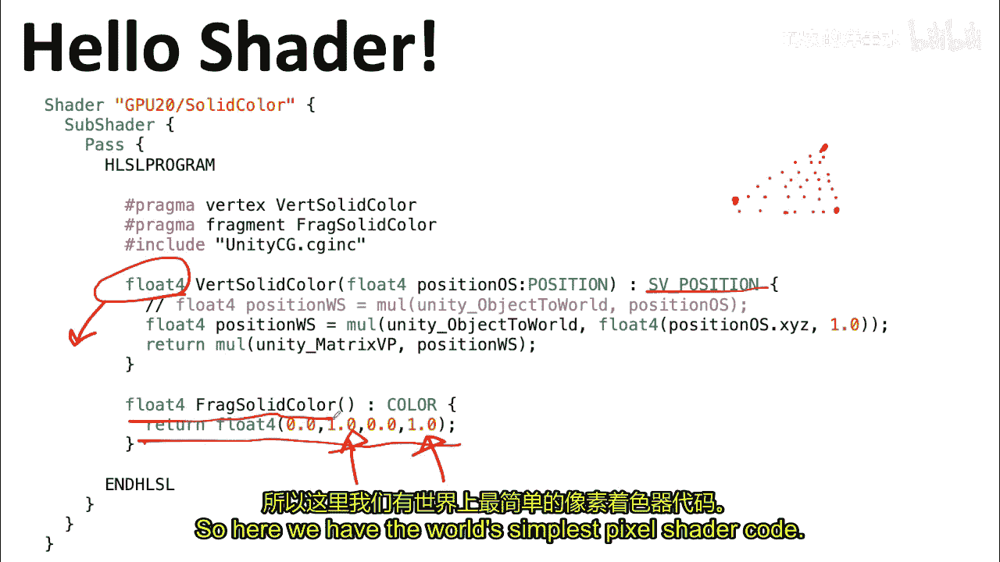
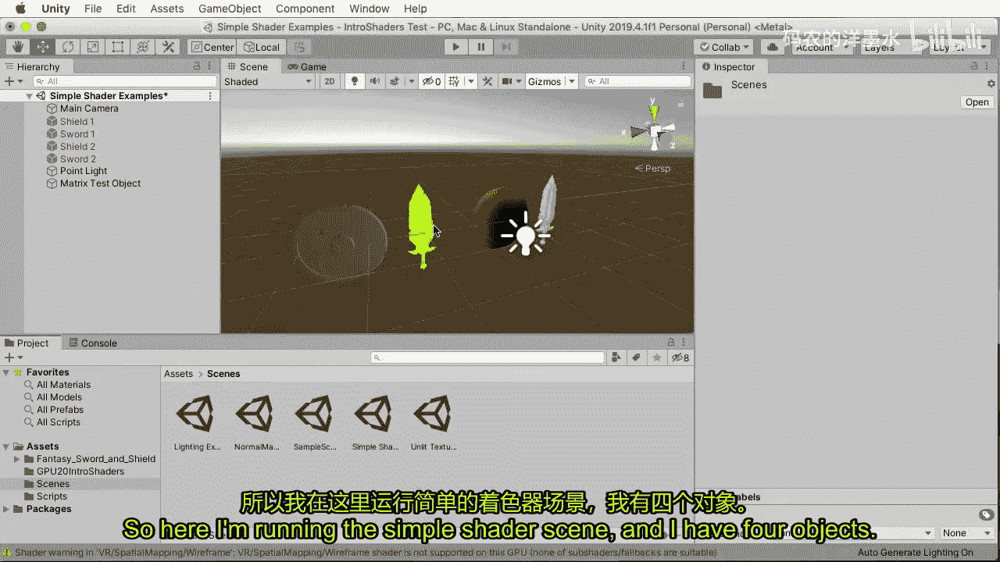
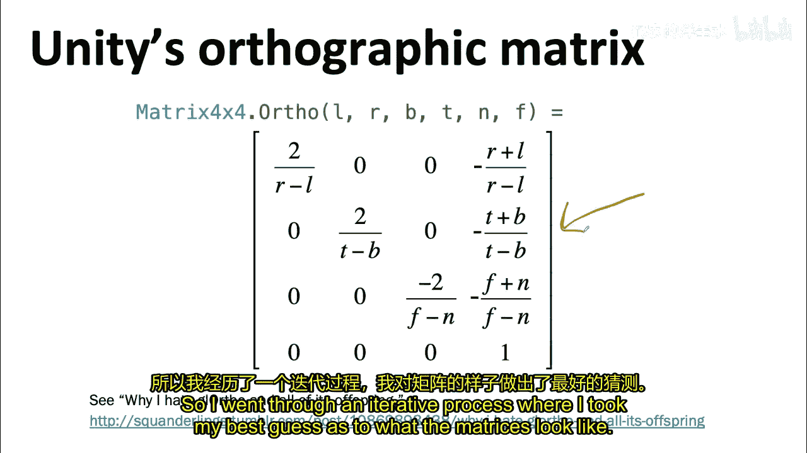
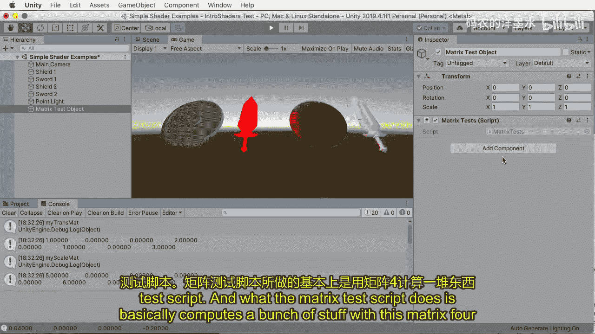
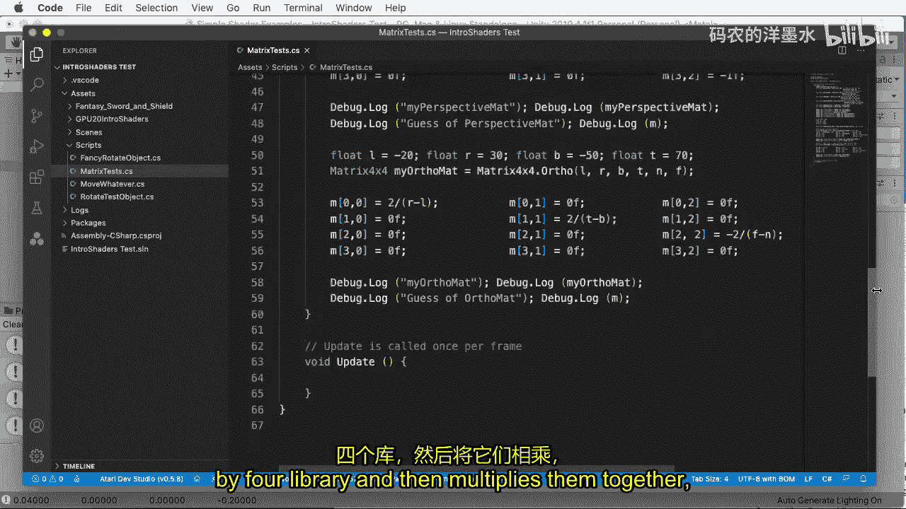
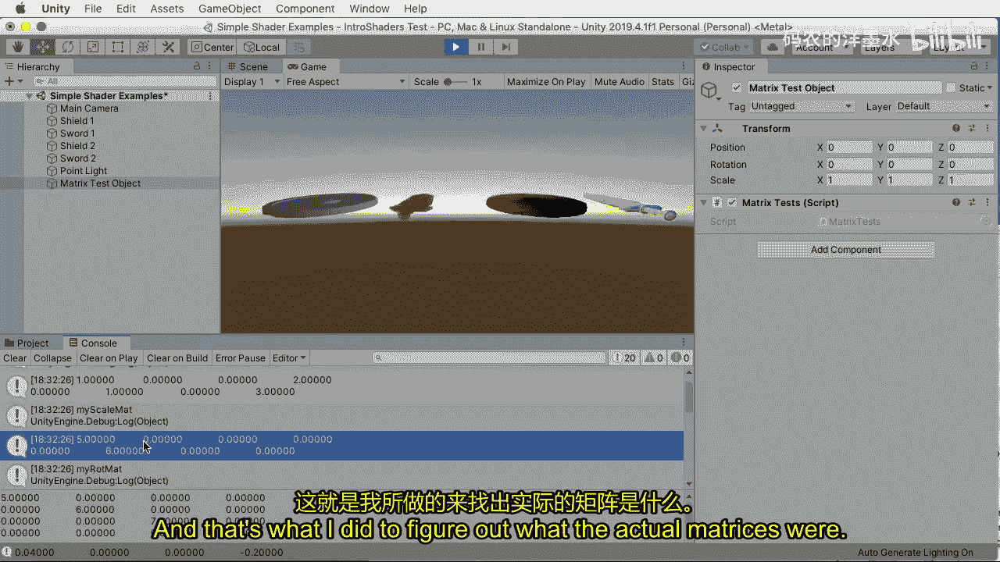
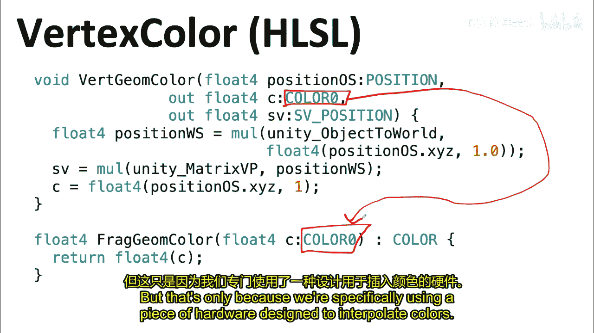
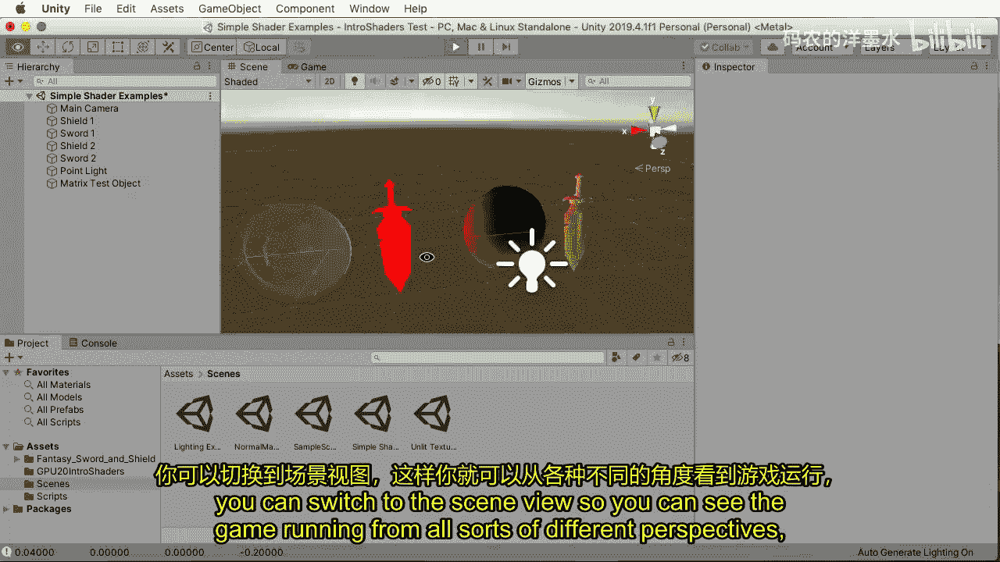
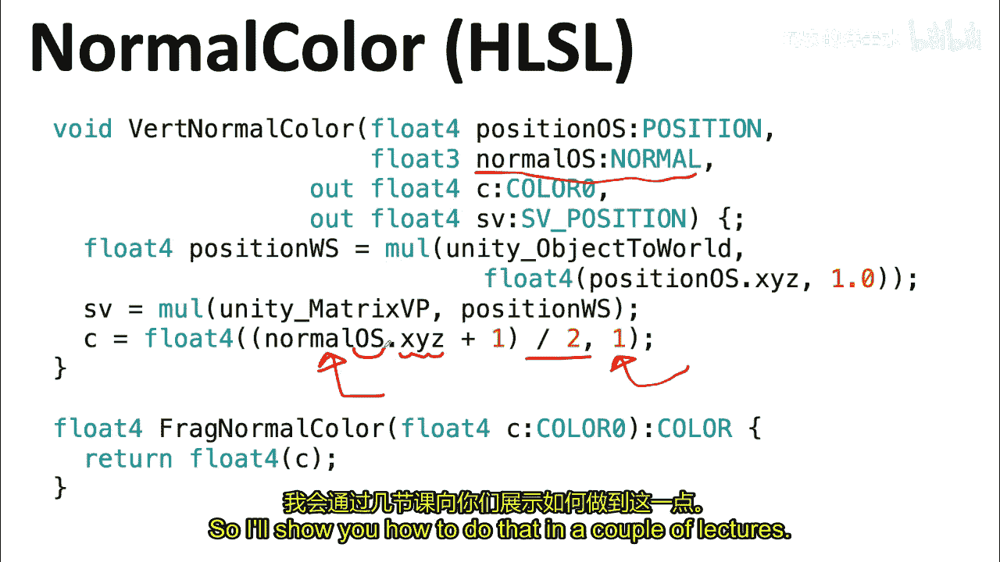
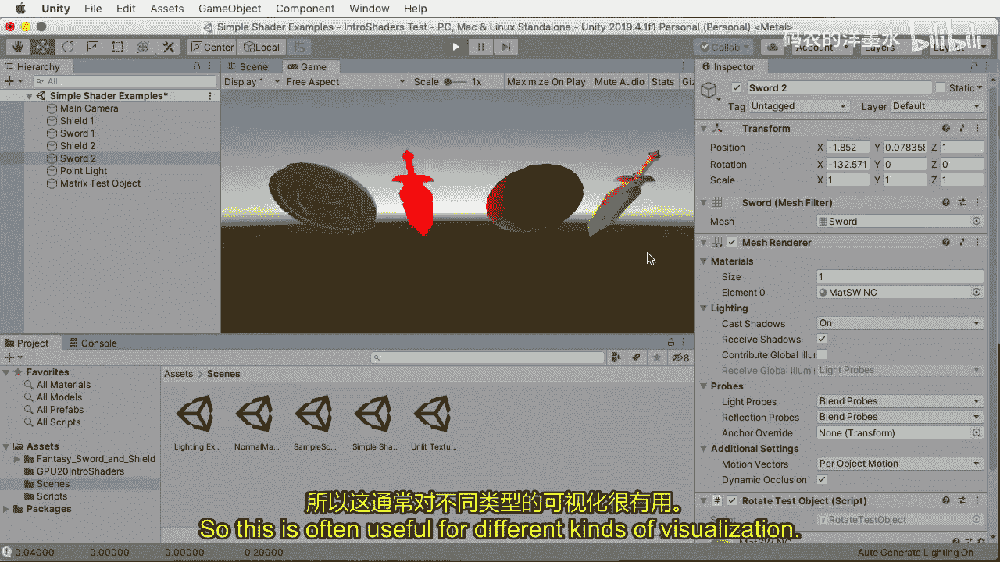

# 022：简单无光着色器 🎨

在本节课中，我们将学习如何编写一些简单的、不响应光照的着色器代码。我们将从Unity平台上的具体HLSL代码示例开始，逐步理解顶点着色器和片段（像素）着色器的基本结构和工作原理。

---

## 概述

我们已经花了很多时间回顾计算机图形学的基础知识，并讨论了如何使用Unity作为实现图形算法的平台。我们也泛泛地谈到了着色器代码。现在，我们将最终查看一些实际可工作的着色器代码的具体示例。我们将从一些不响应光照的简单着色器代码开始。

**重要提示**：如果你使用传统内置渲染管线启动一个空白的3D项目，请务必进入项目设置的“Player Settings”，确保色彩空间设置为“Linear”。即使在2020.1 beta版本中，它仍然默认是“Gamma”，这并不理想。幸运的是，如果你启动通用渲染管线或高清渲染管线项目，它会默认设置为“Linear”。

---

## 第一个着色器：纯色着色器

经过本课程的多次讲座，我们终于可以看一些着色器代码了。实际的HLSL代码位于 `HLSLPROGRAM` 和 `ENDHLSL` 之间。在一些较早的Unity着色器示例中，你可能会看到 `CGPROGRAM` 而不是 `HLSLPROGRAM`。根据当前Unity文档，`HLSLPROGRAM` 和 `CGPROGRAM` 之间的唯一区别在于自动包含的各种头文件。实际上，HLSL和CG本质上是相同的。

### 代码结构与元数据

`HLSLPROGRAM` 和 `ENDHLSL` 之外的所有内容并非HLSL本身的一部分，而是Unity特定的元数据。这些元数据告诉Unity如何组织你即将提供的代码。例如，它会将着色器放在名为“GPU 20”的文件夹中，并在其中创建一个名为“Solid Color”的着色器。我们目前查看的所有着色器都只有一个子着色器（SubShader）和一个通道（Pass），后续我们会看到具有多个通道的情况。

### 包含文件与预定义变量

`#include` 指令的作用与你预期的一致。几乎任何为Unity编写的着色器都需要包含 `UnityCG.cginc` 这组定义。

这可能会让事情看起来有点复杂，因为我们将使用许多Unity为你预定义的变量。Unity运行时会在内部运行各种脚本，来设置这些变量，例如 `UNITY_MATRIX_MVP`（模型-视图-投影矩阵）和 `unity_ObjectToWorld`（物体到世界的变换矩阵）。`unity_ObjectToWorld` 是一个4x4矩阵，用于将坐标从模型空间变换到世界空间。`UNITY_MATRIX_MVP` 是视图变换和透视变换的组合。

**注意**：Unity的命名约定可能有些令人困惑。它列出了变换应用于向量时的顺序，但这并不是顶点变换的实际矩阵乘法顺序。因为我们使用的是列向量约定（向量在右侧，矩阵在左侧），所以Unity实际上是在CPU端预先计算了 `P * V`（投影矩阵乘以视图矩阵）。变量名中的“V”在前可能会造成误解，但这只是Unity使用的约定。

如果你不使用Unity的渲染例程来填充这些变量，你就需要在C#脚本中显式地创建这些矩阵，并通过CPU端发送到GPU。Unity在幕后为我们处理了这些。

### 编译指令与着色器函数

我们使用 `#pragma` 指令来告诉编译器哪个是顶点着色器，哪个是片段（像素）着色器。这里使用“fragment”来表示像素着色器。

```hlsl
#pragma vertex vertSolidColor
#pragma fragment fragSolidColor
```

我们定义了顶点着色器函数 `vertSolidColor` 和片段着色器函数 `fragSolidColor`。人们通常将它们简称为 `vert` 和 `frag`，但为了展示不同的示例，这里使用了更具描述性的名称。

### 顶点着色器详解

顶点着色器使用一种特殊的语法来定义输入和输出。`POSITION` 语义表示输入的是顶点位置数据。你不能随意创建语义，必须使用预定义的语义。

顶点着色器处理单个顶点，并输出一个四维坐标，该坐标表示在最终投影裁剪空间中的屏幕位置，使用 `SV_POSITION` 语义标记。

在代码中，我们首先将模型空间的位置转换到世界空间。我们采用了一种优化提示：不是直接进行4x4矩阵乘法，而是将位置向量的x, y, z分量取出，手动添加一个 `w=1` 的分量，然后再进行矩阵乘法。这样做是希望编译器能利用最后一个分量为1的事实来简化实际的矩阵乘法代码，从而生成更高效的代码。这是一种以牺牲部分代码清晰度为代价来提示编译器优化的做法。

```hlsl
// 将模型空间位置转换到世界空间（带优化提示）
float4 worldPos = mul(unity_ObjectToWorld, float4(v.vertex.xyz, 1.0));
// 将世界空间位置转换到裁剪空间
o.pos = mul(UNITY_MATRIX_VP, worldPos);
```

**注意**：代码中没有显式地进行透视除法（即除以w分量）。这个操作由GPU上的其他硬件（或固件）处理。作为程序员，我们不需要在着色器中编写这一步。

### 片段着色器详解

顶点着色器运行后，会生成大量像素（远多于顶点数量）。然后，这些信息被用来计算颜色。

在这个最简单的示例中，我们的片段着色器不接受任何参数，只是简单地返回一个颜色值。这里我们返回绿色（RGBA: 0, 1, 0, 1）。

```hlsl
fixed4 fragSolidColor() : SV_Target
{
    return fixed4(0, 1, 0, 1); // 返回绿色
}
```

---



## 运行示例与矩阵揭秘



在示例场景中，有四个物体应用了不同的着色器。最左边是一个使用Unity标准内置着色器的盾牌，作为通用参考。旁边是应用了我们刚编写的“纯色着色器”的物体，它显示为绿色。

如果你好奇Unity内部的各种矩阵是什么样子，可以通过一些测试来获取。例如，可以创建一个脚本，使用Unity的 `Matrix4x4` 类库计算各种变换矩阵，并与内置例程的结果进行比较，从而推断出矩阵的实际构成。正交投影矩阵和透视投影矩阵的具体形式可以通过这种方式验证。Unity文档通常不会明确列出这些矩阵的具体值。

---

## 另一种编码风格：输出参数



上一节我们介绍了使用 `return` 语句返回单个值的顶点着色器写法。本节中我们来看看另一种风格，即使用 `out` 输出参数。

我们可以不使用 `return` 命令，而是将函数声明为 `void` 类型，并通过 `out` 参数来输出结果。这是一种编程语言风格的功能，而非纯数学函数。





```hlsl
void vertSolidColorOut (appdata_base v, out float4 pos : SV_POSITION)
{
    // 计算裁剪空间位置
    float4 worldPos = mul(unity_ObjectToWorld, float4(v.vertex.xyz, 1.0));
    pos = mul(UNITY_MATRIX_VP, worldPos);
}
```

在这种风格下，片段着色器可以直接输出一个颜色变量。我们需要记住为这个输出变量赋值。

```hlsl
void fragSolidColorOut (out fixed4 col : SV_Target)
{
    col = fixed4(1, 0, 0, 1); // 输出红色
}
```

将着色器改为这种风格后，物体会显示为红色。这证明了代码的有效性。



---

## 可视化着色器：位置与法线

到目前为止，我们展示的片段着色器都没有接受任何参数。现在，我们将让着色器接受一个颜色参数，并直接显示它。同时，我们也将探索如何用着色器来可视化几何数据。

### 位置可视化

在顶点着色器中，我们可以将位置信息（例如模型空间的X, Y, Z坐标）直接转换为RGB颜色并输出。这是一种诊断工具，用于可视化几何数据并确保其被正确解释。

我们将X坐标映射为红色，Y映射为绿色，Z映射为蓝色。这个映射本身没有特别的逻辑，只是为了可视化。坐标值大于1的部分会“冲白”（达到最大值），负值部分则会显示为黑色。

```hlsl
// 在顶点着色器中计算颜色
o.color = float4(v.vertex.xyz, 1.0); // 将位置直接作为颜色
// 在片段着色器中输出插值后的颜色
fixed4 fragVertexDemo (float4 color : COLOR0) : SV_Target
{
    return color;
}
```

**重要概念：插值**：片段着色器接收到的 `color` 参数并不是直接从顶点着色器传递过来的原始值，而是由硬件在三角形顶点之间**插值**后的结果。`COLOR0` 语义将这个输出与硬件的颜色插值单元连接起来。

在示例场景中，从右数第二个物体应用了“顶点演示着色器”，其X, Y, Z坐标被解释为颜色，产生了一种有趣的视觉效果。

### 法线可视化

法线信息通常用于漫反射等光照计算。但在这里，我们仅用它进行可视化。法线向量的分量范围通常在-1到1之间。



为了将其映射到0到1的颜色范围，我们可以对每个分量进行变换：`(normal.xyz + 1.0) * 0.5`。

```hlsl
// 在顶点着色器中可视化法线
float3 visualNormal = (v.normal.xyz + 1.0) * 0.5;
o.color = float4(visualNormal, 1.0);
```



同样，我们在片段着色器中输出这个插值后的颜色。需要注意的是，这里显示的是模型空间中的法线。对法线向量进行坐标空间变换比变换顶点位置要复杂一些，我们将在后续课程中介绍。

在示例场景中，最右边的物体正在运行这个法线可视化代码。这对于调试和艺术效果都非常有用。

---



## 总结



本节课中，我们一起学习了如何编写简单的无光照着色器。我们从最基本的纯色着色器开始，理解了HLSL代码在Unity中的基本结构，包括编译指令、包含文件、预定义变量以及顶点/片段着色器的编写。我们探讨了两种不同的函数输出风格：使用 `return` 语句和使用 `out` 参数。最后，我们学习了如何利用着色器将几何数据（如位置和法线）可视化为颜色，这是一种强大的调试和艺术创作工具。这些基础知识是我们后续学习更复杂光照和渲染技术的起点。