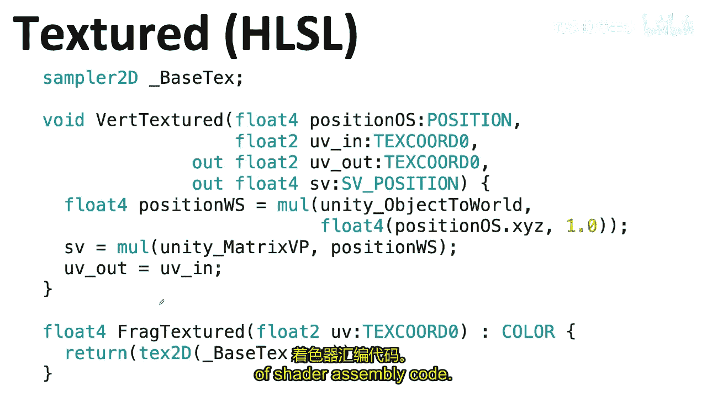
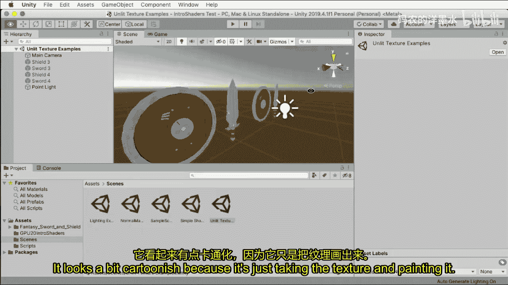
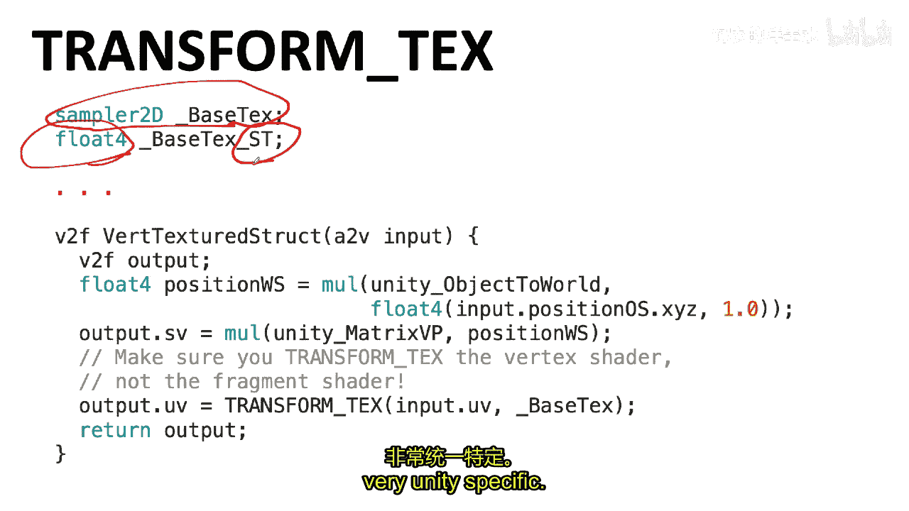
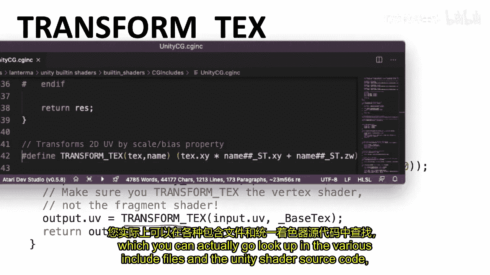
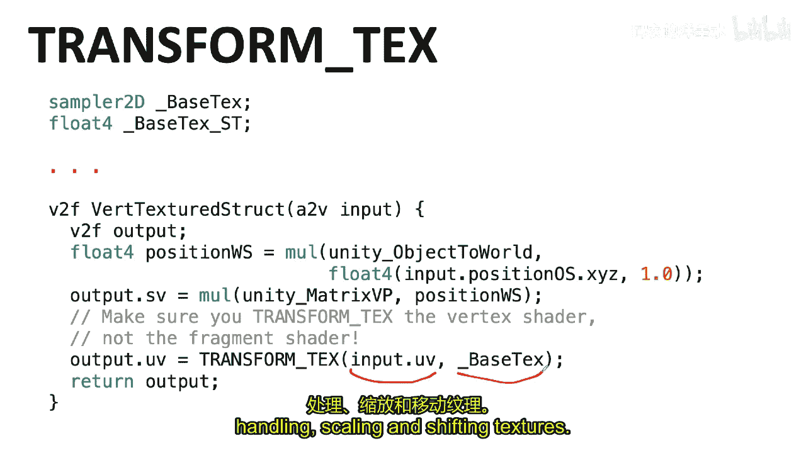

# 023：在着色器代码中访问纹理 🎨

在本节课中，我们将学习如何在着色器代码中访问和使用纹理。我们将探讨如何在Unity中设置纹理属性，如何在顶点和片段着色器之间传递纹理坐标，以及如何执行纹理采样。课程内容将涵盖基本的纹理映射概念，并展示两种不同的代码结构来实现相同的功能。

---

## 概述

本节将介绍着色器代码中处理纹理的核心部分。我们将看到如何声明纹理属性，如何在顶点着色器中接收纹理坐标，以及如何在片段着色器中进行纹理查找。代码主体与第20讲的内容相似，主要新增的是属性部分。

---

## 属性声明与变量

属性代表可以在Unity检视面板中赋值的变量。HLSL代码实际位于 `HLSLPROGRAM` 和 `ENDHLSL` 行之间。其外的内容是元信息，用于告知Unity如何使用此特定着色器代码。大多数其他引擎也会有类似的设置。

以下是属性声明的示例：
```hlsl
Properties {
    _BaseTex ("Base RGB", 2D) = "white" {}
}
```
此处变量名 `_BaseTex` 将出现在实际的HLSL程序中。下划线是Unity的命名约定。字符串中的“Base RGB”是此属性在Unity检视面板中的标签。括号内的内容描述了属性的类型，这是一个在CPU端赋值、然后应用于所有待处理顶点或像素的**uniform变量**。`"white" {}` 设置了默认值。

---

## 编译器指令与语义

我们在此看到的HLSL编译器指令与上一讲相同。处理纹理坐标语义时有一个特别容易混淆的问题。“语义”指的是定义显卡上硬件寄存器行为的这些 `TEXCOORD0` 等大写字母标识符。

主要问题在于，顶点着色器输入中的 `TEXCOORD0` 与顶点着色器输出中的 `TEXCOORD0` 完全不同。

输入中的 `TEXCOORD0` 通过API连接到CPU端。而输出中的 `TEXCOORD0` 则将顶点着色器的输出连接到插值硬件，该硬件为特定三角形生成的各个像素创建所有插值后的UV值。如果这两者被命名为不同的东西会更好理解。在着色器代码中，你没有义务必须将从API传入的 `TEXCOORD0` 与连接顶点着色器和像素着色器的 `TEXCOORD0` 匹配起来，它们是不同的东西。

在本例中，我们将其视为相同的东西，因为我们只是将传入的纹理坐标原封不动地输出。

---

## 顶点着色器

大部分代码与上一讲相同。顶点着色器接收顶点的位置，并需要输出一个裁剪空间中的位置，GPU用它来确定三角形的位置，并在需要时进行Z缓冲等操作。

我们在此将物体空间中的位置转换到世界空间。这个添加了 `1` 的奇怪写法有点特殊，你并非必须这样做，可以直接进行4x4矩阵乘法，但这样写可能暗示编译器可以进行一些优化。

然后，我们获取世界空间中的位置，并通过视图和投影变换得到裁剪空间中的坐标并输出。

对于纹理坐标，除了每个3D顶点具有位置外，它还有一个2D坐标。在Unity中，这些坐标称为UV。其他引擎可能使用S和T的约定。人们使用U、V或S、T作为坐标，因为X和Y已被3D坐标XYZ占用。这些2D纹理坐标代表对图像的查找，该图像是包裹在物体周围的纹理。我们在这里只是将传入的UV坐标原样发送出去。当然，输出的UV坐标会经过插值硬件。

因此，片段着色器将进行纹理查找，查找的不是传递三角形三个顶点纹理坐标所产生的三个坐标之一，而是光栅化过程中创建的数十或数百个像素的插值坐标。这样，你就可以显示一个漂亮的图像，而不是一个大色块。

---

## 片段着色器与纹理查找

片段着色器将执行纹理查找。至关重要的是，实际的纹理查找（由 `tex2D` 命令执行）发生在像素着色器中。如果你在顶点着色器中看到 `tex2D` 引用，可能有一些特殊原因，但大多数情况下通常不需要这样做。任何合理平台上的现代着色器模型都可以在顶点着色器中执行纹理查找（如果你出于某种原因需要的话）。早期的着色器模型、早期的GPU实际上只在像素着色器中具有纹理查找能力，因为那通常是需要它的地方。

`tex2D` 命令为我们执行查找。你给它一个纹理变量名和一个二维坐标，它就会进行查找。此时进行查找时，它将执行我们在之前课程中看过的图像插值（纹理插值），并根据你在API中设置的标志选择插值技术。如果你使用Unity，这些通常是在特定纹理的检视面板中设置的。

在这里，我们将读取该纹理，不进行任何光照或其他复杂计算，直接返回该RGBA值。我们必须使用 `COLOR` 语义来执行此操作，因为这告诉GPU这是一个RGB值，将其发送到缓冲区，并可能根据你在API中设置的行为变量以不同方式解释Alpha通道。

---

## 变量声明与结构体

在提供顶点着色器和片段着色器代码之前，我们有一个声明。在这里，我们将带下划线的 `_BaseTex` 统一变量声明为 `sampler2D`，这基本上意味着这是一个2D纹理。请注意，我必须在着色器代码本身中声明它，仅在此处的属性列表中声明是不够的。此外，如果属性列表中指示的类型与着色器代码本身中给出的特定类型不兼容，Unity可能会报错或发生其他奇怪的事情。

另一点需要注意的是，虽然我对像素着色器使用了返回结构，但对顶点着色器没有使用那种返回结构。相反，我们在参数列表中使用这些 `out` 关键字，并在此处分配这些参数。

在上一讲中，我承诺会展示另一种处理方式，现在我们就来看看。这段代码做完全相同的事情，只是我们引入了类似于C语言中结构体的用法。

这里我们定义了一个 `appdata` 结构体和一个 `v2f` 结构体。`appdata` 结构体包含每个顶点的输入位置和输入UV坐标。`v2f` 结构体有一个裁剪空间位置 `SV_POSITION` 和UV纹理坐标。这里的所有底层逻辑都是相同的。我只需要在这里稍微不同地使用点符号来访问正确的内容。例如，这里我使用 `.uv` 来选择此输入结构体的uv组件。

请注意，我不需要显式地有一个输入 `SV_POSITION`，显卡将获取这些裁剪空间位置，并根据此处存在语义的事实来构建三角形。我想再次强调，你在此处看到的 `TEXCOORD0`（即UV组件）与用于连接像素着色器的 `TEXCOORD0` 坐标不同。

我们需要类似地调整顶点结构中的代码，从输入结构体中检索位置和UV坐标，并类似地将内容分配给此处指定的输出结构体。我们需要使用点符号，但一旦我们将这些内容分配给输出结构体，就可以返回它。这只是一种编码风格，如果这段代码和那段代码编译成不同的着色器汇编代码，我会感到非常惊讶。

---

## 场景演示与功能扩展

现在我们来看看Unity包中的“Unlit Texture”场景。这并不十分有趣，因为这里没有实际的光照。它看起来有点卡通感，因为它只是获取纹理并绘制它，没有发生什么非常令人兴奋的事情。

在左侧，你可以看到原始的纹理着色器。如果我展开它，可以查看纹理。这与你在着色器代码字符串中看到的“Base RGB”相对应。

我们可以尝试其他操作，比如把剑的纹理放上去，这看起来很奇怪，让我们撤销它。然后下一个是“Textured Structure Shader”，正如我所说，它的操作完全相同，只是编码风格不同。

在Unity中，你应该能够在此处添加一些偏移来改变传入的纹理坐标，但这似乎不起作用，这似乎是个问题。你还应该能够对传入的坐标应用缩放因子，例如，如果你想为砖墙等重复此纹理，但更改它也不起作用。

为了能够处理此功能，我们必须做一些额外的事情。右侧的剑和盾牌使用了另一个我称为“Texture Tiling Correctly”的着色器。如果我们使用这个，那么我们就可以正确地调整平铺。





让我们将其更改为10和10，你会看到一堆小盾牌。你可以在每个方向上以不同方式操作，并以不同方式拉伸它，这很有趣。让我们朝另一个方向拉伸它。好的，这也很有趣。或者你也可以偏移盾牌，如果我在这里放0.5和0.5，那么它会获取纹理的另一部分。无论如何，为了实现此功能，我们必须稍微调整代码。

---

## 实现纹理缩放与偏移

修复方法如下，这非常令人烦恼，是Unity特有的。

Unity着色器编译器希望你获取所有纹理，并创建一个末尾附加了下划线和大写字母“T”的 `float4` 变量。这是非常非常Unity特定的。然后有一个宏，你实际上可以在Unity着色器源代码的各种包含文件中查找它。你给这个宏一个UV纹理坐标和要查找的纹理，它将替换所需的几个变换，以合并来自检视面板的用于处理纹理缩放和移动的功能。

核心代码调整如下：
```hlsl
// 声明一个与纹理对应的_ST变量（Unity特定）
float4 _BaseTex_ST;

// 在顶点着色器中应用缩放和偏移
o.uv = TRANSFORM_TEX(v.uv, _BaseTex);

// 片段着色器中使用宏处理后的UV进行采样
fixed4 col = tex2D(_BaseTex, i.uv);
```
`TRANSFORM_TEX` 宏会自动应用在材质检视面板中设置的平铺和偏移值。

---

## 总结







本节课中，我们一起学习了在着色器代码中访问纹理的完整流程。我们从声明纹理属性开始，理解了uniform变量的概念。接着，我们探讨了顶点着色器如何接收并传递纹理坐标，以及片段着色器如何使用 `tex2D` 函数进行纹理采样。我们还比较了两种不同的代码结构：一种使用输出参数，另一种使用返回结构体，两者功能等价。最后，我们了解了如何在Unity中实现纹理的缩放和偏移功能，这需要通过特定的 `_ST` 变量和 `TRANSFORM_TEX` 宏来完成。掌握这些基础知识，你就能在着色器中有效地使用纹理来增强模型的视觉效果。