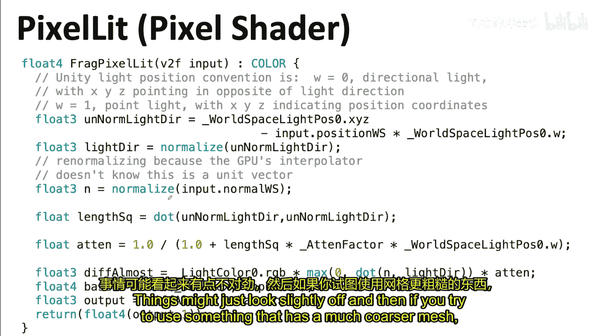
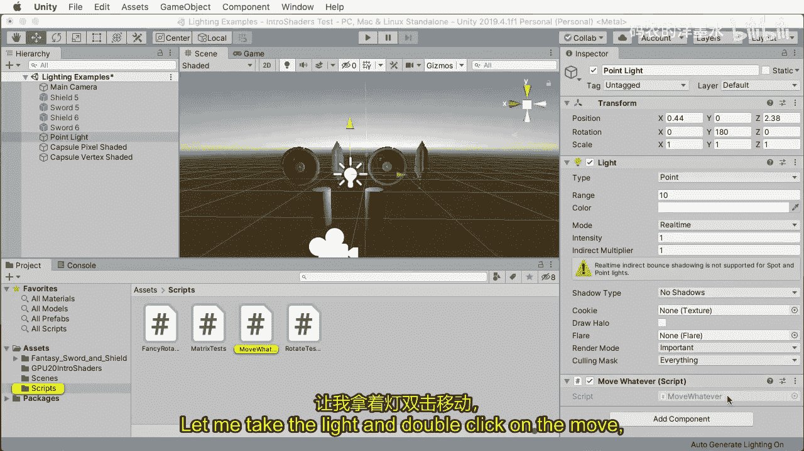
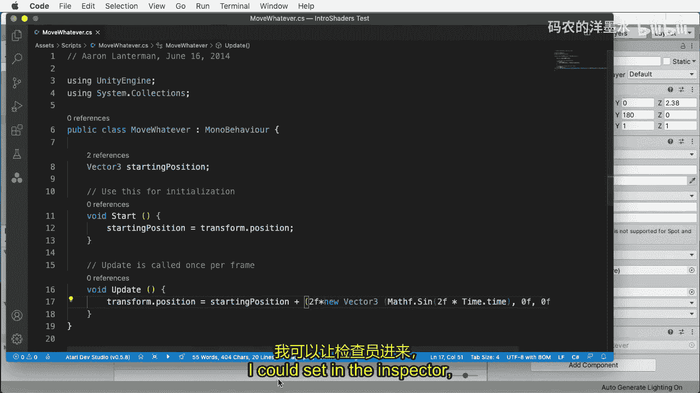
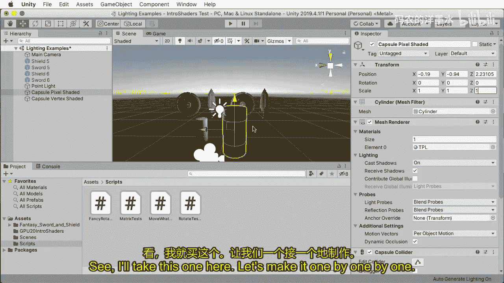
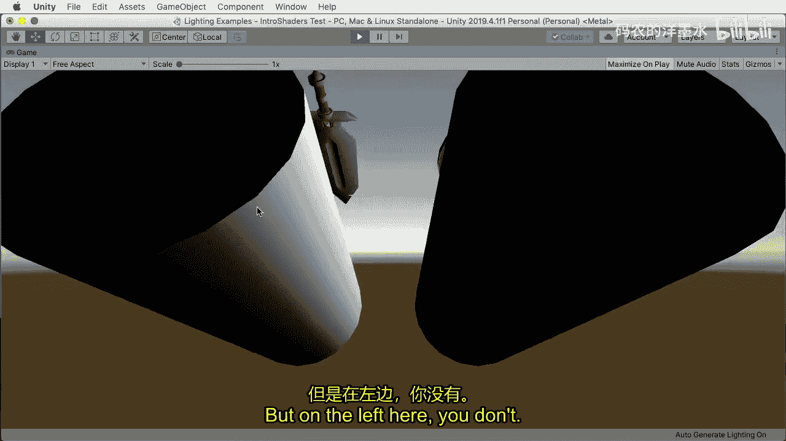
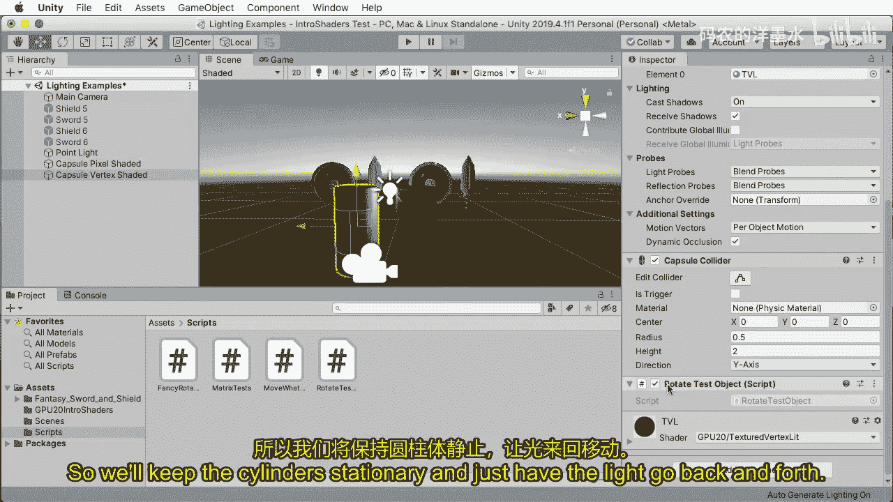
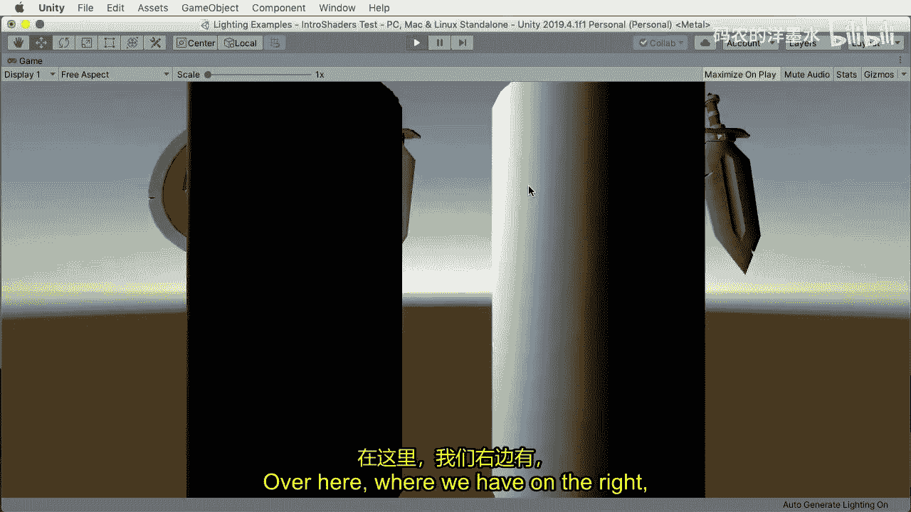

# 025：简单光照着色器教程 🎮

在本节课中，我们将学习如何编写处理光照的着色器代码。我们将重点介绍两种实现漫反射光照的方法：逐顶点光照（也称为Gouraud着色）和逐像素光照（也称为Phong着色）。课程将涵盖从基础概念到实际代码实现的全过程，确保初学者能够理解并应用这些技术。

---

## 概述

上一节我们介绍了基础的纹理着色器。本节中，我们将探讨如何为3D对象添加光照效果，使其看起来更加真实。我们将从逐顶点光照开始，然后过渡到更高质量的逐像素光照。

## 着色器结构

以下是实现光照效果的基本着色器结构。我们首先处理顶点着色器，将对象空间中的位置转换到世界空间，再转换到裁剪空间。纹理坐标则直接传递，但会通过一个变换宏来处理偏移和缩放。

```hlsl
// 顶点着色器示例结构
v2f vert (appdata v)
{
    v2f o;
    // 位置变换：对象空间 -> 世界空间 -> 裁剪空间
    o.vertex = UnityObjectToClipPos(v.vertex);
    // 纹理坐标变换
    o.uv = TRANSFORM_TEX(v.uv, _MainTex);
    return o;
}
```

## 逐顶点光照（Gouraud着色）

逐顶点光照在顶点着色器中计算光照强度，然后通过硬件插值传递给像素着色器。这种方法计算量较小，但效果可能不够平滑。

### 核心计算

光照计算的核心是朗伯反射模型。我们计算光线方向与表面法线的点积，并应用衰减（对于点光源）。

**公式**：
`diffuse = lightColor * max(0, dot(normal, lightDir)) * attenuation`

以下是实现步骤：

1.  **变换法线**：将法线从对象空间变换到世界空间。由于法线是方向向量，需要使用模型变换矩阵的逆转置矩阵。
    ```hlsl
    float3 worldNormal = mul(v.normal, (float3x3)unity_WorldToObject);
    worldNormal = normalize(worldNormal);
    ```
2.  **计算光线方向**：根据光源类型（平行光或点光源）计算指向光源的向量。
    ```hlsl
    float3 lightDir = _WorldSpaceLightPos0.xyz - v.worldPos * _WorldSpaceLightPos0.w;
    lightDir = normalize(lightDir);
    ```
3.  **计算衰减**：仅对点光源应用基于距离的衰减。
    ```hlsl
    float atten = 1.0;
    #ifdef USING_POINT_LIGHT
        float dist = length(_WorldSpaceLightPos0.xyz - v.worldPos);
        atten = 1.0 / (1.0 + _AttenuationFactor * dist * dist);
    #endif
    ```
4.  **计算漫反射光**：结合光线颜色、法线点积和衰减因子。
    ```hlsl
    float diff = max(0, dot(worldNormal, lightDir));
    float3 diffuse = _LightColor0.rgb * diff * atten;
    ```

### 传递数据

计算出的光照强度（`diffuse`）将与纹理坐标一起，通过插值寄存器传递给像素着色器。

```hlsl
struct v2f
{
    float2 uv : TEXCOORD0;
    float3 diffuse : TEXCOORD1; // 用于传递光照计算结果
    float4 vertex : SV_POSITION;
};
```

## 逐像素光照（Phong着色）

逐像素光照将大部分计算转移到像素着色器中进行，通过对每个像素独立计算光照来获得更平滑、更高质量的效果。现代GPU可以轻松处理这种计算。

### 顶点着色器的变化

在逐像素光照中，顶点着色器的工作变简单了，主要是进行几何变换和传递必要的原始数据（如世界空间位置和法线）给像素着色器。

```hlsl
v2f vert (appdata v)
{
    v2f o;
    o.vertex = UnityObjectToClipPos(v.vertex); // 裁剪空间位置
    o.worldPos = mul(unity_ObjectToWorld, v.vertex).xyz; // 世界空间位置
    o.worldNormal = UnityObjectToWorldNormal(v.normal); // 世界空间法线
    o.uv = TRANSFORM_TEX(v.uv, _MainTex); // 纹理坐标
    return o;
}
```

### 像素着色器的计算

现在，所有复杂的光照计算都在像素着色器中完成。流程与逐顶点光照类似，但针对每个像素执行。

1.  **重新归一化法线**：经过插值后的法线不再是单位长度，必须重新归一化。
    ```hlsl
    float3 normal = normalize(i.worldNormal); // 关键步骤！
    ```
2.  **进行完整的光照计算**：使用插值得到的世界空间位置和重新归一化的法线，重复在逐顶点着色器中进行的光照计算步骤（计算光线方向、衰减、漫反射等）。

```hlsl
fixed4 frag (v2f i) : SV_Target
{
    // 采样纹理
    fixed4 col = tex2D(_MainTex, i.uv);
    // 归一化插值后的法线
    float3 normal = normalize(i.worldNormal);
    // 计算光线方向（处理平行光/点光源）
    float3 lightDir = _WorldSpaceLightPos0.xyz - i.worldPos * _WorldSpaceLightPos0.w;
    lightDir = normalize(lightDir);
    // 计算衰减
    float atten = 1.0;
    #ifdef USING_POINT_LIGHT
        float dist = length(_WorldSpaceLightPos0.xyz - i.worldPos);
        atten = 1.0 / (1.0 + _AttenuationFactor * dist * dist);
    #endif
    // 计算漫反射
    float diff = max(0, dot(normal, lightDir));
    float3 diffuse = _LightColor0.rgb * diff * atten;
    // 最终颜色 = 纹理颜色 * 光照
    col.rgb *= diffuse;
    return col;
}
```

**常见错误**：忘记在像素着色器中归一化法线会导致光照错误，在网格较粗糙时尤其明显。



## 效果对比

为了直观展示两种方法的区别，我们可以在一个场景中并排使用两种着色器。

*   **逐顶点光照**：在圆柱体等曲面物体上，可以看到明显的三角形面片轮廓，光斑移动时会出现“条纹”效果。这是因为光照只在顶点计算，面内部通过插值得到。
*   **逐像素光照**：在圆柱体上产生平滑、连续的光照过渡，没有明显的面片感。因为每个像素都独立计算了光照。



## 总结





本节课中我们一起学习了两种实现漫反射光照的着色器技术。





*   我们首先介绍了**逐顶点光照（Gouraud着色）**，它在顶点着色器中计算光照，效率较高但视觉效果有局限，适合性能要求严格的场景或简单模型。
*   接着，我们探讨了**逐像素光照（Phong着色）**，它将计算移至像素着色器，通过对每个像素进行独立计算来获得更平滑、更高质量的光照效果，是现代图形应用中的标准做法。
*   我们详细讲解了两种方法中**法线变换**、**光线方向计算**（兼容平行光和点光源）、**衰减处理**以及**数据传递**的关键步骤和常见陷阱。




理解这两种基础光照模型，是学习更复杂着色器效果（如高光反射、法线贴图等）的重要基石。