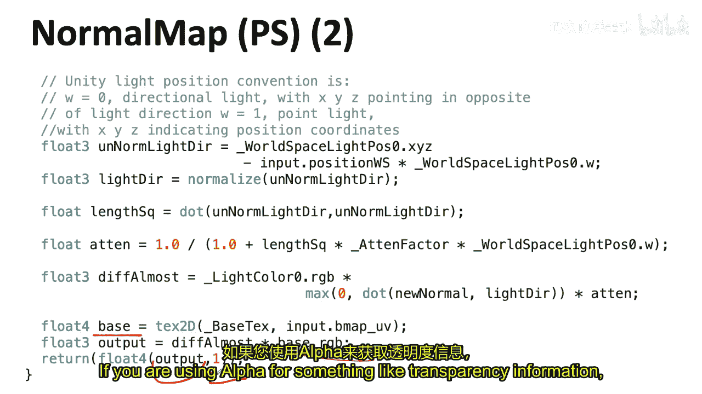
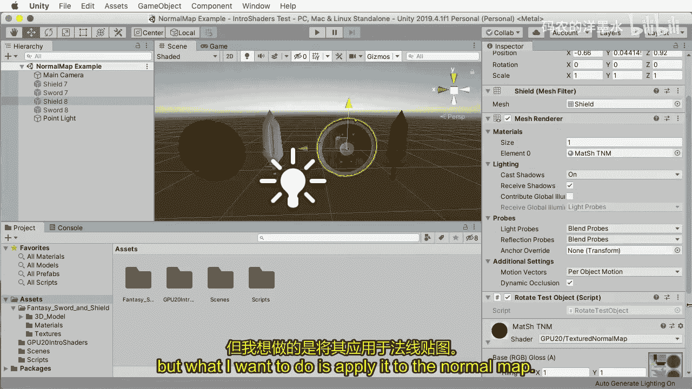
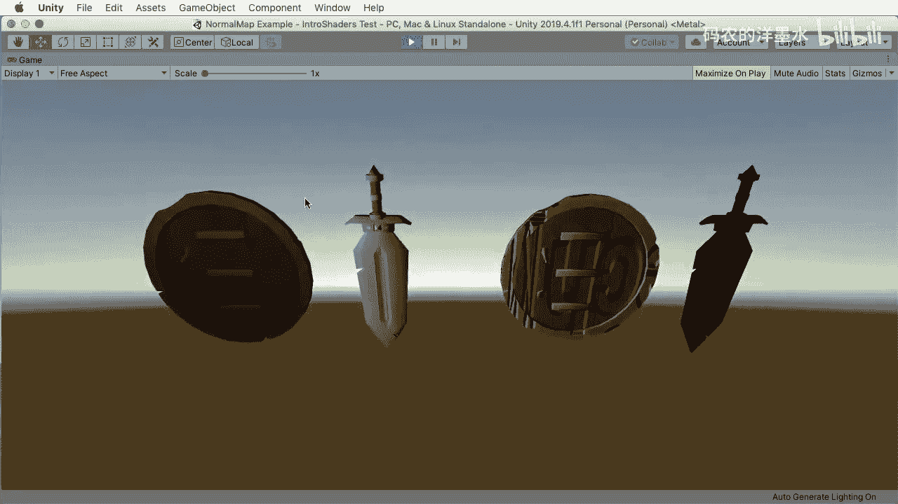
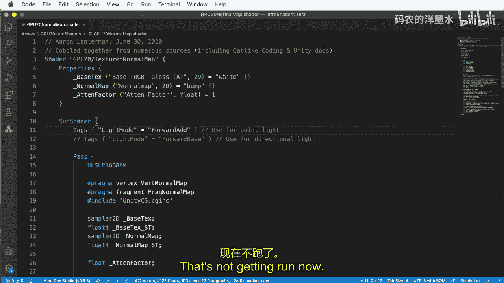
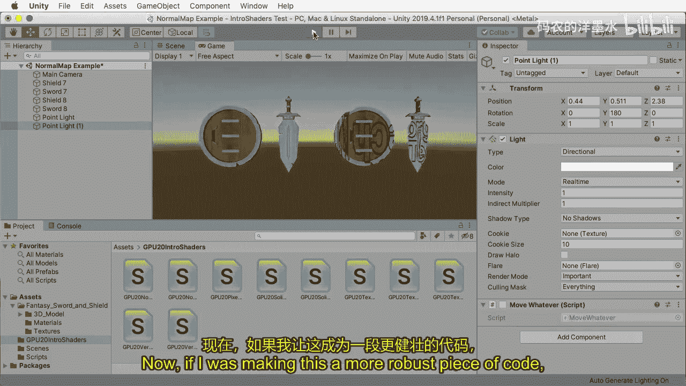
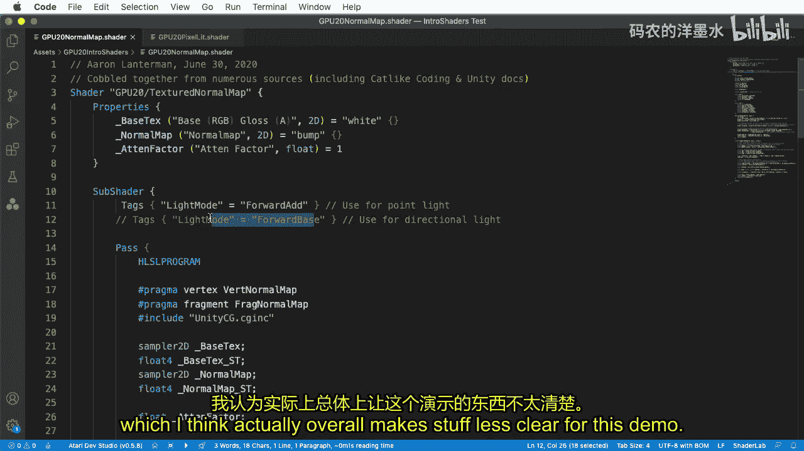

# 026：法线贴图 🎮

在本节课中，我们将学习如何在着色器中实现法线贴图技术。法线贴图是一种在不增加模型几何复杂度的前提下，通过改变表面法线方向来模拟凹凸细节的技术。我们将基于上一节学习的漫反射光照着色器进行扩展。

---

## 概述

法线贴图的核心思想是使用一张特殊的纹理（法线贴图）来存储每个像素点的法线向量偏移信息。在片段着色器中，我们读取这张贴图，并结合模型原始的切线和副切线信息，将贴图中的法线从切线空间转换到世界空间，最终用于光照计算。

---

## 属性与变量声明

首先，我们需要在着色器代码中声明法线贴图属性，并定义对应的变量。

```hlsl
Properties
{
    _MainTex ("Base Texture", 2D) = "white" {}
    _BumpMap ("Normal Map", 2D) = "bump" {}
}
```

在CGPROGRAM代码块中，我们需要声明与属性对应的采样器。

```hlsl
sampler2D _MainTex;
sampler2D _BumpMap;
```

---

## 顶点着色器输入与输出

顶点着色器需要接收比之前更多的数据。除了位置和法线，我们还需要模型的切线信息，以便构建切线空间。

以下是顶点着色器的输入结构体。

```hlsl
struct appdata
{
    float4 vertex : POSITION;
    float3 normal : NORMAL;
    float4 tangent : TANGENT;
    float2 texcoord : TEXCOORD0;
};
```

顶点着色器的输出结构体需要包含传递给片段着色器的所有插值数据。

```hlsl
struct v2f
{
    float4 pos : SV_POSITION;
    float2 uv : TEXCOORD0;
    float2 uv_bump : TEXCOORD1;
    float3 worldNormal : TEXCOORD2;
    float3 worldTangent : TEXCOORD3;
    float3 worldBitangent : TEXCOORD4;
    float3 worldPos : TEXCOORD5;
};
```

---

## 顶点着色器处理

在顶点着色器中，我们需要完成以下任务：
1.  将顶点位置变换到裁剪空间。
2.  将法线和切线变换到世界空间。
3.  计算副切线（叉乘法线和切线）。
4.  传递纹理坐标和世界空间位置。

以下是顶点着色器的主要代码。

```hlsl
v2f vert (appdata v)
{
    v2f o;
    // 变换顶点位置到裁剪空间
    o.pos = UnityObjectToClipPos(v.vertex);
    // 传递主纹理和法线贴图的UV坐标（允许独立缩放偏移）
    o.uv = TRANSFORM_TEX(v.texcoord, _MainTex);
    o.uv_bump = TRANSFORM_TEX(v.texcoord, _BumpMap);
    // 变换法线到世界空间（使用逆转置矩阵）
    o.worldNormal = normalize(mul(v.normal, (float3x3)unity_WorldToObject));
    // 变换切线到世界空间（仅使用旋转部分）
    o.worldTangent = normalize(mul((float3x3)unity_ObjectToWorld, v.tangent.xyz));
    // 计算副切线（叉乘）并考虑切线方向（W分量）
    o.worldBitangent = normalize(cross(o.worldNormal, o.worldTangent) * v.tangent.w);
    // 计算世界空间顶点位置
    o.worldPos = mul(unity_ObjectToWorld, v.vertex).xyz;
    return o;
}
```

> **注意**：法线变换使用`unity_WorldToObject`矩阵的逆转置，而切线变换直接使用`unity_ObjectToWorld`的3x3部分。副切线计算中乘以`v.tangent.w`用于处理镜像UV，具体数学原理可参考额外资料。

---

## 片段着色器处理

在片段着色器中，我们的核心任务是：
1.  从法线贴图中解码出切线空间法线。
2.  利用插值得到的TBN矩阵（切线、副切线、法线）将其转换到世界空间。
3.  使用转换后的法线进行光照计算。

以下是片段着色器的主要步骤。

### 1. 解码法线贴图

法线贴图通常将X和Y分量存储在Alpha和Green通道中，我们需要将其解码为完整的3D向量。

```hlsl
// 从法线贴图读取并解码切线空间法线
fixed4 packedNormal = tex2D(_BumpMap, i.uv_bump);
float3 tangentNormal;
// 从Alpha和Green通道解码X和Y，范围从[0,1]映射到[-1,1]
tangentNormal.xy = (packedNormal.wy * 2 - 1);
// 根据单位向量性质计算Z分量
tangentNormal.z = sqrt(1 - saturate(dot(tangentNormal.xy, tangentNormal.xy)));
```

### 2. 构建TBN矩阵并转换法线

使用从顶点着色器插值并重新归一化后的TBN向量构建矩阵，将切线空间法线变换到世界空间。



```hlsl
// 重新归一化插值后的TBN向量
float3 worldNormal = normalize(i.worldNormal);
float3 worldTangent = normalize(i.worldTangent);
float3 worldBitangent = normalize(i.worldBitangent);
// 构建TBN矩阵
float3x3 TBN = float3x3(worldTangent, worldBitangent, worldNormal);
// 将切线空间法线变换到世界空间
float3 worldNormalPerturbed = normalize(mul(TBN, tangentNormal));
```

### 3. 进行光照计算

使用扰动后的世界空间法线进行漫反射光照计算。光照计算部分与之前课程类似，需要处理方向光和点光的差异。



```hlsl
// 计算指向光源的向量并归一化用于点积计算
float3 lightDir = normalize(_WorldSpaceLightPos0.xyz - i.worldPos * _WorldSpaceLightPos0.w);
// 保留未归一化的版本用于点光衰减计算
float3 lightDirUnnorm = _WorldSpaceLightPos0.xyz - i.worldPos * _WorldSpaceLightPos0.w;
float atten = 1.0;
// 如果是点光源（w分量为1），计算衰减
if (_WorldSpaceLightPos0.w != 0.0) {
    atten = 1.0 / (1.0 + length(lightDirUnnorm) * length(lightDirUnnorm));
}
// 计算漫反射系数（兰伯特光照）
float diff = max(0, dot(worldNormalPerturbed, lightDir));
// 结合光照颜色和衰减
float3 lightColor = _LightColor0.rgb;
float3 diffuse = diff * lightColor * atten;
// 采样基础颜色贴图
float4 baseColor = tex2D(_MainTex, i.uv);
// 最终输出颜色
return float4(baseColor.rgb * diffuse, 1.0);
```



---

## 在Unity中测试效果

将编写好的着色器应用到材质上，并为其指定基础纹理和法线贴图。在场景中观察，应用了法线贴图的物体会根据光照方向显示出丰富的凹凸细节，而仅使用基础纹理的物体则显得平坦。

> **提示**：为了获得更明显的效果，可以使用高对比度的法线贴图。在Unity编辑器中，将法线贴图拖拽到材质的对应属性槽即可。

---

## 关于Unity渲染路径的注意事项

本示例着色器使用了`Tags { "LightMode"="ForwardAdd" }`，这意味着它主要在**附加前向渲染通道**中执行，用于处理额外的方向光和所有点光源。主方向光通常在**基础前向渲染通道**中处理。



因此，如果你在场景中只使用一个方向光，并且它被Unity认定为主方向光，那么使用此标签的着色器可能不会被调用，导致物体“消失”。为了使着色器能同时处理基础通道和附加通道，一个更健壮的实现应包含多个子着色器（SubShader）或通道（Pass），分别对应`"LightMode"="ForwardBase"`和`"LightMode"="ForwardAdd"`。

---

## 总结





本节课中我们一起学习了法线贴图的实现原理。我们了解了如何通过切线、副切线和法线构建TBN矩阵，将法线贴图中存储的切线空间向量转换到世界空间，并最终用于增强光照计算的视觉效果。关键在于理解从2D纹理解码3D法线、构建变换矩阵以及处理不同渲染通道的逻辑。虽然涉及一些Unity特定的实现细节，但核心的图形学概念（切线空间、法线变换、TBN矩阵）是跨引擎通用的。