# 027：环境映射 🌐

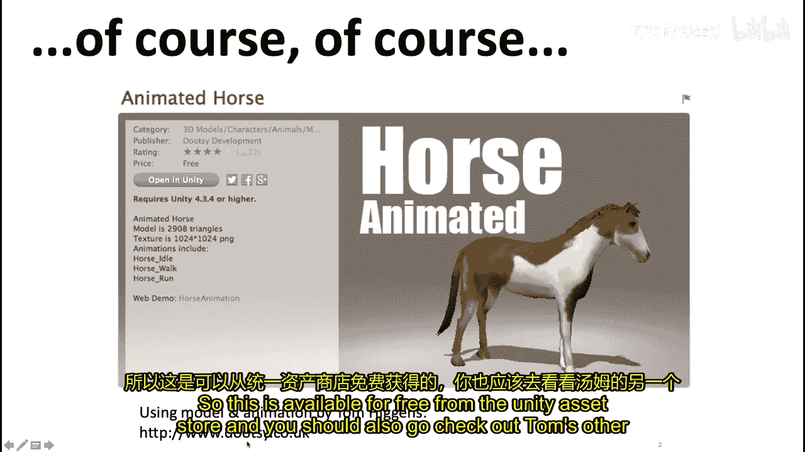

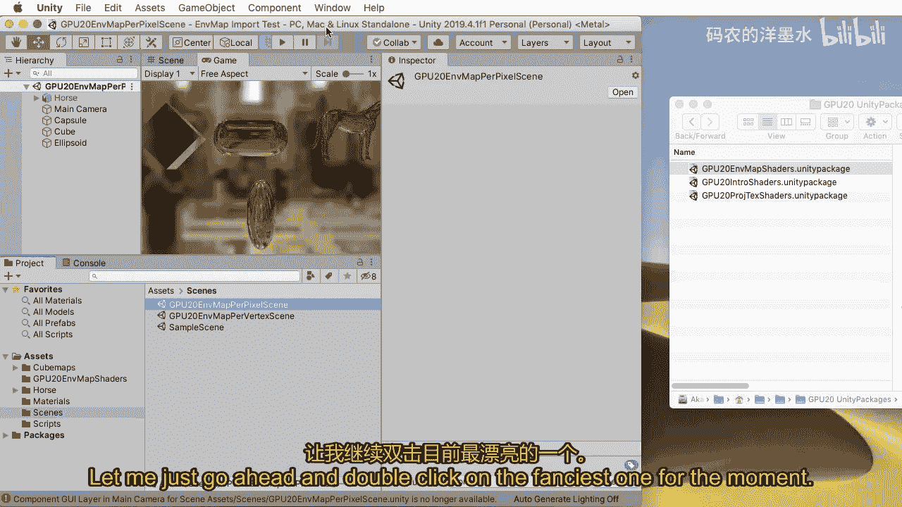

在本节课中，我们将学习一种特殊的纹理映射技术——环境映射。我们将探讨如何利用立方体贴图来模拟物体表面的反射和折射效果，并比较逐顶点计算与逐像素计算在实现这些效果时的差异。

---

## 概述

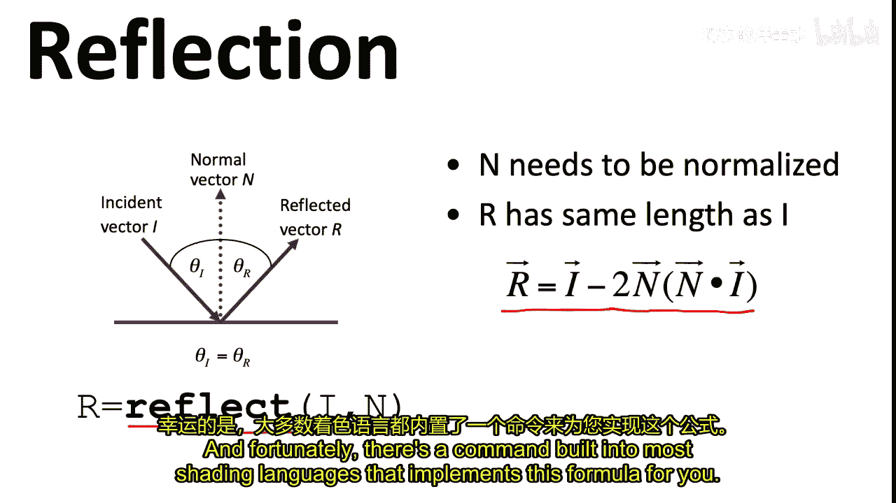

环境映射是一种用于模拟物体表面反射和折射周围环境的技术。它通过预计算的立方体贴图来“伪造”这些效果，无需进行实时光线追踪。本节课将介绍其核心概念、实现方法，并展示如何在Unity中编写相关着色器。

---

## 核心概念与公式

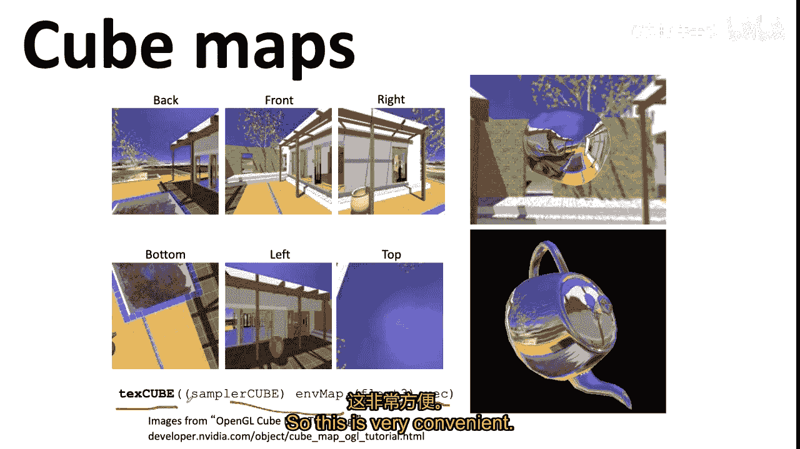

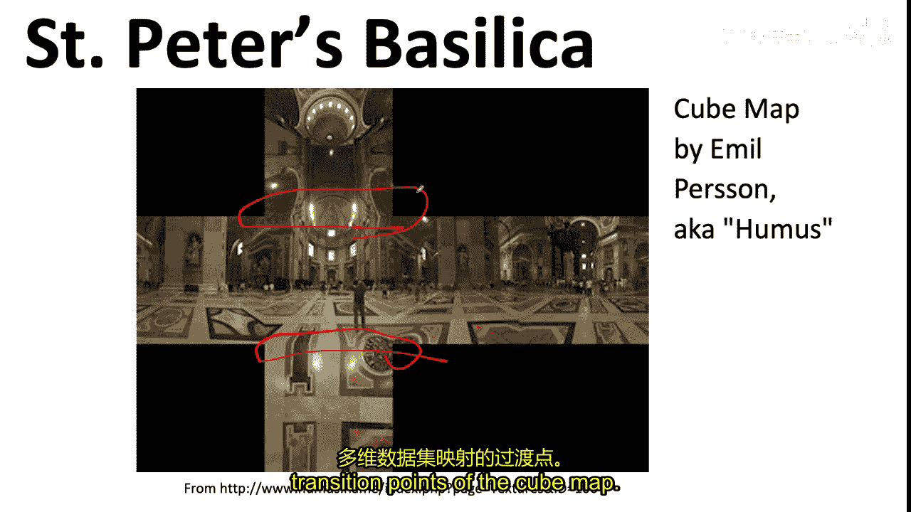

在环境映射中，我们主要使用两个关键向量：**反射向量**和**折射向量**。

*   **反射向量**的计算公式通常由着色器语言内置函数实现：
    ```
    reflect(I, N)
    ```
    其中 `I` 是入射向量（从表面指向相机的反方向），`N` 是表面法线。

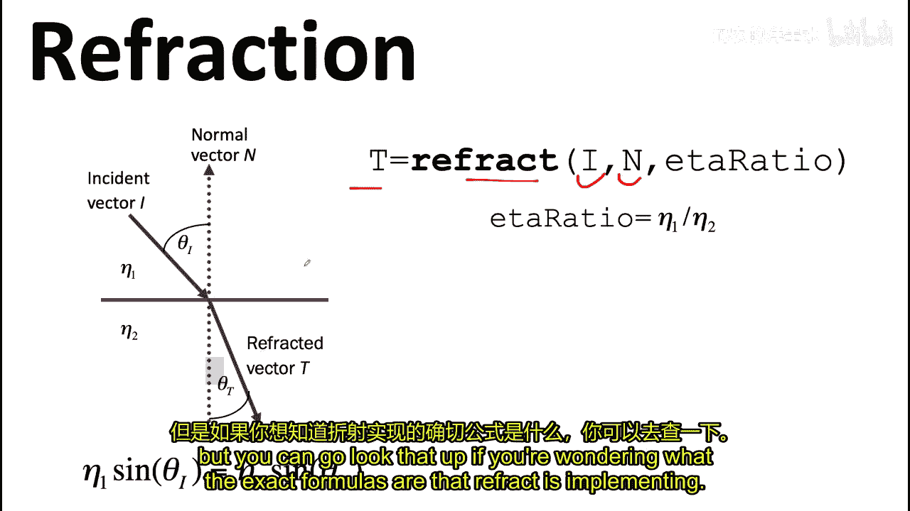

*   **折射向量**的计算遵循斯涅尔定律，同样由内置函数实现：
    ```
    refract(I, N, eta)
    ```
    其中 `eta` 是两种介质的折射率之比（`eta = n_i / n_t`）。

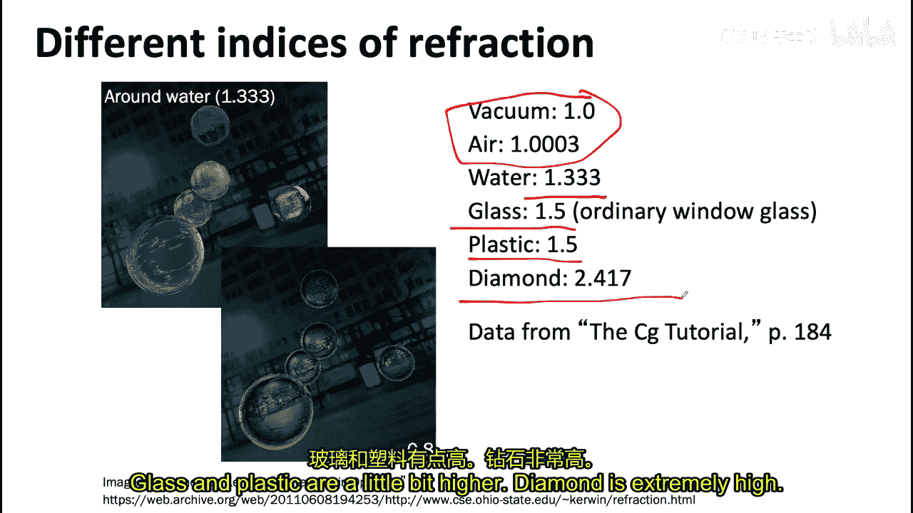

*   **立方体贴图采样**使用 `texCUBE` 函数，它接受一个三维方向向量，并返回该方向对应的颜色值。

---

## 实现方法对比

### 逐顶点环境映射

上一节我们介绍了反射和折射的基本原理。本节中，我们首先来看一种简单的实现方式：在顶点着色器中计算反射/折射向量。

在逐顶点方法中，我们在顶点着色器为每个顶点计算世界空间下的反射和折射方向向量。然后，GPU的插值硬件会在三角形内部对这些向量进行线性插值，并将结果传递给像素着色器进行立方体贴图查找。

以下是该方法的简要步骤：
1.  在顶点着色器中将顶点位置和法线变换到世界空间。
2.  计算从相机到顶点的入射向量。
3.  使用 `reflect` 和 `refract` 函数计算反射和折射向量。
4.  将计算出的向量传递给像素着色器。
5.  在像素着色器中，使用插值后的向量对立方体贴图进行采样，并根据混合系数混合两种颜色。

然而，这种方法存在明显缺陷。由于向量在三角形内部只是简单线性插值，当表面曲率变化较大或折射率较高时，会产生明显的视觉瑕疵，如闪烁和扭曲的“宝石状”效果。

### 逐像素环境映射

鉴于逐顶点方法的不足，我们需要一种更精确的方法。本节我们将转向逐像素环境映射。

在逐像素方法中，我们将计算推迟到像素着色器中进行。顶点着色器只负责将必要的基础信息（如世界空间位置和法线）传递给像素着色器。

以下是该方法的改进步骤：
1.  顶点着色器仅进行几何变换，将世界空间位置和法线传递给像素着色器。
2.  在像素着色器中，为每个像素重新计算精确的入射向量。
3.  使用该入射向量和插值后的法线，在像素级别计算反射和折射向量。
4.  进行立方体贴图采样和颜色混合。

这种方法消除了逐顶点插值带来的瑕疵，效果更加平滑和准确。

---

## 进阶效果：菲涅尔效应

除了基本的反射和折射混合，我们还可以模拟菲涅尔效应——即反射与透射的比例随观察角度而变的现象（例如，在浅角度观察水面时反射更强烈）。

我们使用一个简化的经验公式来模拟这一效果：
```
float reflectionFactor = max(0.0, min(1.0, bias + scale * pow(1.0 + dot(I, N), power)));
```
其中 `bias`、`scale` 和 `power` 是可调参数。`reflectionFactor` 用于在反射颜色和折射颜色之间进行插值。当视线与法线平行时，折射主导；当视线与表面趋于平行时，反射主导。

为了调试和直观理解参数影响，着色器还包含一个“蓝黄”可视化模式，用蓝色代表反射部分，黄色代表折射部分。

---

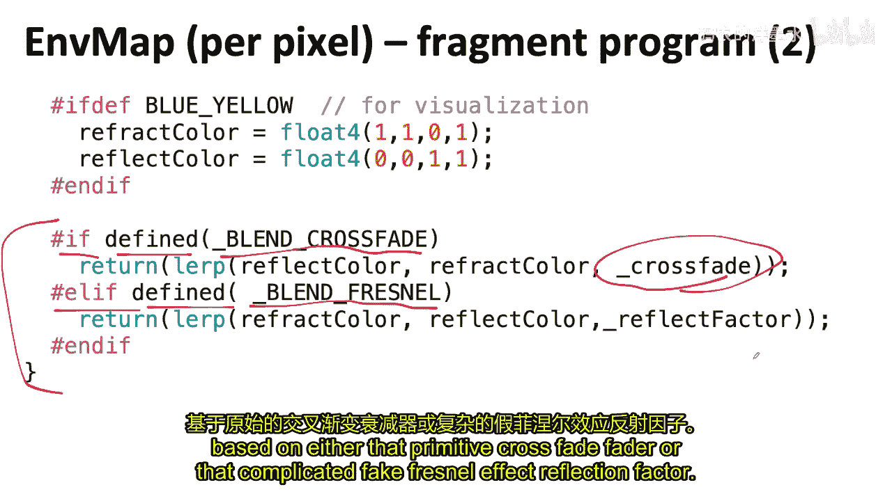

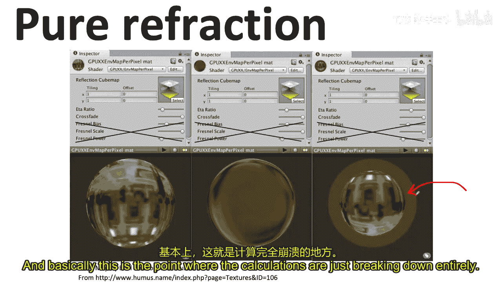

## 作业：色散效果

一个有趣的扩展是实现**色散**效果。这模拟了光通过棱镜时不同波长（颜色）的光折射角度不同的现象。

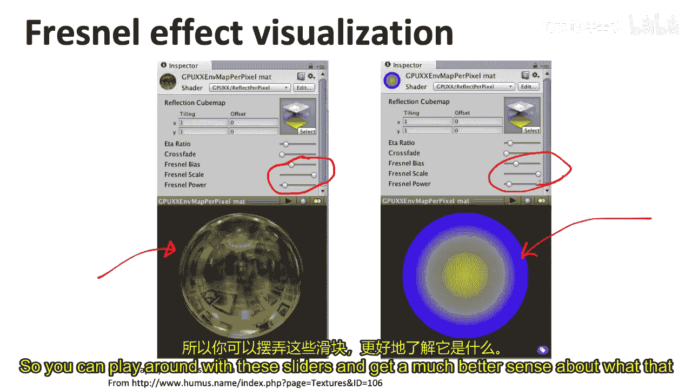

实现思路是：
*   为红、绿、蓝三个颜色通道分别指定略微不同的折射率比值（`eta`）。
*   在像素着色器中，使用各自的 `eta` 值计算三个不同的折射向量。
*   分别用这三个向量对立方体贴图进行采样，得到的结果分别作为输出颜色的R、G、B通道。

这样就能产生彩虹般的边缘色散效果，常用于渲染水晶、钻石等材质。

---

## 总结

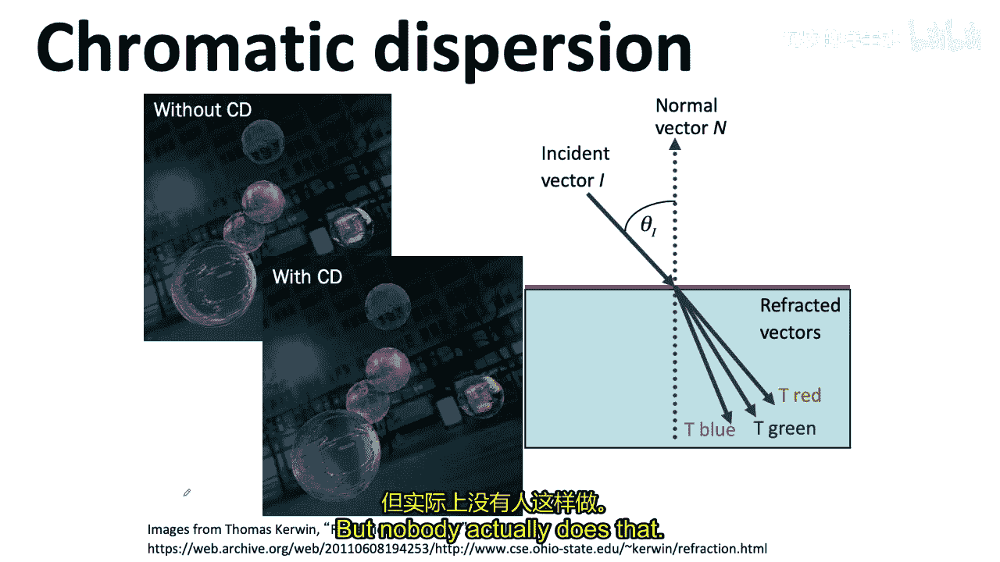

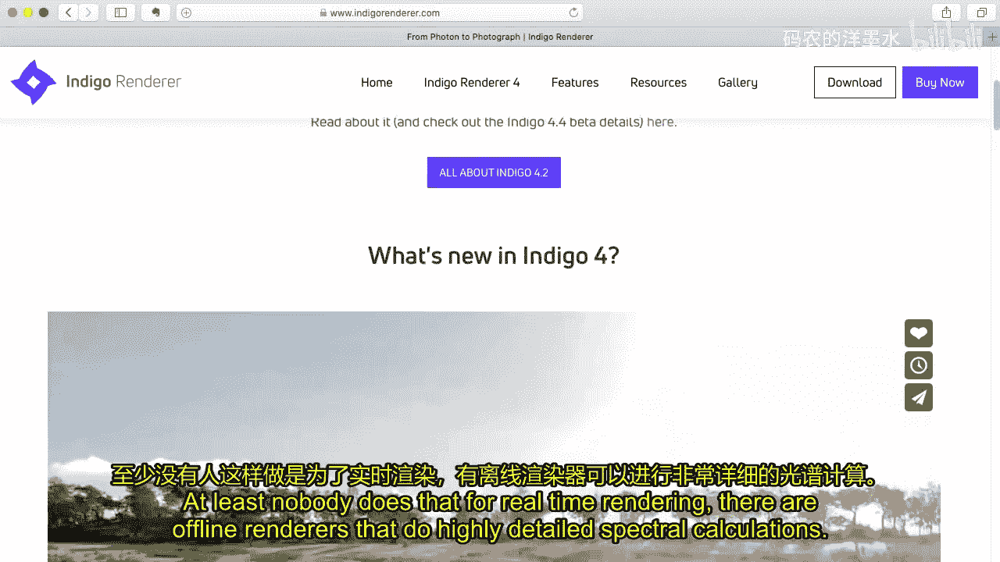

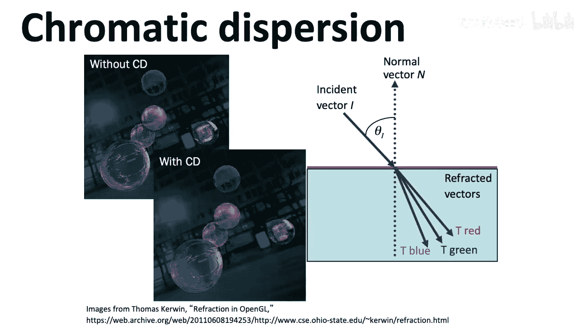

本节课我们一起学习了环境映射技术。我们了解了如何使用立方体贴图来模拟反射和折射这种依赖于视点的光学效果。我们比较了逐顶点计算和逐像素计算两种实现方式，认识到逐像素计算对于质量至关重要。我们还介绍了如何通过简化的公式来模拟菲涅尔效应，并提出了实现色散效果的思路。环境映射是一种高效且广泛使用的技术，能够在实时渲染中极大地增强物体的视觉真实感。