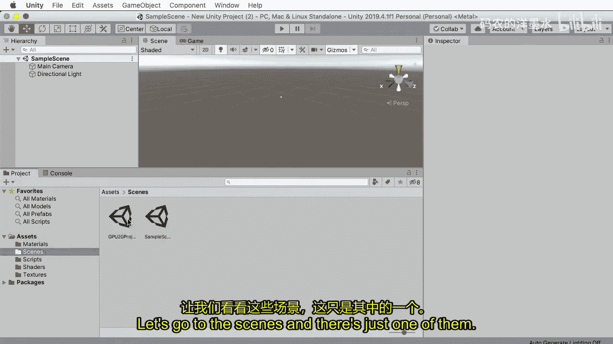
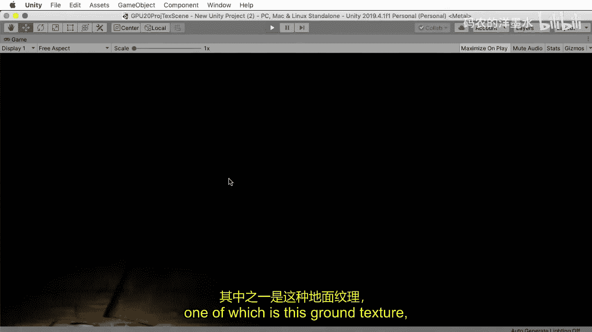
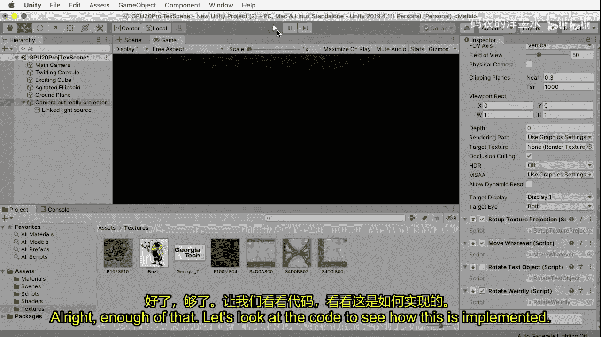
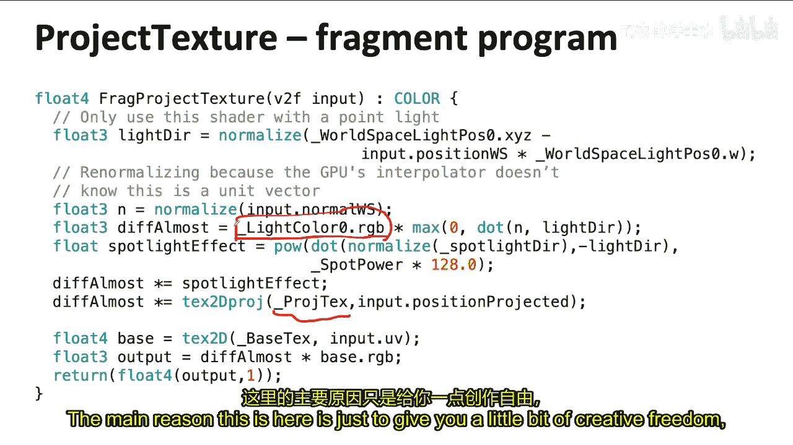
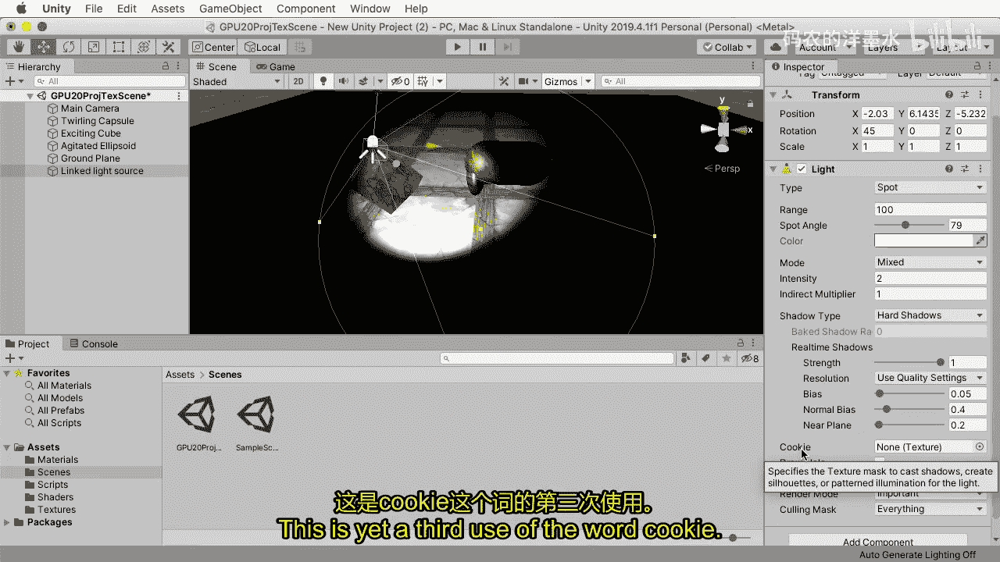

# 028：投影纹理 🎮

在本节课中，我们将学习如何使用投影纹理技术。这是一种将二维纹理像幻灯片投影仪一样，投射到场景中其他物体表面的方法。我们将了解其背后的数学原理，并在Unity中通过代码实现这一效果。

---



## 概述



在前面的课程中，我们学习了包裹在物体表面的二维纹理，以及用于模拟反射和折射效果的三维立方体贴图。本节课，我们将回到二维纹理，但以一种全新的方式使用它们：想象将它们放入幻灯片投影仪，然后投射到场景中的其他物体上。

## 投影纹理的原理

投影纹理的核心思想是模拟从光源视角进行的渲染。我们使用与将3D物体投影到相机平面相同的矩阵变换，但这里使用的是光源的位置和方向，而非相机的位置和方向，就好像光源本身就是一个相机。

以下是实现投影纹理所需的关键变换步骤：

1.  **模型坐标 -> 世界空间**：将物体从自身的模型坐标系转换到全局世界坐标系。
2.  **世界空间 -> 光源视图空间**：使用光源的“视角”（即视图矩阵）将世界坐标转换到以光源为原点的视图空间。
3.  **视图空间 -> 光源裁剪空间**：使用光源的投影矩阵进行投影变换。
4.  **坐标范围转换**：将裁剪空间坐标从 `[-1, 1]` 的范围转换到纹理采样所需的 `[0, 1]` 范围。

在代码中，我们使用 `S, T, R, Q` 代替通常的 `X, Y, Z, W`，以避免与相机坐标混淆。其中，`Q` 分量相当于透视除法中的 `W` 分量，通过除以 `Q` 来实现纹理的透视投影效果。

## Unity 中的演示

在深入代码之前，让我们先在一个Unity演示中直观地感受投影纹理的效果。

演示场景中包含一个地面和几个旋转、移动的物体。一个“Buzz”角色的纹理被从一个虚拟的“投影仪”光源投射到所有物体上。我们可以调整光源的“聚光”参数来控制投射区域的大小和边缘衰减。

演示还展示了纹理的环绕模式（Clamp, Repeat, Mirror等）对投影效果的影响，以及如何通过脚本动态控制投影参数。



## 代码实现解析

上一节我们预览了投影纹理的效果，本节中我们来看看实现这一效果的着色器代码和C#脚本是如何工作的。

### 着色器部分

首先，我们在着色器中声明所需的变量和结构。

```hlsl
// 在Properties块中声明，用于在材质面板调整
_ProjectorTex ("Projected Texture", 2D) = "white" {}
_SpotPower ("Spotlight Power", Range(0.01, 1)) = 0.5

// 在CGPROGRAM中声明对应的变量
sampler2D _ProjectorTex;
float _SpotPower;
float4x4 _ProjectorMatrixVP; // 光源的视图投影矩阵
float3 _SpotlightDirection;   // 聚光方向
```

顶点着色器的主要任务是计算并传递各种空间下的坐标。

```hlsl
// 顶点着色器输出结构
struct v2f {
    float4 pos : SV_POSITION;      // 裁剪空间位置（用于光栅化）
    float2 uv : TEXCOORD0;         // 物体自身纹理坐标
    float3 worldPos : TEXCOORD1;   // 世界空间位置
    float3 worldNormal : TEXCOORD2;// 世界空间法线
    float4 posProj : TEXCOORD3;    // 投影纹理坐标（S,T,R,Q）
};

v2f vert (appdata_base v) {
    v2f o;
    // 常规变换：物体空间 -> 世界空间 -> 相机视图空间 -> 裁剪空间
    o.worldPos = mul(unity_ObjectToWorld, v.vertex).xyz;
    o.pos = mul(UNITY_MATRIX_VP, float4(o.worldPos, 1.0));

    // 变换法线到世界空间（使用逆转置矩阵）
    o.worldNormal = normalize(mul(v.normal, (float3x3)unity_WorldToObject));

    // 传递物体自身纹理坐标（支持缩放和偏移）
    o.uv = TRANSFORM_TEX(v.texcoord, _MainTex);

    // **关键步骤**：计算投影纹理坐标
    // 使用光源的视图投影矩阵变换世界坐标
    o.posProj = mul(_ProjectorMatrixVP, float4(o.worldPos, 1.0));

    return o;
}
```

片段着色器负责最终的颜色计算，结合了基础纹理、漫反射光照、聚光效果和投影纹理。

```hlsl
fixed4 frag (v2f i) : SV_Target {
    // 1. 基础纹理颜色
    fixed4 baseColor = tex2D(_MainTex, i.uv);

    // 2. 漫反射光照计算
    float3 lightDir = normalize(_WorldSpaceLightPos0.xyz - i.worldPos * _WorldSpaceLightPos0.w);
    float diff = max(0, dot(normalize(i.worldNormal), lightDir));
    fixed4 litColor = _LightColor0 * diff;

    // 3. 聚光效果计算
    float3 spotDir = normalize(_SpotlightDirection);
    // 注意：lightDir指向光源，spotDir指向照射方向，因此需要取反
    float spotFactor = max(0, dot(-lightDir, spotDir));
    // 使用幂函数控制聚光边缘的衰减程度
    spotFactor = pow(spotFactor, _SpotPower * 128);

    // 4. **关键步骤**：采样投影纹理
    // 使用 tex2Dproj 函数，它自动处理 posProj 的透视除法 (除以Q分量)
    fixed4 projColor = tex2Dproj(_ProjectorTex, i.posProj);

    // 5. 合并所有效果
    fixed4 finalColor = baseColor * litColor * spotFactor * projColor;
    finalColor.a = 1.0; // 简单处理Alpha通道
    return finalColor;
}
```

### C# 脚本部分

着色器中的 `_ProjectorMatrixVP` 和 `_SpotlightDirection` 需要从CPU端设置。我们通过一个附加到“投影仪”游戏对象（带Camera组件）的C#脚本来完成。

```csharp
using UnityEngine;

[ExecuteInEditMode] // 在编辑模式下也运行，方便预览
public class ProjectorMatrixSetter : MonoBehaviour
{
    private Camera myCamera;
    private Matrix4x4 viewMatrix;
    private Matrix4x4 projMatrix;

    void Start()
    {
        // 获取附加到同一游戏对象上的Camera组件
        myCamera = GetComponent<Camera>();
        if (myCamera == null)
        {
            Debug.LogError("This script requires a Camera component on the same GameObject.");
        }
    }

    void Update()
    {
        if (myCamera != null)
        {
            // 1. 从“投影仪”相机获取视图矩阵和投影矩阵
            viewMatrix = myCamera.worldToCameraMatrix;
            projMatrix = GL.GetGPUProjectionMatrix(myCamera.projectionMatrix, false);

            // 2. 构造从[-1,1]到[0,1]的缩放平移矩阵
            Matrix4x4 scaleOffset = Matrix4x4.identity;
            scaleOffset.m00 = scaleOffset.m11 = scaleOffset.m22 = 0.5f;
            scaleOffset.m03 = scaleOffset.m13 = scaleOffset.m23 = 0.5f;

            // 3. 组合成最终的光源视图投影矩阵
            Matrix4x4 projectorVP = scaleOffset * projMatrix * viewMatrix;

            // 4. 将矩阵和方向设置为全局着色器属性
            // （注意：此方法会影响场景中所有使用该变量名的材质，适用于单光源演示）
            Shader.SetGlobalMatrix("_ProjectorMatrixVP", projectorVP);
            Shader.SetGlobalVector("_SpotlightDirection", transform.forward);
        }
    }
}
```

## 注意事项与扩展

我们已经看到了投影纹理的基本实现，但在实际应用中还需要注意一些问题。

以下是使用投影纹理时的一些关键点和潜在问题：



*   **性能考虑**：示例中使用 `Shader.SetGlobalMatrix` 通过字符串名称查找着色器属性，这在性能上开销较大。对于生产环境，应使用属性ID（`Shader.PropertyToID`）进行缓存和设置。
*   **多光源支持**：示例代码是全局设置，只适用于单个投影光源。支持多个投影灯需要更复杂的架构，例如使用每个物体的材质属性块（MaterialPropertyBlock）。
*   **镜像问题**：投影数学本身不关心方向，有时会导致纹理被镜像投射，需要额外的裁剪或判断逻辑。
*   **纹理边缘**：用于投影的纹理最好在边缘留有空像素或使用合适的环绕模式，避免不想要的拉伸或重复。
*   **Unity内置方案**：Unity引擎本身内置了支持纹理投影的聚光灯（在光源组件中称为“Cookie”）。它的实现更高效、功能更完整（如支持阴影），但原理与本节课介绍的核心思想相通。理解我们手动实现的版本有助于深入理解其工作机制。

## 总结

本节课中，我们一起学习了投影纹理技术。我们从原理出发，理解了如何将光源视为一个相机，通过视图投影变换将纹理坐标投射到物体表面。随后，我们在Unity中逐步实现了这一效果，编写了包含关键变换的着色器代码，以及用于传递矩阵数据的C#脚本。



投影纹理不仅本身是一种创造视觉效果的强大工具（如营造氛围、播放动态海报），它更是实现更高级技术（如下一节课将介绍的**阴影映射**）的基础。通过手动实现这个过程，我们加深了对渲染管线中坐标变换和纹理采样机制的理解。