# 029：阴影映射 🎮

在本节课中，我们将学习一种在现代游戏中实现实时阴影的核心技术——阴影映射。我们将了解其基本原理、实现步骤以及在实际应用中可能遇到的问题。

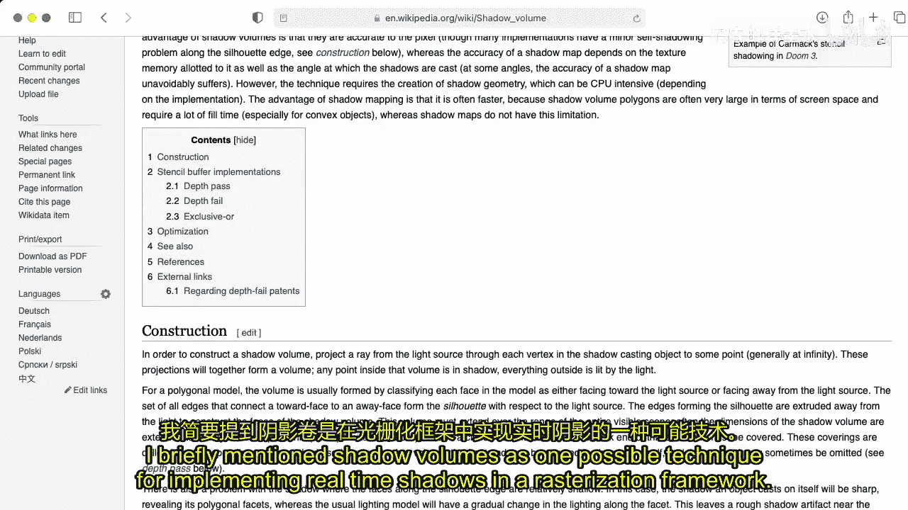

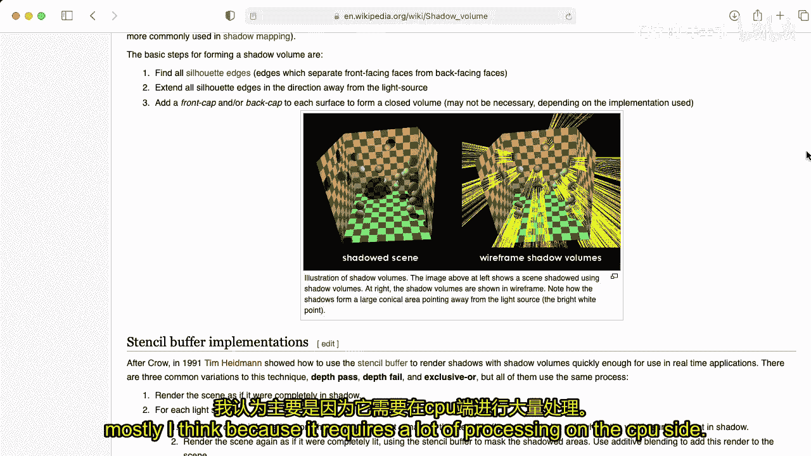

## 概述

上一讲我们简要提到了阴影体积技术。本节我们将深入探讨目前更为主流的阴影映射技术。这是一种基于光栅化的多通道渲染技巧，用于在实时图形中计算物体投射的阴影。

## 阴影映射的基本原理

阴影映射是一种需要多个渲染通道的算法。其核心思想是从光源的视角渲染场景，生成一张深度图（阴影贴图），然后在从摄像机视角渲染最终场景时，利用这张深度图来判断像素是否处于阴影中。

以下是实现阴影映射的两个主要步骤：

1.  **从光源视角渲染**：将光源视为摄像机，渲染整个场景。此过程不计算颜色，只将每个像素到光源的最近距离（深度值）记录到深度缓冲区中，生成一张**阴影贴图**。
    ```glsl
    // 伪代码：第一通道，生成阴影贴图
    RenderSceneFromLightView();
    depthMap = CaptureDepthBuffer();
    ```

2.  **从摄像机视角渲染**：正常渲染场景。对于每个待渲染的像素，计算其到光源的距离，并与阴影贴图中对应位置存储的深度值进行比较。
    ```glsl
    // 伪代码：第二通道，渲染并判断阴影
    for each (pixel in camera view) {
        float distanceToLight = CalculateDistanceToLight(pixel.worldPosition);
        float storedDepth = SampleShadowMap(depthMap, pixel.projectedLightCoord);
        
        if (distanceToLight > storedDepth + bias) {
            // 该像素被其他物体遮挡，处于阴影中
            pixel.color *= shadowFactor;
        } else {
            // 该像素未被遮挡，进行正常光照计算
            pixel.color = CalculateLighting(pixel);
        }
    }
    ```
    如果当前像素到光源的距离**大于**阴影贴图中记录的深度值，则说明该像素与光源之间存在其他物体，因此它处于阴影中。反之，则接受光照。

## 原理图解

为了更直观地理解，我们通过图解来分析两种情况。

### 情况一：物体在阴影中

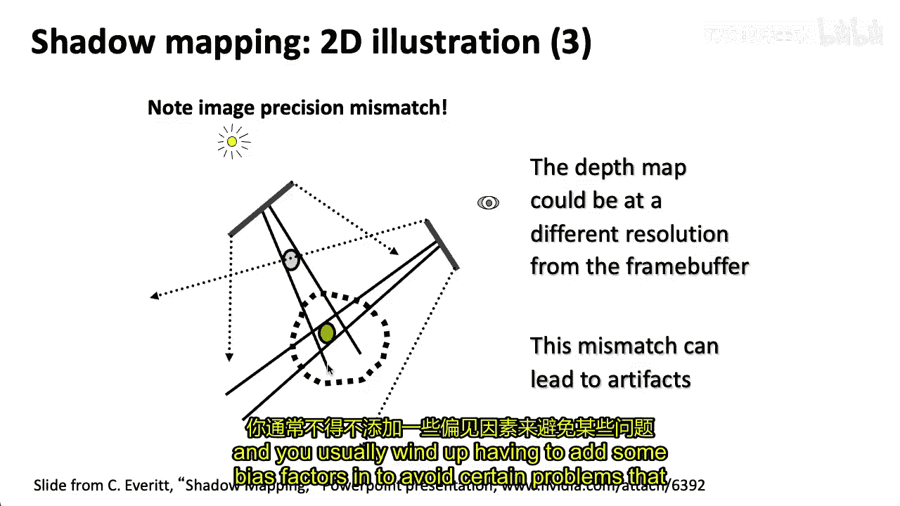

假设场景中有一个靠近光源的蓝色物体和一个稍远的绿色物体。
*   **第一通道（光源视角）**：蓝色物体距离光源更近，其深度值被记录在阴影贴图中。
*   **第二通道（摄像机视角）**：当渲染绿色物体上的某个像素时，计算其到光源的距离。由于这个距离大于阴影贴图中对应位置记录的（蓝色物体的）深度值，系统判定该像素被蓝色物体遮挡，因此处于阴影中。

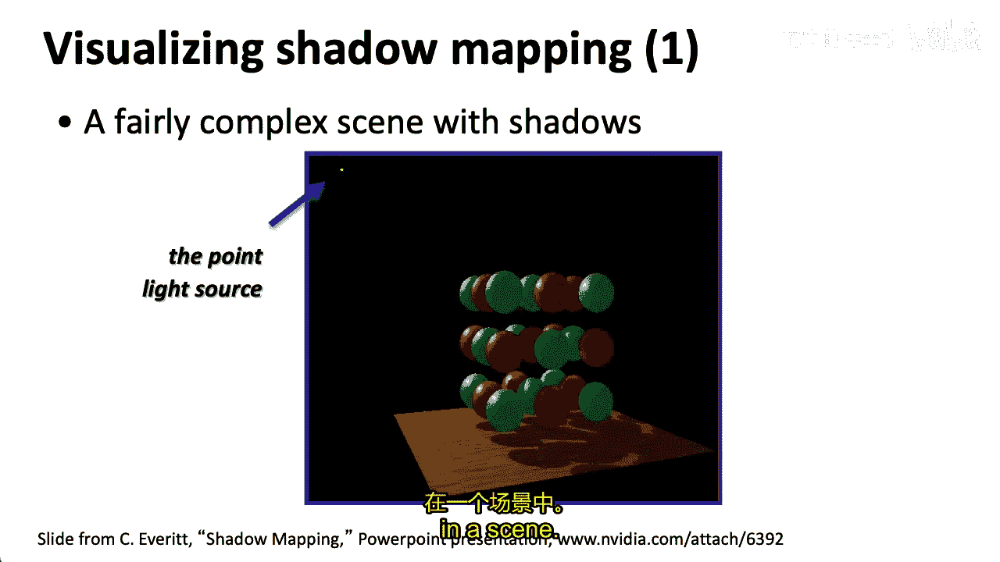

### 情况二：物体不在阴影中

假设只有绿色物体，没有蓝色遮挡物。
*   **第一通道**：阴影贴图记录的是绿色物体到光源的深度值。
*   **第二通道**：渲染绿色物体像素时，计算出的距离与阴影贴图中记录的值基本相等。因此判定没有遮挡，该像素接受光照。

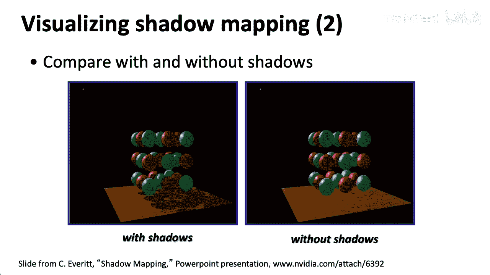

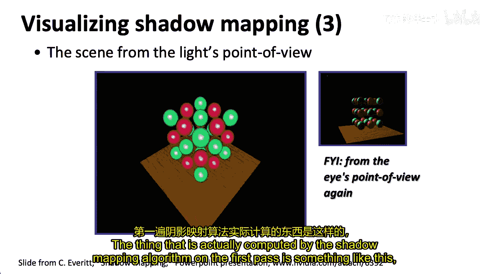

## 阴影映射的挑战与优化

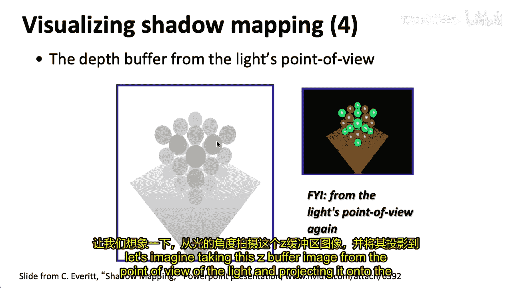

理论上，上述方法能生成阴影。但在实践中，直接应用会遇到一些问题，需要引入优化技巧。

以下是阴影映射常见的几个问题及其应对策略：

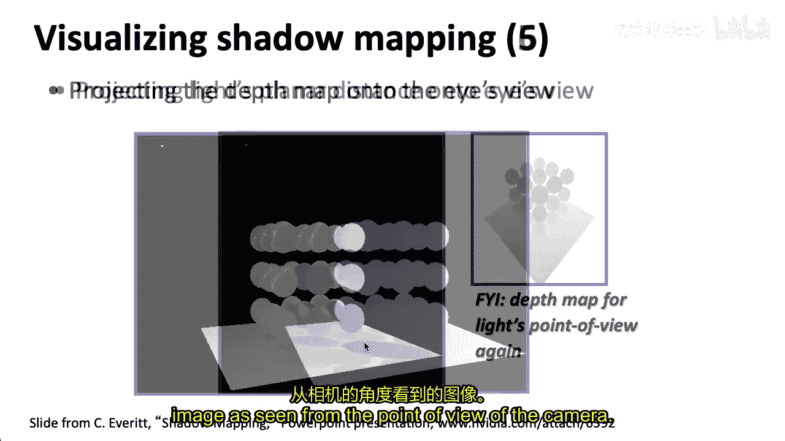

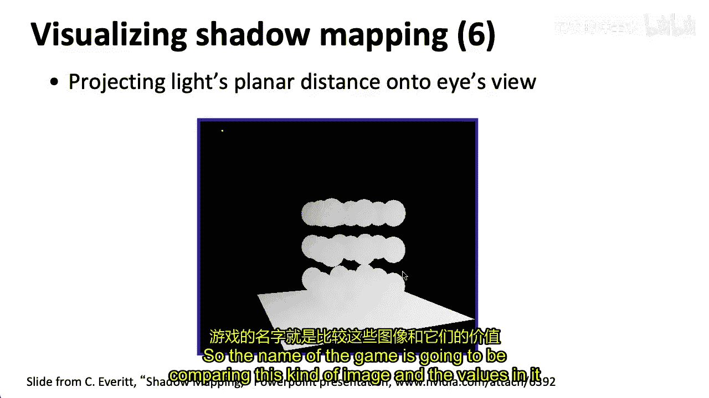

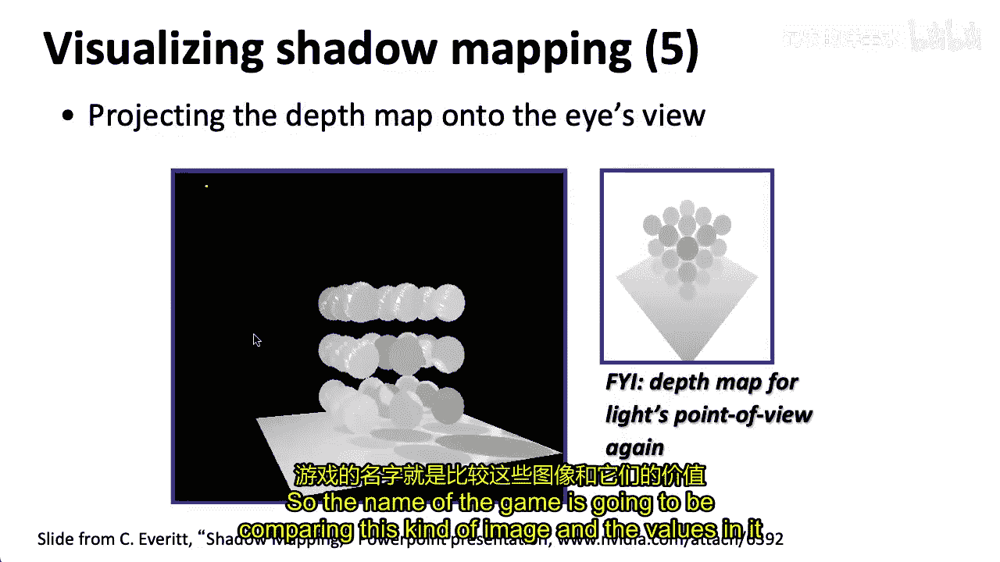

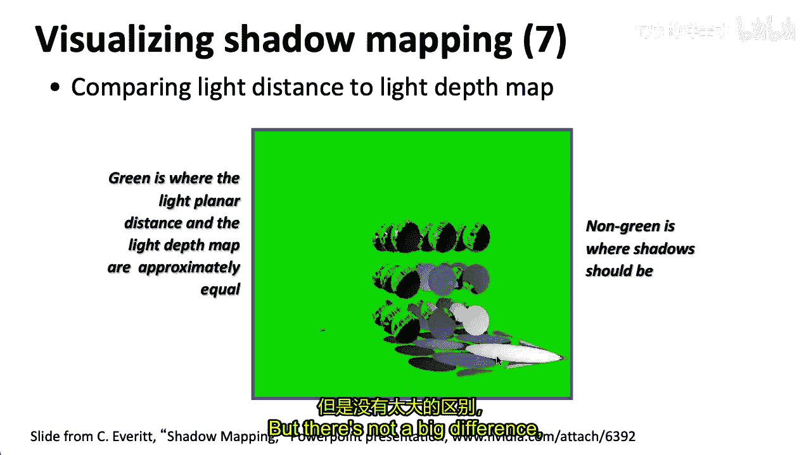

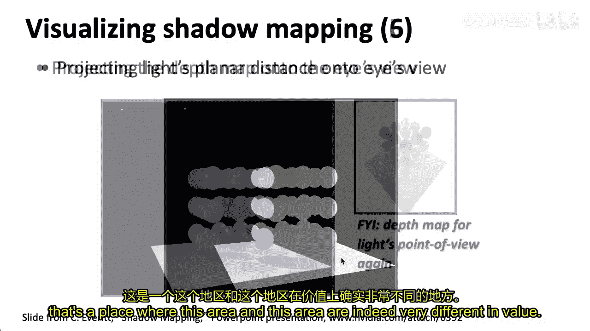

*   **阴影痤疮**：由于深度缓冲区的精度限制，物体表面可能会错误地判定为自我遮挡，产生条纹状瑕疵。解决方法是为深度比较引入一个**偏移量**。
    ```glsl
    // 添加 bias 以避免阴影痤疮
    if (distanceToLight > storedDepth + bias) { ... }
    ```

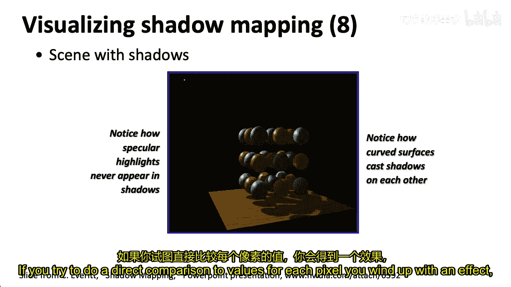

*   **块状锯齿**：当阴影贴图分辨率不足，或阴影被投射到离光源很远的表面时，阴影边缘会出现明显的像素块状感。可以通过提高阴影贴图分辨率或使用**百分比渐近滤波**等过滤技术来平滑边缘。

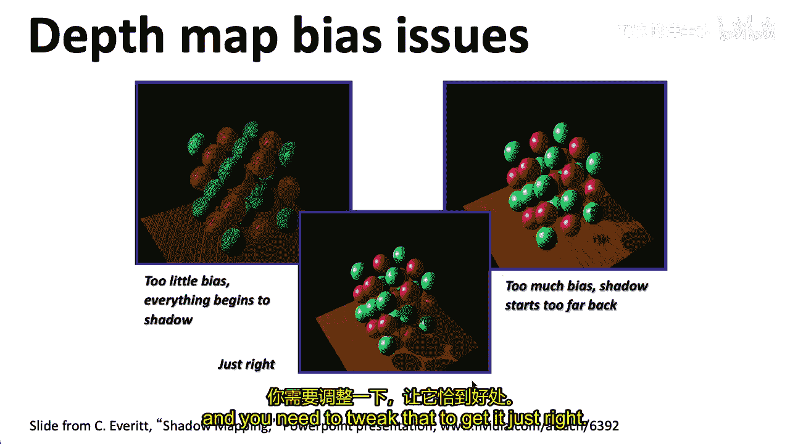

*   **硬阴影**：基础的阴影映射只能生成边缘锐利的硬阴影。现实中的阴影通常有柔和的边缘。可以通过**PCF**等技术来模拟软阴影效果。

## 与其他技术的结合

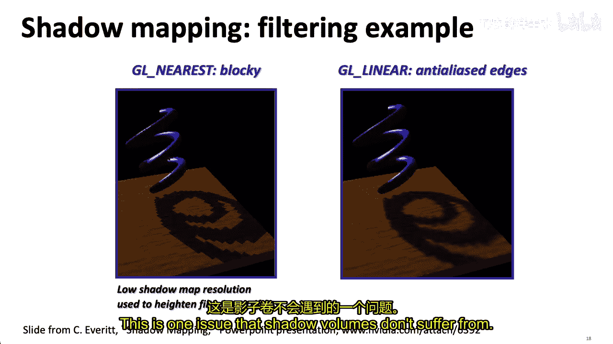

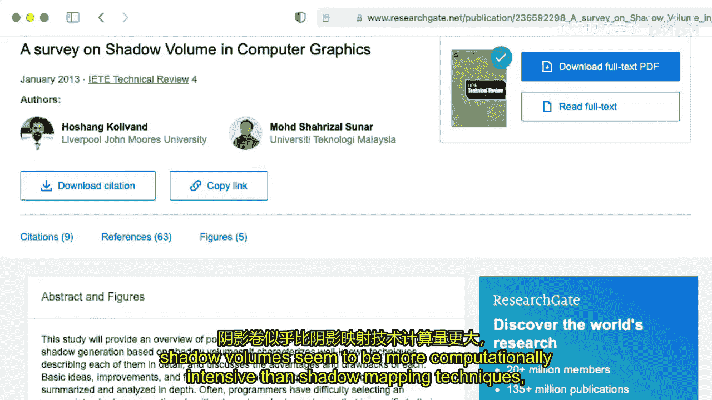

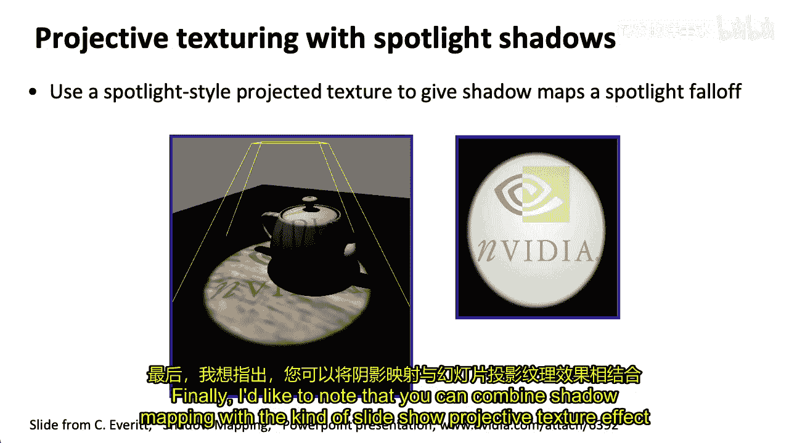

阴影映射可以与上一讲学习的**投影纹理**技术结合，创造出更复杂的效果。例如，可以模拟树叶缝隙中透下的斑驳光影，或者实现类似幻灯投影机与阴影互动的场景。

## 总结

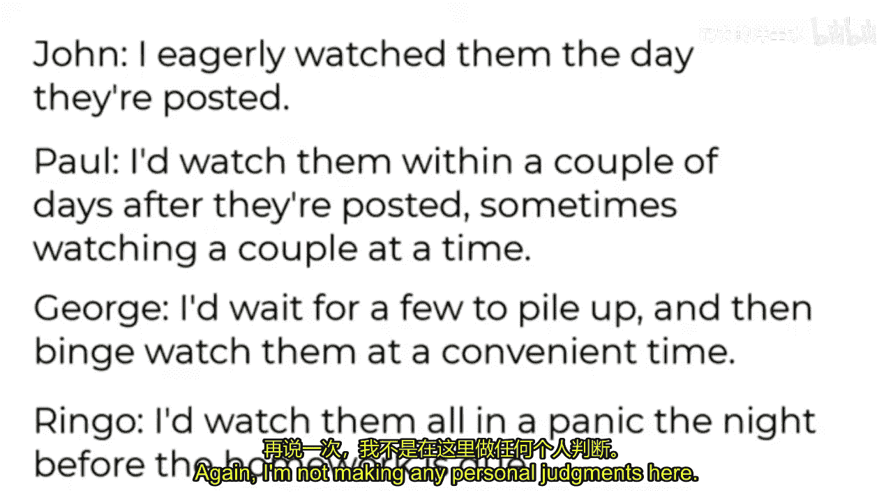

本节课我们一起学习了实时阴影生成的关键技术——阴影映射。我们了解了它的双通道渲染原理：首先生成光源视角的深度图，然后在主渲染中通过深度比较决定阴影区域。我们还探讨了实践中遇到的阴影痤疮、块状锯齿等问题，以及通过添加偏移量、过滤等技术进行优化的方法。虽然这是一种基于光栅化的“技巧”，但在实时光线追踪普及之前，它仍是游戏和实时图形应用中生成阴影最主流和高效的方法之一。