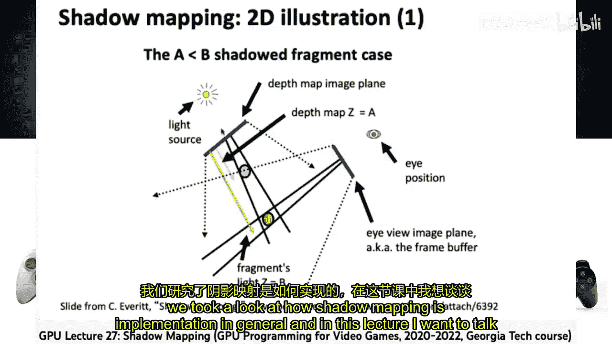
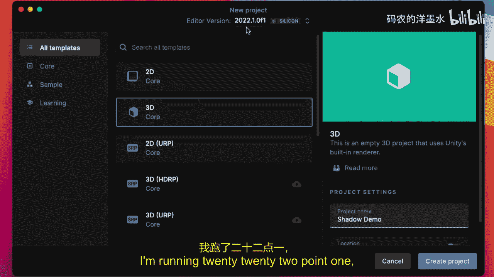
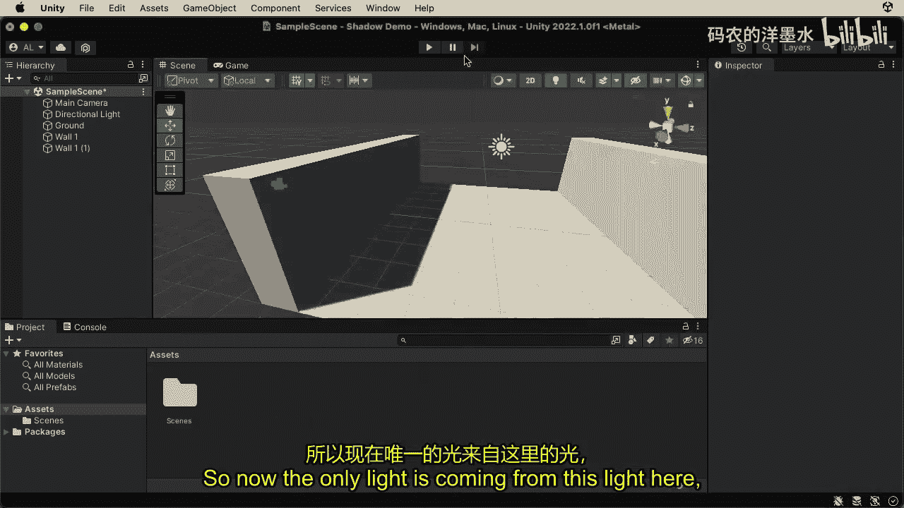
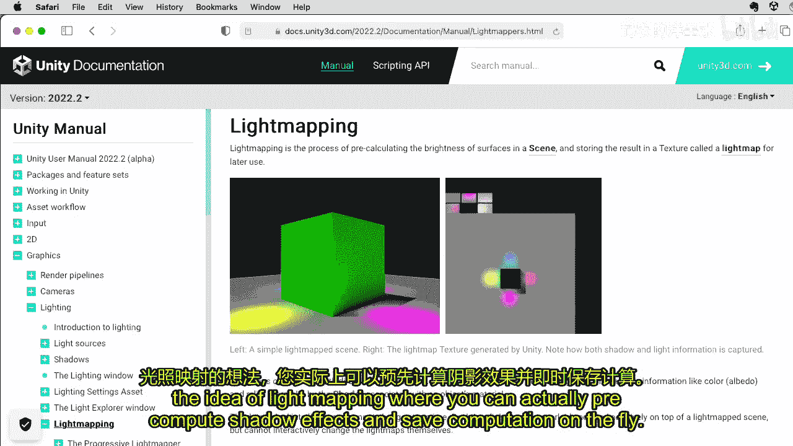
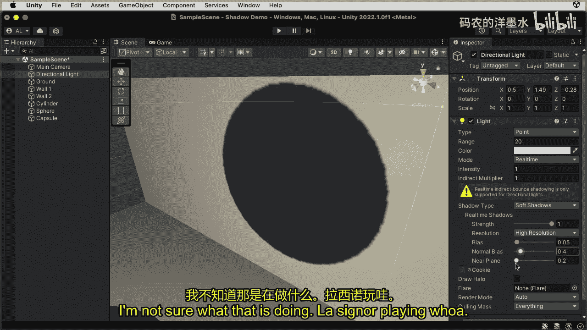
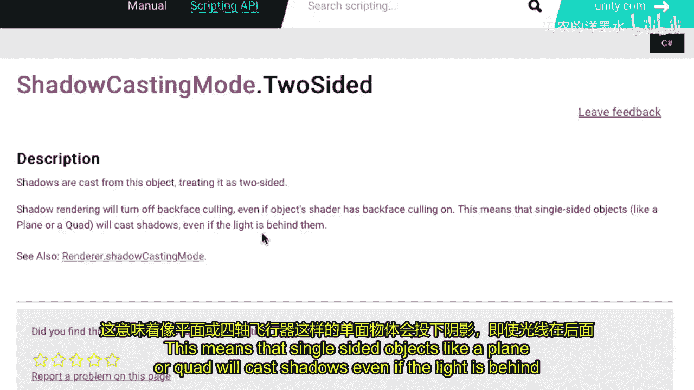
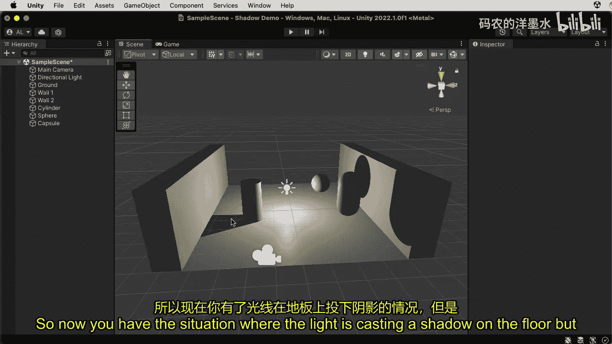

# 030：Unity中的实时阴影 🎮

在本节课中，我们将学习如何在Unity引擎中实现和配置实时阴影。我们将从创建一个基础场景开始，逐步探索Unity内置渲染管线中与阴影相关的各项设置，包括阴影类型、分辨率、偏置以及如何控制单个物体的阴影投射与接收。

上一讲我们介绍了阴影贴图（Shadow Mapping）的通用实现原理。本节中，我们来看看如何在Unity这一具体的游戏引擎中应用这些概念。

## 创建基础场景

首先，启动一个全新的3D项目，并使用内置渲染管线。建议使用Unity 2022.1或相近版本。

打开新项目后，应首先调整颜色空间设置。进入 **Edit -> Project Settings -> Player**，向下滚动找到 **Rendering** 部分的 **Color Space**，将其从 **Gamma** 改为 **Linear**。线性颜色空间能提供更准确的光照计算。

接下来，创建一个平面（Plane）作为地面，并将其位置设置为 `(0, 0, 0)`。

然后，创建一些用于投射阴影的物体。例如，创建一个立方体（Cube），调整其缩放以形成一堵墙（例如，Y轴缩放为3，X轴缩放以延伸）。将其命名为“Wall 1”。复制这面墙以创建第二面墙。

为了专注于理解光照，可以关闭天空盒（Skybox）的环境光影响。进入 **Window -> Rendering -> Lighting**，在 **Environment** 标签页下，将 **Skybox Material** 设置为 **None**。此时场景中的唯一光源是默认的平行光（Directional Light）。

## 配置光源与阴影

在Unity中，光源组件是控制阴影的核心。选中场景中的平行光，可以在检查器（Inspector）中看到 **Shadow** 相关设置。

**阴影类型**：光源的阴影模式有多个选项：
*   **No Shadows**：不投射任何阴影，性能开销最小。
*   **Hard Shadows**：产生边缘锐利的阴影，能清晰看到阴影贴图像素结构。
*   **Soft Shadows**：产生边缘柔和的阴影，通过过滤减轻了像素感，视觉上更自然，但计算开销稍大。
*   **Mixed**：此模式与烘焙光照（Baked Lighting）相关，用于混合实时与预计算光照。在当前纯实时设置下，其效果与 **Realtime** 类似。

可以尝试旋转光源方向，观察墙上和地面上的阴影如何变化。也可以将光源类型改为点光源（Point Light），并调整其位置和范围，观察阴影的动态变化。

## 阴影质量参数详解

以下是光源阴影设置中影响质量和效果的核心参数：

*   **Strength**：控制阴影的暗度。降低此值会使阴影变淡，并非完全符合物理模型，但可用于实现非全黑的阴影艺术效果。
*   **Resolution**：设置阴影贴图的分辨率。选项包括 **Low**、**Medium**、**High**、**Very High**。分辨率越高，阴影边缘越清晰，锯齿越少，但GPU内存占用和渲染开销也越大。
*   **Bias**：阴影深度偏置。用于将阴影略微“推离”投射物体，是解决 **自阴影瑕疵（Self-Shadowing Artifacts）** 的常用技术。值通常在0到2之间。
*   **Normal Bias**：法线偏置。沿表面法线方向“收缩”阴影投射面，是另一种避免自阴影瑕疵的方法。值通常在0到3之间。
*   **Near Plane**：定义渲染阴影贴图时，视锥体（Frustum）的近裁剪面距离。距离光源过近的物体将不会被纳入阴影计算，可用于优化性能。

## 控制单个物体的阴影行为

除了全局光源设置，还可以控制每个网格渲染器（Mesh Renderer）的阴影行为。

选中场景中的物体（如圆柱体），在检查器的 **Mesh Renderer** 组件中，找到 **Shadows** 部分：
*   **Cast Shadows**：控制该物体是否投射阴影。选项包括：
    *   **On**：正常投射阴影。
    *   **Off**：不投射阴影。
    *   **Two Sided**：强制双面投射阴影，即使物体材质启用了背面剔除（Backface Culling）。对于平面等单面物体，即使光源在背面也能投射阴影。
    *   **Shadows Only**：物体本身不可见，但会投射阴影。这可以用于创造有趣的游戏机制，例如让隐形敌人仅通过阴影暴露位置。
*   **Receive Shadows**：控制该物体是否接收其他物体投射的阴影。可以独立于阴影投射进行开关。

## 性能考量与脚本控制

实时阴影计算开销很大，尤其是在移动平台或复杂场景中。为了优化性能，可以：
1.  为不重要的动态光源（如短暂出现的爆炸光效）关闭阴影。
2.  根据物体重要性，选择性地关闭其 **Cast Shadows** 或 **Receive Shadows** 属性。
3.  在质量设置（Quality Settings）中全局调整阴影分辨率和距离。

所有这些阴影参数都可以通过C#脚本进行动态控制，为实现游戏逻辑（如昼夜循环、动态光源管理）提供了灵活性。

本节课中我们一起学习了在Unity中实现实时阴影的完整流程。我们从创建基础场景和配置光源开始，详细探讨了阴影类型、质量参数（如强度、分辨率、偏置）的具体作用，并学习了如何精细控制单个物体的阴影投射与接收行为。理解这些设置对于在游戏中平衡视觉质量与运行性能至关重要。在后续课程中，我们将探讨另一种重要的光照技术——烘焙光照（Baked Lighting）与光照贴图（Lightmapping）。