# 031：Cook-Torrance高光模型

在本节课中，我们将学习Cook-Torrance高光模型。这是基于物理的渲染中最流行的镜面反射模型。我们将从回顾之前课程中提到的简单镜面反射模型开始，逐步深入探讨如何构建一个更符合物理规律、能量守恒且计算可行的模型。

## 概述

在之前关于环境贴图的课程中，我们简要提到了完美的镜面反射。到目前为止，我们主要讨论的是漫反射光照模型。本讲我们将重点探讨Cook-Torrance模型，这是基于物理的渲染中最流行的镜面反射模型。

基于物理的渲染并非追求完美的物理模拟，而是旨在获得物理上可信、同时又能实时计算的结果。这样，我们在调整材质和光源时，效果会更加可预测。

## 准备工作与核心原则

在开始之前，如果你使用Unity等引擎，请确保使用线性颜色空间，而非伽马颜色空间。

基于物理的渲染有两个核心原则需要遵守：

1.  **能量守恒**：除非材质是自发光光源，否则它反射的能量不能超过入射的能量。
2.  **亥姆霍兹互易性**：交换观察者和光源的位置，应该得到相同的计算结果。

## 材质分类：金属与非金属

现代艺术工作流和基于物理的渲染对金属和非金属材质做了明确区分。

*   **金属**：只有镜面反射，且镜面反射可以带有颜色。
*   **非金属**：在电气工程中称为**电介质**。在这里，电介质泛指一切非金属材质。电介质同时具有漫反射和镜面反射，但其镜面反射是**白色**的。

一个常见的误解是，像粉笔、纸板这样的材质没有镜面反射。实际上，它们有，尤其是在掠射角度下。为了获得真实的效果，我们需要为它们添加镜面反射。

## 高动态范围渲染

如果你尝试实现这些物理特性，并使用真实的光源和材质，你会发现相机接收到的光线具有极大的动态范围。过去，艺术家们需要花费大量时间调整光源强度，以避免图像过曝。但在追求物理真实感时，我们必须处理场景中极暗和极亮的部分。

因此，你可能需要一个能处理高动态范围的渲染缓冲区，然后使用**色调映射**或**泛光**等技术，将高动态范围信息压缩到显示器能够正常显示的范围内。

## 双向反射分布函数回顾

在课程早期，我们介绍了**双向反射分布函数**的概念。

BRDF是一个函数，它描述了从某个方向入射的光，在另一个方向反射的比例。对于我们常用的光源类型，公式前会有一个“魔法”因子 **π**。在本课程中，你可以暂时将其视为一个常数。

以下是BRDF的一般形式：

`反射光颜色 = BRDF * 光源颜色 * max(0, dot(法线, 光源方向))`

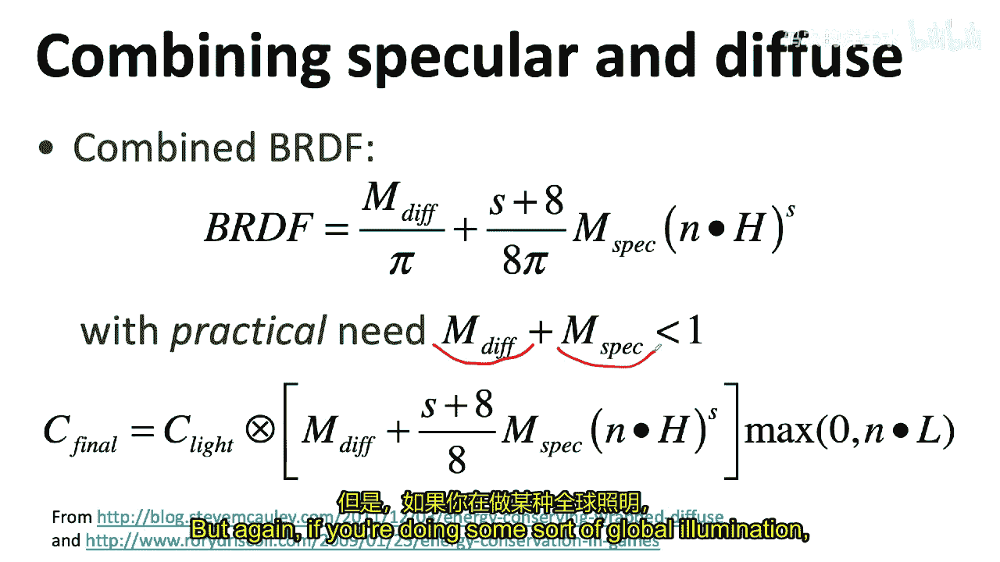

其中，`光源颜色 * max(0, dot(法线, 光源方向))` 是常见的兰伯特漫反射项。

## 从经典模型到物理模型

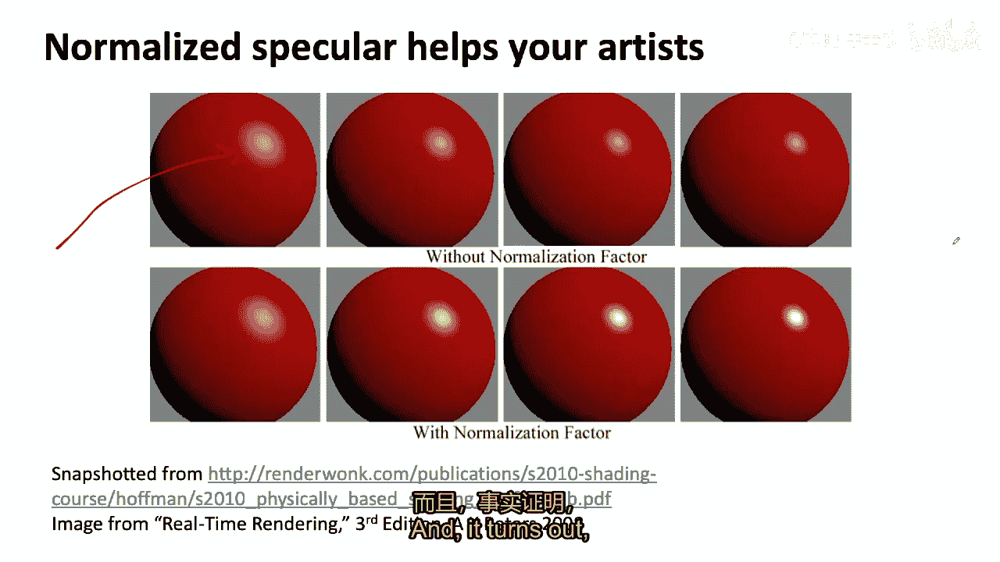

我们一直使用的漫反射模型比较简单。

`漫反射BRDF = 材质颜色 / π`

当它与包含π因子的光源计算时，π会相互抵消，因此我们经常在代码中省略它。

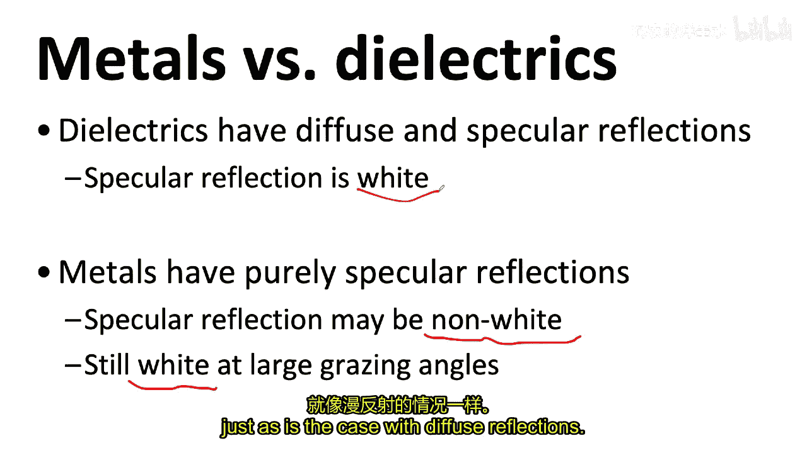

过去，人们常在漫反射模型上添加一个**Blinn-Phong高光**项来模拟镜面反射。其形式如下：

`Blinn-Phong高光项 = (材质高光色 / π) * pow(max(0, dot(半角向量, 法线)), 光泽度)`

这里的**半角向量**是观察方向与光源方向的中间向量。然而，这个经典模型不满足亥姆霍兹互易性，因为它分母中的 `dot(法线, 光源方向)` 与 `dot(法线, 观察方向)` 并不总是相等。

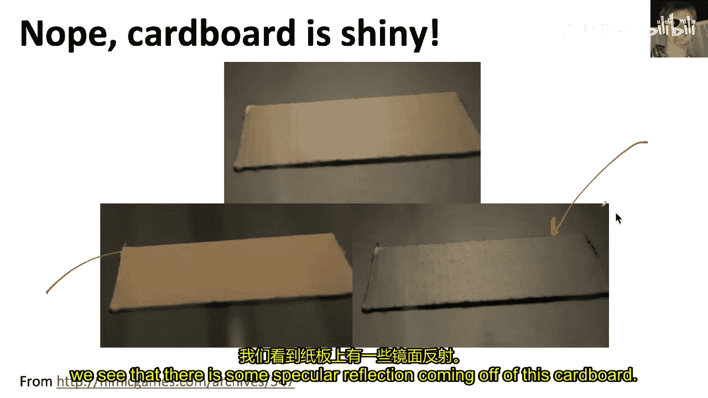

为了使它满足互易性，一个简单的修改是去掉分母：

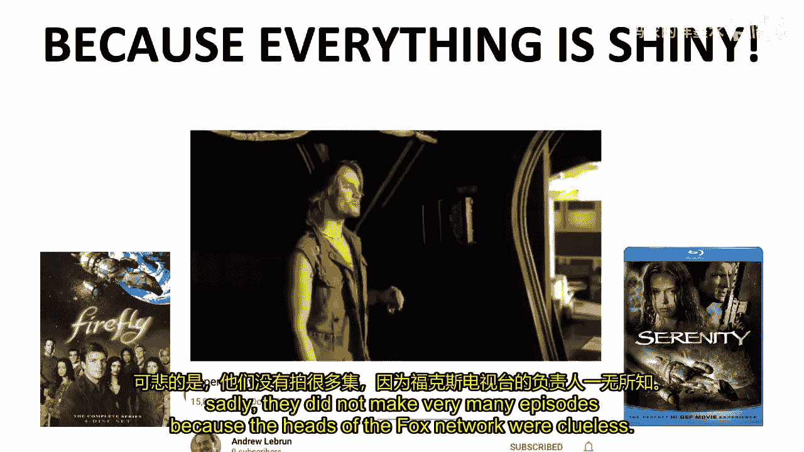

`修正的Blinn-Phong高光项 = (材质高光色 / π) * pow(max(0, dot(半角向量, 法线)), 光泽度)`

但这样又引入了**能量不守恒**的问题。随着高光斑点变窄，其总亮度并没有相应增加。

为了解决能量守恒问题，需要在公式前添加一个与光泽度相关的归一化因子 `(光泽度 + 8) / 8`：

`能量守恒的Blinn-Phong = (材质高光色 / π) * ((光泽度 + 8) / 8) * pow(max(0, dot(半角向量, 法线)), 光泽度)`

这样，当高光变窄时，它会同时变得更亮，从而保持总的反射能量大致不变。这对于艺术家调整参数更为友好。

## 菲涅尔效应

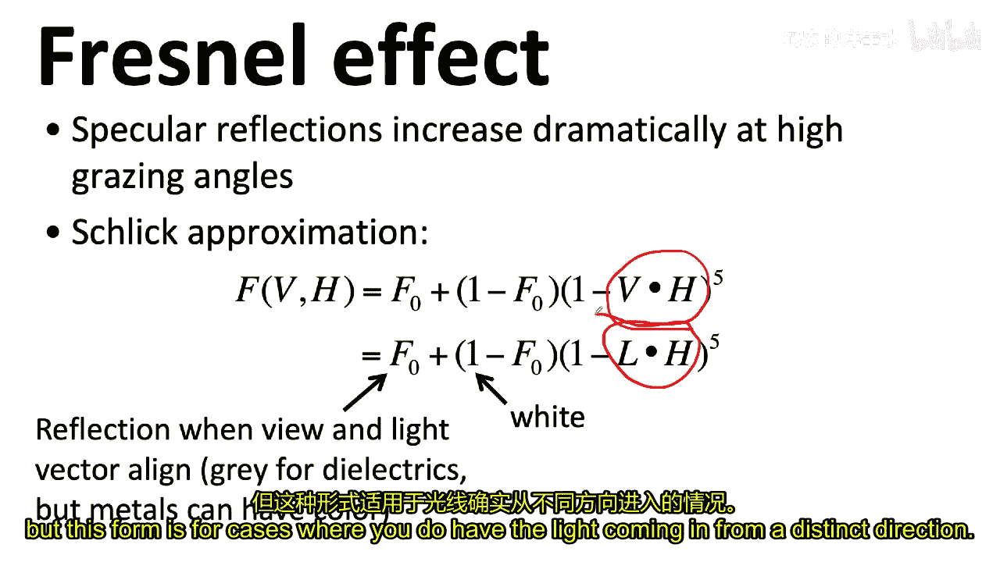

菲涅尔效应描述了反射率随观察角度变化的现象。当视线与表面法线夹角越大时，反射越强。

完整的菲涅尔方程很复杂，在着色器中常用**Schlick近似**：

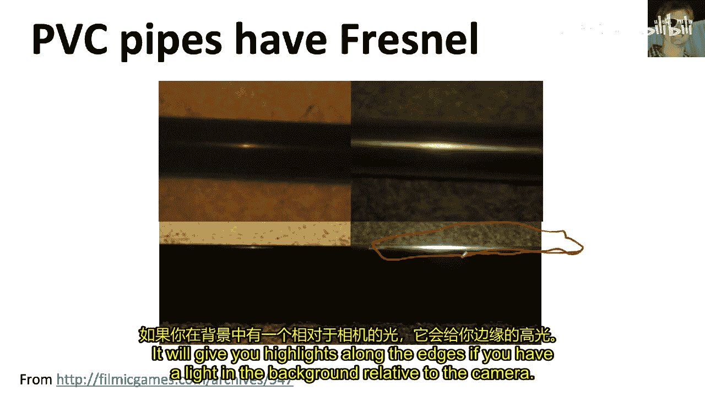

`F = F0 + (1 - F0) * pow(1 - dot(观察方向, 半角向量), 5)`

其中，**F0**是法线入射时的基础反射率。
*   对于电介质，**F0**是一个很小的灰度值，反射很弱。
*   对于金属，**F0**值较大，且可以带有颜色。

当观察方向与光源方向一致时，公式后半部分为0，反射率就是**F0**。当处于掠射角时，反射率趋近于1，所有材质都会表现出强烈的镜面反射。

菲涅尔效应适用于所有材质，而不仅仅是金属。它解释了为什么在掠射角度下，即使是纸板这样的材质也会出现高光。

## 微表面理论与Cook-Torrance模型

现实中的表面并非绝对光滑，而是由许多微小的凹凸构成。这些微表面的粗糙度决定了镜面反射的锐利或模糊程度。

**Cook-Torrance模型**是一个综合考虑了微表面分布、几何遮蔽和菲涅尔效应的镜面反射模型。其一般形式如下：

`镜面反射BRDF = (F * D * G) / (4 * dot(法线, 观察方向) * dot(法线, 光源方向))`

其中：
*   **F**：菲涅尔项，使用Schlick近似计算。
*   **D**：法线分布函数，描述微表面法线的分布，决定高光的形状和宽度。
*   **G**：几何遮蔽项，描述微表面之间互相遮挡导致的光线衰减。

### 法线分布函数

D项定义了微表面法线朝向半角向量H的几率。它通常由一个**粗糙度**参数控制。

*   **修正的Blinn-Phong**：可以作为D项的一种简单选择，但已不常用。
*   **GGX/Trowbridge-Reitz**：这是目前最流行的D项。它能产生一个锐利的核心和长而平滑的拖尾，更符合许多真实材质的观察结果。其公式如下：

`D_GGX = (α^2) / (π * ( (dot(法线, 半角向量)^2) * (α^2 - 1) + 1 )^2 )`

其中，α是粗糙度参数。艺术家通常使用一个0到1的**光滑度**参数，然后通过 `α = (1 - 光滑度)^2` 之类的映射来得到粗糙度。

### 几何遮蔽项

G项描述了微表面在入射和出射时可能产生的阴影和遮蔽效应。原始的Cook-Torrance G项比较复杂。

一个与GGX分布配套的常用G项是**Smith-Schlick-GGX**，它可以分解为入射和出射两个因子的乘积：

`G_Smith = G1(dot(法线, 光源方向)) * G1(dot(法线, 观察方向))`
`G1(n·v) = (n·v) / ( (n·v) * (1 - k) + k )`

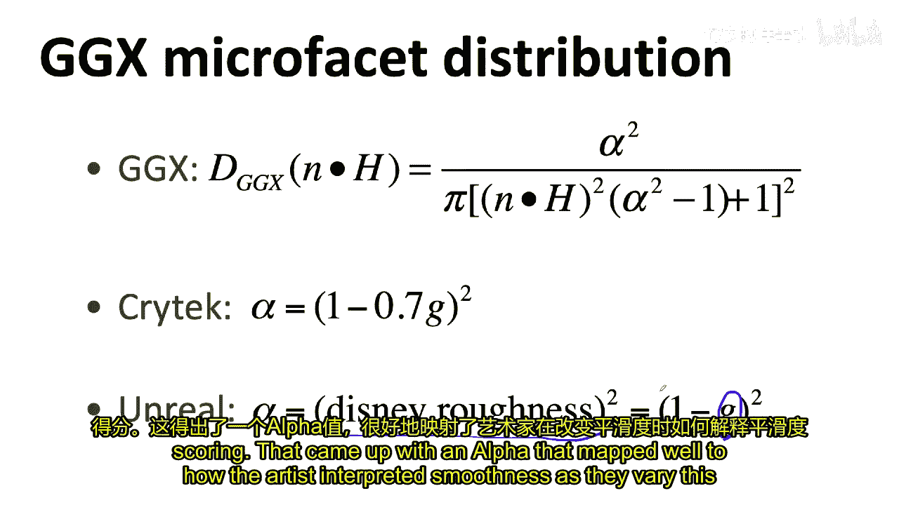

其中，k是与粗糙度相关的参数，例如 `k = (粗糙度^2) / 2`。

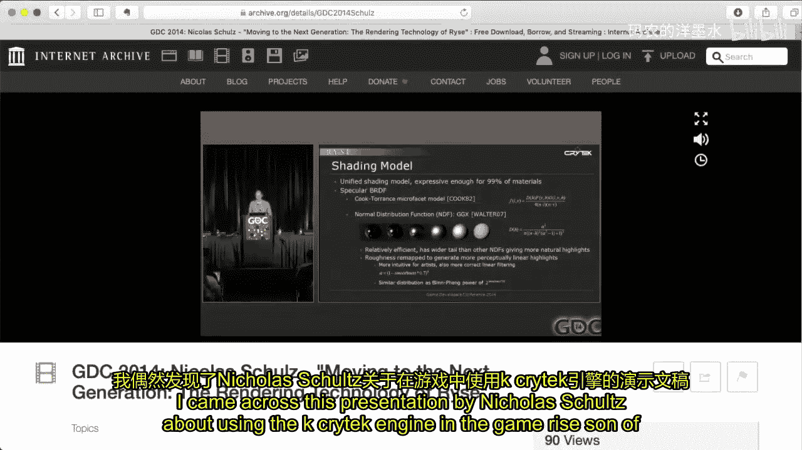

为了计算优化，人们常定义一个**可见性项**，它合并了G项和Cook-Torrance分母的一部分：

`V = G / (4 * dot(法线, 光源方向) * dot(法线, 观察方向))`

这样，最终的镜面反射计算就变成了：

`镜面反射 = F * D * V`

## 完整的着色模型

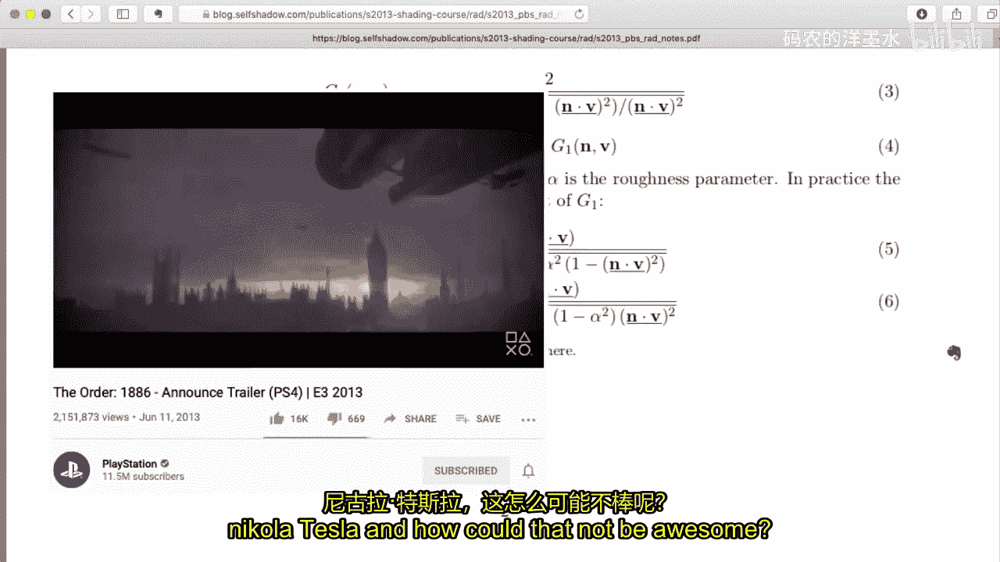

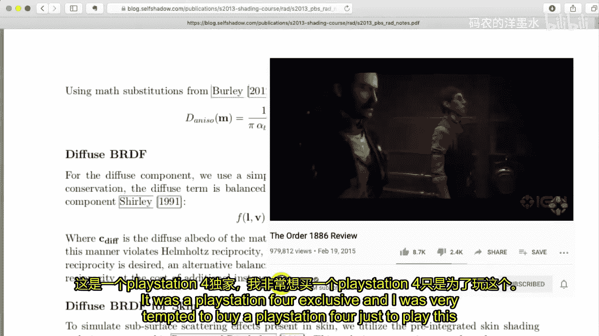

最终，一个基于物理的着色模型通常结合了漫反射和镜面反射：

`最终颜色 = (漫反射颜色 / π + 镜面反射BRDF) * 光源颜色 * max(0, dot(法线, 光源方向))`

对于金属，其漫反射颜色应为黑色，因为所有入射光都被吸收或镜面反射。为了确保能量守恒，材质的漫反射颜色和高光颜色之和应小于1。

## 总结

本节课我们一起学习了Cook-Torrance高光模型。我们从经典的Blinn-Phong模型出发，指出了其在物理正确性上的不足。然后，我们逐步引入了能量守恒、亥姆霍兹互易性、菲涅尔效应等核心概念。最后，我们深入探讨了Cook-Torrance模型的三个组成部分：菲涅尔项、法线分布函数和几何遮蔽项，并介绍了目前业界主流的GGX和Smith-Schlick-GGX实现方案。

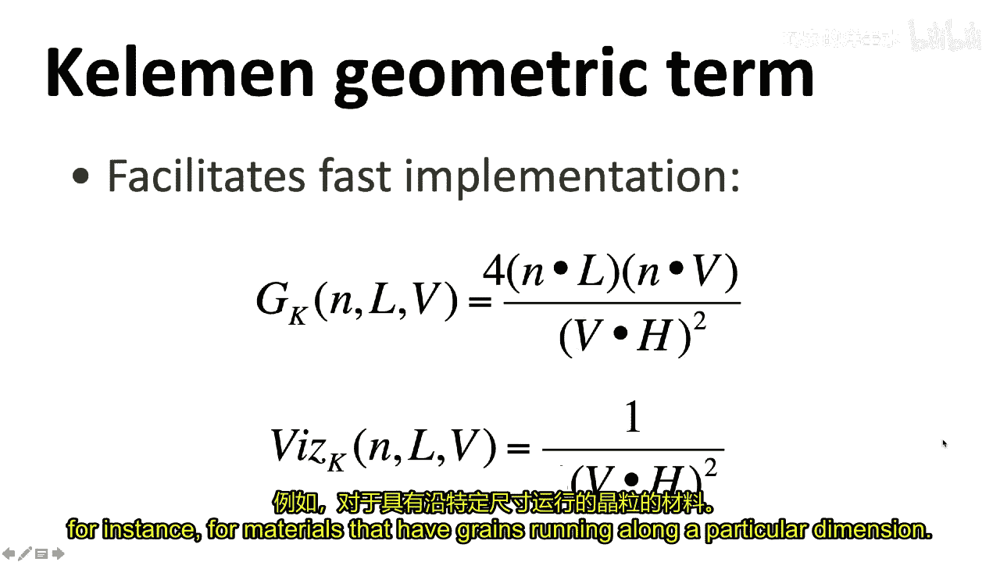

掌握这个模型，是理解现代基于物理的渲染管线的基础，它能帮助我们在游戏中创造出更加真实可信的材质和光照效果。