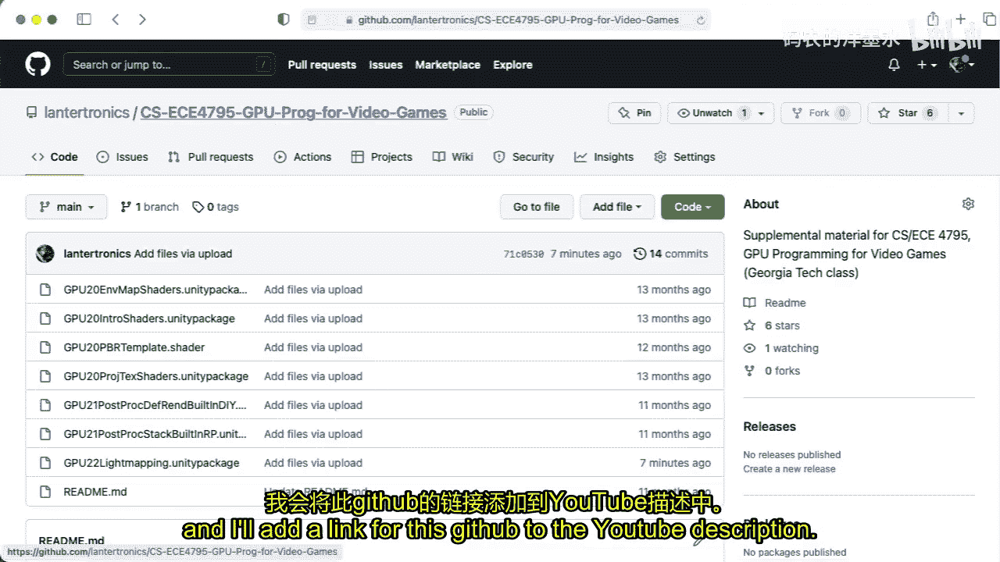
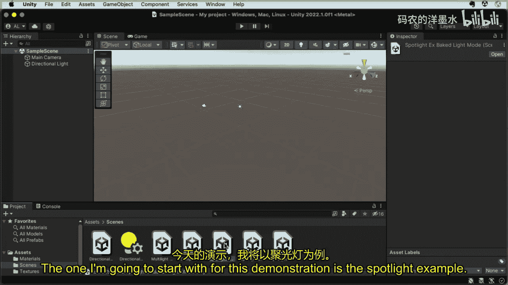
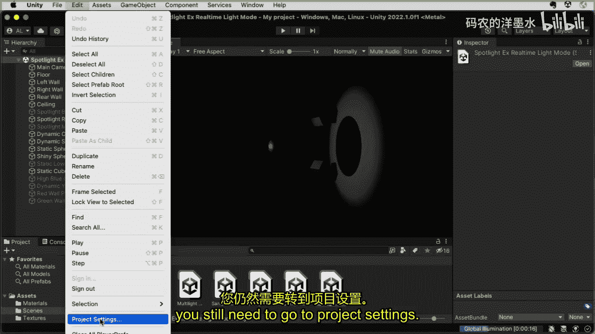
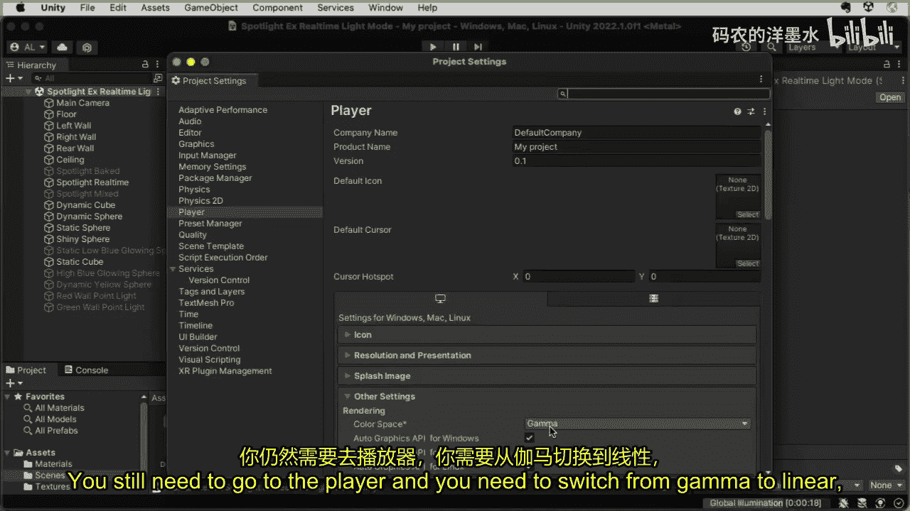
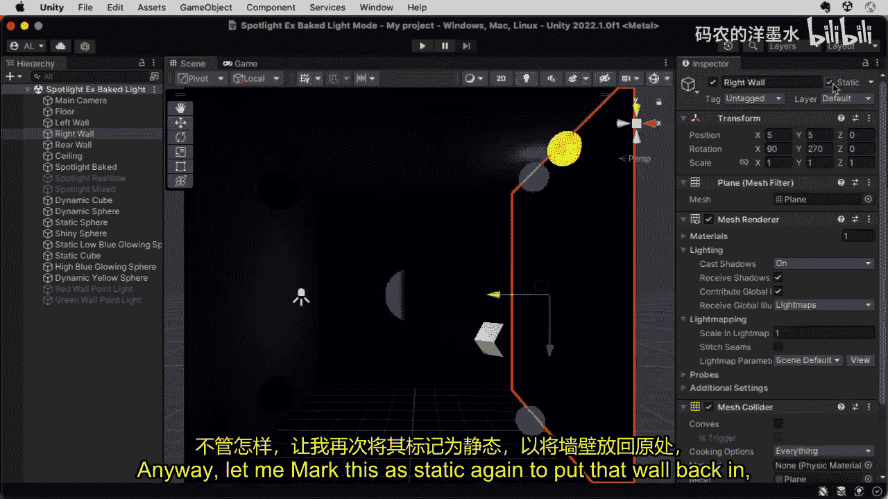
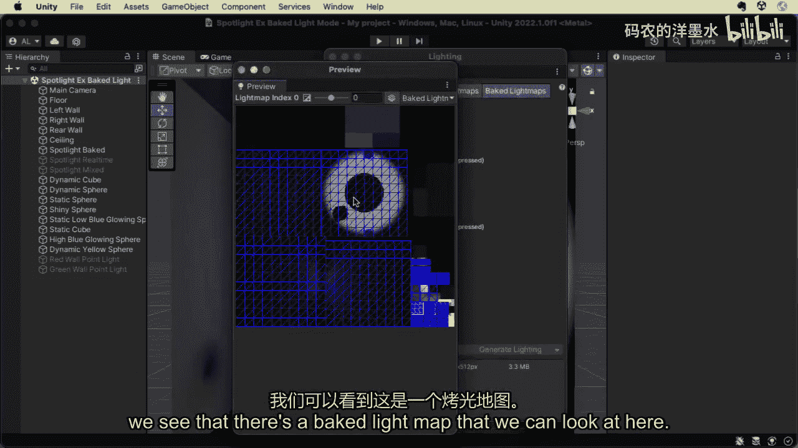
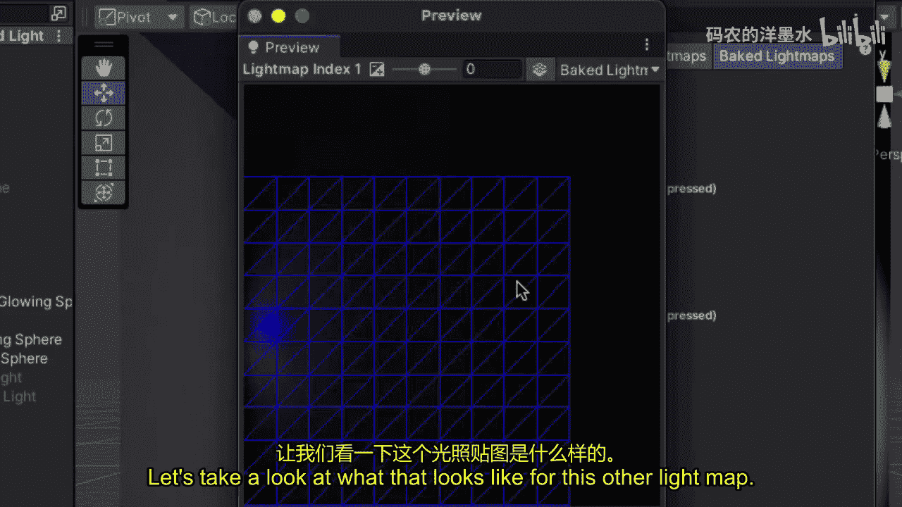
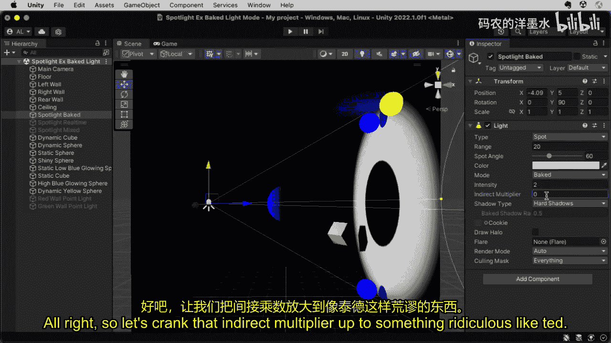
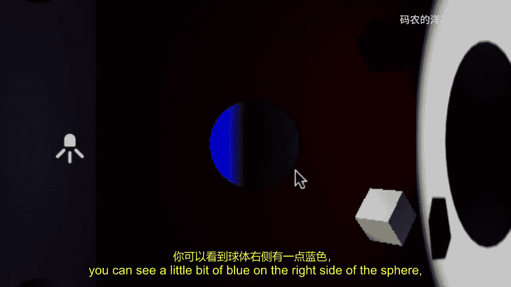
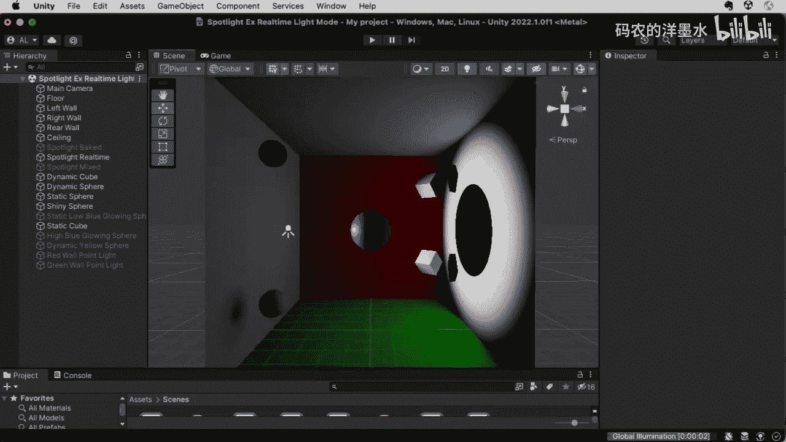

# 032：Unity中完全烘焙光照贴图 🎮



在本节课中，我们将学习如何在Unity中预计算光照效果，并将其“烘焙”到称为光照贴图的特殊纹理中。这与我们之前看到的实时计算光照效果不同。

上一节我们介绍了实时光照，本节中我们来看看如何通过烘焙来模拟更复杂的光照效果，例如光线反弹。







## 场景设置与线性色彩空间

首先，我们需要正确设置项目。在Unity的默认3D内置渲染管线项目中，光照可能看起来不正确。这是因为色彩空间设置。

以下是关键步骤：
1.  进入 **项目设置**。
2.  选择 **播放器** 选项卡。
3.  在 **其他设置** 下，将 **色彩空间** 从 **伽马** 切换到 **线性**。

```csharp
// 此设置在编辑器中进行，无需代码。
// 路径：Project Settings -> Player -> Other Settings -> Color Space
```

完成此设置后，场景中的光照显示将恢复正常。

## 实时光照场景示例

我们从一个使用实时光照的简单场景开始。场景中包含一个聚光灯、一个球体、几个方块和墙壁。

*   **球体材质**：被特意设置为不真实的材质。其**反照率**颜色为蓝色，但**高光**颜色为红色。这有助于清晰区分漫反射和高光反射。
*   **聚光灯**：设置为**实时**模式。这意味着所有光照计算（包括阴影）都在游戏运行时每帧进行。
*   **局限性**：实时光照无法计算光线在表面间反弹的效果（即全局光照）。因此，只有被灯光直接照射的区域是明亮的，背光面和阴影区域完全黑暗。

## 切换到烘焙光照模式

接下来，我们查看同一个场景的烘焙光照版本。将聚光灯的**模式**从“实时”改为“烘焙”。

烘焙光照的核心流程是：Unity在编辑器中进行一次复杂的预计算，模拟光线从光源发出后，在场景所有**静态**物体表面的反弹和吸收过程，并将最终的光照强度和颜色信息存储到**光照贴图**纹理中。

烘焙完成后，你会注意到场景发生了显著变化：
*   **出现间接光照**：即使墙壁没有被灯光直接照射，现在也能被看到。这是因为光线从地板或其他墙壁反弹到了这里。
*   **球体背光面变亮**：球体背离光源的一侧现在呈现出微弱的蓝色。这是蓝色墙壁反射的间接光照造成的。



## 静态对象与光照烘焙

烘焙光照只对标记为**静态**的游戏对象生效。这是一个承诺，告诉Unity这些物体在游戏运行时不会移动，因此可以安全地将它们的光照信息预先计算并烘焙到纹理中。

以下是不同对象状态的影响：

*   **标记为静态的物体**：参与光照烘焙计算，可以接收和贡献间接光照，并能投射烘焙阴影。
*   **未标记为静态的物体**：不参与光照烘焙计算。在烘焙光照场景中，它们只能接收**直接光照**（如果光源模式为“混合”或“实时”），或者完全不接收光照（如果光源为纯烘焙模式）。它们也不会贡献间接光。

**重要提示**：将物体标记为静态并不会在代码层面阻止其移动。如果在运行时通过脚本移动了一个静态物体，它的视觉效果（如阴影）仍会停留在烘焙时的位置，导致画面错误。

## 光照贴图与方向性贴图

Unity会自动为场景生成光照贴图。你可以通过 **窗口 -> 渲染 -> 光照** 打开光照设置窗口，并在 **烘焙光照贴图** 选项卡中查看它们。

Unity实际上会生成两种贴图：
1.  **颜色光照贴图**：存储了烘焙后的光照颜色和强度信息。
2.  **方向性贴图**：这是一种额外的贴图，用于编码光照的主要入射方向信息。着色器可以利用这些数据来模拟更精确的漫反射效果，即使光照是烘焙的。

## 烘焙参数：间接光乘数



在灯光组件的烘焙设置中，有一个关键参数叫**间接光乘数**。它控制着光线每次反弹后保留的能量强度。

*   **值 = 1**：物理上准确的能量保留（基于材质反射率）。
*   **值 > 1**：光线在每次反弹后能量增加，会导致场景异常明亮，通常用于艺术化效果。
*   **值 < 1**：光线在每次反弹后能量衰减更快，间接光照效果更弱。
*   **值 = 0**：完全禁用间接光照，场景将只有直接光照效果。



## 烘焙光照的优缺点

**优点**：
*   **高质量全局光照**：可以计算逼真的光线反弹和颜色渗透效果。
*   **运行时性能极高**：光照计算在游戏运行前已完成，运行时只需简单的纹理采样，对GPU消耗极低。



**缺点**：
*   **无法处理动态物体**：静态物体的光照是固定的，移动后会穿帮。
*   **无法包含高光**：高光反射依赖于观察者（摄像机）的位置，而烘焙时摄像机位置未知。因此，烘焙光照只能处理**漫反射**。
*   **增加内存占用**：光照贴图需要额外的纹理内存。
*   **烘焙耗时**：修改场景或光照后需要重新烘焙，等待时间较长。

## 总结



本节课中我们一起学习了Unity中的完全烘焙光照贴图技术。我们了解了如何通过将灯光模式设置为“烘焙”来预计算全局光照，并将结果存储到光照贴图中。我们探讨了“静态”对象的概念及其对烘焙的重要性，查看了生成的光照贴图和方向性贴图，并调整了间接光乘数参数。最后，我们总结了烘焙光照在提供高质量间接光方面的优势，以及其在处理动态对象和高光反射方面的局限性。



在下一讲中，我们将探讨一种折中的“混合”光照模式，它试图结合烘焙光照和实时光照的优点。