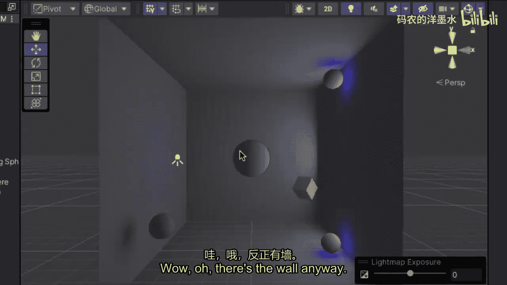
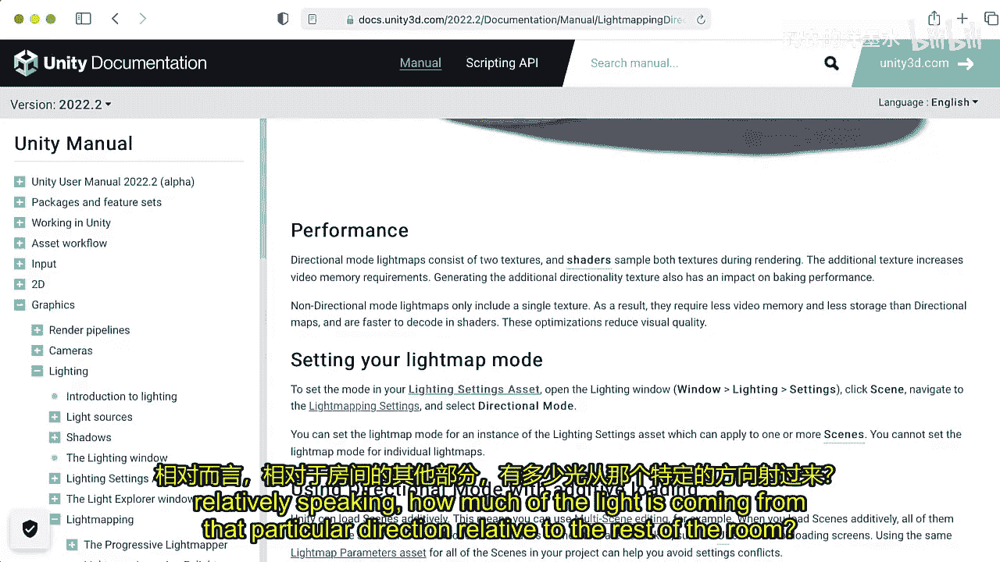
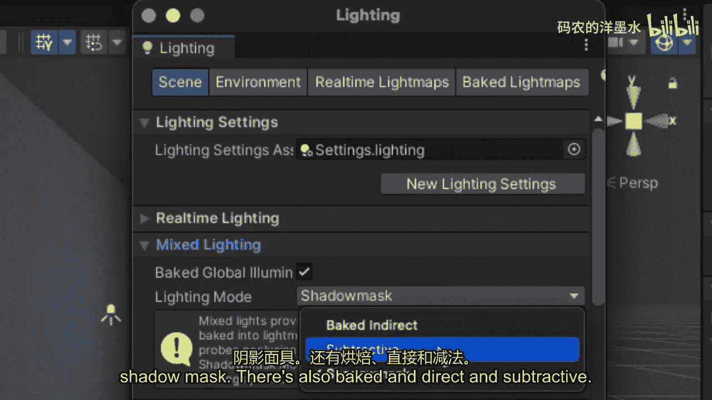
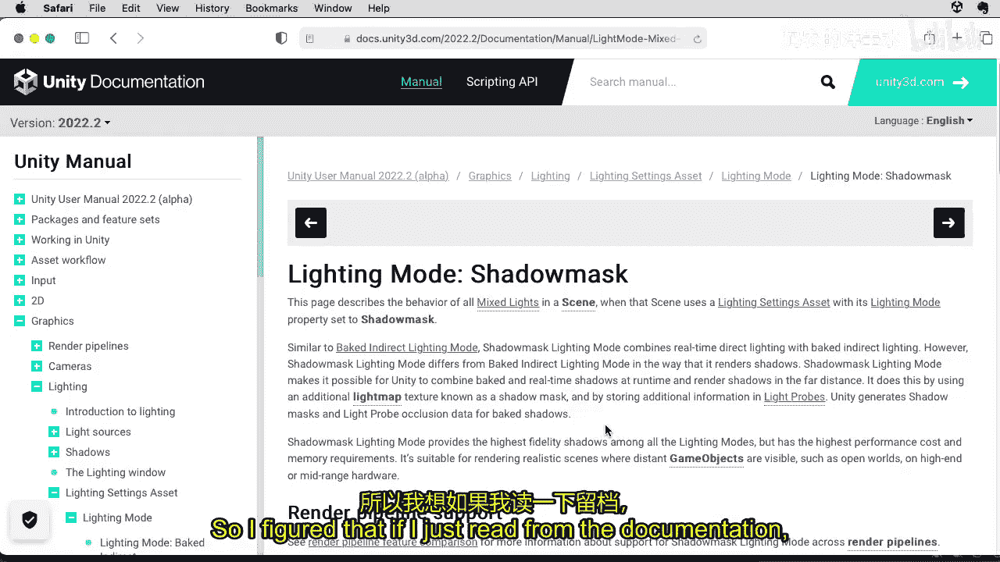
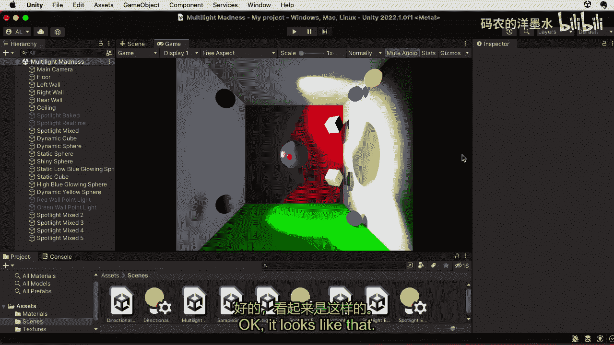

# 033：Unity中混合模式灯光的光照贴图 🎮

在本节课中，我们将学习Unity中混合模式灯光的工作原理，特别是它如何结合实时灯光与烘焙灯光来生成光照贴图，并实现如镜面高光等实时效果。

上一节我们介绍了纯烘焙灯光模式，它能够计算全局光照和光线反弹，但无法处理依赖于摄像机位置的镜面高光。本节中我们来看看混合模式灯光，它如何解决这个问题。

混合模式灯光将光照计算分为两部分：
*   **直接光照**：由实时灯光计算，支持镜面高光等效果。
*   **间接光照（反弹光）**：预先烘焙到光照贴图中。

因此，混合模式下的光照贴图**仅包含间接光照信息**，直接光照效果则由GPU在运行时实时计算并叠加。

以下是混合模式灯光的关键特性：

*   **支持镜面高光**：因为直接光照是实时计算的。
*   **保留全局光照**：间接光照和光线反弹效果通过烘焙保留。
*   **性能权衡**：比纯烘焙模式需要更多实时计算，但比纯实时模式性能更好。

---

为了更直观地理解，我们可以通过Unity的调试菜单查看不同的光照贴图。

*   **烘焙光照贴图**：在纯烘焙模式下，此贴图包含**直接和间接**的所有光照信息。
*   **方向性贴图**：编码了间接光照射到表面点的方向信息，这对于法线贴图等效果很重要。
*   **阴影遮罩**：这是混合模式（特别是“Shadowmask”模式）下特有的贴图。它存储了烘焙阴影的信息，允许Unity在运行时将烘焙阴影与实时阴影结合。

关于阴影遮罩，Unity官方文档说明：
> 阴影遮罩光照模式将实时直接光照与烘焙间接光照相结合。它通过使用一种称为阴影遮罩的额外光照贴图纹理，以及在光照探针中存储额外信息，使得Unity能够在运行时组合烘焙和实时阴影，并渲染远距离阴影。阴影遮罩纹理每个纹素最多可包含四盏灯光的信息。

对于本课程的学习者而言，无需过度深究阴影遮罩的实现细节，了解其核心作用即可。

---

我们可以通过一个多灯光的场景来观察阴影遮罩的分配机制。

在一个包含五盏混合模式聚光灯的场景中，阴影遮罩最多只能为四盏灯分配独立的通道（RGBA）。Unity的烘焙系统会自动决定哪四盏灯被纳入阴影遮罩，而超出的灯光将回退到完全的烘焙光照处理。通过开关灯光可以观察到阴影遮罩的分配会动态变化。

---

最后，我们探讨方向性贴图的重要性。在一个同时包含烘焙光、实时光和混合光的场景中，只有实时光和混合光能产生镜面高光。

如果地面材质使用了法线贴图，那么来自间接光照的细节表现（如凹凸感）就依赖于方向性贴图提供的入射光方向信息。如果将方向模式切换为“非方向性”，方向性贴图将消失，法线贴图在间接光照下的效果会大打折扣。

---

本节课中我们一起学习了Unity中混合模式灯光的光照贴图。我们了解到混合模式巧妙地结合了实时计算与预烘焙的优点：实时计算直接光照以支持镜面高光等动态效果，同时通过烘焙光照贴图来保留高质量的全局光照和光线反弹。我们还简要介绍了阴影遮罩和方向性贴图这两个关键概念及其作用。