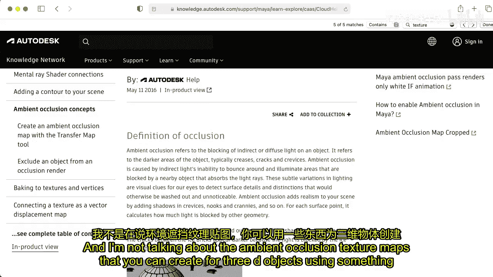
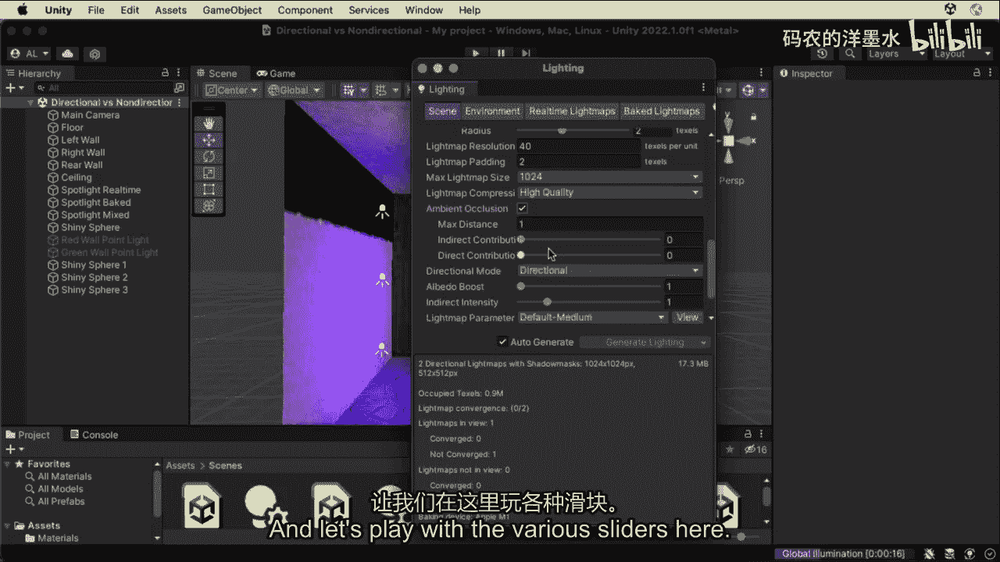
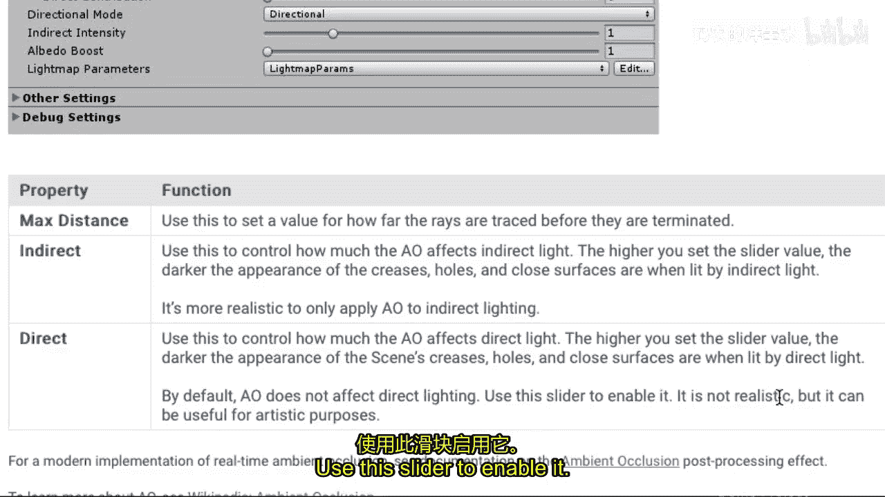
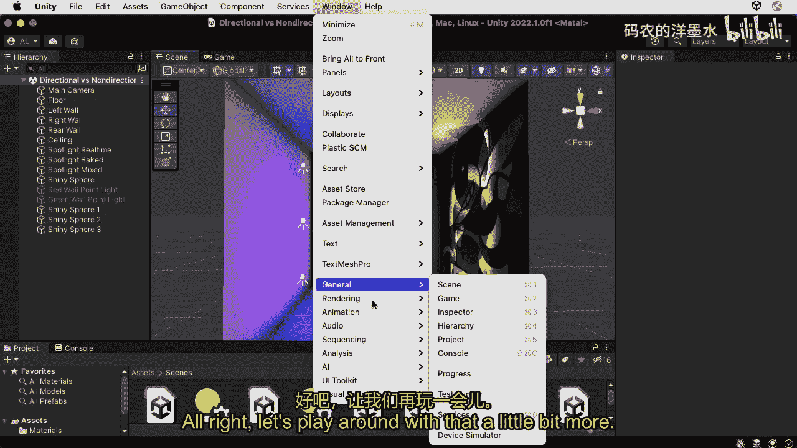
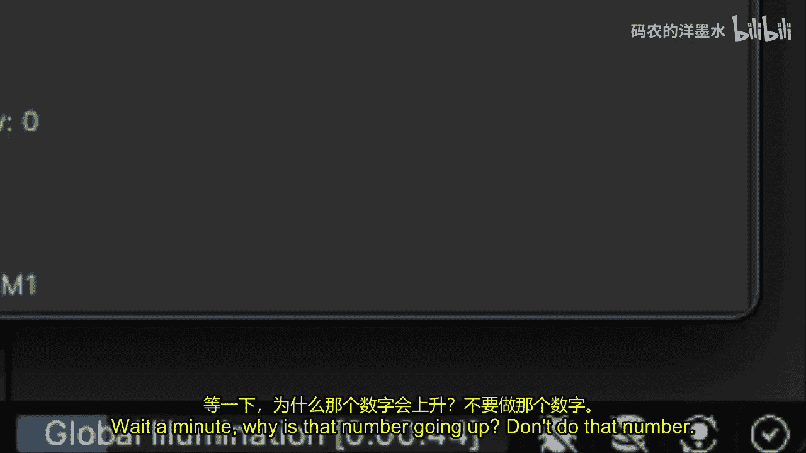
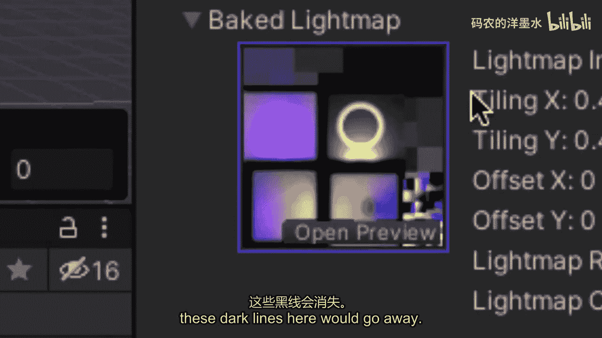

# 034：环境遮蔽光

## 概述

在本节课中，我们将学习环境遮蔽光（Ambient Occlusion）的概念及其在游戏开发中的应用。我们将重点探讨如何在Unity中，将环境遮蔽光效果烘焙到光照贴图中，并了解其核心参数与视觉效果。

---

## 课程内容

大家好，我是Er Lanchman，佐治亚理工学院电气与计算机工程系的教授。在本次关于视频游戏GPU编程的讲座中，我将讨论环境遮蔽光。

使用环境遮蔽光时需要谨慎。这是一个很酷的效果，但很容易过度使用。具体来说，我将讨论如何将环境遮蔽光效果烘焙到Unity的光照贴图中。我不会讨论任何花哨的实时环境遮蔽光计算，也不会讨论屏幕空间环境遮蔽光这种实时后处理效果（尽管我可能在未来的讲座中简要提及），更不会讨论使用Maya等工具为3D对象创建的环境遮蔽光纹理贴图。

这是一个演示场景，你可以从Github下载它。我在上一讲中也使用了这个场景。场景顶部有一个实时光源，中间有一个烘焙光源，底部则是一个混合光源。

接下来，我将开启烘焙的环境遮蔽光效果。当你观察时，请特别注意房间的角落，以及天花板、墙壁和地板相接的地方。

现在，让我们打开“窗口 -> 渲染 -> 光照”设置面板。向下滚动，找到环境遮蔽光选项并将其开启。然后，我们来调整一下这里的各种滑块。

让我们看看官方文档对这些参数的说明。我们有一个“间接贡献”滑块，用于控制环境遮蔽光对间接光照的影响程度。滑块值越高，由间接光照亮的褶皱、孔洞和紧密表面区域就显得越暗。通常，只将环境遮蔽光应用于间接光照会更真实。

我们还有一个类似的“直接贡献”滑块。文档说明，默认情况下环境遮蔽光不影响直接光照。使用此滑块可以启用该效果，但这并不真实，可能仅用于艺术目的。

现在，让我们调整一下“间接贡献”滑块，将其值提高一点。我们需要等待Unity计算一会儿。

大家好，在剪辑后我重新开始讲解。由于某种原因，计算预估时间不断增长，所以我先关闭了环境遮蔽光，然后再重新开启并设置参数，现在它似乎正常工作了。

当“间接贡献”设置为1.89时，你可以看到角落变暗了，墙壁、天花板和地板相接的缝隙也变得更暗了。环境遮蔽光的理念是：考虑到场景中那种普遍、漫反射式的光线弹跳效果，如果你身处这样一个角落，光线能进来的方向就更少，物体可能会阻挡光线，因此这个区域会被人为地变暗。

其实现原理是，系统在场景中选取一个特定点，从该点发射出一系列光线，然后检测在一定距离内（我认为这是“最大距离”设置）是否击中了物体。如果击中了，它就假设可能有光线被阻挡了。

让我点击游戏视图，这样你就能在没有编辑器界面干扰的情况下看到效果了。

让我们再调整一下。先把光照设置调回来，然后把“直接贡献”也设为1.89。

实际上之前是1.84，不确定看起来是否有区别。要真正比较，需要截图并排对比。

让我们把“间接贡献”调低，只保留“直接贡献”的效果。等等，为什么这个数字在上升？别这样。

好吧，我感觉有些失控了。让我把这个调低，然后关掉它。现在它在没有环境遮蔽光的情况下运行。让我先让它计算完。

现在，让我重新开启环境遮蔽光，只调高“直接贡献”，但不调高“间接贡献”，看看效果如何。现在数字在下降了。我不知道为什么它似乎会卡住，然后需要我关闭再重新开启。如果有人知道原因，请在下方留言。

让我们把这个值调高很多。哦，不，它不喜欢这样，看，它又开始异常了。好吧，让我把它全部调回最低。不，它还在上升。好吧，让我关掉它。

现在我要做的是重新开启它，然后调高“直接贡献”的值，但也许不会调到最高。看，这里的数字在下降。实际上，让我做一件可能早就该做的事：截图。这是只有“直接贡献”环境遮蔽光的效果。看看这和关闭环境遮蔽光时是否真的有区别。

现在让我关闭环境遮蔽光。无论这里的直接光效果是什么，对于这个场景来说，可能不是展示它的最佳例子。是的，我确实没看出什么区别。好吧，至少对于这个场景，我认为这没什么意思。

让我们重新开启环境遮蔽光。我将把“直接贡献”调低。现在，让我把“间接贡献”调高。

看，我们现在有了这些大片的黑色区域。正如我提到的，这个效果很容易过度使用。请记住，环境遮蔽光是一种模拟全局光照某些方面的方法，但它不是真正的、完整的全局光照计算，它是一种技巧。还要记住，环境遮蔽光主要处理漫反射光照，并不真正处理高光效果。

我想强调的一点是，Unity将环境遮蔽光烘焙到光照贴图中的方式，是将其直接烘焙进光照贴图纹理本身。环境遮蔽光效果并非存储在某些独立的光照贴图纹理中。

为了验证这一点，如果我在这里查看烘焙的光照贴图，你可以看到这些变暗的边缘。实际上，由于这里网格的显示方式，在这里更容易看到，你可以看到这些暗线。如果我去掉环境遮蔽光效果，这些暗线就会消失。

---

## 总结

本节课中，我们一起学习了环境遮蔽光的基本概念。我们了解到，环境遮蔽光是一种用于模拟角落和缝隙因光线被遮挡而变暗的技术，能增加场景的深度感和真实感。在Unity中，我们可以通过光照设置面板将其效果烘焙到光照贴图中，并通过“间接贡献”和“直接贡献”参数来控制其影响的强度。需要注意的是，这是一个容易被过度使用的艺术化效果，使用时需保持克制，以追求自然真实的结果。