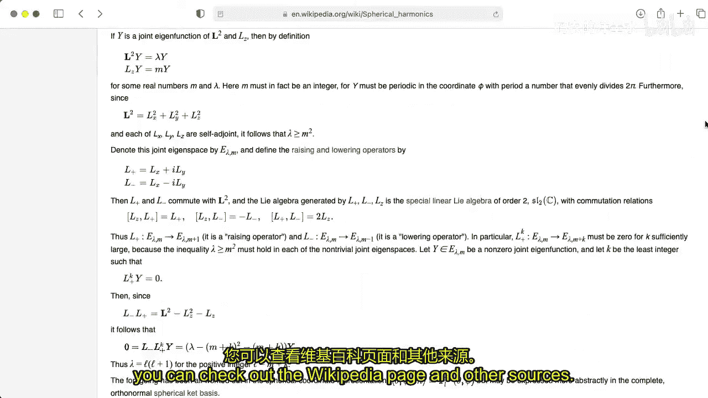
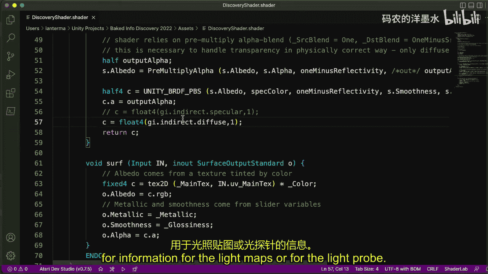
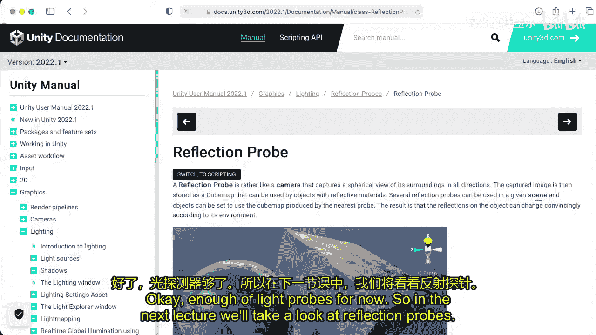

# 035：Unity中的光探针与球谐函数 🎮

在本节课中，我们将学习Unity中的光探针与球谐函数。上一节我们介绍了光照贴图，它通过预计算光照效果来节省运行时开销。本节中，我们来看看如何为动态物体提供全局光照信息。

## 概述

光探针是一种技术，用于为场景中的动态物体提供烘焙的全局光照信息。与光照贴图不同，光照贴图仅适用于标记为静态的物体。光探针通过在场景中放置采样点来捕获光照信息，动态物体运行时通过插值这些点的信息来获得光照。

## 光探针的工作原理

以下是光探针的基本工作流程：

1.  **创建光探针组**：在Unity编辑器中，通过菜单 `GameObject > Light > Light Probe Group` 创建一个光探针组。
2.  **放置光探针**：进入编辑模式，在场景的关键位置放置光探针采样点。
3.  **烘焙光照**：进行光照烘焙时，Unity会计算每个光探针位置从各个方向接收到的光照信息。
4.  **运行时插值**：对于动态物体，Unity会查找其周围最近的光探针，并插值它们存储的光照信息来照亮该物体。

## 光探针的存储方式

从技术角度看，每个光探针存储的是一个球面全景HDR图像，该图像使用**球谐函数**进行编码。Unity文档指出，它使用前两级球谐函数，这对应于9个系数。

由于需要为红、绿、蓝三个颜色通道分别存储，因此每个光探针总共存储 **27个球谐系数**。

**公式表示**：`Light_Probe_Data = {SH_Coefficients_Red[9], SH_Coefficients_Green[9], SH_Coefficients_Blue[9]}`

## 什么是球谐函数？

球谐函数类似于傅里叶级数，但它的定义域是球面而非区间。它非常适合用来表示从不同方向入射的光照的整体变化趋势。

**核心概念**：球谐函数是一组定义在球面上的正交基函数，任何定义在球面上的函数都可以用这些基函数的线性组合来近似表示。

以下是一个球谐函数基函数的可视化示例（L0至L3）：



图中蓝色区域表示函数值为正，黄色区域表示函数值为负。Unity仅使用前两级（L0和L1），这足以平滑地表示大范围的照明变化，但无法捕捉尖锐的阴影或高光细节。

## 光探针的局限性

光探针提供的是**漫反射光照**的近似信息，主要用于环境光和间接光照。它不包含精确的镜面反射细节。对于镜面反射，需要使用反射探针。

此外，光探针可能产生一种称为“振铃”的伪影。当光探针一侧光线极亮而另一侧极暗时，球谐函数重建可能会导致暗侧出现不应有的光斑。

在Unity中，可以通过勾选光探针组件的 **`Remove Ringing`** 选项来缓解此问题，但这会降低光照对比度和准确性。

## 实践：查看光探针数据

在提供的演示场景中，有一个自定义着色器（Discovery Shader）可以可视化原始的光探针数据。


**关键代码行**：
```glsl
// 获取并输出光探针的漫反射信息（球谐函数数据）
c = float4(gi.indirect.diffuse, 1);
```
这行代码直接从Unity提供的光照数据结构中提取了由光探针插值得到的漫反射颜色。

如果将物体材质切换为标准着色器，你还会看到实时直接光照与光探针提供的间接光照相结合的效果。

## 光探针与混合光照模式



当光源设置为 **`Baked`** 模式时，其直接光和间接光都会烘焙进光照贴图和光探针。
当光源设置为 **`Mixed`** 模式时，只有间接光（反弹光）被烘焙进光照贴图和光探针，直接光则留待实时计算。

这解释了为何在演示中，将聚光灯从`Baked`切换到`Mixed`后，光探针可视化（Discovery Shader）中的红色直接光部分会消失。

## 总结

本节课中我们一起学习了：
1.  **光探针的作用**：为动态物体提供烘焙的全局光照信息。
2.  **其工作原理**：在场景中放置采样点，烘焙时存储光照信息，运行时为动态物体进行插值。
3.  **数据的存储**：使用**球谐函数**编码光照信息，每个探针存储27个系数。
4.  **优点与局限**：能有效提供柔和的间接光照，但不擅长处理尖锐阴影和镜面高光，且可能产生振铃伪影。
5.  **工作流程**：创建光探针组、放置探针、烘焙光照，动态物体即可自动获取光照。

光探针是平衡画面质量与性能的重要工具。下一节课，我们将探讨用于处理镜面反射的**反射探针**。



