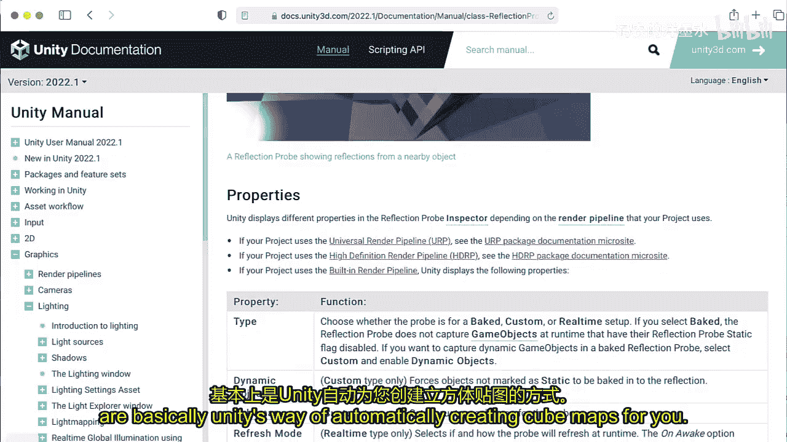
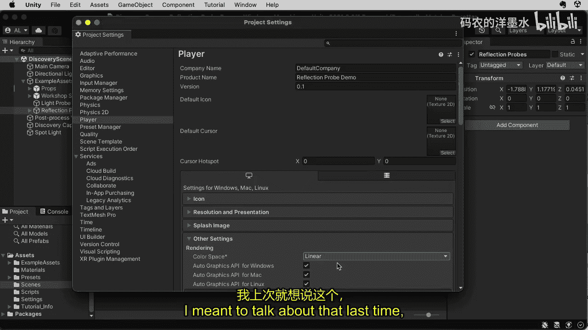
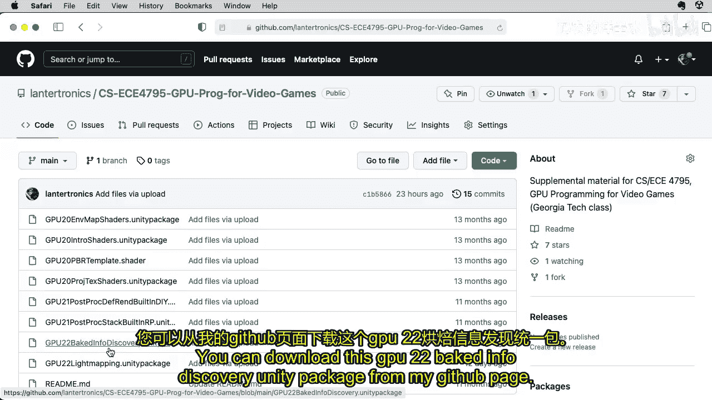
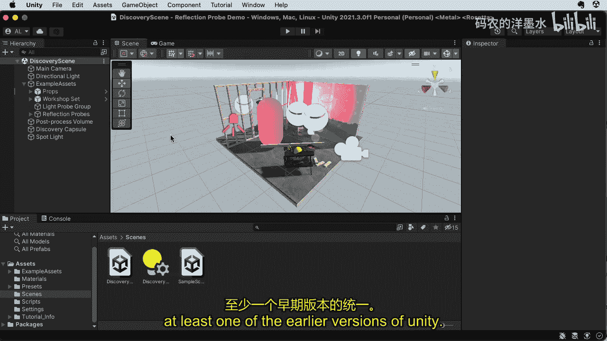
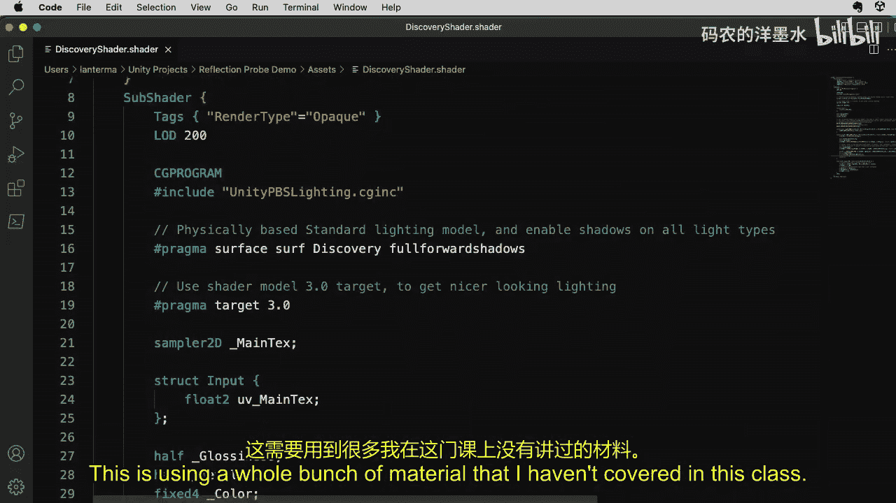
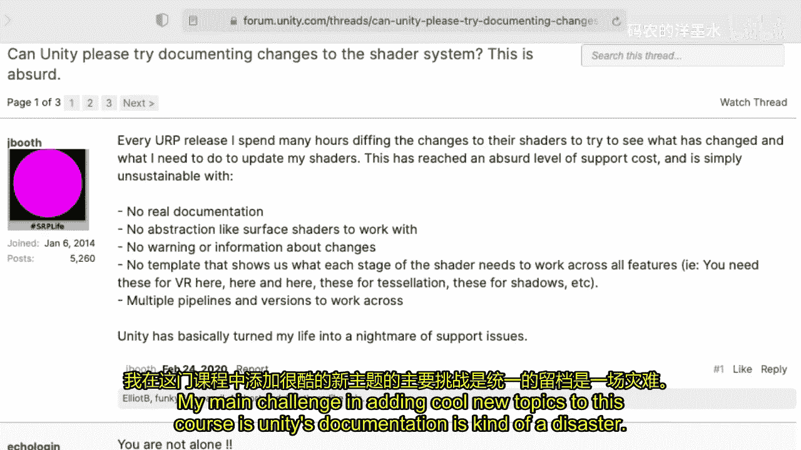
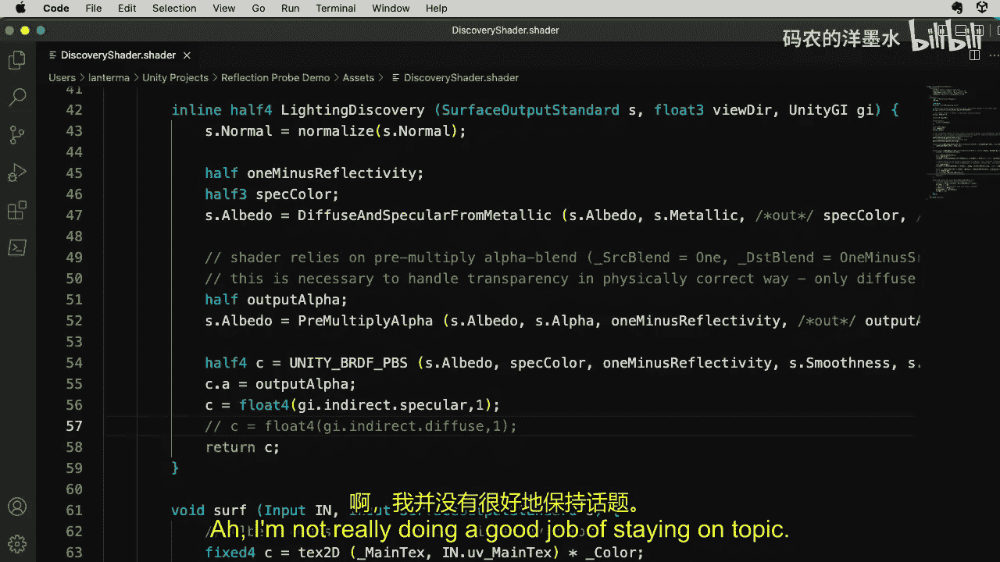
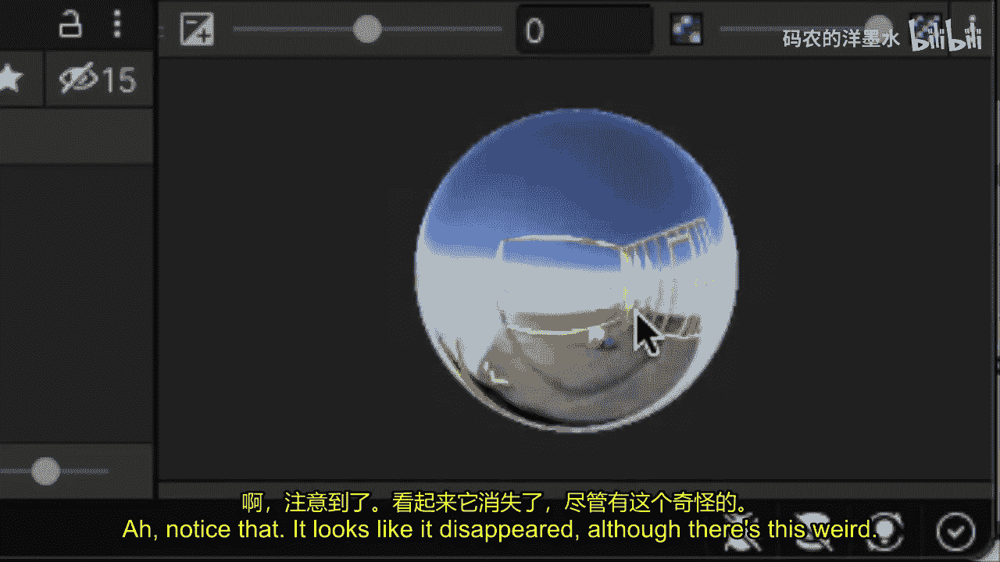
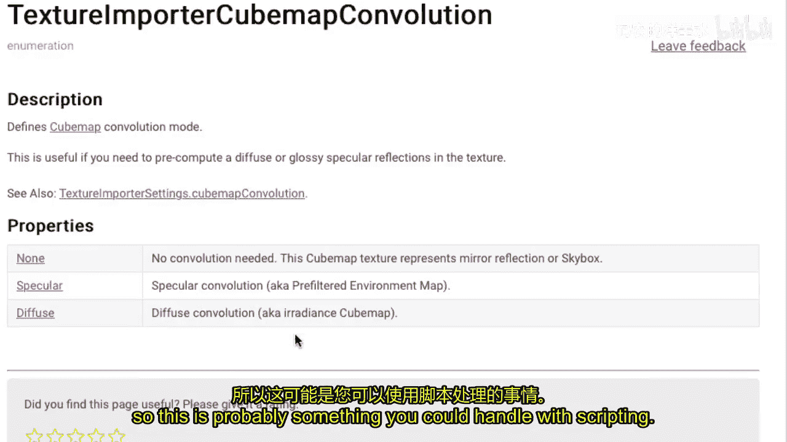

# 036：Unity中的反射探针 🎮

在本节课中，我们将学习Unity中的反射探针。反射探针是一种用于处理物体表面镜面反射的技术，它能自动为场景生成立方体贴图，从而让动态物体也能拥有逼真的反射效果。

上一讲我们介绍了用于处理漫反射光照的光照探针。本节中，我们来看看如何处理依赖于观察角度的镜面反射。

## 场景与设置准备

首先，为了确保光照计算准确，需要将项目的色彩空间设置为线性空间。

以下是设置步骤：
1.  进入 **Project Settings**。
2.  选择 **Player** 选项卡。
3.  确保 **Color Space** 设置为 **Linear**。

本课程使用的演示场景和资源可以从GitHub页面下载。场景中包含一个建筑结构、一个天空盒、若干光源以及三个反射探针。

## 反射探针基础概念

反射探针是Unity自动生成的**立方体贴图**。与光照贴图或光照探针只能处理漫反射不同，反射探针专门用于模拟镜面反射效果。

在场景中，反射探针显示为一个带有方框的图标。这个方框定义了探针的影响区域。

## 反射探针的工作模式

反射探针有三种主要的工作模式，决定了立方体贴图如何生成和更新。

以下是三种模式：
*   **Baked（烘焙）**：仅烘焙场景中的静态物体。动态物体移动时，反射内容不会更新。
*   **Realtime（实时）**：在游戏运行时动态生成立方体贴图，可以包含动态物体，但计算开销很大。
*   **Custom（自定义）**：允许开发者指定一个已有的立方体贴图纹理，而不由Unity自动生成。

## 影响区域与混合

每个反射探针都有一个边界盒。当物体在场景中移动时，它会根据位置在多个探针的立方体贴图之间进行平滑的交叉淡化混合。

例如，物体在探针A和探针B的重叠区域内移动时，其反射效果会从探针A的贴图逐渐过渡到探针B的贴图。

## 粗糙度与模糊处理

在真实的材质中，表面的粗糙度会影响镜面反射的清晰度。Unity通过预计算立方体贴图的**多级渐远纹理** 来实现这一效果。

在材质中，**Smoothness（平滑度）** 参数控制着反射的模糊程度。平滑度越低（表面越粗糙），Unity就会使用越模糊的Mip层级来采样立方体贴图，模拟出散射的反射光效果。这个过程涉及复杂的**镜面反射卷积** 计算。

## 性能考量

使用实时反射探针对性能影响较大。为了优化，Unity提供了**时间分片** 更新选项。

以下是几种更新策略：
*   **All Faces At Once**：一帧内更新立方体贴图的所有六个面。
*   **Individual Faces**：将更新分摊到多帧完成（例如每帧更新一个面）。
*   **No Time Slicing**：无时间分片，更新在一帧内完成。

开发者需要根据场景需求和目标平台性能来权衡选择。

## 实际应用演示

在标准着色器中，结合**Metallic（金属度）** 和**Smoothness（平滑度）** 参数，反射探针能与场景中的直接光照（如点光源、聚光灯）共同作用，形成完整的镜面高光。

例如，一个高金属度、高平滑度的表面会清晰地反射出立方体贴图的内容和光源的亮点。

本节课中我们一起学习了Unity反射探针的核心原理与应用。反射探针通过自动生成和混合立方体贴图，为动态物体提供了基于图像的镜面反射照明，是增强场景视觉真实感的重要工具。你需要理解其烘焙与实时模式的区别、影响区域的混合机制，以及如何通过平滑度参数控制反射的模糊程度，从而在效果和性能之间做出合理选择。