# 037：Unity标准着色器详解 🎮

在本节课中，我们将深入学习Unity的标准着色器。在前几节关于GPU编程与游戏开发的课程中，我们主要分析了我为阐述概念而编写的自定义着色器。这些着色器灵活性不足，例如，它们可能只支持单一的点光源或方向光。如果使用了错误的光源类型，物体可能会消失，这常常让我的学生感到困惑。因此，本节课我们将重点研究Unity的标准着色器。虽然我之前曾提及或偶尔使用过它，但并未深入探讨。这里，我将概述其功能。在接下来的几节课中，我们将深入分析创建这个复杂着色器的源代码。

## 项目设置与环境准备

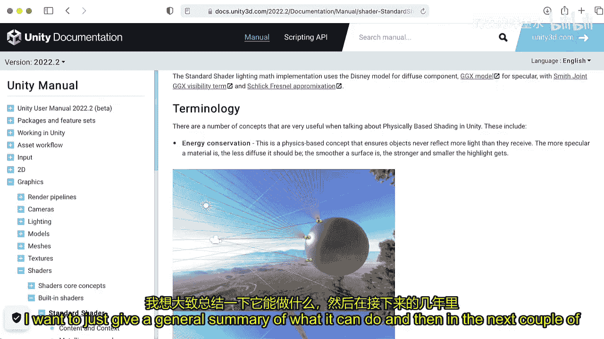

首先，我创建了一个空白的3D内置渲染管线项目。和往常一样，我们需要进入项目设置。

我已经将色彩空间设置为线性。通常，项目默认使用伽马空间，你必须手动将其改为线性。我会反复强调这一点，因为人们常常忘记这个步骤。

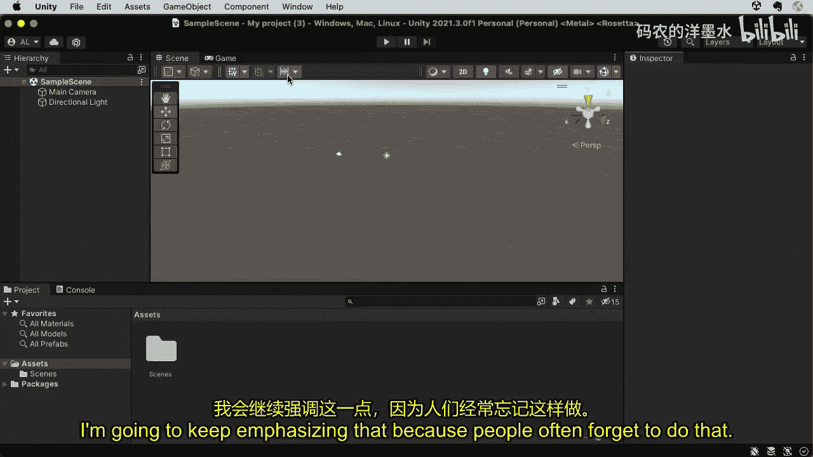

接下来，我们前往Unity资源商店。

让我们搜索一个僵尸模型。

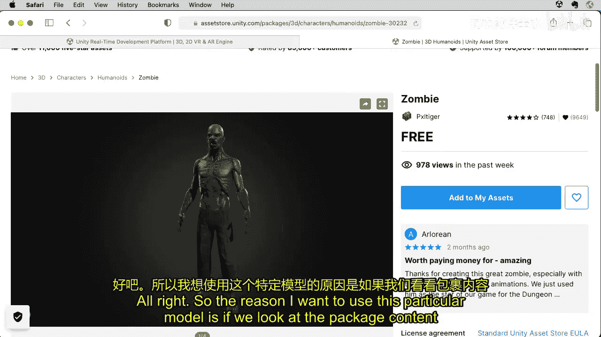

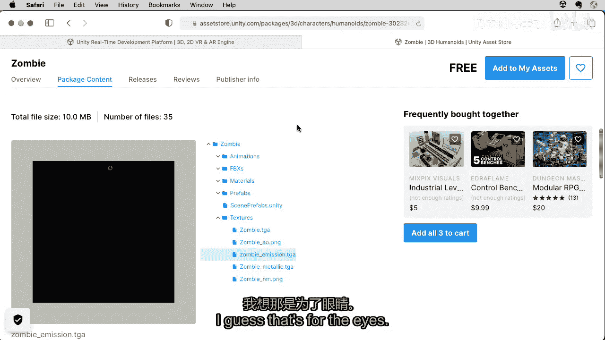

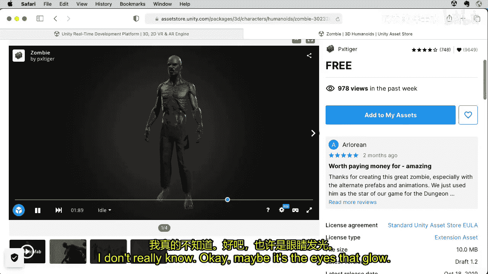

我找到了一个风格化的僵尸模型。但我需要免费的资源，所以将价格滑块拉到最底端。很好，这个僵尸看起来相当吓人。

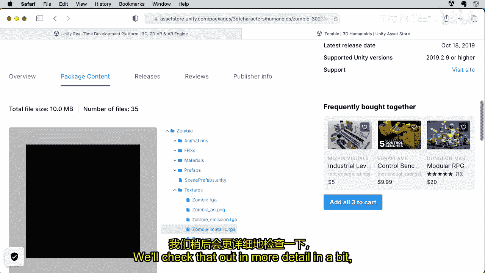

这个模型可以用于你的僵尸生存类游戏。想象一下，世界已经被僵尸占领了。

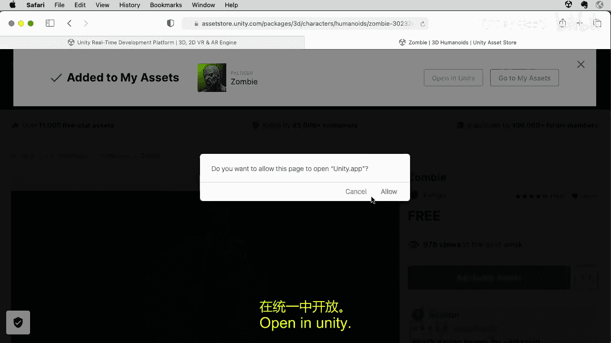

我选择这个特定模型的原因是，查看其包内容中的纹理贴图时，会发现它几乎包含了所有需要的元素。

它提供了漫反射贴图、环境光遮蔽贴图（这是我们之前没有深入讨论过的）、一张自发光贴图（可能是为了让眼睛发光），以及一张金属度贴图（虽然看起来没什么效果，但稍后会详细检查）和一张不错的法线贴图。

我不太确定自发光贴图的具体用途，也许是让眼睛发光。

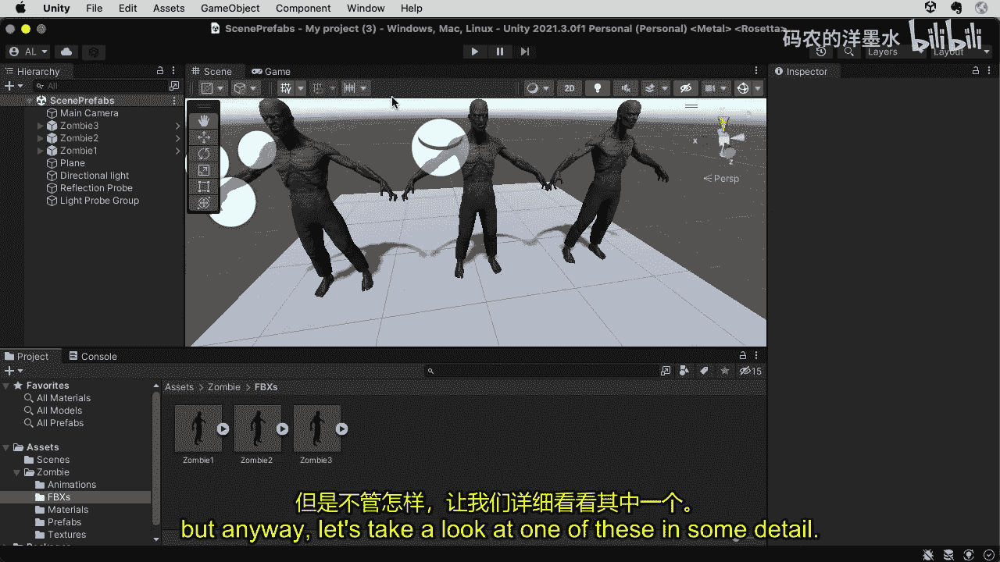

金属度贴图似乎没有明显效果，但这可能只是显示问题，我们稍后会详细检查。此外，还有一张很好的法线贴图。

好的，让我们将这个资源添加到我的项目中，然后导入到Unity。

在Unity中打开。

现在，进入包管理器，我们应该能找到僵尸资源。在我的资源中，正在获取资源，找到了僵尸。这里有一堆僵尸模型。这些可能是我之前下载的其他僵尸资源。我想这个是我需要的僵尸。导入。

导入后，场景文件夹里没有新内容。让我们查看僵尸文件夹。这里有一个包含多个僵尸的场景，这很好。场景中有什么呢？有摄像机、一些光照探针（这很不错）、一个反射探针，以及一个方向光（可以看到它投射了阴影）。这里还有一群僵尸，它们都一样吗？播放这个场景时，僵尸有动画吗？是的，它们有动画。

僵尸正在向你走来，它们奔跑，然后倒下。在预制体和FBX文件夹中，有三个不同的僵尸模型，它们之间可能有些差异，但我无法分辨。无论如何，让我们详细查看其中一个。

点击这里的僵尸角色。

展开它。我们看到许多不同的身体部件。向下滚动，会发现它们都使用了“僵尸”材质，而这个材质使用了标准着色器。注意，当我点击某个部件时，这里会出现一个小球，显示哪些光照探针在起作用。让我到上方，选择Gizmos，并关闭光照探针组的Gizmo显示。

现在，我可以点击僵尸的各个部分，而不会看到那个代表光照探针的球体了。由于所有部件都使用相同的材质，我可以选择任意一个部件来调整材质，更改会应用到整个僵尸。

## 探索材质属性：自发光与光照

让我们先来探索一下。首先关注眼睛。我的理论是眼睛会发光。所以，如果我把场景中的光源关掉。

啊，我们看到眼睛在发光了。让我也关掉天空盒，避免天空盒的光照干扰。同时关闭反射探针，以消除来自反射探针的高光。再关闭光照探针组。这会是永久性的吗？我需要重新烘焙吗？让我们看看。

如果我把主方向光切换到实时模式，这样就没有任何烘焙光照了。为什么我还能看到僵尸？自发光贴图里是不是有什么我不知道的内容？让我看看。没有，我只看到一个看起来像眼球的东西。做个简单的检查，我把自发光贴图设置为“无”。哦，这很有趣。

自发光颜色默认应该是黑色，但现在它变成了白色。这个默认值很奇怪。为什么关掉所有光源后我还能看到僵尸？让我再看看光照设置对话框，环境设置里是不是还有一个颜色需要去掉？即使移除了天空盒材质，场景中是否还有一个环境颜色？如果有，把它调到最低。哦，确实有。仅仅移除天空盒材质是不够的，还需要移除场景环境光照中的另一个颜色。我之前不知道这一点，这很好。

现在，场景中没有任何光源了。很好。回到我们的僵尸，选择僵尸的一部分，把那个诡异的眼球自发光贴图放回去。就是这个。看，诡异的眼睛，诡异的眼睛。好的，这很有教育意义。😊

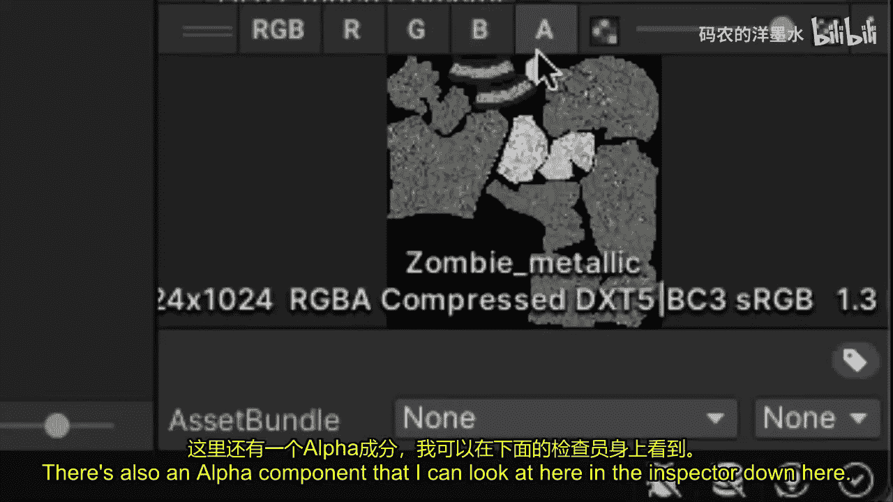

现在，我打赌如果我打开反射探针，眼睛会有点偏蓝。我说对了。虽然很难看清，但你可以看到这里有一点蓝色的轮廓，因为我关掉了天空盒。Unity默认使用一种蓝色背景。让我把主摄像机的背景颜色设为黑色。等等，反射探针有它自己的摄像机来创建场景。我需要把这个调低。好了，现在一切都按我想要的方式设置了。

我花了这么多时间做这些，是为了非常明确地展示每个光源的作用，所以我想先清除所有干扰。现在，场景中唯一的光源就是眼球的自发光贴图。

## 逐步添加效果：法线贴图与金属度

现在，让我们开始添加有趣的效果。首先，我要重新打开主方向光。这样，物体上就有一些光照了。现在，让我们来调整纹理贴图。

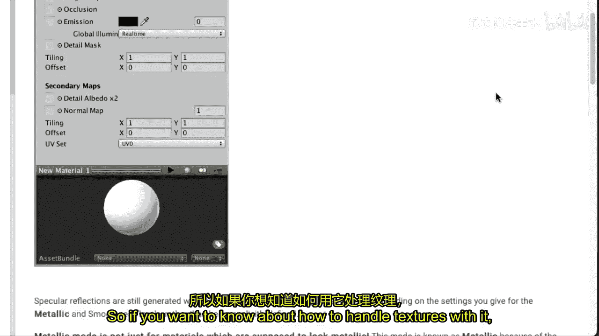

首先，我想调整法线贴图。如果我把法线贴图的强度设置为0，模型看起来会平滑很多。随着我增加这个数值，贴图的效果会越来越明显。我甚至可以增加到1以上，产生非常夸张的效果。在这里，我基本上是在极大地破坏效果，但这可能用于某些特殊效果会很有趣。

为了再次说明这一点，让我把反照率贴图设置为“无”，这样你就能更清楚地看到法线贴图的效果。看，这里非常平滑，等等。

现在，如果我看僵尸的金属度/平滑度贴图，它看起来好像没什么内容。但这只是显示了RGB图像，在检查器中，我还可以查看它的Alpha通道。

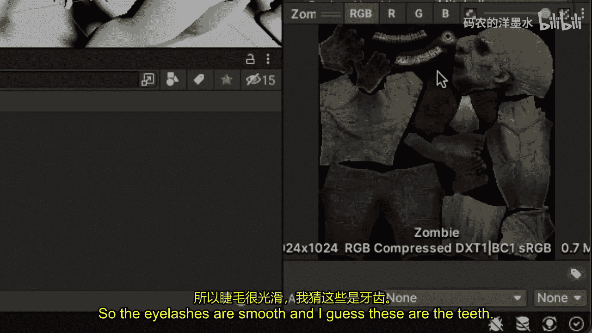

标准着色器（名称后没有带“Specular”字样的）被称为高光着色器的“金属度”模式。在这种情况下，你可以通过纹理或滑块提供一个金属度参数，同时还有一个单独的平滑度参数，也可以通过纹理或滑块控制。基本上，金属度参数表示它是电介质（值为0）还是金属（值为1）。记住，电介质材料有漫反射和高光两方面，而金属材料只有高光方面。

如果你想了解如何处理相关纹理，让我查一下“Alpha”这个词。通常有一种纹理叫做金属/高光贴图。材料的金属度水平由纹理的红色通道值控制。

而材料的平滑度水平则由纹理的Alpha通道控制，绿色和蓝色通道被忽略。如果我们查看这个特定的纹理，里面什么都没有。所以这个僵尸没有金属度属性，这有点令人失望，我本来希望能演示金属效果。但僵尸模型本身很酷，所以我们继续。

那么，Alpha通道就是平滑度参数。这些较亮的区域对应什么？什么被认为是平滑的？为了理解这一点，让我们看看反照率贴图。

啊，在这里。这是头部。这些是睫毛吗？那是什么？好的，那是眼睛。所以这些可能是睫毛。睫毛是平滑的。

我猜这些是牙齿。我不确定。让我们回到模型，把反照率贴图放回去。是的，我猜那是牙齿。抱歉，也许那就是牙齿。所以牙齿被认为是闪亮的。

哦，我之前把平滑度滑块调到了0，让我把它调回来。啊，你看，当我调高平滑度滑块时，你会看到更多的高光反射效果。这个滑块会乘以我们从纹理中得到的效果。

为了强调这一点，让我再次移除反照率贴图。让我们看看，再试试平滑度滑块。哦，你知道吗，这很有趣。有反照率贴图时，效果明显得多。好了。

我们也看看如果再次移除这个纹理会怎样。这里有一个平滑度纹理，你看不到它是因为它在Alpha通道里。但我确实看到了区别，看我按Ctrl+Z，是的。好的，我要做的是使用……撤销。😔 撤销。重做，撤销。所以，你确实能看到包含平滑度贴图的效果。

我刚意识到我打开了反射探针，所以场景不仅仅被方向光照亮。抱歉，我不认为这影响了我阐述的主要观点。无论如何，让我关掉反射探针，确认方向光是场景中唯一的光源。

## 核心概念：环境光遮蔽

这为我们讨论本节课要总结的核心主题——环境光遮蔽贴图——做好了准备。让我们看看它是什么样子。

环境光遮蔽贴图的理念是，你希望在一些角落、缝隙和凹陷处（比如眼睛周围或耳朵里）变得更暗，这些地方相对于僵尸的其他部分，光线通常更难到达。这使我们能够调暗间接光源（如光照探针和反射探针）的贡献。它不影响直接光。

你可以让美术师手绘这样的纹理，但通常这类贴图是在3D软件（如Blender或Maya）中计算生成的。基本上，软件会在模型表面的每个点发射出一系列射线，追踪一小段距离，然后计算有多少射线在途中碰到了其他物体。这个计算是静态的。当然，这里的僵尸是动态的，它在移动、追逐你。而环境光遮蔽贴图只对制作贴图时软件中模型的姿态准确。还有一种实时环境光遮蔽技术，叫做屏幕空间环境光遮蔽，我将在后面讨论后期处理时介绍。

还要注意，这与我们在创建光照贴图时作为参数看到的环境光遮蔽概念不同。在那里，环境光遮蔽被烘焙到贴图中；而在这里，它是一个单独的纹理。

除了环境光遮蔽贴图，我还有一个滑块来控制其效果的强度。现在移动滑块似乎没有效果，因为场景中只有一个光源——一个实时的方向光（直接光），所以环境光遮蔽贴图没有起作用。

但如果我打开反射探针，场景中就会有更多光照。让我关掉再打开。现在，如果我调整那个滑块，你会看到效果。当我调高时，效果非常细微。看脖子这里，当我调高时，脖子变暗了。看眼睛周围，也变暗了。腋下这里也是类似的。

让我关掉反射探针，打开光照探针组。这是有光照探针的效果，这是没有的效果。记住，光照探针处理场景中的反弹光，我们可以用它来表示动态物体上的间接光（这些物体无法使用光照贴图）。通过空间中各点的光照探针来表示这种光，使用的是球谐函数。

有了光照探针，让我们回到滑块，调高调低。哦，效果非常细微。看这里。好了，你可以在脸颊的毛发上看到一点效果。

让我同时打开反射探针和光照探针。记住，光照探针处理漫反射类的光，反射探针处理高光类的光。让我同时打开两者，然后调整滑块。好的，所以……😔 好了。

我在想，如果移除反照率贴图，会不会更容易看到效果？好的，现在我的反射探针和光照探针都就位了，让我们调整环境光遮蔽的滑块看看。让我把环境光遮蔽贴图放回去。啊，这样更容易看到环境光遮蔽的效果了。哦，让我先不要反射探针，对吧？现在你可以在脖子这里看到效果。现在在腋下这里肯定能看到了。

## 总结与扩展

我已经讲了快20分钟，但只是触及了标准着色器的皮毛。它还有高度贴图、细节遮罩、次级贴图等等功能。你可以查看相关文档，也有很多关于标准着色器的YouTube教程。在接下来的几节课中，我们将深入代码。

为了说明环境光遮蔽，我之前把法线贴图效果调到了0。现在让我把法线贴图加回来。好了。

最后我想提一下，这里的标准着色器使用了Unity所谓的“金属度工作流”。还有一种替代方案是“高光设置”，它在解释各种纹理的方式上有所不同。你可以查看Unity文档了解它们的区别。

对于标准着色器，它暴露了一个金属度值，用于说明材料是否是金属。对于金属材料，反照率颜色控制高光反射的颜色，并且大部分光反射为高光反射。非金属材料的高光反射颜色与入射光相同，并且在正对表面观察时几乎不反射。

这里一个容易混淆的地方是，对于金属，反照率其实不是真正的反照率，而是正对表面的反射颜色。但无论如何。

对于标准高光设置，我们选择这个着色器是为了经典的方法。使用高光颜色来控制材料中高光反射的颜色和强度。这使得高光反射的颜色可以与漫反射颜色不同。这个着色器允许你做一些技术上可能不符合物理规律，但可能很有趣的事情。

---

本节课中，我们一起学习了Unity标准着色器的基本构成与核心功能。我们从项目设置开始，逐步探索了自发光、法线贴图、金属度/平滑度以及环境光遮蔽等关键属性。通过调整僵尸模型的材质，我们直观地看到了每种贴图对最终渲染效果的影响。标准着色器是一个功能强大且灵活的工具，理解其工作原理是进行高效游戏美术资源制作和高级着色器编程的基础。在接下来的课程中，我们将深入其源代码，进一步揭开其内部机制。