# 038：解析Unity标准着色器（第一部分）🎮

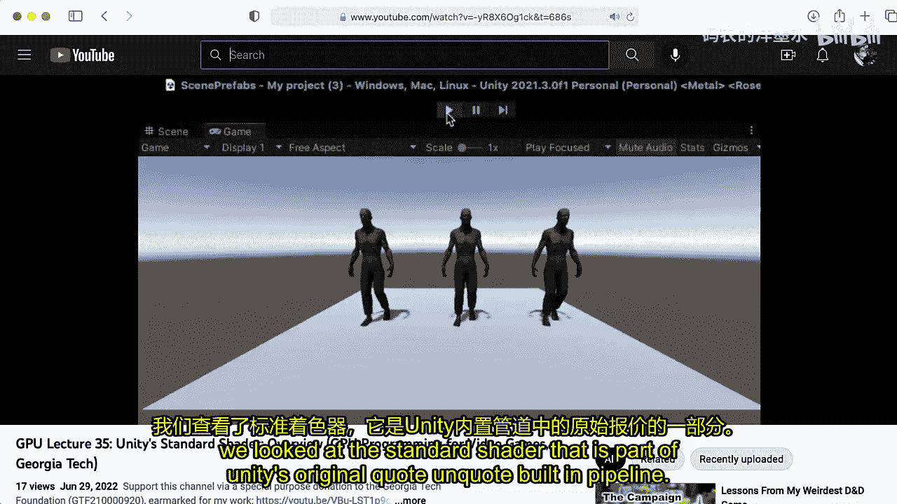

在本节课中，我们将学习如何探索和解析Unity内置渲染管线中的标准着色器（Standard Shader）的源代码。我们将从下载源代码开始，逐步创建一个可修改的自定义版本，并了解其基本结构和组成。

---

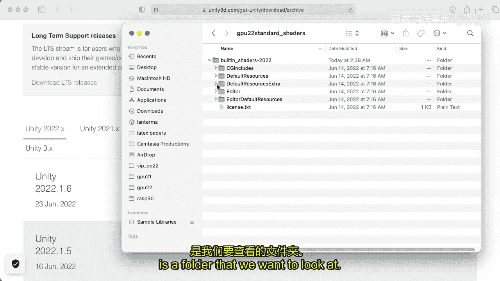

## 概述

上一讲我们介绍了Unity内置渲染管线中的标准着色器。本节中，我们将深入其源代码，尝试理解其实现方式。与以往不同，本次课程将展示一个探索代码的过程，希望能让大家了解阅读着色器代码时的思考方式。

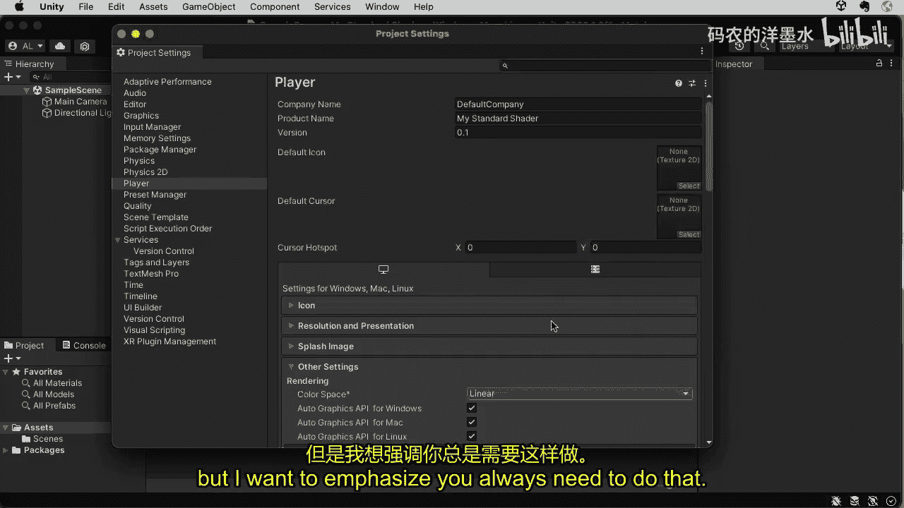

---

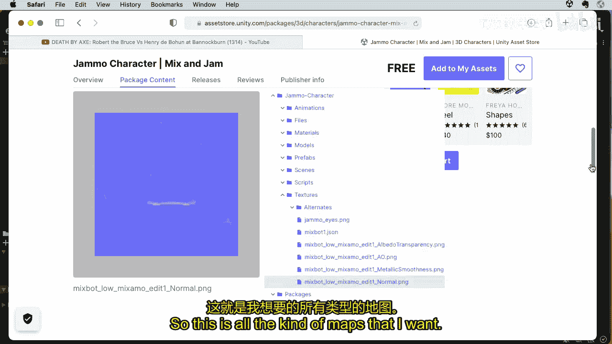

## 获取源代码

首先，我们需要获取标准着色器的源代码。

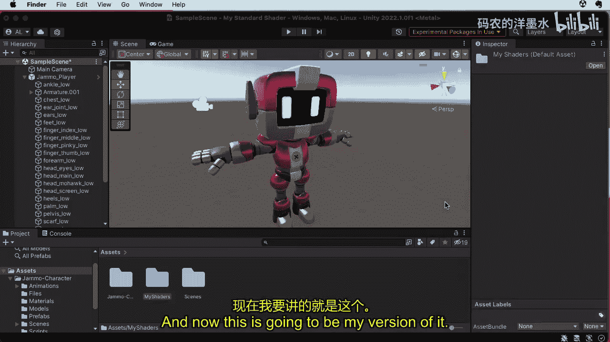

1.  访问Unity官网的存档下载页面（unity3d.com/unity/download/archive）。
2.  选择长期支持版本（例如2022.1.6）。
3.  根据操作系统下载对应的内置着色器包（例如“Built-in shaders for Mac”）。
4.  解压后，在“Default Resources Extra”文件夹中可以找到源代码。

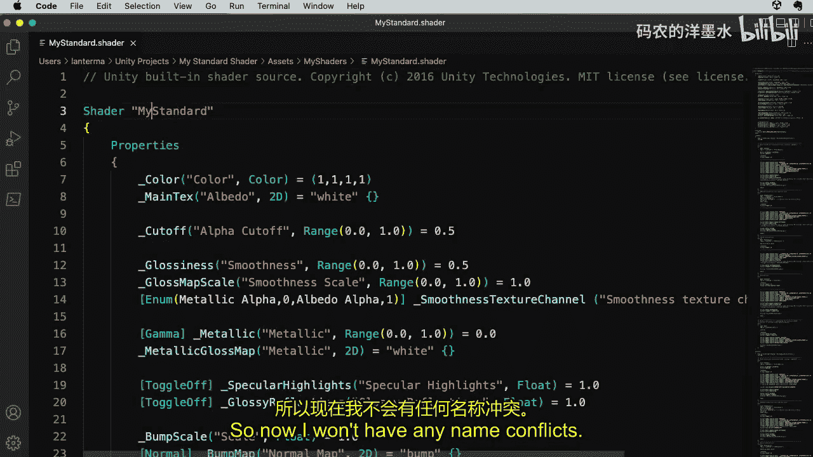

**注意**：该文件夹中包含许多Unity 4时代的遗留着色器，但我们现在关注的是名为“Standard”或“Standard (Specular setup)”的着色器，在Unity 5发布时它也被称为“Uber Shader”。

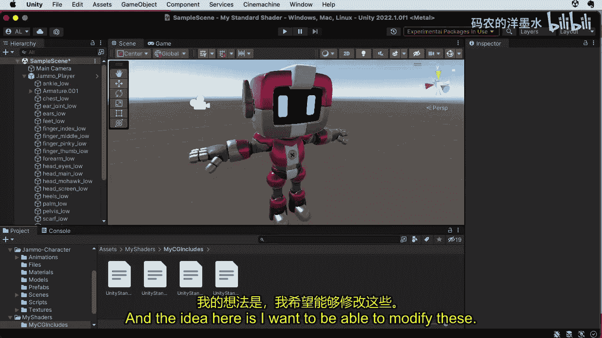

---

## 准备测试环境

在开始分析代码前，我们需要一个场景和模型进行测试。

1.  创建一个新的3D项目（使用内置渲染管线）。
2.  在项目设置（Project Settings）中，将色彩空间从伽马（Gamma）切换到线性（Linear）。**这是一个重要步骤，请务必执行。**
3.  导入一个包含多种贴图的角色模型（例如Jam-o字符）用于测试。理想的测试模型应包含：
    *   反照率贴图（Albedo Map）
    *   法线贴图（Normal Map）
    *   金属光滑度贴图（Metallic Smoothness Map）
    *   环境光遮蔽贴图（Ambient Occlusion Map）

导入模型后，检查其材质使用的着色器，确认是“Standard”系列。

---

## 创建自定义着色器副本

为了能够安全地修改和分析，我们需要创建标准着色器的自定义副本。

以下是操作步骤：

1.  在Assets目录下创建一个新文件夹，命名为“MyShaders”。
2.  从下载的源代码中，找到并复制以下两个核心文件到“MyShaders”文件夹：
    *   `Standard.shader`
    *   `StandardSpecular.shader`
3.  重命名这两个文件，以避免与Unity内置着色器冲突。例如：
    *   `MyStandard.shader`
    *   `MyStandardSpecular.shader`
4.  打开这两个新文件，将着色器的名称（`Shader “...”`）也相应修改，例如改为 `Shader “Custom/MyStandard”`。
5.  最关键的一步：在文件内进行全局搜索和替换，将所有引用原始Unity内置头文件（如`UnityStandard`）的路径，改为指向我们本地副本的路径。例如，将 `#include “UnityStandardCore.cginc”` 改为 `#include “Assets/MyShaders/MyUnityStandardCore.cginc”`。

**核心概念**：通过创建副本并修改引用路径，我们建立了一个独立于Unity引擎、可自由编辑的着色器代码库。

---

## 分析着色器通道结构

标准着色器包含多个渲染通道（Pass），用于处理不同的渲染情况。为了理清结构，我们可以创建一个“通道概览”文件。

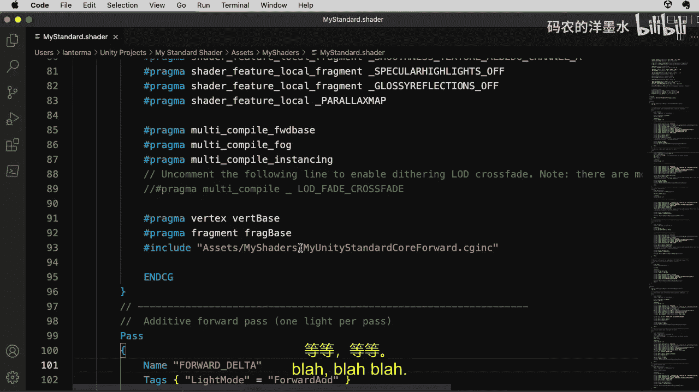

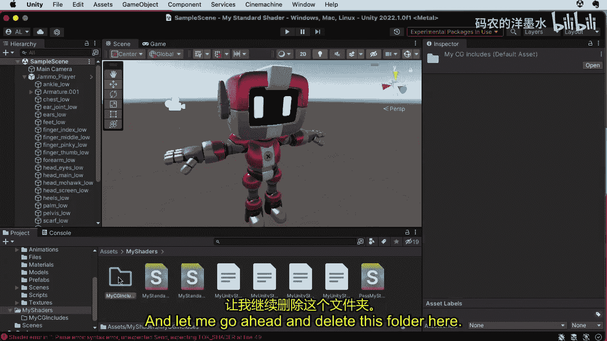

1.  复制 `MyStandard.shader`，创建一个名为 `PassMyStandard.shader` 的分析文件。
2.  在这个文件中，删除所有具体的着色器代码，只保留每个通道（Pass）的框架信息，包括：
    *   通道名称（如 `ForwardBase`, `ForwardAdd`）
    *   光照模式标签（`Tags { “LightMode” = “...” }`）
    *   使用的顶点/片元着色器函数名
    *   包含的头文件

通过分析，我们可以总结出标准着色器在正向渲染（Forward Rendering）下的主要通道：

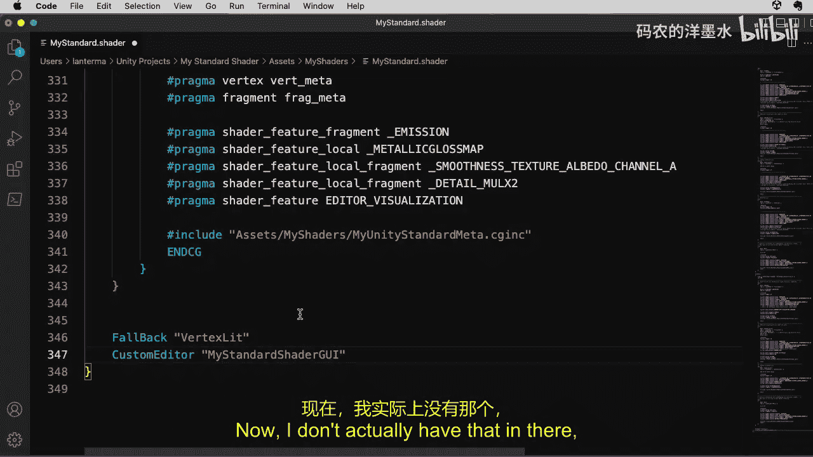

*   **`ForwardBase` (基础前向通道)**：处理最重要的方向光、自发光纹理和光照贴图。每个物体渲染一次。
*   **`ForwardAdd` (附加前向通道)**：处理额外的光源（如其他方向光、点光源、聚光灯）。每个光源渲染一次。
*   **`ShadowCaster` (阴影投射通道)**：用于生成物体的阴影。
*   **`Deferred` (延迟渲染通道)**：用于延迟渲染路径（本课暂不深入）。
*   **`Meta` (元通道)**：不用于实时游戏渲染，专门用于全局光照（GI）计算。

**注意**：文件中通常还包含针对Shader Model 2.0的备用通道，以兼容旧硬件。但现代游戏开发通常以Shader Model 3.0或更高为目标，可以忽略这些备用通道。

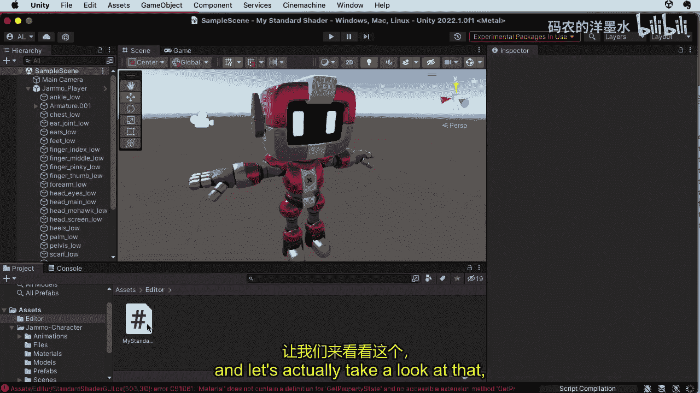

---

## 解决路径与编辑器问题

在尝试使用自定义着色器时，可能会遇到路径错误和自定义编辑器界面失效的问题。

1.  **路径问题**：确保所有 `#include` 指令中的文件路径都正确指向了“MyShaders”文件夹下的本地副本。可能需要使用绝对路径，如 `Assets/MyShaders/...`。
2.  **自定义编辑器界面**：标准着色器使用一个C#脚本（`StandardShaderGUI`）来提供材质检视面板中美观的UI。如果希望自定义着色器也拥有此界面，需要：
    *   复制 `StandardShaderGUI.cs` 到项目的 `Editor` 文件夹。
    *   修改着色器文件顶部的 `CustomEditor “StandardShaderGUI”` 行，指向你的副本。
    *   修改C#脚本中的类名和相关引用。**注意**：这个过程可能涉及复杂的C#代码修改，如果遇到编译错误，一个临时的解决方案是暂时改回使用 `CustomEditor “StandardShaderGUI”`，直接调用Unity内置的编辑器。

**核心概念**：`CustomEditor` 指令将着色器与一个C#脚本关联，该脚本控制材质在Unity编辑器中的属性显示方式。

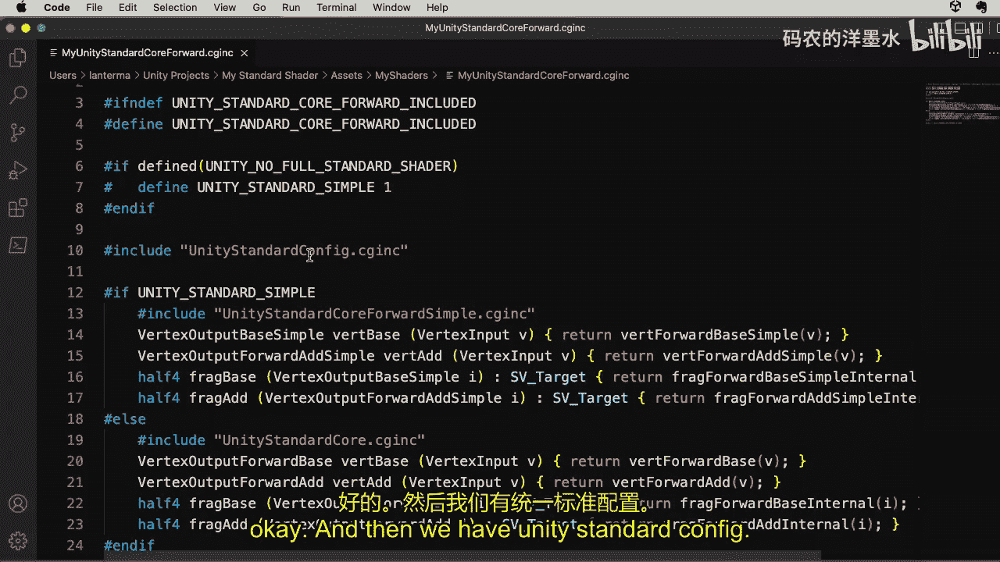

---

## 深入核心代码

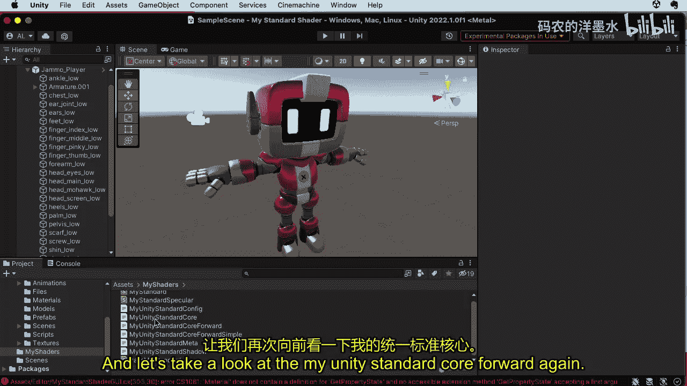

要理解着色器如何工作，需要查看其核心计算文件。

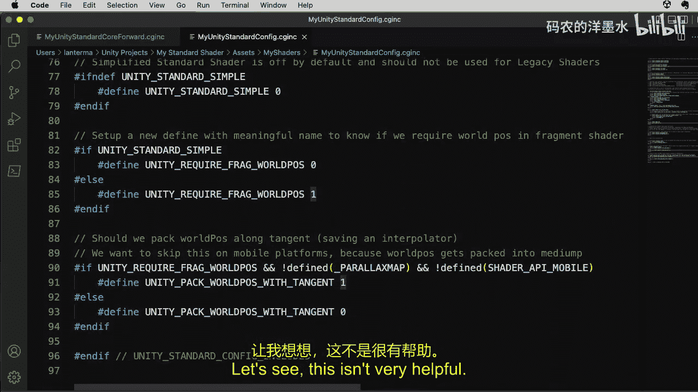

1.  打开 `MyUnityStandardCoreForward.cginc` 文件，这是正向渲染的核心。
2.  你会发现它主要引用了其他文件，例如：
    *   `UnityStandardCore.cginc`：包含主要的照明计算函数。
    *   `UnityStandardConfig.cginc`：包含大量的宏定义和配置，用于根据目标平台（如Shader Model版本）启用或禁用特定功能（如GGX高光、球谐函数等）。
3.  这是一个典型的“套娃”结构，一个文件引用另一个，层层深入。为了完全掌控代码，你需要将所有被引用的 `.cginc` 文件都复制到本地目录，并修改其中的文件引用路径，确保整个依赖链都是你的自定义版本。

这个过程虽然繁琐，但能让你获得一个完全独立、可任意修改的标准着色器实现，是深入学习其原理的宝贵基础。

---

## 总结

本节课中我们一起学习了如何开始解析Unity标准着色器的源代码。我们完成了以下步骤：获取官方源代码、创建测试场景、建立自定义的可修改着色器副本、分析其多通道渲染结构，并初步了解了其复杂的文件依赖关系。在下一部分，我们将利用这个准备好的自定义代码库，真正开始深入探索标准着色器内部的照明模型和具体算法实现。