# 039：解析Unity标准着色器（第二部分）🎮

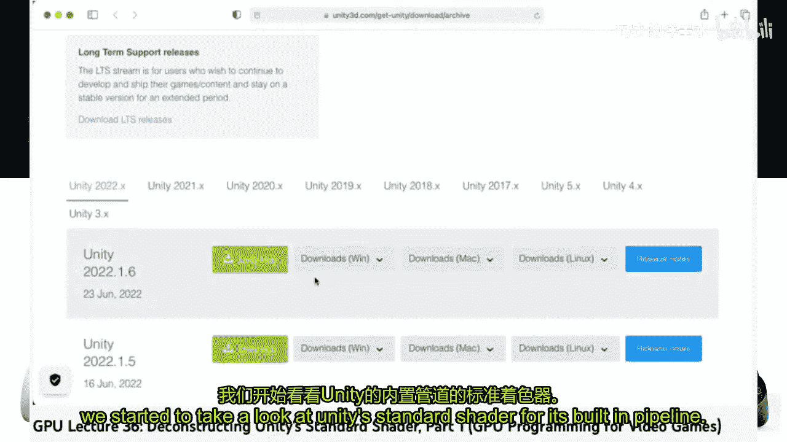

在本节课中，我们将继续深入解析Unity内置渲染管线的标准着色器。我们将重点关注顶点着色器和像素着色器的核心逻辑，探索光照计算、全局光照以及物理渲染（PBR）的具体实现。通过剖析代码结构，我们将理解一个现代、复杂的生产级着色器是如何组织的。

---

## 顶点着色器：数据准备与变换

上一节我们介绍了标准着色器的整体结构和多个Pass。本节中，我们来看看顶点着色器具体如何处理输入数据。

顶点着色器的主要任务是将模型的顶点数据从对象空间转换到齐次裁剪空间，并计算后续像素着色器所需的各种插值数据，如纹理坐标、法线、视角向量等。

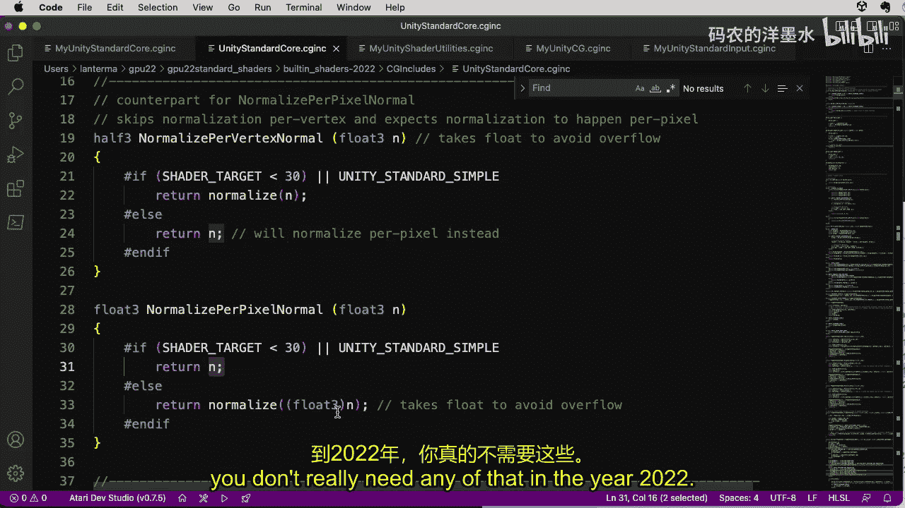

以下是`vertForwardBase`函数中的核心步骤：

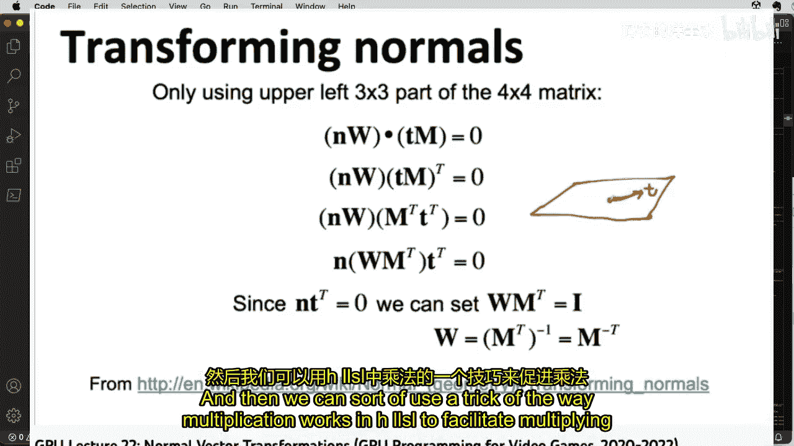

1.  **计算裁剪空间位置**：
    代码通过`UnityObjectToClipPos`宏（本质上是`mul(UNITY_MATRIX_VP, mul(unity_ObjectToWorld, float4(v.vertex.xyz, 1.0)))`）将顶点位置变换到裁剪空间。这种分步写法旨在为编译器提供优化提示。

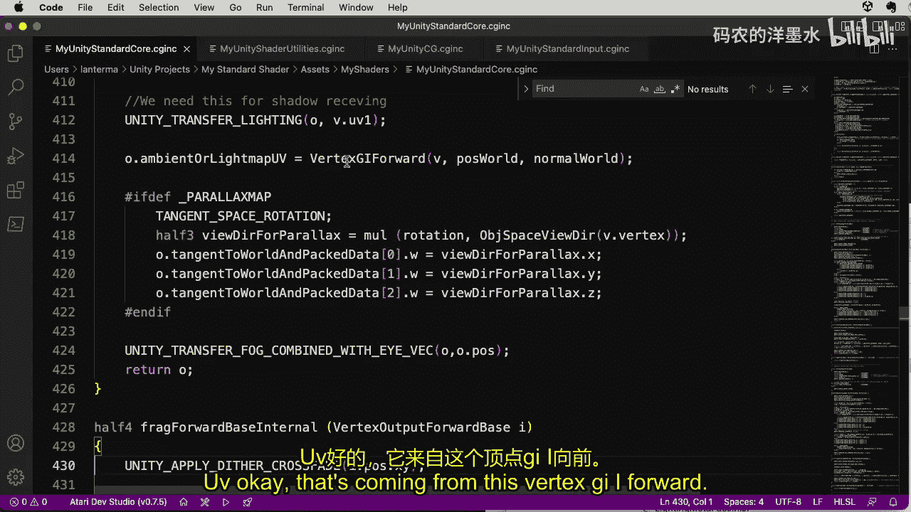

2.  **处理纹理坐标**：
    使用`TRANSFORM_TEX`宏处理纹理的缩放（Tiling）和偏移（Offset）。

3.  **计算视角向量**：
    计算从顶点到相机世界位置的向量。对于Shader Model 3.0及以上，为了性能，仅在顶点着色器中进行近似计算，真正的归一化留到像素着色器进行。

    ```hlsl
    o.eyeVec.xyz = UnityWorldSpaceViewDir(posWorld);
    ```

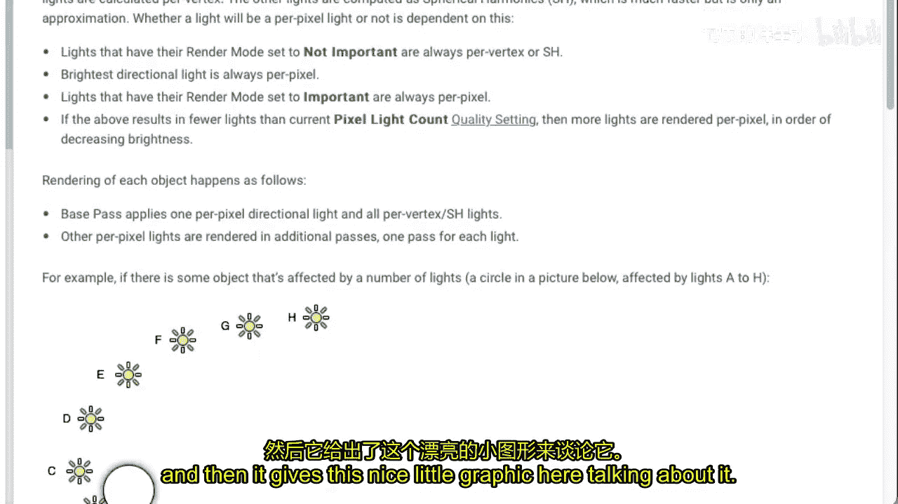

4.  **变换法线到世界空间**：
    使用`UnityObjectToWorldNormal`函数。如果对象缩放不均匀，此函数会使用逆转置矩阵进行正确变换。

    ```hlsl
    float3 worldNormal = UnityObjectToWorldNormal(v.normal);
    ```

5.  **处理全局光照（GI）数据**：
    调用`VertexGIForward`函数。此函数根据情况返回两种数据之一：如果对象使用了光照贴图，则返回光照贴图UV；否则，计算并返回基于球谐函数（Spherical Harmonics）的顶点环境光颜色。

6.  **处理雾效**：
    调用`UNITY_TRANSFER_FOG`宏，将雾效因子打包到输出数据的特定分量中（例如，存入`eyeVec.w`）。

`vertForwardAdd`函数是用于附加光照Pass的顶点着色器，其逻辑是`vertForwardBase`的一个子集，主要移除了环境光和球谐函数的计算部分。

---

## 像素着色器：光照合成核心

顶点着色器准备好了插值数据后，像素着色器开始进行复杂的光照计算。`fragForwardBaseInternal`是基础Pass的核心。

### 1. 数据准备 (`FRAGMENT_SETUP` 和 `UnityGlobalIllumination`)

像素着色器首先通过`FRAGMENT_SETUP`宏初始化一个包含表面参数（如漫反射颜色`albedo`、高光颜色`specColor`、粗糙度`smoothness`等）的结构体。这些值来自纹理采样和材质属性。

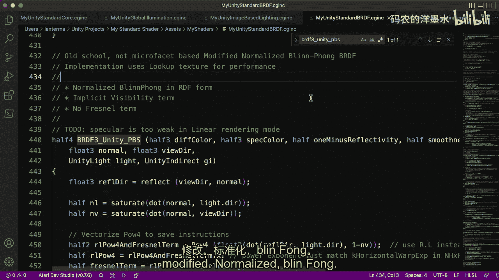

接着，通过`UnityGlobalIllumination`函数计算间接光照。这是一个非常复杂的函数，它负责：
*   **间接漫反射**：从光照贴图或球谐函数中采样环境光。
*   **间接高光**：从反射探针（Reflection Probes）的立方体贴图中采样镜面反射信息。
*   **环境光遮蔽**：将环境光遮蔽（AO）贴图的影响应用到间接光照上。

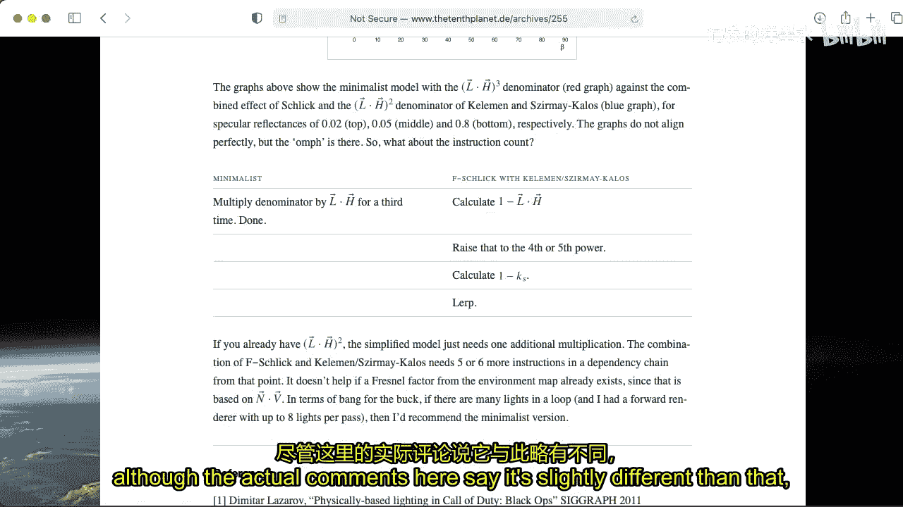

### 2. 主直接光照计算 (`UNITY_BRDF_PBS`)

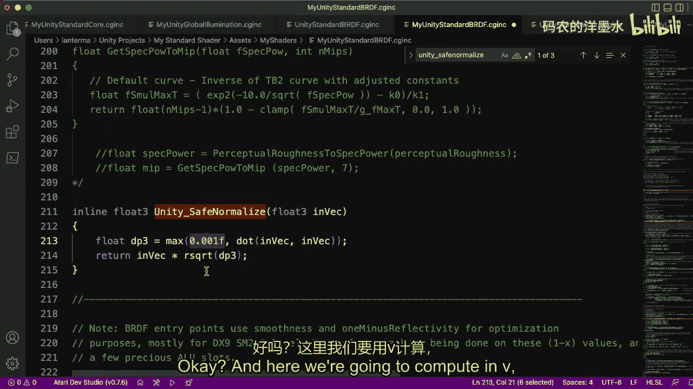

这是物理渲染的核心。Unity通过`UNITY_BRDF_PBS`宏调用其PBR BRDF函数。该宏在`UnityStandardBRDF.cginc`中定义，并提供了几种BRDF实现的选择。

最常用的是基于迪士尼原则的BRDF1（GGX/Smith模型）。让我们看看它的关键部分：

*   **迪士尼漫反射模型**：
    与传统的Lambert漫反射不同，迪士尼模型引入了粗糙度因子，使得粗糙表面的边缘反射更亮，而光滑表面的边缘更暗，更符合观察结果。

    ```hlsl
    // 简化版的迪士尼漫反射核心
    float FD90 = 0.5 + 2 * VoH * VoH * roughness;
    float FdV = 1 + (FD90 - 1) * Pow5(1 - NoV);
    float FdL = 1 + (FD90 - 1) * Pow5(1 - NoL);
    return FdV * FdL;
    ```

*   **镜面反射项（Cook-Torrance BRDF）**：
    包含分布函数（D）、几何遮蔽函数（G）和菲涅尔项（F）。

    *   **分布函数（GGX）**：描述微表面法线的分布。
        ```hlsl
        float D_GGX = a2 / (PI * denom * denom);
        ```
    *   **几何遮蔽函数（Smith）**：描述微表面阴影和遮蔽。
    *   **菲涅尔项（Schlick近似）**：描述不同视角下反射与折射的比例。
        ```hlsl
        float3 F_Schlick = F0 + (1 - F0) * pow(1 - VoH, 5);
        ```

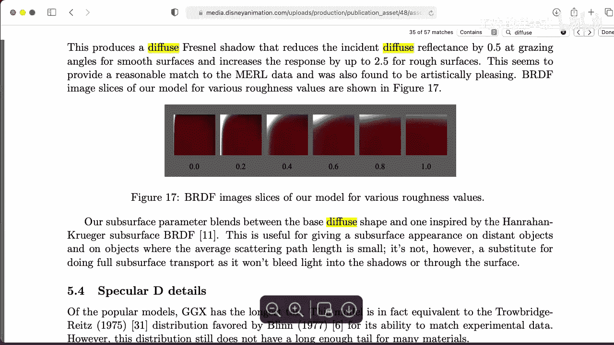

*   **能量守恒**：
    代码尝试在漫反射和镜面反射之间保持能量守恒。`1 - reflectivity`（1减去反射率）代表了可用于漫反射的能量比例。基础反射率`F0`通常由金属度贴图或高光颜色贴图决定。

### 3. 最终颜色合成

最终像素颜色是直接光照和间接光照的合成：

```hlsl
// 简化合成逻辑
float3 color = (diffuseDirect + diffuseGI) * albedo;
color += specularDirect * lightColor;
color += specularGI * surfaceReduction; // surfaceReduction 是用于IBL的因子
color += emissionColor; // 自发光
return ApplyFog(color, fogCoord); // 应用雾效
```

对于附加光照Pass（`fragForwardAddInternal`），计算逻辑类似，但间接光照部分为零，因为所有间接光照已在基础Pass中计算完毕。它只处理当前附加光源的直接光照贡献，并以加法混合模式渲染到帧缓冲区。

---

## 代码结构与评价

本节课我们一起深入探索了Unity标准着色器中前向渲染路径的核心代码。我们可以总结出该着色器代码的以下几个特点：

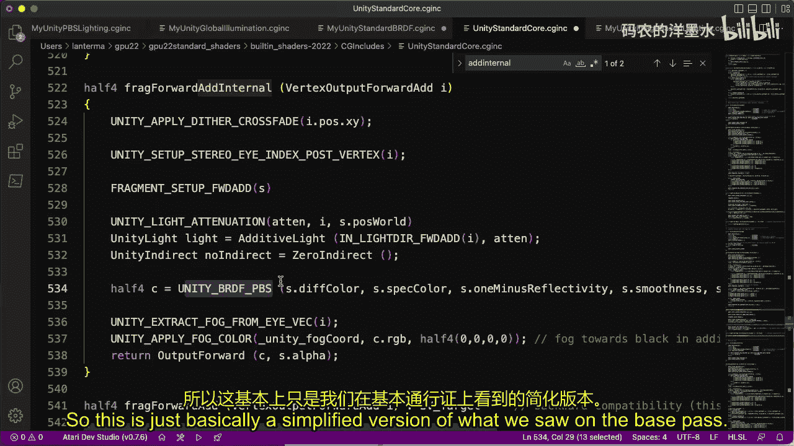

1.  **模块化但分散**：功能被拆分成大量小函数和宏，分布在多个`.cginc`包含文件中。这有利于复用，但极大地增加了代码阅读和跟踪的难度。
2.  **历史包袱沉重**：代码中保留了大量对旧硬件（如Shader Model 2.0）和旧渲染路径（如“Simple”版本）的支持，使得核心逻辑被条件编译指令包围。
3.  **复杂的GI系统**：它紧密集成了Unity的全局光照系统，包括实时光照贴图、烘焙光照贴图、球谐函数、反射探针和光照探针，这部分逻辑非常复杂。
4.  **生产级PBR实现**：它实现了一个经过生产验证的、基于迪士尼原则的PBR模型，并考虑了能量守恒、多光源处理等细节。

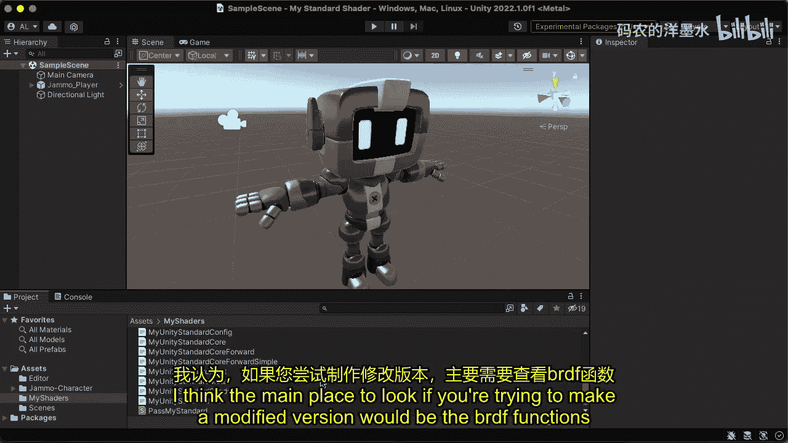

**给初学者的建议**：如果希望基于此代码创建自定义着色器，一个实用的起点是：
1.  删除所有针对`SHADER_TARGET`低于3.0的代码路径。
2.  删除或忽略“Simple”版本的Shader变体。
3.  将注意力集中在`UnityStandardBRDF.cginc`和`UnityStandardCore.cginc`这两个核心文件上。
4.  尝试将一些关键宏展开，以更清晰地理解数据流。

虽然这套代码结构看起来像一团“乱麻”，但它也展示了如何在一个着色器中组织并实现一个功能完整、支持大量特性的现代渲染模型。理解它有助于我们驾驭复杂度和编写高性能、高质量的图形代码。