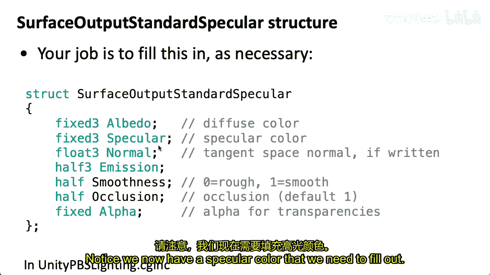
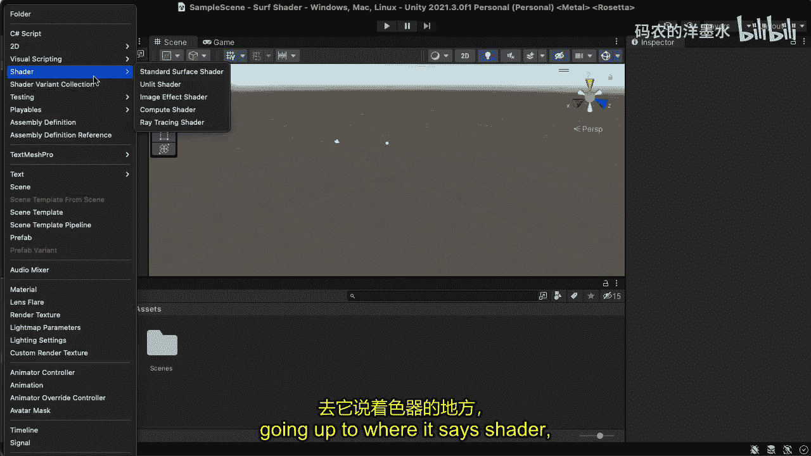
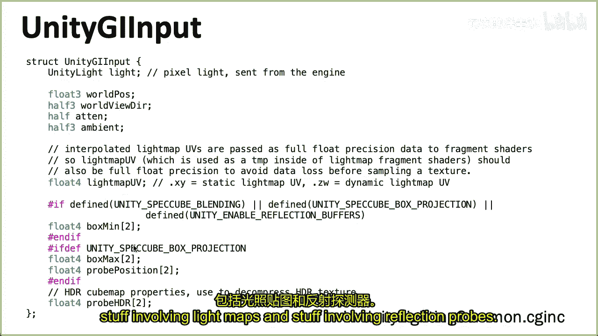
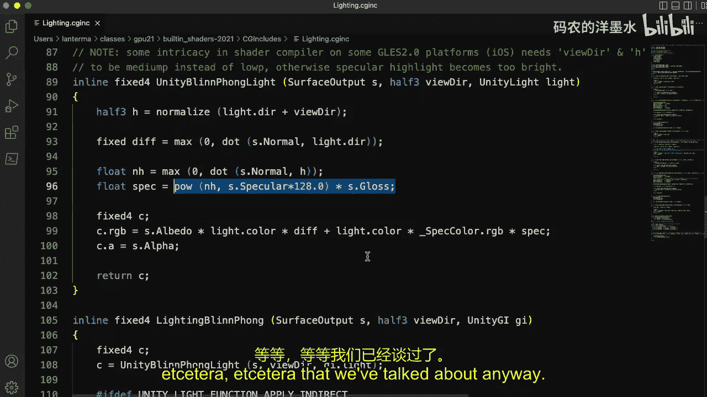
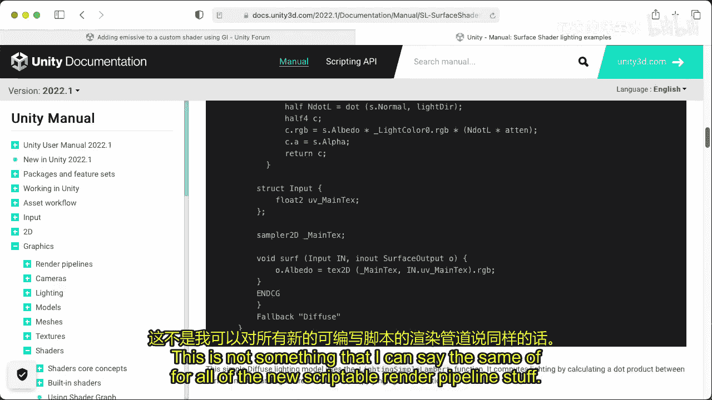
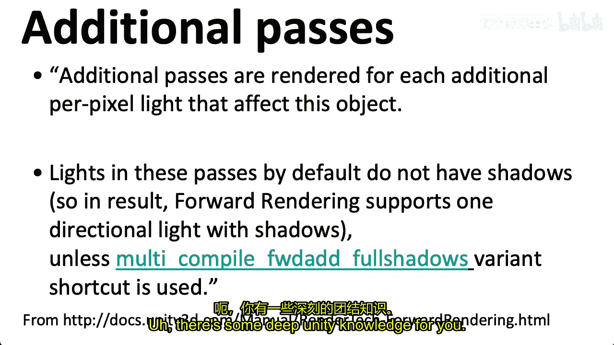
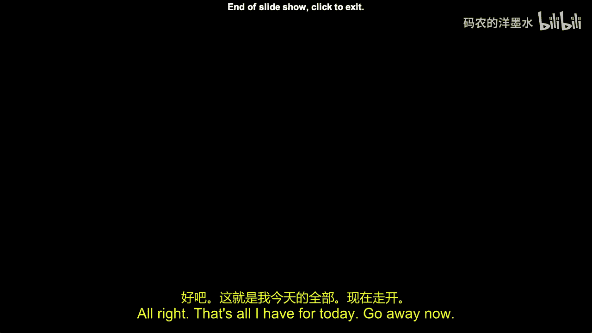

# 040：Unity中的表面着色器 🎨

在本节课中，我们将学习Unity中的表面着色器技术。这是一种高级着色器编写方法，它通过代码生成简化了与光照交互的复杂过程。我们将探讨其工作原理、核心概念以及如何自定义光照模型。

---

## 概述

表面着色器是Unity特有的一项技术，它旨在简化编写受光照影响的着色器的复杂性。尽管它是Unity内置渲染管线的功能，但其核心思想——分离表面材质描述与光照计算——在其他引擎中也有类似实现。本教程将详细介绍表面着色器的结构、使用方法以及如何自定义光照模型。

---

## 表面着色器的核心概念

表面着色器的核心思想是将**表面材质属性**与**光照模型**分离开。你的主要工作是填充一个描述表面信息的结构体，而Unity会自动生成处理各种光照类型、阴影选项和渲染路径（如前向渲染和延迟渲染）的底层顶点和片段着色器代码。

在代码中，这通过 `#pragma surface` 指令实现。例如，定义一个使用标准光照模型的表面着色器：
```hlsl
#pragma surface surf Standard
```
这里，`surf` 是你编写的表面处理函数的名称，`Standard` 指定了使用的光照模型。





---

## 标准工作流程：Metallic 与 Specular

Unity的表面着色器支持两种主要的工作流程，它们定义了如何描述材质。

### Metallic 工作流程

在Metallic工作流程中，你主要使用两个参数：
*   **Albedo Map (反照率贴图)**：对于电介质（非金属），它存储漫反射颜色。对于金属，它存储的是镜面反射的正面反射率 **F0**。
*   **Metallic Map (金属度贴图)**：这是一个单通道贴图，0表示电介质，1表示金属。理论上应为0或1，但出于艺术原因，也可以使用中间值。

其核心公式体现在 `DiffuseAndSpecularFromMetallic` 函数中：
```hlsl
// 计算镜面反射颜色和“一减反射率”
specColor = lerp(unity_ColorSpaceDielectricSpec.rgb, albedo, metallic);
oneMinusReflectivity = (1 - unity_ColorSpaceDielectricSpec.a) - metallic * (1 - unity_ColorSpaceDielectricSpec.a);
// 计算真正的漫反射反照率
diffuseAlbedo = albedo * oneMinusReflectivity;
```
对于纯金属（`metallic = 1`），`diffuseAlbedo` 为0。对于纯电介质（`metallic = 0`），`diffuseAlbedo` 是 `albedo` 的96%，因为4%的能量分配给了电介质的镜面反射。

### Specular 工作流程

Specular工作流程更为通用：
*   **Albedo Map (反照率贴图)**：始终表示漫反射颜色。对于金属，应设为黑色。
*   **Specular Map (高光贴图)**：直接指定镜面反射颜色 **F0**。对于电介质，这通常是一个灰度值。

---

## 编写表面着色器

以下是创建一个基本表面着色器的步骤。

### 创建模板

在Unity编辑器中，可以通过 **Assets > Create > Shader > Standard Surface Shader** 来生成一个模板代码。

### 代码结构解析



生成的模板代码主要包含以下部分：





1.  **属性块 (Properties)**：定义在材质检视器中可调整的变量。
2.  **CGPROGRAM 指令**：
    ```hlsl
    #pragma surface surf Standard fullforwardshadows
    ```
    这声明了这是一个表面着色器，表面函数是 `surf`，使用 `Standard` 光照模型，并启用完整的阴影支持。
3.  **输入结构体 (struct Input)**：必须命名为 `Input`。用于从顶点着色器向表面函数传递数据。要访问纹理坐标，必须使用 `uv_` 加纹理名称的变量名，例如 `float2 uv_MainTex`。
4.  **表面函数 (surf)**：这是你编写的核心函数，负责填充 `SurfaceOutputStandard` 结构体（如果使用Standard光照模型）。你需要在这里采样纹理、计算颜色、金属度、平滑度等。

一个简单的 `surf` 函数示例：
```hlsl
void surf (Input IN, inout SurfaceOutputStandard o) {
    fixed4 c = tex2D(_MainTex, IN.uv_MainTex) * _Color;
    o.Albedo = c.rgb;
    o.Metallic = _Metallic;
    o.Smoothness = _Glossiness;
    o.Alpha = c.a;
}
```

---

## 自定义光照模型

表面着色器允许你定义自己的光照模型。Unity会根据 `#pragma surface` 中指定的名称（例如 `Standard`）去寻找名为 `Lighting<Name>` 和 `Lighting<Name>_GI` 的函数。

例如，对于 `Standard` 模型，Unity会调用 `LightingStandard` 函数来计算直接光照，调用 `LightingStandard_GI` 函数来设置全局光照（GI）数据。

`LightingStandard` 函数内部会调用 `Unity_BRDF_PBS` 函数，该函数实现了基于物理的渲染（PBR）核心算法，结合了迪士尼漫反射模型和Cook-Torrance镜面反射模型（使用GGX分布和Smith联合可见性函数）。

---

## 内置渲染管线中的光照处理

在Unity内置渲染管线的**前向渲染路径**中，光照处理遵循特定规则：
1.  **Base Pass (基础通道)**：渲染物体时，处理一个最重要的逐像素方向光（可带阴影）和所有球谐光照/顶点光照。
2.  **Additional Passes (附加通道)**：为每个额外的、影响该物体的逐像素光渲染一个附加通道。这些通道默认无阴影。

表面着色器编译器会自动为你生成处理这些多通道情况的代码。

---

## 总结





本节课我们一起学习了Unity中的表面着色器。我们了解了它如何通过分离表面属性和光照计算来简化复杂着色器的编写。我们探讨了Metallic和Specular两种工作流程的差异，分析了表面着色器的基本代码结构，包括Input结构、surface函数以及自定义光照模型的原理。最后，我们回顾了内置渲染管线前向渲染的光照处理机制。表面着色器是理解Unity着色器编写和光照交互的重要工具。