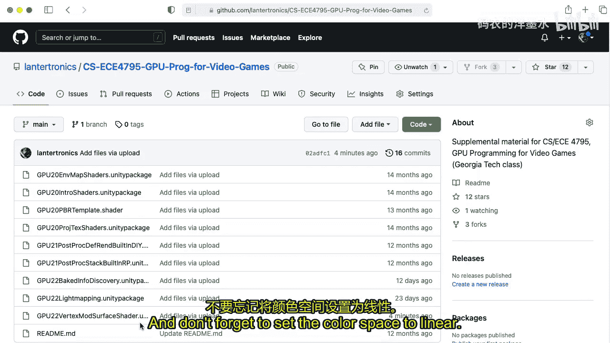
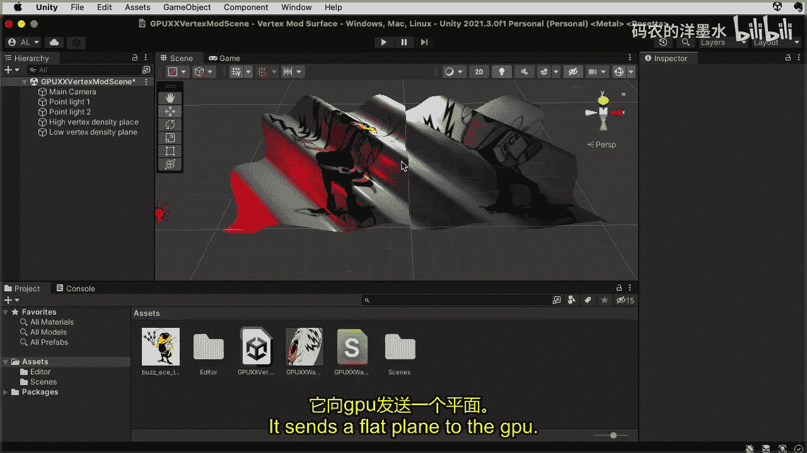
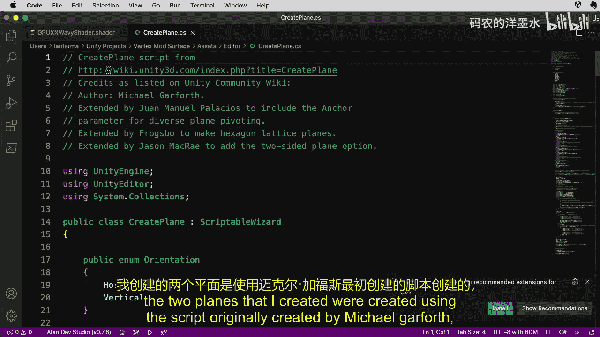
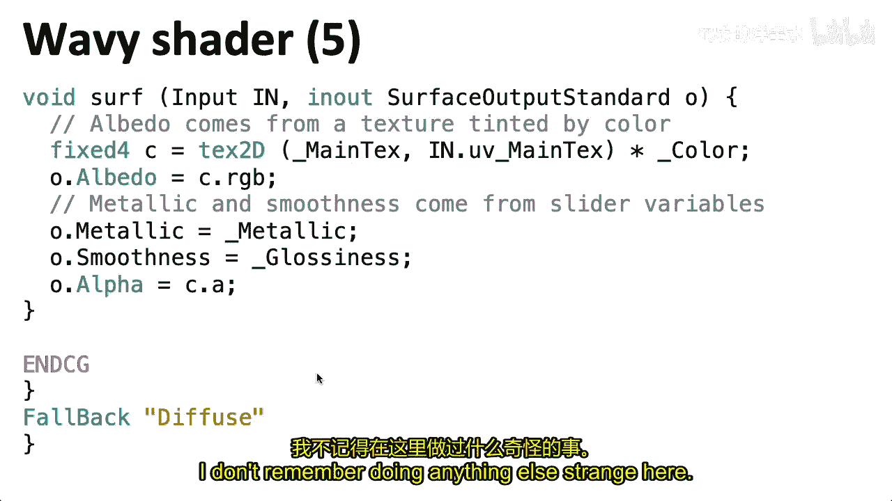

# 041：表面着色器中的程序性顶点修改 🎮

在本节课中，我们将学习如何在GPU上实现酷炫的程序性动画效果，例如波浪形变。我们将深入探讨如何在Unity的表面着色器中注入顶点修改功能，从而在运行时动态改变网格的形状。



上一节我们介绍了Unity的表面着色器技术，它允许我们通过编写函数来定义材质属性以及自定义光照交互。本节中，我们将看看如何在这个流程中插入顶点修改操作。



## 概述与准备

如果你想亲自尝试本节代码，可以访问我的GitHub仓库 `CS-EC4795`，获取名为 `GPU22_VertexModSurfaceShader` 的Unity包。将其加载到一个使用标准内置渲染管线的3D项目中，并记得将色彩空间设置为线性。下方描述区提供了GitHub链接。




场景中显示的这个物体，在CPU侧实际上只是一个平面。CPU将一个平面网格发送给GPU，而你在这里看到的波浪效果完全是在GPU上实时计算生成的。

## 场景与效果演示

以下是场景设置与参数调节的演示。


我的场景包含两盏点光源：一盏红色的和一盏白色的。请注意，场景中有两个结构相同但细分密度不同的平面。左侧平面网格非常密集，右侧则粗糙得多。这两个平面是使用一个特殊脚本创建的，你可以在编辑器文件夹中找到它，该脚本最初由Michael Garforth编写，发布在Unity Wiki上。

通过点击材质上的小三角图标，可以在场景视图中实时预览动画效果，而无需进入播放模式。

### 可调节参数

以下是该着色器的主要可调节参数及其效果：

*   **振幅**：控制波浪的起伏高度。增加振幅会使波浪更加剧烈。
*   **时间频率**：控制波浪波动的速度。数值越高，波动越快。
*   **波数**：控制波浪的空间频率，即波浪的密集程度。增加波数会使波浪更紧密，但可能导致右侧粗糙网格出现严重的走样现象。
*   **方向**：控制平面波传播的方向。对于圆形波，此参数无效。
*   **波形切换**：可以在平面波和圆形波（类似水滴落下的涟漪）之间切换。圆形波在粗糙网格上的走样问题通常更为明显。

## 背后的数学原理

该着色器实现的数学基础是**二维波动方程的解**。你无需深入理解方程细节，只需了解其大致形式。

对于**平面波**，其位移公式基于正弦函数：
`位移Y = 振幅A * sin(波数向量K · 坐标(X, Z) - 时间频率ω * 时间t)`
其中，`K`是波数向量，决定了波的传播方向和空间频率；`ω`是角频率，决定了波的时间频率。

对于**圆形波**，我们采用了一个简化的近似公式来模拟涟漪效果：
`位移Y = 振幅A * sin(波数K * 径向距离R - 时间频率ω * 时间t) / (ε + R)`
主要区别在于增加了除以径向距离`R`的项，以模拟能量随扩散而衰减的效果，并添加了一个小常数`ε`来避免除以零的错误。

## 代码实现解析

在Unity的CG代码中，我们可以找到名为 `appdata_` 开头的结构体。通过顶点修改函数，我们可以在标准的3D图形顶点处理流程之前修改这些结构体中的数据。

以下是着色器代码的核心部分解析：

```hlsl
Shader "Custom/VertexWaveSurface" {
    Properties {
        // ... 定义振幅、波数等属性
    }
    SubShader {
        Tags { "RenderType"="Opaque" }
        // 关键：声明顶点修改函数
        #pragma surface surf Standard vertex:makeWave

        // 顶点修改函数
        void makeWave(inout appdata_full v) {
            // 1. 计算波数向量
            float kx, kz;
            sincos(_Direction, kz, kx); // 注意sincos参数顺序
            kx *= _WaveNumber;
            kz *= _WaveNumber;

            // 2. 根据波形选择计算正弦函数的参数
            float sinusoidArgument;
            if (_WaveType < 0.5) { // 平面波
                sinusoidArgument = (v.vertex.x * kx + v.vertex.z * kz) - _Time.y * _TemporalFrequency;
            } else { // 圆形波
                float r = sqrt(v.vertex.x * v.vertex.x + v.vertex.z * v.vertex.z);
                sinusoidArgument = _WaveNumber * r - _Time.y * _TemporalFrequency;
            }

            // 3. 计算位移并应用到顶点Y坐标
            float s, c;
            sincos(sinusoidArgument, s, c);
            float displacement = _Amplitude * s;

            if (_WaveType > 0.5) { // 圆形波需要衰减
                float r = sqrt(v.vertex.x * v.vertex.x + v.vertex.z * v.vertex.z);
                displacement /= (0.5 + r); // 0.5是避免除零的epsilon
            }

            v.vertex.y += displacement;

            // 4. 修正法线（重要！）
            // 为了使光照正确，必须根据表面变形调整法线方向。
            // 这里涉及偏导数计算，代码已简化。
            float derivative = _Amplitude * _WaveNumber * c;
            if (_WaveType > 0.5) {
                float r = sqrt(v.vertex.x * v.vertex.x + v.vertex.z * v.vertex.z);
                derivative /= (0.5 + r);
                // 圆形波的法线修正更复杂，此处略去细节
            }
            // 粗略调整法线（平面波近似）
            v.normal = normalize(float3(-kx * derivative, 1.0, -kz * derivative));
        }

        // 表面着色器函数
        void surf (Input IN, inout SurfaceOutputStandard o) {
            // ... 设置金属度、光滑度等标准表面属性
            o.Albedo = float3(0.7, 0.7, 0.8);
            o.Metallic = _Metallic;
            o.Smoothness = _Smoothness;
        }
    }
    FallBack "Diffuse"
}
```

代码关键点：
1.  `#pragma surface surf Standard vertex:makeWave` 这行指令告诉Unity，表面着色器使用标准光照模型，并且顶点处理由自定义函数 `makeWave` 负责。
2.  `makeWave` 函数接收一个 `appdata_full` 结构体（包含顶点位置、法线等信息），并通过 `inout` 关键字修改它。
3.  函数内首先根据参数计算波数向量和正弦函数的参数。
4.  然后计算位移量，并应用到顶点的Y坐标上。
5.  **至关重要的一步**：修改顶点位置后，必须相应地修正**顶点法线**。如果法线仍指向原始方向（如垂直向上），光照计算就会错误，物体看起来会像平坦的。修正法线需要计算表面变形的偏导数，对于平面波，可以近似计算；对于复杂变形，则需要更精确的数学。
6.  最后的 `surf` 函数定义了标准的表面材质属性。



当然，同样的顶点变形逻辑也可以用在手写的自定义顶点着色器中，只需在世界变换、视图变换等操作之前应用这些修改即可。


## 总结

本节课中，我们一起学习了如何在Unity表面着色器中实现程序性顶点修改。我们了解了如何通过编写顶点函数来动态改变网格形状，从而创建出平面波和圆形波浪动画。关键点在于：不仅要修改顶点位置以实现形变，还必须同步更新**法线信息**，以确保光照渲染的正确性。这种技术为创造动态、丰富的视觉特效提供了强大的工具。

---
**致Georgia Tech选课学生**：请前往Canvas完成本讲测验。请告诉我：1. 你在Georgia Tech上过的最喜欢的课程（不包括我教的）；2. 你最喜欢那门课的哪个方面；3. 你上过的最不喜欢的课程（不包括我教的）；4. 你最不喜欢那门课的哪个方面。此信息仅为我个人兴趣收集，将严格保密。