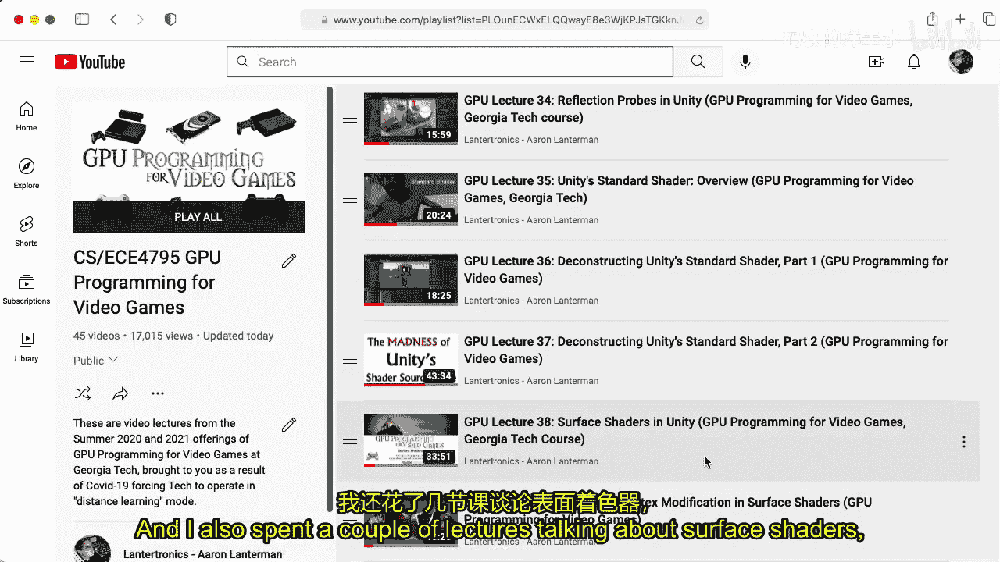
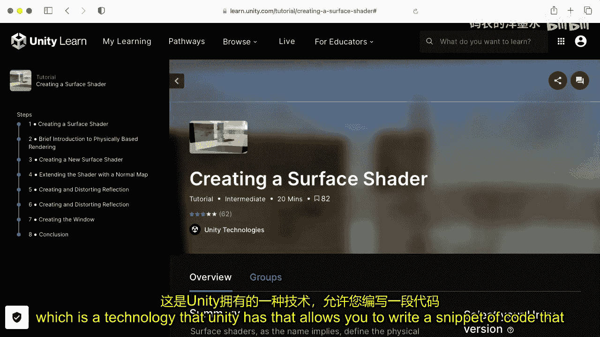
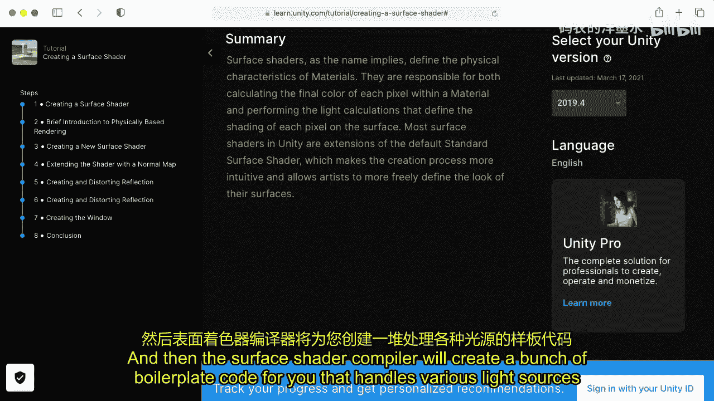
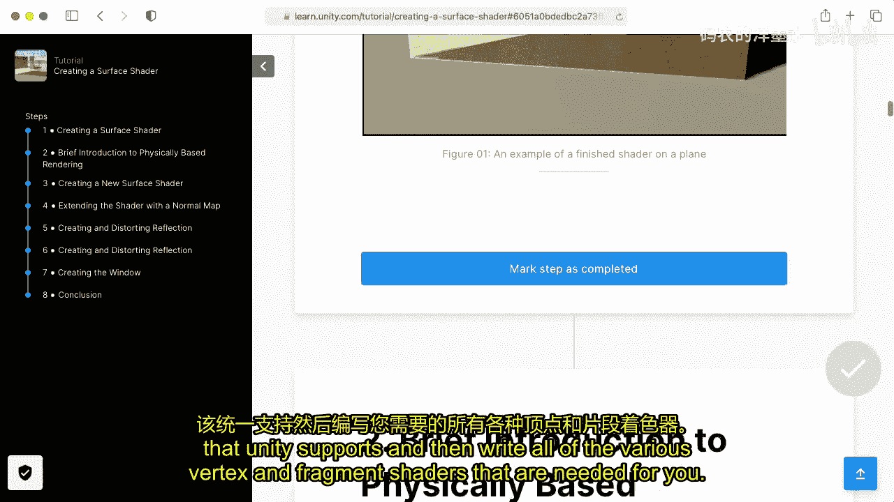
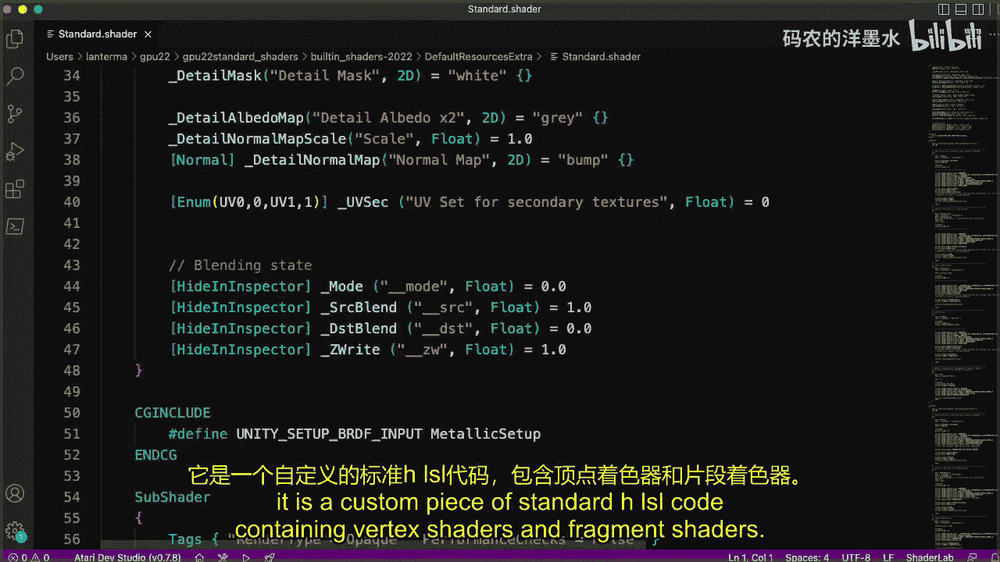
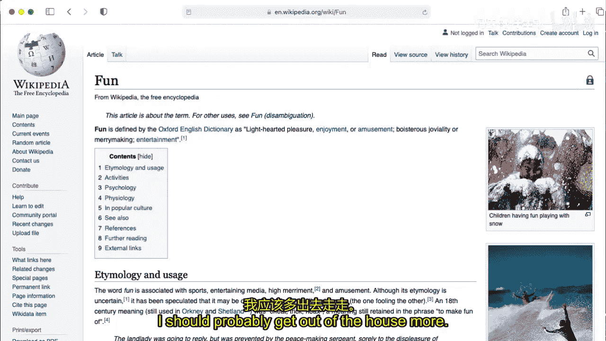
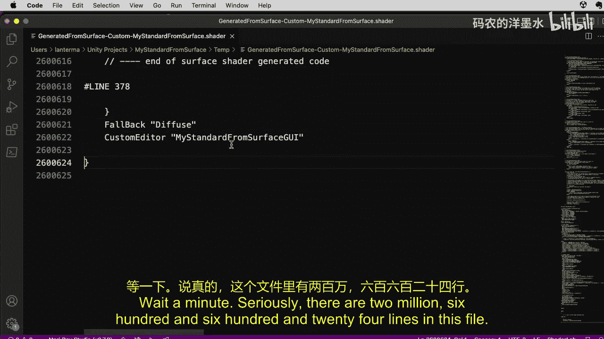
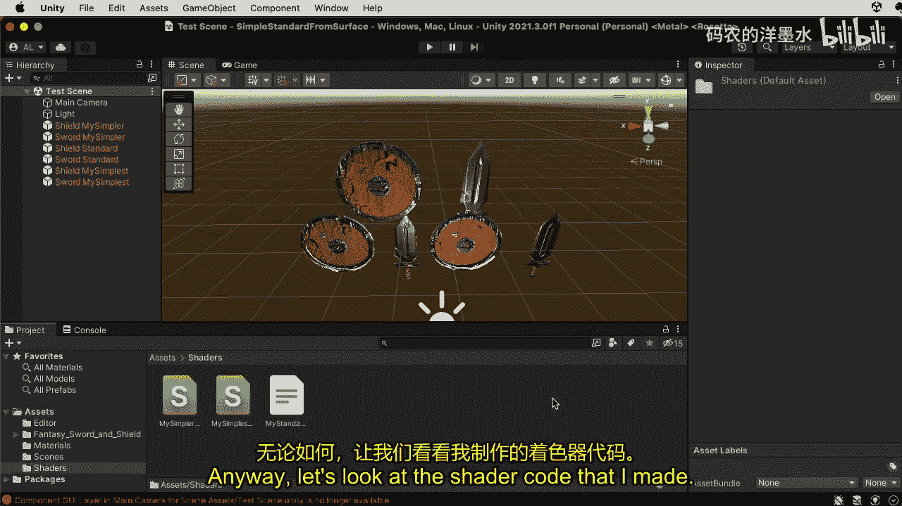
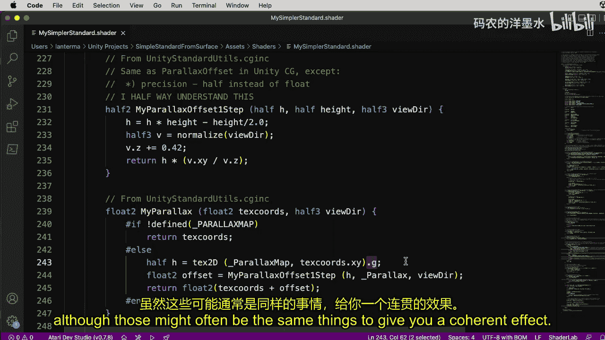
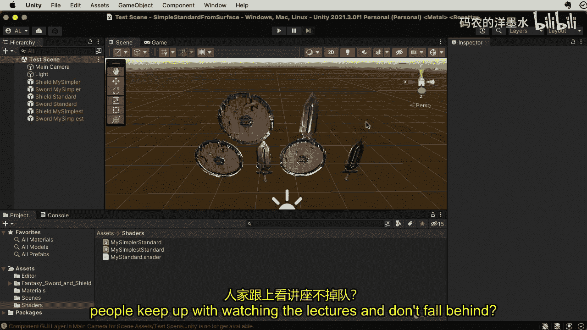

# 042：标准着色器重写为表面着色器 🎮

在本节课中，我们将学习如何将Unity内置的标准着色器（Standard Shader）重写为表面着色器（Surface Shader）。通过这个过程，我们可以更深入地理解标准着色器的工作原理，并掌握表面着色器技术的实际应用。

---

上一节我们介绍了Unity标准着色器及其在游戏渲染中的重要性。本节中，我们来看看如何利用表面着色器技术来重新实现它。

我的名字是Er Lancherman，是佐治亚理工学院电气与计算机工程系的教授。在这门关于视频游戏GPU编程的课程中，我用了三节课讲解Unity内置渲染管线中的标准着色器，也用了几节课介绍表面着色器。表面着色器是Unity提供的一项技术，允许你编写一小段代码来指定材质属性，以及一个可选的、描述光线应如何响应这些材质属性的自定义光照函数。然后，表面着色器编译器会为你生成大量样板代码，这些代码会处理Unity支持的各种光源，并为你编写所需的所有顶点和片段着色器。

标准着色器本身并不是一个表面着色器，它是一段包含顶点和片段着色器的自定义HLSL代码。因此，我认为尝试将Unity标准着色器重写为表面着色器会很有教育意义，既能更好地理解标准着色器，也能提供一个表面着色器的示例。在左侧，我有一把使用Unity标准着色器的剑和盾牌。在右侧，则使用了名为“My Standard From Surface”的着色器，这是我使用表面着色器技术实现的版本。你可以从我的GitHub获取这个演示的Unity包，名为“GPU22_StandardFromSurfaceShader”。

我尚未对原始标准着色器和我的表面着色器版本进行详细比较，因此不确定所有功能是否都正常工作，也不确定是否完全匹配。但我想指出的一点是高度图（Height Map）和视差映射（Parallax Mapping）的效果。让我把盾牌上的法线贴图强度调低到零，你会看到高度图产生了一些有趣的效果。现在让我调整高度图的强度，将其从零开始逐渐调高，并放大一点以便观察。这就是一种称为视差的有趣效果，我之前没有讲过，它比我们在本课程中目前讨论的其他效果更高级，但它是标准着色器的一部分，因此也是我在这里实现的内容之一。让我们重新打开法线贴图，现在也可以加上视差效果。

当我坐下来开始这项使用表面着色器技术重现标准着色器的任务时，在整理硬盘时发现，我早在2018年就已经做过了，只是忘记了。所以，这个“My Standard From Surface”着色器从属性（Properties）开始，这些属性是我直接从原始标准着色器中复制过来的。现在，我们不再有顶点和片段着色器，而是定义了一个表面着色器。当然，我调用了自定义光照模型“MyStandard”。请注意，不要与之前某节课中的“My Standard Shader”混淆。在那节课中，我只是复制了原始着色器代码并在所有内容前加上了“My”。我们在这里的做法不同，这是在为表面着色器创建一个光照模型。

我从UnityCG和UnityPBSLighting中导入了一些内容，但对于其他我们需要的东西，我实际上会将代码复制到这个文件中，试图将所有内容集中在一个地方。着色器功能（Shader Features）是从原始标准着色器复制过来的。同样，这里的各种声明也是复制的。在这里，我定义了`MySurfaceOutputStandard`结构体，这是从UnityPBSLighting中的`SurfaceOutputStandard`结构体复制过来的。需要注意的是，对于你自己的自定义光照模型，你可以在这个结构体中放入任何你想要的内容。

让我们看看这里还有什么。我有一堆从其他文件复制过来的东西，当我这样做时，我通常在名称前加上“My”，以区分此文件中的内容和Unity主要包含文件中的内容，这样我们就可以根据需要在这里修改东西。这里有一个函数定义了“MyStandard”版本的标准光照模型的光照模型。这里调用了BRDF函数等。上面是光照函数`LightingMyStandard_GI`（全局光照）。往下翻，我放了一堆函数在这个文件里，以便集中管理。例如，我从UnityCG中复制了`UnpackNormal`函数，并在这里将其命名为`MyUnpackNormal`，这样我就可以在一个地方拥有所有内容，而不需要在文件之间跳转和追踪代码。在某些情况下，我将几个函数重新组合成一个函数，以使逻辑更清晰。

继续往下翻，这里有一些关于解包法线、混合法线、读取细节遮罩纹理（这是一个更高级的表面着色器功能）的内容。这里是`MyNormalInTangentSpace`函数，以及一堆复杂的东西。这里是纹理提取函数，包括发射贴图、Alpha提取、反照率贴图提取（这包括了许多与细节遮罩相关的内容）、遮挡纹理、金属度/光滑度提取。哦，这里还有使用高度图的视差效果函数。老实说，我并不完全理解它的工作原理，如果我花功夫是可以理解的，但暂时不想深入。这里是实际的表面函数（`surf`）。看看四年前自己写的代码总是很有趣。我当时写道：“在整个标准着色器的子例程中，使用XY作为主贴图UV坐标、ZW作为次级贴图UV坐标的风格是一致的。” 这是个不错的观察。

对于这个演示代码和实际的标准着色器，纹理坐标分配可能发生在顶点着色器中（在UnityStandardConfig中通过一个纹理代码例程完成）。但在表面着色器编译后，这个分配可能会发生在片段着色器中，因此效率可能稍低，但没关系。显然，标准着色器中关于使用备用UV集的内容，我不太记得具体问题是什么，但当时我遇到了问题，所以直接把它去掉了。

我们继续：在各个纹理中查找数据，处理视差、反照率、Alpha，获取法线。我在这里有一条注释：“如果你要写入法线，请写入切线空间法线。” 这是表面着色器结构体期望的一部分。这里调用了`MyNormalInTangentSpace`函数。然后我们获取发射纹理、遮挡、金属度/光滑度，并相应地设置所有内容。就是这样。

我还应该提到，标准着色器有一个自定义检视面板（Custom Inspector），我把它复制过来并改名为“MyStandardFromSurfaceGUI”。这个自定义编辑器必须放在Editor文件夹中。就本课程而言，你不需要担心如何制作这样的自定义检视面板的细节；如果没有它，你只会有一个常规的检视面板，这也没问题。我在这里加了一条注释：“由Er Lanchman修改以便编译”。我不太记得当时具体改了些什么，但记得当时为了让原始的GUI工作遇到了问题，四年前我肯定找到了修复方法。

表面着色器编译器会获取你的表面着色器代码，并为你编写一堆顶点和片段着色器。我们实际上可以查看它生成的代码。点击“Show generated code”，结果代码就在这里了，而且有很多。往下翻，看看有多少行？等等，这个文件竟然有 **26,624** 行！

我应该做一个简化版本，去掉一些功能，也许能得到一个更小的编译文件。幸运的是，看起来我四年前也做了这个。如果你去我的GitHub，我在那里放了代码“GPU22_SimplifiedStandardFromSurfaceShader”。是的，我又忘了自己做过这个，是在整理文件时发现的。我意识到当我深夜录制这些课程并且很累时，我听起来有点像William Shatner。

好的，新建一个3D项目。和往常一样，我们进入项目设置，在Player中将颜色空间设置为线性，因为伽马空间不好，我们需要线性空间。导入“GPU22_SimplifiedStandardFromSurfaceShader”。检查测试场景。哦，我在这里放了一堆东西。这里有一把剑和盾牌使用标准着色器。这里有一把剑和盾牌使用我的简化版标准着色器。这里还有一把剑和盾牌使用我的最简版标准着色器。看起来我创建了两种不同简化级别的着色器。哦，我应该提一下，我使用了一张几年前DragonCon上Buzz的照片制作了法线贴图，并把它用在盾牌上，让法线贴图效果更明显。

让我们看看我写的着色器代码。我有一个叫“mystandardshader.txt”的文件。我记得四年前做这个的时候，编译花了很长时间。现在这个不是前几节课创建的“My Standard”，而是我刚才展示的文件中称为“StandardFromSurfaceShader”的东西，我在这里加上了“Txt”后缀，这样Unity就不会尝试编译它。那么，简化版着色器是什么样的呢？

我写了什么？移除了与透明度混合模式、次级贴图相关的代码，以及关闭镜面高光和反射的复选框选项。所以现在这里的代码更少了。这里有我的光照模型、辅助函数、从纹理获取数据的函数、视差相关的东西，还有表面函数。让我们看看表面着色器编译器生成的代码。结果代码不再是超过200万行，而是只有 **66,533** 行。

让我们看看检视面板里有什么。我们有反照率、金属度、光滑度这些常规选项，但没有任何次级贴图相关的选项。果然，这些着色器的每个变体都需要自己单独的自定义检视面板GUI文件。对于我的最简版着色器，只有反照率、金属度/光滑度和一个法线贴图。查看代码，我有一条注释，说明我移除了与透明度混合模式、次级贴图相关的代码（这些在简化版中已经移除了）。但在最简版中，我还移除了高度图、视差效果、遮挡贴图和发射贴图。所以这段代码应该更紧凑，更容易理解，尽管仍然有很多内容需要消化。

让我们看看表面着色器编译器为最简版生成的代码。现在只有……哦，还在加载……只有 **14,867** 行代码。现在，我可以保存这个文件，更改它的名称，这样它就变成了一个标准的Unity着色器文件，然后你可以修改它、优化它，做任何你想做的事情。这次代码量不再那么夸张了，让我们看看代码。这里有一堆表面着色器编译器添加的注释，说明它需要什么。它在这里添加了一些包含文件，比如UnityCG.cginc等。关于内部数据、虚拟预处理器以解决HLSL编译器行处理问题的各种内容，真是疯狂。

那么，让我看看是否能找到编译后的代码在哪里，因为这里的所有内容都是我的原始代码（或者说，是源自Unity的原始代码）。在某个地方，我们应该能看到表面着色器编译器自己生成的函数。哦，这里是结构体，这是用于在插值器中传递数据的`v2f_surf`结构体，包含世界法线、世界位置等。这是关于着色器目标的吗？关于雾坐标和阴影坐标的内容。哦，这里有一堆这些结构体的变体，看起来我们在某个编译器指令中，它会选择不同的版本。找到了，这里是实际的顶点着色器。这里是我们期望看到的内容：将顶点从物体坐标转换到裁剪坐标，传递纹理坐标、世界位置、世界法线，变换切线，如果需要的话计算副法线。关于动态光照贴图、更多光照贴图的内容。这里是关于那四个可以逐顶点计算的点光源的内容，关于球谐函数的东西，一堆关于雾的内容。现在我们有了片段着色器。更多关于雾的内容。这里我们查看光照方向、世界视角方向。我们有一堆被初始化为0的变量。我想之后我们实际上会进行纹理查找。我的纹理查找在哪里？涉及光照结构的东西？全局光照内容。然后它调用了实际的光照函数，其职责是填充那些被初始化为0的各种变量。

以上就是表面着色器编译器创建的HLSL代码。

在所有这些课程中，我还没有展示过为这些着色器创建的实际汇编代码。让我们点击“Compile and show code”。好的，这不是一个有效的着色器文件，内容仅用于信息和调试目的。开始往下翻，看看我们能发现什么。哇，看看所有这些，太疯狂了。我们有一些看起来像 `u_xlat39`, `u_xlat` 的东西，我猜这些是寄存器。看 `FMA`，这可能是某种乘加指令。所以这看起来不像你通常看到的汇编代码样子，但这些都映射到汇编指令。这里有一些点积操作，一些倒数平方根操作。哦，这真的很有趣，这里有一个纹理查找操作。这绝对不是你想手动编写的东西。

在结束之前，有一点我需要澄清：高度图在概念上是一个标量图。我放了一张Buzz的RGB图片在这里。与视差映射相关的例程会提取绿色通道作为高度图使用。再次说明，这与你可能用来生成法线贴图的高度图是分开的，尽管它们通常是同一个东西，以产生一致的效果。

---

本节课中，我们一起学习了将复杂的Unity标准着色器重写为表面着色器的过程。我们看到了表面着色器如何通过编译器自动生成大量样板代码，简化了处理多光源和复杂光照模型的开发工作。通过创建简化版本，我们也了解到如何控制生成代码的复杂度，使其更易于理解和维护。这个过程不仅加深了我们对标准着色器内部机制的理解，也展示了表面着色器在提高开发效率方面的强大能力。

如果你是正在修读本课程学分的佐治亚理工学院学生，请前往Canvas完成与本讲相关的小测验，其中只有一个问题，希望你用几句话给出建议：我和其他教授在教授异步课程时，可以做些什么来确保大家能跟上观看讲座的进度而不落后。

