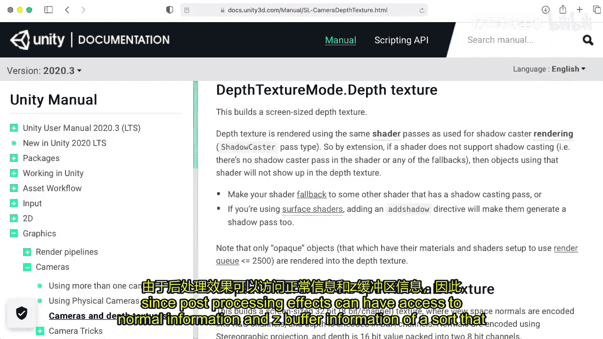
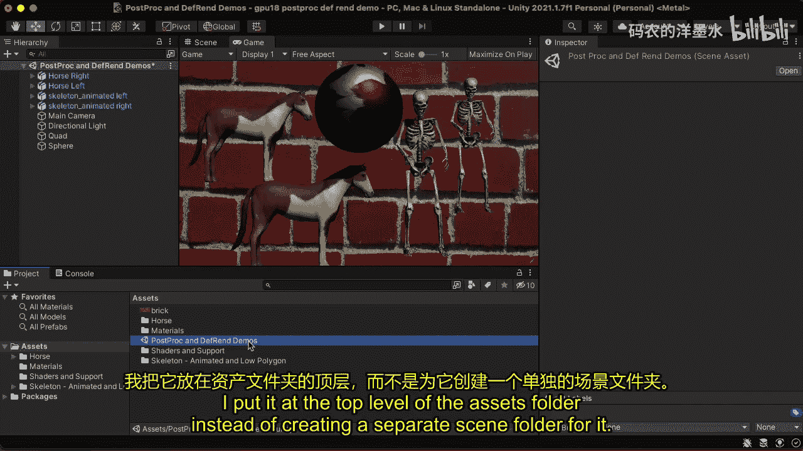
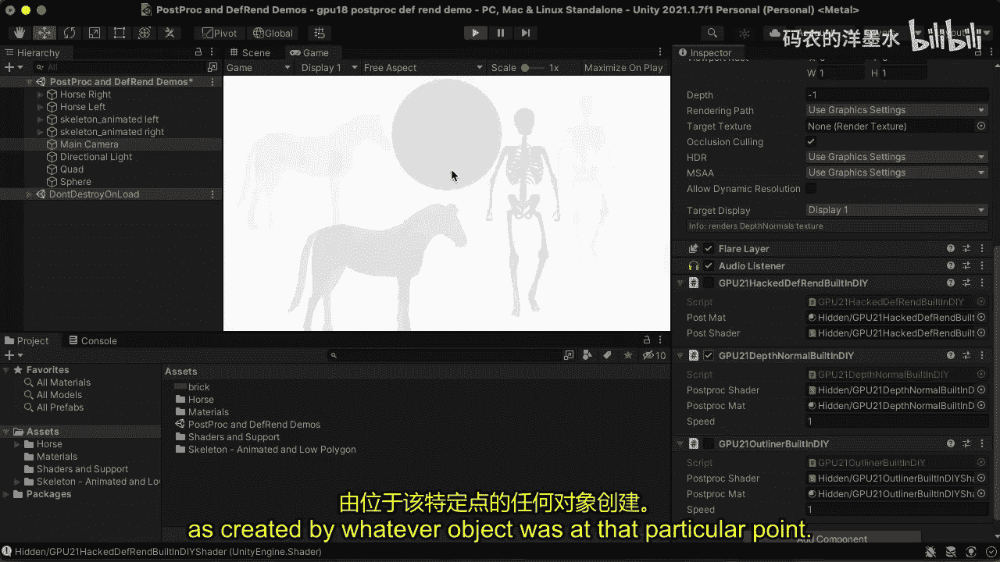
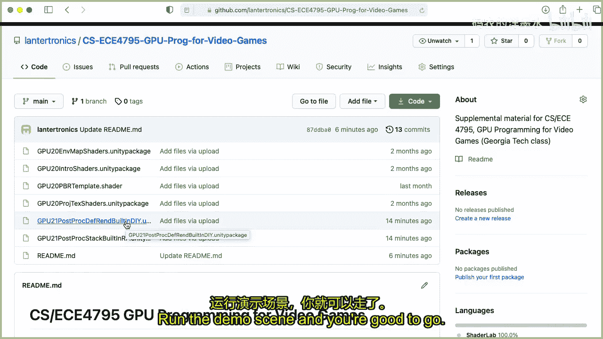

# 043：基于内置流水线的DIY后期处理 🎮

在本节课中，我们将学习如何在Unity内置渲染管线中，通过编写自定义脚本和着色器，实现DIY的后期处理效果。我们将探讨边缘检测、深度与法线信息可视化，以及一个简化的延迟渲染示例。

---



## 概述

后期处理类似于为每一帧画面应用Photoshop滤镜。在游戏中，它可以实现诸如泛光、运动模糊等视觉效果。本节课我们将绕过Unity官方的后期处理栈，手动实现几个效果，以理解其背后的工作原理。



上一节我们介绍了后期处理的基本概念，本节中我们来看看如何通过代码具体实现。

---



## 场景与脚本设置

我们使用一个演示场景，其中包含马、骷髅模型和一个带有砖墙纹理的背景。所有物体都使用内置渲染管线的标准着色器。

摄像机附有三个脚本：
1.  **延迟渲染演示脚本**：用于展示高级渲染概念。
2.  **轮廓线脚本**：随时间在原始图像和边缘检测图像之间进行变形。
3.  **深度法线脚本**：用于可视化场景的深度和视图空间法线信息。

以下是脚本在检视面板中的示例：


所有相关代码和着色器都位于名为 `Shaders and Support` 的文件夹中，便于管理。

---

## 实现轮廓线（边缘检测）效果

首先，我们来看如何实现一个简单的边缘检测效果。请注意，在实际项目中使用内置管线时，应优先使用Unity提供的后期处理栈包。这里的DIY版本是为了揭示底层原理。

### 着色器代码分析

所有后期处理着色器都需要包含 `UnityCG.cginc` 文件。其核心思想是：先正常渲染一帧，然后将该帧图像作为纹理，再渲染一个覆盖全屏的四边形（两个三角形）并应用我们的效果。

我们使用 `Hidden` 特性来隐藏着色器，使其不出现在材质球的着色器列表中。

```glsl
Shader "Hidden/OutlineShader"
{
    Properties
    {
        _MainTex ("Texture", 2D) = "white" {}
        _Speed ("Speed", Float) = 1.0
    }
    SubShader
    {
        // ... 通道和顶点着色器代码（通常由UnityCG提供）...

        sampler2D _MainTex;
        float4 _MainTex_TexelSize; // Unity提供的纹理像素尺寸信息
        float _Speed;

        fixed4 frag (v2f i) : SV_Target
        {
            // 采样原始像素及其上下左右相邻像素
            fixed4 original = tex2D(_MainTex, i.uv);
            fixed4 originalLeft = tex2D(_MainTex, i.uv - float2(_MainTex_TexelSize.x, 0));
            fixed4 originalRight = tex2D(_MainTex, i.uv + float2(_MainTex_TexelSize.x, 0));
            fixed4 originalUp = tex2D(_MainTex, i.uv - float2(0, _MainTex_TexelSize.y));
            fixed4 originalDown = tex2D(_MainTex, i.uv + float2(0, _MainTex_TexelSize.y));

            // 计算水平和垂直方向的一阶差分（近似梯度）
            float3 horizontalDiff = abs(original.rgb - originalLeft.rgb) + abs(original.rgb - originalRight.rgb);
            float3 verticalDiff = abs(original.rgb - originalUp.rgb) + abs(original.rgb - originalDown.rgb);

            // 合并梯度得到边缘强度
            float edgeStrength = length(horizontalDiff + verticalDiff);

            // 根据时间在原始图像和边缘图像之间插值
            float t = 0.5 * (1.0 + sin(_Time.y * _Speed));
            fixed4 edgeColor = fixed4(edgeStrength.xxx, original.a);
            fixed4 finalColor = lerp(original, edgeColor, t);

            return finalColor;
        }
        // ...
    }
}
```
**关键点**：
*   `_MainTex_TexelSize` 是一个 `float4`，其 `x` 和 `y` 分量分别表示纹理像素在UV空间中的宽度和高度倒数，用于精确访问相邻像素。
*   通过计算相邻像素的颜色差异来近似图像梯度，从而检测边缘。
*   使用 `_Time.y` 和 `_Speed` 变量来实现随时间变化的动态效果。

### C# 脚本驱动

C#脚本负责将着色器材质应用到摄像机的渲染图像回调中。

```csharp
[RequireComponent(typeof(Camera))]
public class Outliner : MonoBehaviour
{
    public Shader outlineShader;
    private Material outlineMaterial;
    public float speed = 1.0f;

    void Start()
    {
        // 根据着色器名称查找并创建材质
        outlineShader = Shader.Find("Hidden/OutlineShader");
        outlineMaterial = new Material(outlineShader);
    }

    void Update()
    {
        // 将C#端的speed变量传递给着色器中的_Speed属性
        outlineMaterial.SetFloat("_Speed", speed);
    }

    // OnRenderImage 在常规渲染完成后、显示到屏幕前被调用
    void OnRenderImage(RenderTexture source, RenderTexture destination)
    {
        // 将源图像通过我们的轮廓线材质渲染到目标图像
        Graphics.Blit(source, destination, outlineMaterial);
    }
}
```
**关键点**：
*   `[RequireComponent(typeof(Camera))]` 确保脚本只能附加到摄像机对象。
*   `Shader.Find` 通过名称（必须与着色器中定义的完全一致）来查找着色器。
*   `OnRenderImage` 是内置管线提供的回调函数，是注入后期处理效果的关键。
*   `Graphics.Blit` 函数执行实际的图像复制和处理操作。

---

## 可视化深度与法线信息

接下来，我们看看如何访问和显示场景的深度缓冲与视图空间法线信息。这些信息可用于实现景深、屏幕空间反射等高级效果。

### 着色器代码分析

这个着色器使用Unity内置的 `_CameraDepthNormalsTexture` 来获取数据。

```glsl
Shader "Hidden/DepthNormalShader"
{
    Properties
    {
        _MainTex ("Texture", 2D) = "white" {}
    }
    SubShader
    {
        sampler2D _MainTex;
        sampler2D _CameraDepthNormalsTexture; // Unity提供的深度法线纹理

        fixed4 frag (v2f i) : SV_Target
        {
            // 解码深度和法线信息
            float3 viewNormal;
            float depth;
            DecodeDepthNormal(tex2D(_CameraDepthNormalsTexture, i.uv), depth, viewNormal);

            // 将法线分量从[-1, 1]映射到[0, 1]以便显示为颜色
            fixed3 normalColor = viewNormal * 0.5 + 0.5;

            // 深度值本身在0到1之间，可以直接显示为灰度
            fixed depthColor = depth;

            // 随时间在法线彩色图和深度灰度图之间交叉淡化
            float t = 0.5 * (1.0 + sin(_Time.y));
            fixed3 finalColor = lerp(depthColor, normalColor, t);

            return fixed4(finalColor, 1.0);
        }
    }
}
```
**关键点**：
*   `_CameraDepthNormalsTexture` 是Unity在特定设置下自动生成的纹理，编码了深度和法线信息。
*   `DecodeDepthNormal` 是 `UnityCG.cginc` 中的辅助函数，用于从纹理中提取深度值和视图空间法线向量。
*   深度值通常经过非线性变换以更好地利用精度，`Linear01Depth` 函数可将其转换为线性的0-1范围。

### C# 脚本设置

为了让Unity生成 `_CameraDepthNormalsTexture`，需要在脚本中设置摄像机的深度纹理模式。

```csharp
[RequireComponent(typeof(Camera))]
public class DepthNormalViewer : MonoBehaviour
{
    void Start()
    {
        // 指示摄像机渲染深度和法线信息到纹理
        GetComponent<Camera>().depthTextureMode = DepthTextureMode.DepthNormals;
    }
    // ... OnRenderImage 方法与之前类似 ...
}
```

---

## 简化的延迟渲染演示

最后，我们通过一个示例来体验延迟渲染的基本思想。与之前所有的正向渲染不同，延迟渲染先将几何信息（位置、法线、材质属性等）存储到多个缓冲区（G-Buffer），然后在第二个光照处理阶段统一计算光照。

### 着色器与脚本逻辑

在这个简化示例中，我们的G-Buffer只包含深度和法线信息，其他材质属性假设为全局统一值。

**着色器核心任务（在片段着色器中）**：
1.  从深度法线纹理重建每个像素在视图空间中的位置。
2.  使用自定义的光照计算（例如简化的Blinn-Phong模型）为每个像素着色。

**C# 脚本核心任务**：
1.  在 `OnPreRender` 回调中，设置摄像机参数（用于位置重建）。
2.  在 `Update` 中更新光源位置。
3.  在 `OnRenderImage` 中，将光源位置等数据传递给着色器，并执行渲染。

```csharp
void OnPreRender()
{
    // 设置摄像机投影参数，用于在着色器中从屏幕空间反推视图空间位置
    Camera cam = GetComponent<Camera>();
    float height = 2 * cam.nearClipPlane * Mathf.Tan(cam.fieldOfView * 0.5f * Mathf.Deg2Rad);
    float width = height * cam.aspect;
    Vector3 cameraData = new Vector3(width, height, cam.nearClipPlane);
    deferredMaterial.SetVector("_CameraData", cameraData);
}
```
**关键公式（视图空间位置重建）**：
在着色器中，从屏幕UV和深度值 `z` 重建视图空间位置 `posVS` 的简化过程如下：
1.  将UV从 `[0,1]` 映射到NDC的 `[-1,1]` 范围：`clipPos.xy = uv * 2.0 - 1.0`。
2.  利用相似三角形原理，用深度值 `z` 和摄像机近平面大小（`_CameraData.xy`）以及近平面距离（`_CameraData.z`）计算：
    ```glsl
    posVS.xy = clipPos.xy * _CameraData.xy * (z / _CameraData.z);
    posVS.z = z; // 深度值直接作为Z坐标
    ```

---

## 效果叠加与项目实践

一个有趣的现象是，这些后期处理效果可以叠加。例如，可以在深度法线可视化效果之上再运行轮廓线效果。

如果你想亲自尝试：
1.  前往 Lanterntronics 的 GitHub 页面，找到 CSEC 4795 代码仓库。
2.  下载名为 `GPU_21_PostProc_Deferred_BuiltIn_DIY` 的Unity包（名称很长，旨在与官方后期处理栈项目区分）。
3.  新建一个空白3D Unity项目，将该包导入Assets文件夹。
4.  打开演示场景并运行。

---

## 总结

本节课我们一起学习了：
1.  **DIY后期处理原理**：通过 `OnRenderImage` 回调和 `Graphics.Blit`，在渲染完成后对全屏图像进行处理。
2.  **边缘检测实现**：通过采样相邻像素计算颜色梯度，实现动态轮廓线效果。
3.  **深度与法线访问**：如何通过 `_CameraDepthNormalsTexture` 和 `DecodeDepthNormal` 函数获取并可视化这些底层图形信息。
4.  **延迟渲染初探**：了解了延迟渲染的基本概念，并实现了一个简化的、基于深度法线重建位置的自定义光照示例。



通过手动实现这些效果，我们深入理解了Unity内置渲染管线中后期处理的注入点、数据传递方式和基本图像处理技巧，为学习和使用更高级、更高效的官方工具奠定了坚实基础。