# 044：Unity内置流水线的后处理栈 🎮

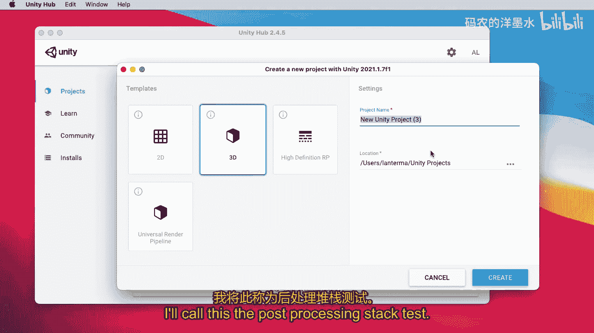

在本节课中，我们将学习如何在Unity内置渲染管线中使用官方的后处理栈（Post-processing Stack）来创建和管理后处理效果。我们将了解如何安装后处理栈包，如何创建自定义后处理效果，以及如何将它们与Unity内置的效果结合使用。

---

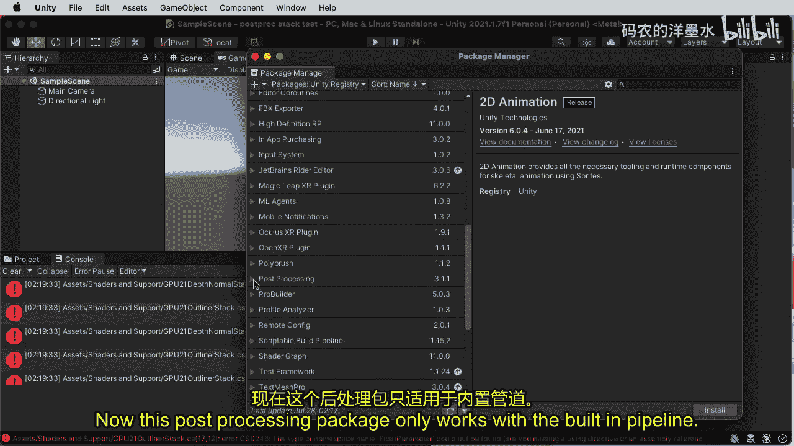

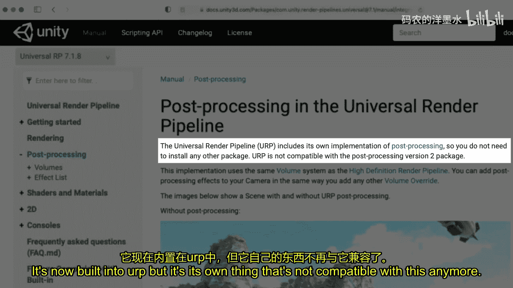

## 项目设置与包安装

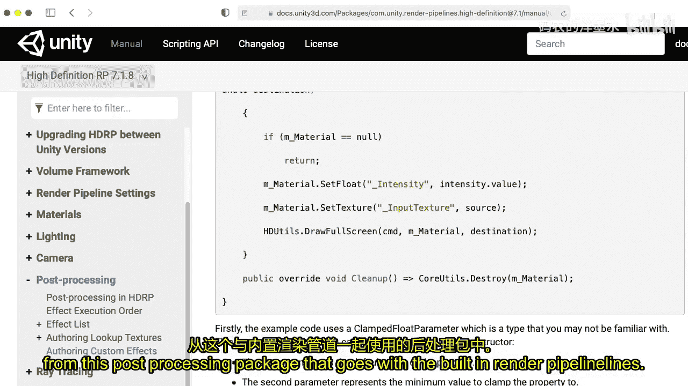

上一节我们介绍了使用自定义脚本实现后处理效果的方法。本节中，我们来看看如何使用Unity官方提供的、更强大的后处理栈框架。

首先，需要创建一个新的Unity项目（例如“PostProcess Stack Test”）。为了使用后处理栈，必须从Package Manager中安装“Post Processing”包。请注意，此包仅适用于内置渲染管线（Built-in Render Pipeline）。对于通用渲染管线（URP）或高清渲染管线（HDRP），它们各自拥有独立的后处理系统，与本教程介绍的系统不兼容。

安装完成后，可以从提供的GitHub链接下载并导入演示资源包。如果导入后出现着色器错误，通常可以通过在Assets文件夹上右键选择“Reimport All”来解决。

---

## 后处理组件与效果应用

在场景中，主摄像机上需要附加两个关键组件：`Post-process Layer` 和 `Post-process Volume`。

`Post-process Layer` 组件必须附加在摄像机上，它负责与场景中的各个后处理体积进行通信。而 `Post-process Volume` 组件则定义了后处理效果的生效范围及其参数。虽然为了方便演示，可以将其附加在摄像机上，但最佳实践是将其作为独立的游戏对象。

以下是核心组件的作用：
*   **Post-process Layer**：摄像机的“接收器”，用于启用后处理并管理效果堆栈的顺序。
*   **Post-process Volume**：效果的“容器”，可以定义效果的作用空间（全局或局部）和具体参数。

在 `Post-process Volume` 中，可以添加各种效果，例如内置的“Chromatic Aberration”（色差）或“Bloom”（泛光）。每个效果的具体参数（如强度、阈值）可以通过勾选参数旁边的“Override”复选框来激活和调整。取消勾选则恢复为默认值。

---

## 后处理体积与混合

`Post-process Volume` 的核心概念在于“体积”。可以创建一个3D对象类型的后处理体积，并通过调整其缩放（Scale）来定义其影响范围。

当摄像机位于该体积内时，体积中定义的效果和参数覆盖才会生效。这允许开发者设计这样的场景：当玩家进入特定区域（如迷雾森林或水下）时，后处理效果（如雾浓度、色调）会平滑地过渡变化。

为了实现这种基于体积的混合，需要在摄像机的 `Post-process Layer` 组件中，将 `Trigger` 属性设置为代表玩家或摄像机的碰撞体。如果体积设置为“Is Global”，则其效果会影响整个场景，无需触发器。

---

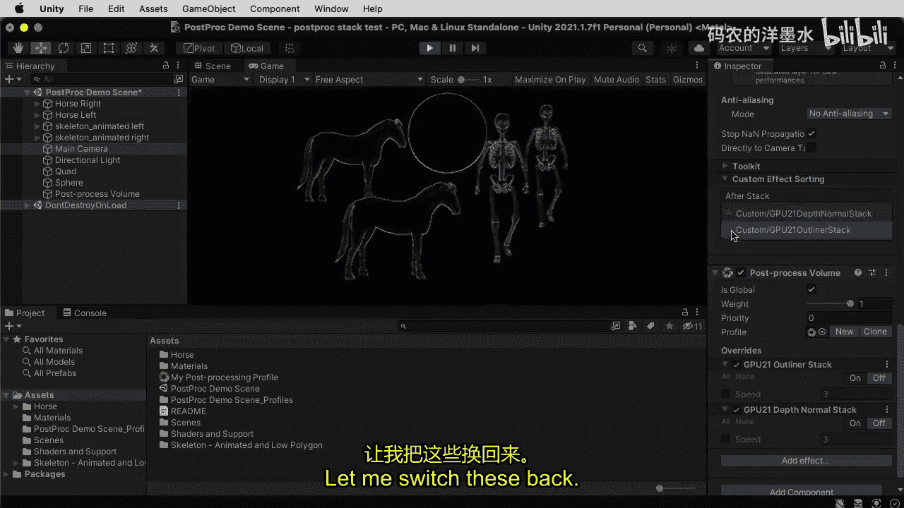

## 自定义后处理着色器

现在，我们深入探讨如何编写自定义的后处理着色器，并将其集成到后处理栈中。

后处理着色器的代码结构与之前课程中使用的略有不同。它采用了Unity较新的HLSL风格。顶点着色器部分通常很简单，主要负责传递纹理坐标。

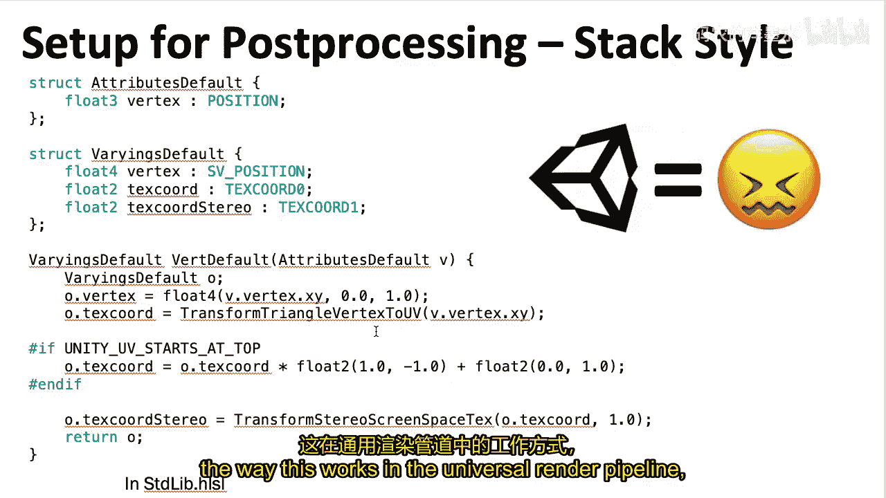

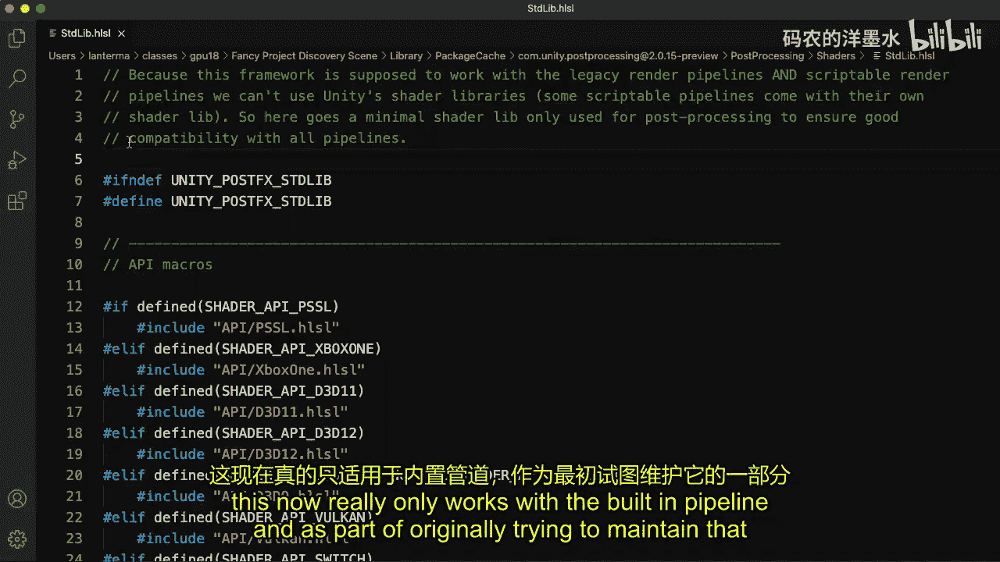

片段着色器是效果实现的核心。以下是一个边缘检测效果的示例代码片段：

```hlsl
// 采样当前像素颜色
float4 col = SAMPLE_TEXTURE2D(_MainTex, sampler_MainTex, i.texcoord);
// 采样相邻像素颜色以计算梯度
float4 colR = SAMPLE_TEXTURE2D(_MainTex, sampler_MainTex, i.texcoord + float2(_MainTex_TexelSize.x, 0));
float4 colU = SAMPLE_TEXTURE2D(_MainTex, sampler_MainTex, i.texcoord + float2(0, _MainTex_TexelSize.y));
// 计算边缘强度
float edge = abs(colR.r - col.r) + abs(colU.r - col.r);
// 在原始图像和边缘图像之间进行交叉淡化
return lerp(col, float4(edge.xxx, 1), _Blend);
```

主要的区别在于纹理采样方式。新的 `TEXTURE2D`/`SAMPLER` 宏将纹理对象与采样器状态分离，这符合现代图形API（如DX11）的最佳实践，允许更高效的资源管理。采样时使用 `SAMPLE_TEXTURE2D(textureName, samplerName, uv)` 宏。

---

## 自定义后处理效果的C#脚本

为了让自定义着色器在后处理栈中工作，还需要一个对应的C#脚本。这个脚本继承自 `PostProcessEffectSettings`，并负责将参数传递给着色器。

以下是脚本结构的关键部分：

```csharp
// 1. 定义效果设置类，包含可在Inspector中调整的参数
[Serializable]
[PostProcess(typeof(MyCustomEffectRenderer), PostProcessEvent.AfterStack, "Custom/MyEffect")]
public sealed class MyCustomEffect : PostProcessEffectSettings
{
    [Range(0f, 1f), Tooltip("Effect intensity.")]
    public FloatParameter intensity = new FloatParameter { value = 0.5f };
}

// 2. 定义效果渲染器类，负责执行渲染命令
public sealed class MyCustomEffectRenderer : PostProcessEffectRenderer<MyCustomEffect>
{
    public override void Render(PostProcessRenderContext context)
    {
        // 获取属性表并设置着色器参数
        var sheet = context.propertySheets.Get(Shader.Find("Custom/MyEffect"));
        sheet.properties.SetFloat("_Intensity", settings.intensity);
        // 使用自定义着色器将源图像渲染到目标
        context.command.BlitFullscreenTriangle(context.source, context.destination, sheet, 0);
    }
}
```

脚本中的 `PostProcessEvent.AfterStack` 属性决定了该效果在渲染流水线中的执行顺序（例如，在Unity所有内置效果之后执行）。

---

## 深度与法线纹理的使用

许多高级后处理效果（如景深、边缘检测）需要访问场景的深度和法线信息。在后处理栈中，可以通过声明 `_CameraDepthNormalsTexture` 来获取这些编码后的数据。

以下是如何在着色器中解码并使用深度和法线信息的示例：

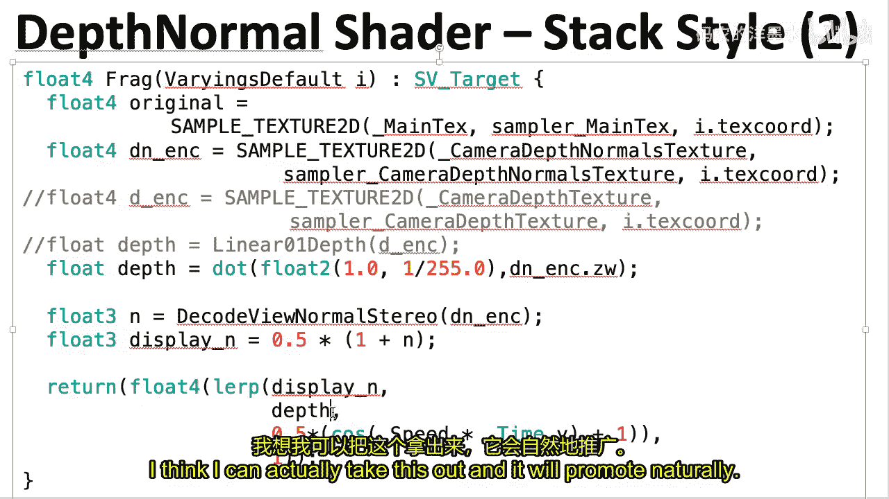

```hlsl
// 声明深度法线纹理
TEXTURE2D(_CameraDepthNormalsTexture);
SAMPLER(sampler_CameraDepthNormalsTexture);

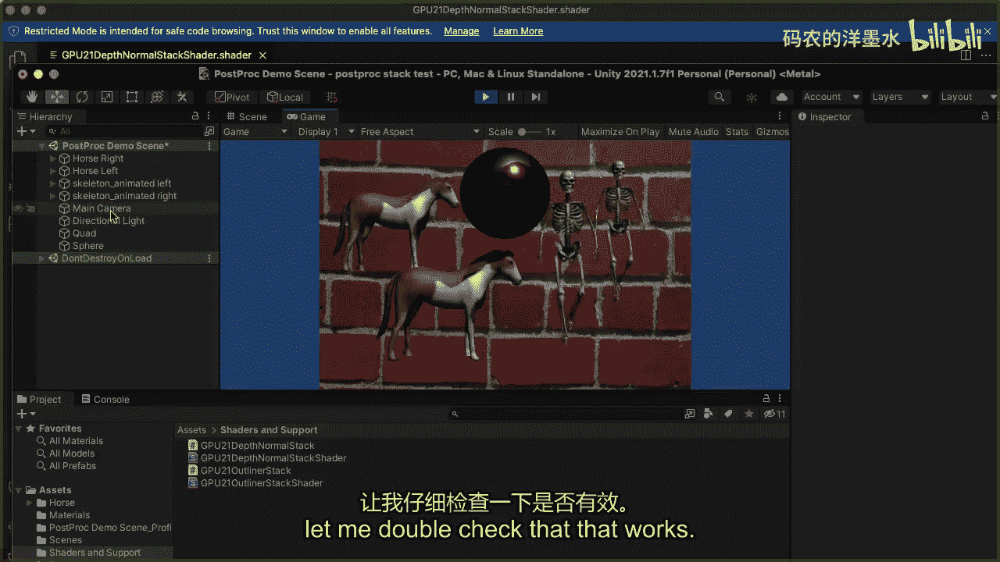

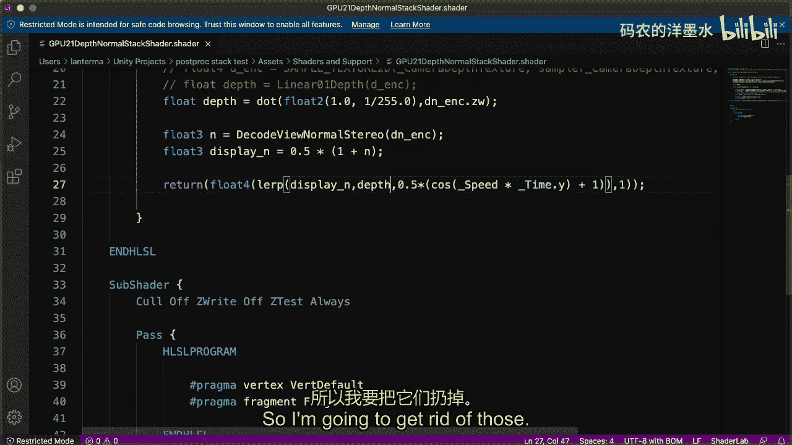

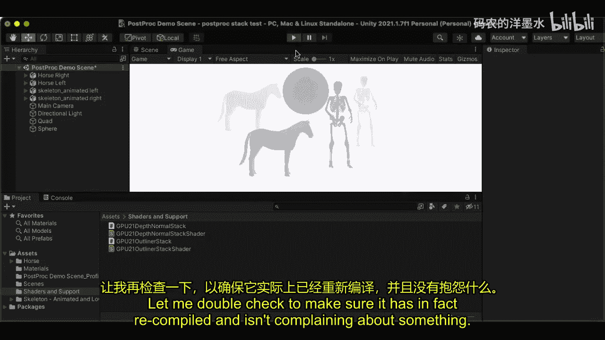

// 在片段着色器中
float4 depthnormal = SAMPLE_TEXTURE2D(_CameraDepthNormalsTexture, sampler_CameraDepthNormalsTexture, i.texcoord);
// 解码深度值 (0到1范围，1为远平面)
float depth = DecodeFloatRG(depthnormal.zw);
// 解码法线向量
float3 normal = DecodeViewNormalStereo(depthnormal);
// 将法线从(-1,1)映射到(0,1)以便显示
normal = normal * 0.5 + 0.5;
```

请注意，解码深度和法线需要使用Unity提供的特定函数（如 `DecodeFloatRG` 和 `DecodeViewNormalStereo`）。如果只需要深度信息，也可以使用 `_CameraDepthTexture`，但解码方式会有所不同，通常使用 `Linear01Depth` 函数来获取线性的、在0到1范围内的深度值。

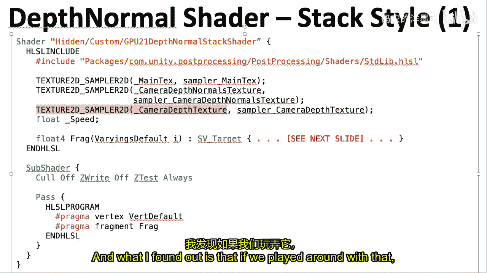

为了让Unity生成这些纹理，必须在对应的效果渲染器C#脚本中重写 `GetCameraFlags` 方法，并返回 `DepthTexture` 或 `DepthNormals` 标志。

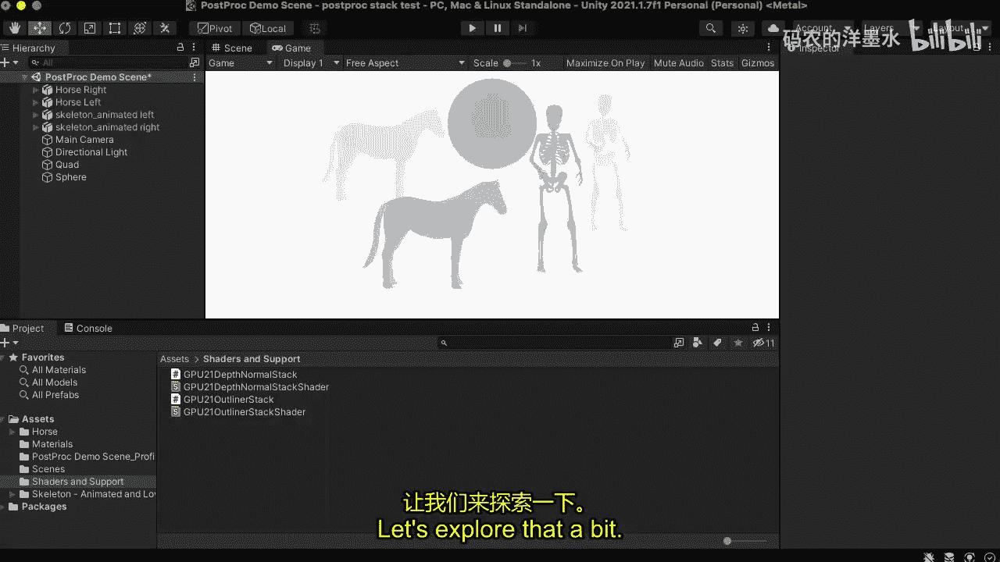

---

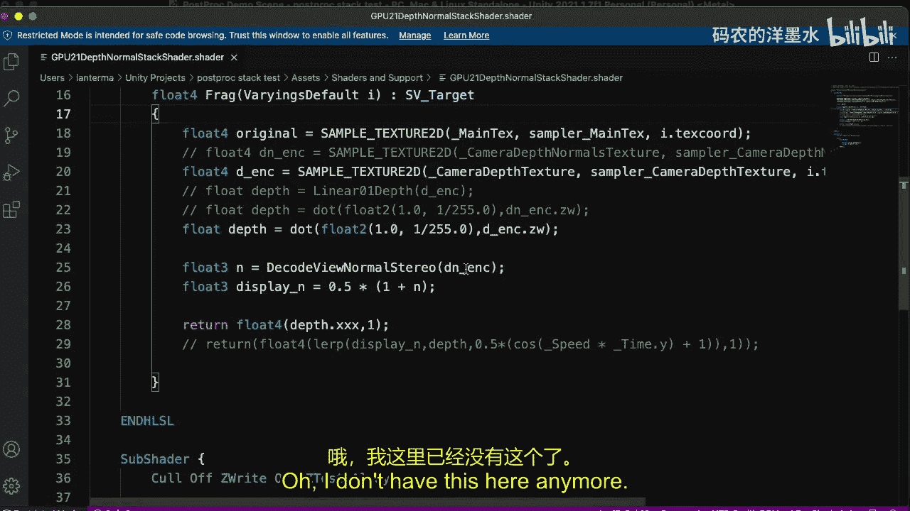

## 总结

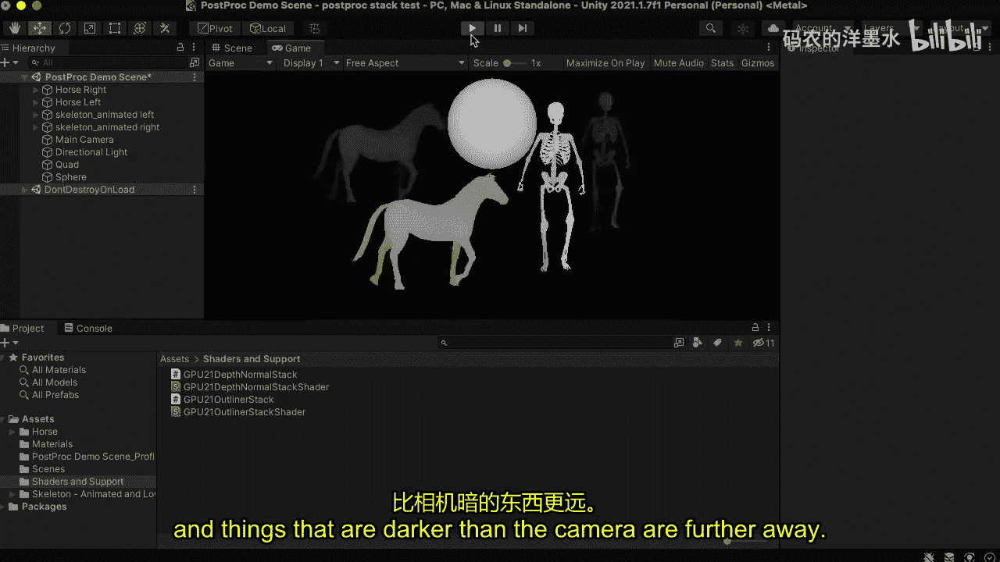

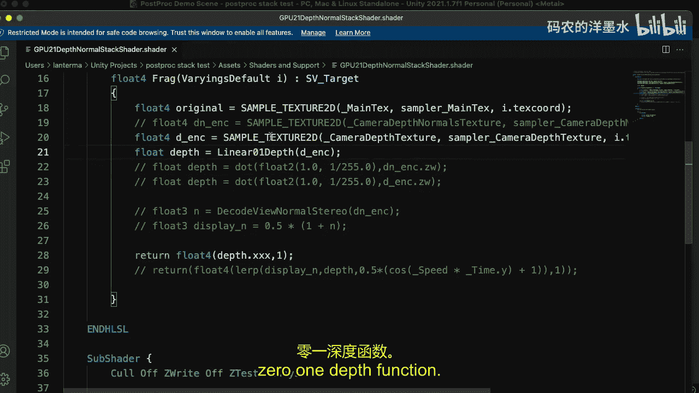

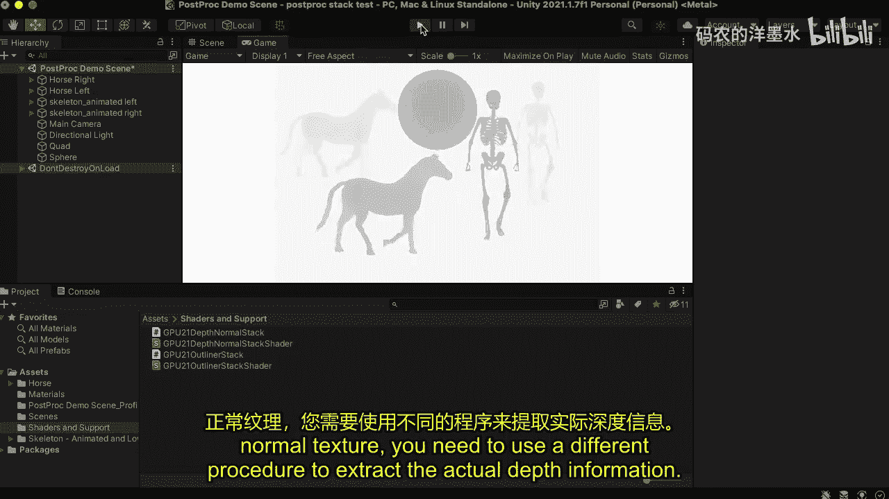

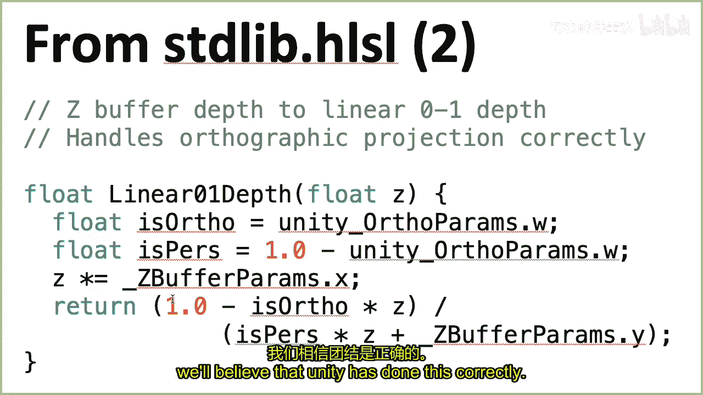

本节课中我们一起学习了Unity内置渲染管线中后处理栈的完整工作流程。我们从安装和设置开始，了解了 `Post-process Layer` 和 `Post-process Volume` 的核心作用。我们探索了如何利用后处理体积实现空间化的效果混合。接着，我们深入研究了如何编写符合后处理栈规范的自定义着色器，包括新的纹理采样语法。我们还学习了如何通过C#脚本将自定义效果集成到后处理框架中，并控制其执行顺序。最后，我们探讨了如何访问和使用深度与法线纹理来实现更复杂的效果。掌握这套流程，你将能够高效地创建和管理专业级的游戏后处理效果。