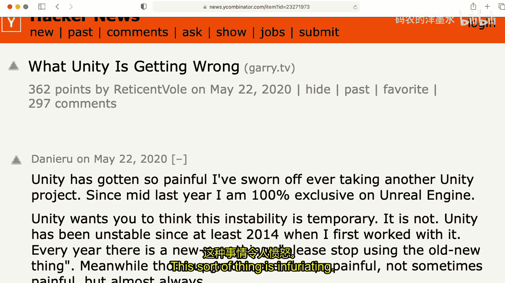
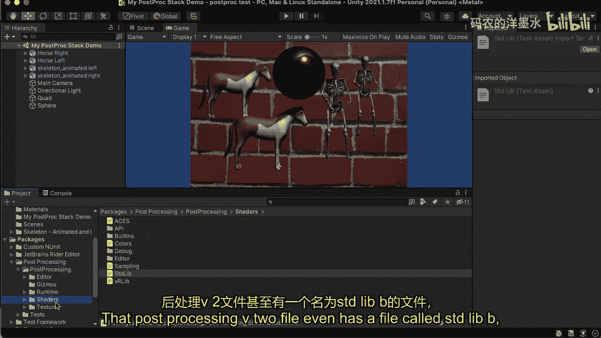
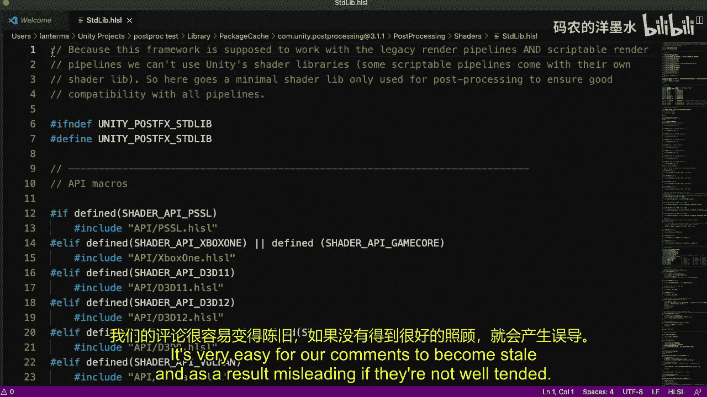
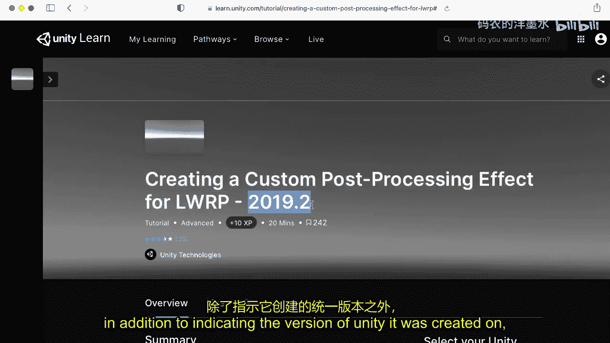
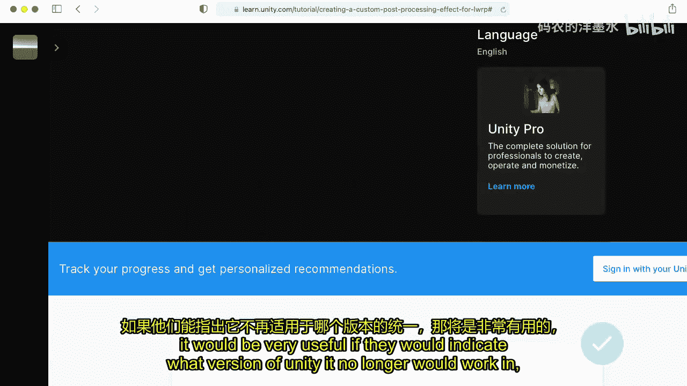
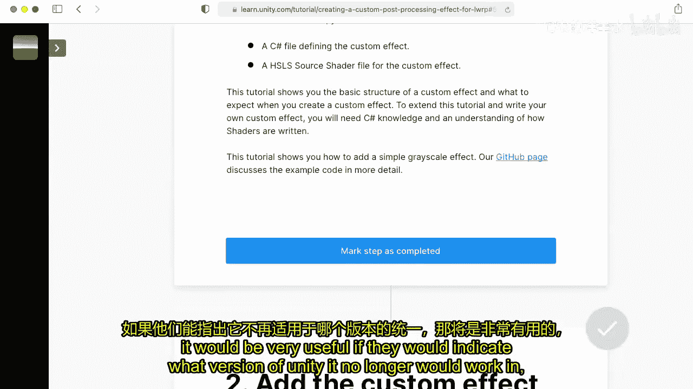
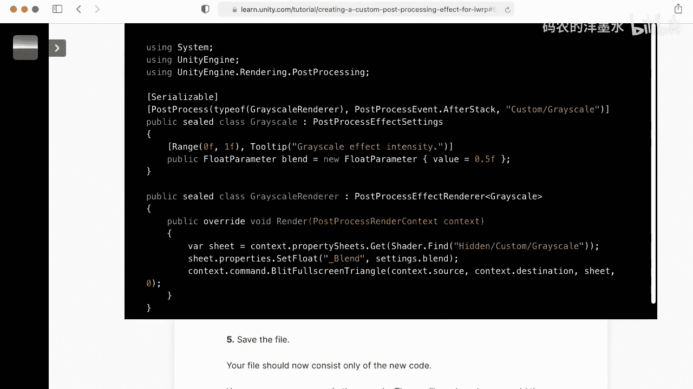
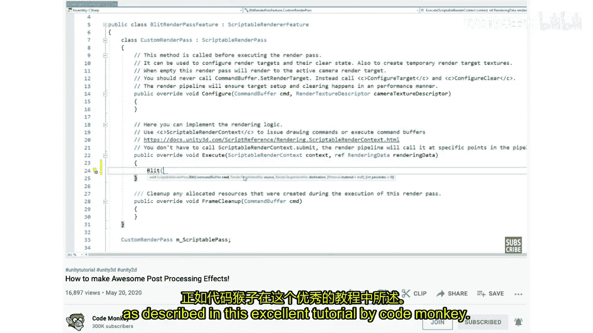
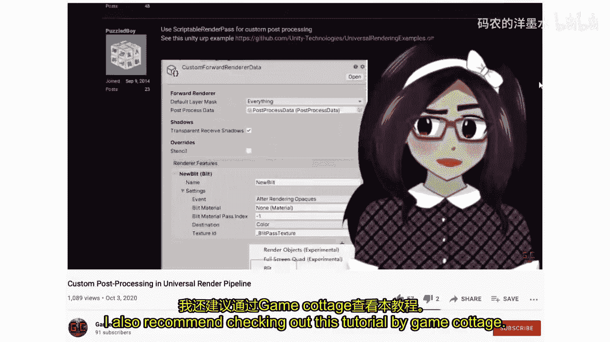
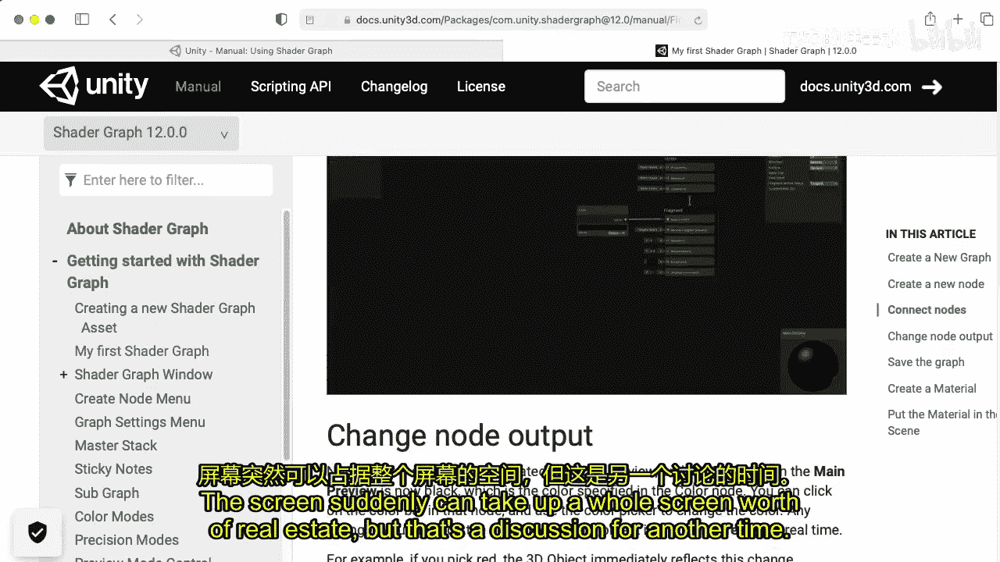

# 045：URP中的自定义后处理 😤

在本节课中，我们将探讨在Unity的通用渲染管线中实现自定义后处理效果所面临的挑战与现状。我们将回顾历史兼容性问题，分析当前可行的解决方案，并理解Unity版本迭代对开发工作流的影响。

## 兼容性断裂：从LWRP到URP

上一节我们介绍了课程背景，本节中我们来看看版本兼容性带来的具体问题。

在2020年夏季学期，我以纯远程学习形式教授了这门课程。由于这是首次完全远程教学，时间紧张，一些通常在课程末期讲解的主题（如后处理）最终未能涵盖。2021年，当我回顾2019年的教学资料时，发现了一个为内置渲染管线编写的自定义后处理效果演示包，以及另一个声称适用于轻量级渲染管线的后处理效果包。

为内置渲染管线编写的自定义后处理演示代码在Unity 2021.1版本中运行良好。然而，当我尝试在Unity 2021.1中运行为轻量级渲染管线编写的版本时（此时URP本质上是LWRP的重命名版本），它完全无法工作。

对于任何有Unity开发经验的人来说，花费数天时间调试代码以适应新版本并非陌生体验。因此，我着手进行必要的修改工作。

经过一番看似无尽的折腾后，我发现了官方文档中的这段说明：
> URP目前不支持自定义后处理效果。如果你的项目使用了自定义后处理效果，这些效果目前无法在URP中重现。自定义后处理效果将在URP的未来版本中得到支持。

我最初以为，在2019年，我可能尝试过将内置管线的演示移植到LWRP，但因无法实现或过于复杂而从未完成。但如果是这样，我为何会将其导出为一个Unity包？作为验证，我查看了佐治亚理工学院使用的Canvas学习管理系统上2019年夏季的课程资料，发现确实存在一个“后处理-轻量级渲染管线”包。这说明它当时至少能运行到足以让我认为可以上传供学生下载的程度。

## 版本差异：问题的根源

上一节我们看到了兼容性问题，本节中我们来看看导致问题的具体版本差异。

当我发现Ditzel Games（不确定发音）的优秀教程时，我感到更加困惑。在该教程中，我看到了一些代码，它们看起来非常像我为内置渲染管线编写的自定义后处理着色器代码。教程中明确指出，虽然URP包含自己的集成后处理解决方案，但该版本的URP也支持后处理V2包——这正是我在内置管线中使用的。文档甚至提到了“为了与现有项目向后兼容”。

那么问题出在哪里？

事实证明，关键在于你查看的是哪个版本。以下是关键发现：
*   在URP 7.x版本（如7.3， 7.6， 7.7）中，文档均提及对后处理V2包的支持。
*   但当版本号跳到8.0时，情况突变。文档明确指出：**URP与后处理V2包不兼容**。

这意味着兼容性在7.x和8.0版本之间被破坏了。这类情况令人沮丧，因为它意味着在搜索Unity相关信息时，你必须将当前年份（如果幸运的话，前一年份）与搜索词一起使用，并努力关注近期创建的信息，因为任何超过两年的信息都可能已经过时。



这对于YouTube搜索尤其棘手，因为旧视频往往拥有更多观看量，从而可能在搜索结果中排名更高，而这些视频更可能已经失效。

## 代码与注释的陷阱

上一节我们分析了版本差异，本节中我们来看看过时的代码和注释如何加剧问题。

那个后处理V2包中甚至有一个名为`StdLib`的文件，其中包含这样一条注释：
```csharp
// 因为这个框架需要同时支持旧版渲染管线和可编程渲染管线，我们不能使用Unity着色器库。
```
但文件中没有任何注释来说明这个情况在包的后继版本中已不再成立。



在Unity（乃至一般编程中）你会经常看到这种情况。注释本质上是不会执行的代码。如果维护不善，注释很容易变得陈旧，从而产生误导。









至少，如果一个教程名为“为LWRP创建自定义后处理效果”，除了标明创建时使用的Unity版本外，如果能指出它在哪个**URP包版本**之后就不再适用，将会非常有帮助，这样你就知道该寻找其他资料了。



## 当前解决方案与未来展望

上一节我们讨论了信息过时的问题，本节中我们来看看目前在URP中实现自定义后处理的可能性。

现在，在通用渲染管线中实现自定义后处理效果并非不可能，只是目前非常棘手。这需要深入钻研可编程渲染管线架构的内部机制，正如Code Monkey的优秀教程所描述的那样。我也推荐查看Gabrie Co.的教程。



当然，一些聪明人已经创建了一些框架来尝试简化这个过程。然而，无论他们的努力多么巧妙，这些框架都很可能在Unity未来的某个版本中失效，或者当Unity最终完成他们本应一开始就做好的功能时，变得不再必要。



如果你查看通用渲染管线的开发路线图，可以看到他们正在进行中的事项，其中就包括**后处理自定义效果**。这让我有些困惑，因为他们之前已经让它运行起来了。正如前面提到的，在2019.3 LTS版本中，使用URP包版本7.2时，你可以使用后处理V2及其自定义效果，但他们却在URP版本8中破坏了它。请注意，现在是2021年，而URP可能已经到了版本12。

文档确实提到你可以使用**渲染通道**来实现一些自定义效果，但这同样需要相当深入地了解URP和整个可编程渲染管线结构。

路线图上最让我兴奋的功能实际上是关于**表面着色器**的部分。这是内置渲染管线拥有的功能，非常棒。它允许你在文本代码中编写描述表面材质属性的函数，以及另一个描述光照模型的函数，然后它会将这些配对起来，并生成处理Unity提供的所有光源所需的不同组合的代码。它帮助你避免处理大量样板代码，也无需进行大量复制粘贴。但不知何故，当他们转向可编程渲染管线时，这个功能消失了。

现在，他们希望每个人都使用**Shader Graph**，这是一种新的图形化编写着色器的方式。但正如我将在另一节课中吐槽的，图形化编程语言可能存在很多问题。例如，可能只需三四行代码、在屏幕上只占很小空间的内容，突然可能需要占据整个屏幕的版面。不过，这将是另一个话题的讨论了。

---



本节课中我们一起学习了在Unity URP中实现自定义后处理效果所面临的挑战。我们回顾了从LWRP到URP过渡中的兼容性断裂问题，分析了不同版本（特别是7.x与8.0+）的差异，指出了依赖过时教程和代码注释的风险。最后，我们探讨了当前实现自定义效果需要深入URP底层的现状，并展望了官方路线图中表面着色器等功能的回归。理解这些版本和架构的变迁，对于在Unity中进行可持续的图形编程至关重要。