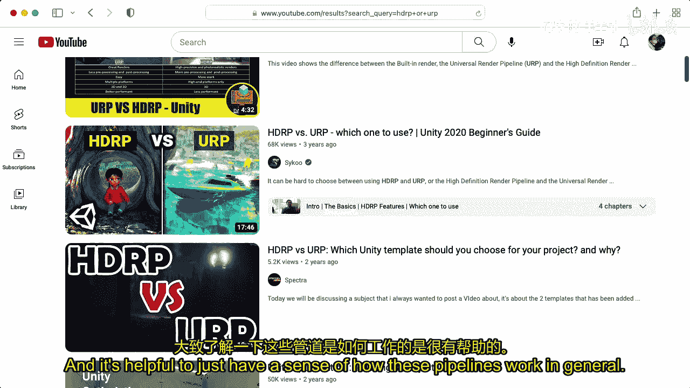
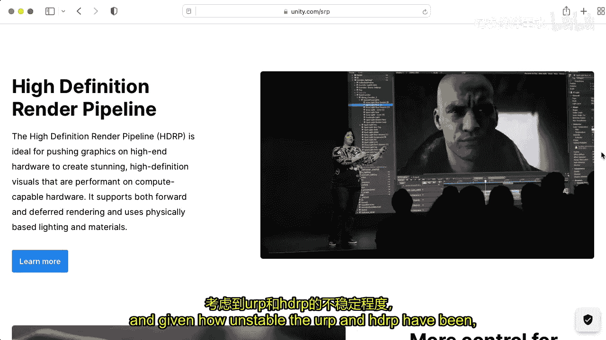
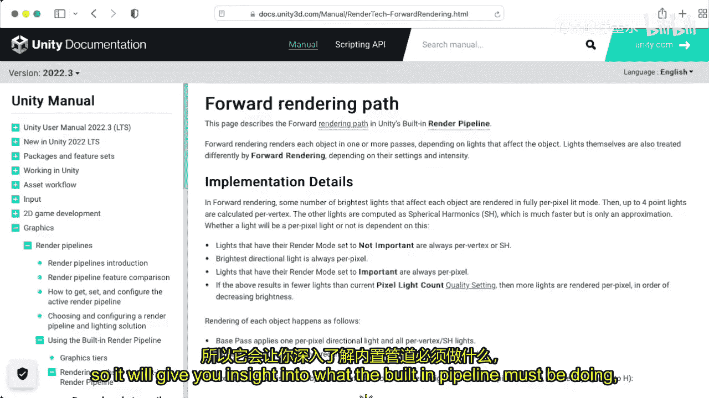
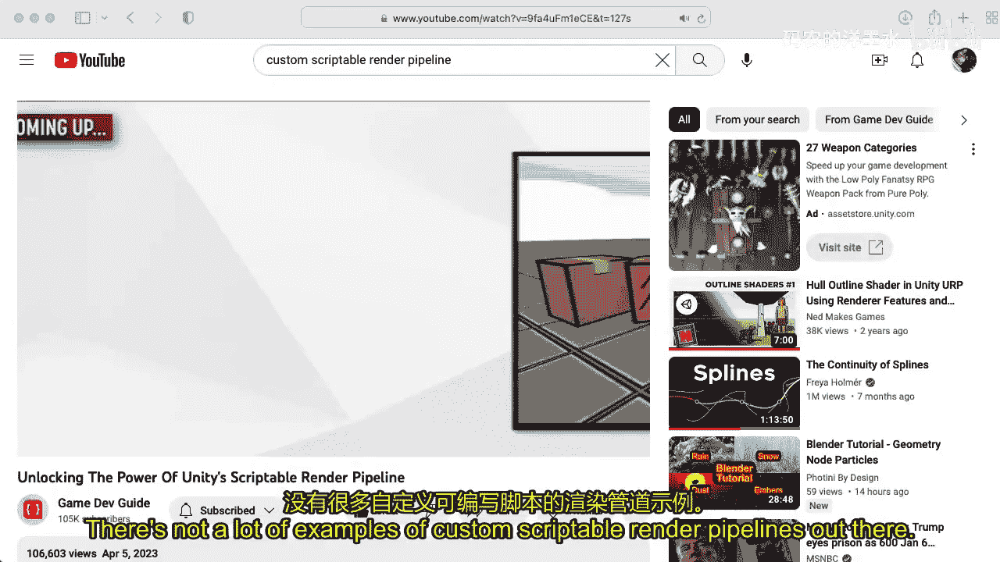

# 046：Unity脚本化渲染流程入门 🎮

在本节课中，我们将学习Unity的脚本化渲染流程。我们将从零开始创建一个渲染管线，而不是使用Unity提供的通用渲染管线或高清渲染管线。通过学习自定义管线的构建，你将能更好地理解URP或HDRP的内部机制，并对渲染管线的工作原理有更深入的认识。

## 概述

上一节我们介绍了GPU编程的基础概念，本节中我们来看看如何构建一个自定义的Unity脚本化渲染管线。我们将探讨其必要性、适用场景以及学习资源。

## 何时使用自定义渲染管线

如果你正在开发游戏，通常不建议从零开始编写脚本化渲染管线，除非你有非常特殊或独特的渲染需求。建议选择通用渲染管线或高清渲染管线。

由于URP和HDRP在不同版本更新中可能不稳定，你可能会考虑坚持使用课程中目前介绍的内置渲染管线，因为它相对稳定。

即使你在游戏中不使用脚本化渲染管线，学习SRP仍然有用。它能让你了解渲染器在底层需要完成的工作，从而深入理解内置管线或其他引擎（如Unreal或Godot）的渲染器工作原理。

## 学习资源推荐

以下是推荐的自定义脚本化渲染管线学习资源：

*   **视频教程**：Game Dev Guide的《解锁Unity脚本化渲染管线的力量》。虽然其中内容大多也能通过修改内置管线实现，但仍具参考价值。
*   **技术演讲**：Alex Williams的《构建自定义渲染管线》。这个演讲值得更多关注。
*   **高级案例**：Unite Copenhagen 2019上的《Battleplanet: Judgment Day》演讲。其中展示的一些效果很难在内置管线中实现。
*   **实战分享**：Mark Mayers向波士顿Unity小组分享的游戏《Deis》相关内容。其中涉及的技术在内置管线中极难实现。

## 总结

本节课中我们一起学习了Unity脚本化渲染流程的基本概念。我们了解了自定义管线的适用场景，并获得了相关的学习资源指引。下一节我们将开始动手实践，构建我们自己的渲染管线基础框架。