# 047：Unity中的自定义前向脚本渲染流水线 🎮

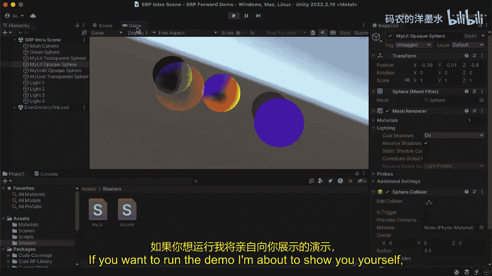

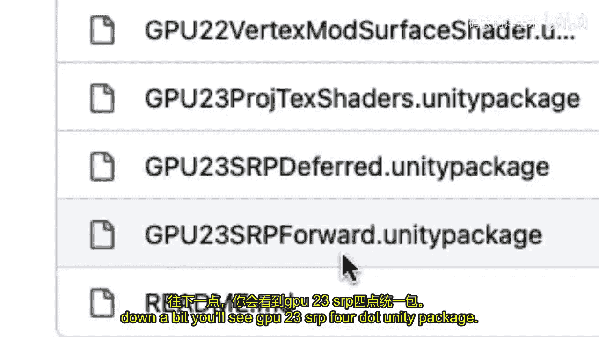

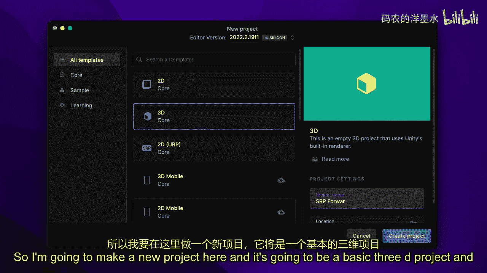

在本节课中，我们将学习如何在Unity中创建一个自定义的前向渲染脚本化渲染流水线。我们将从设置项目开始，逐步讲解如何编写着色器代码和C#脚本，以构建一个能够处理不透明和透明对象、支持多光源渲染的简单渲染管线。

---

## 概述

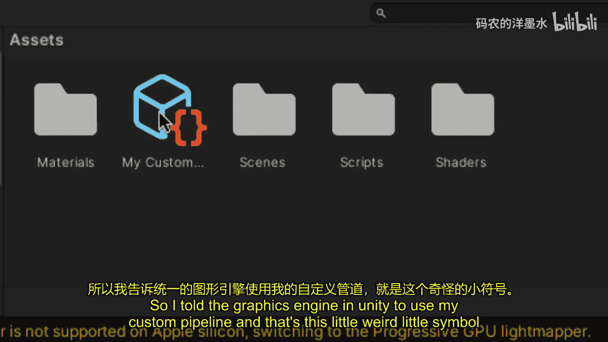

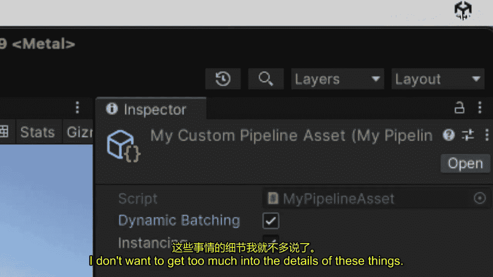

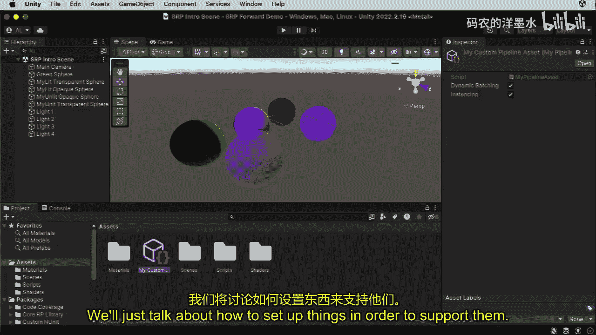

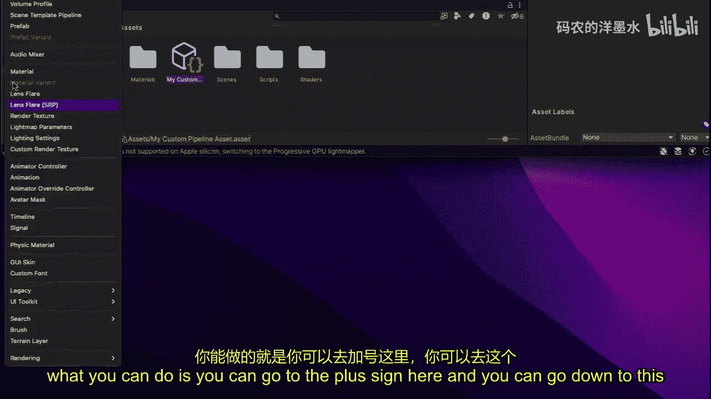

脚本化渲染流水线允许开发者完全控制Unity的渲染流程。本节我们将创建一个名为“My Pipeline”的自定义前向渲染管线。我们将使用一个自定义的着色器，它能在单次渲染通道中处理多个光源，并支持不透明与透明材质的混合渲染。

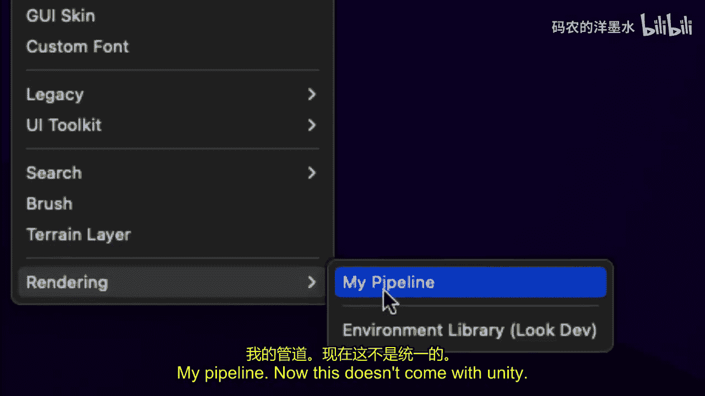

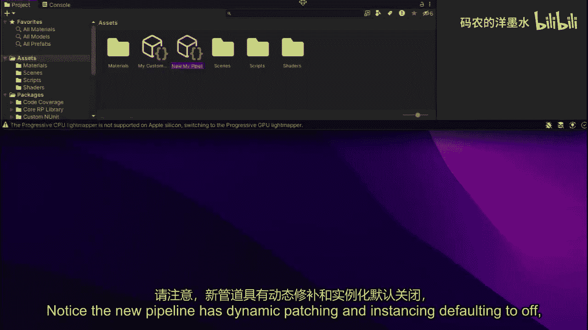

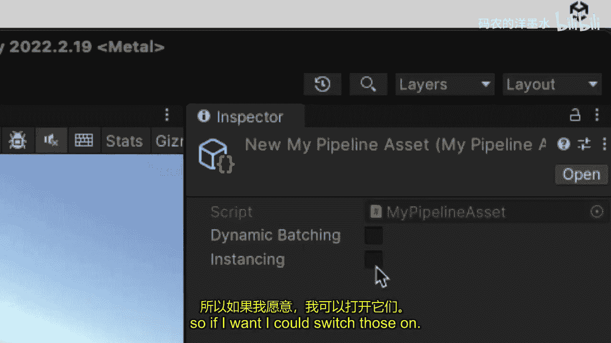

## 项目设置

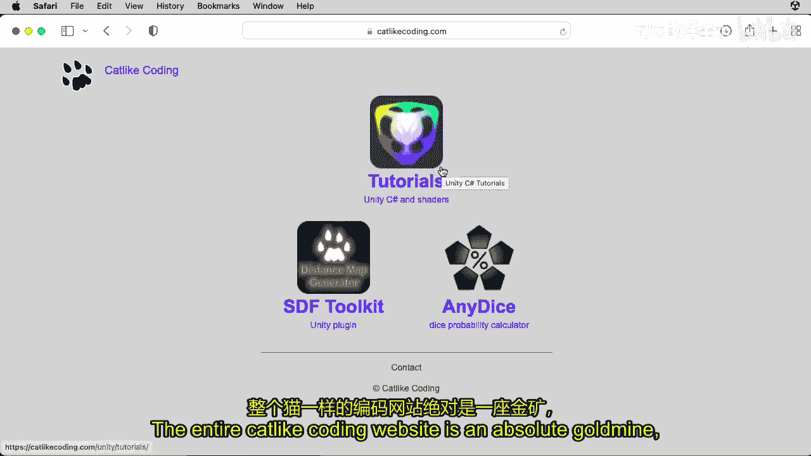

首先，我们需要创建一个新的Unity项目并导入必要的资源包。

1.  创建一个新的3D项目，命名为“SRP 4 demo”。
2.  打开 **Window > Package Manager**。
3.  在左上角的下拉菜单中选择 **Unity Registry**。
4.  搜索并安装 **Core RP Library** 包。这是脚本化渲染流水线的基础包。
5.  从提供的资源中，将 `GPU 23 SRP forward` Unity包导入项目。

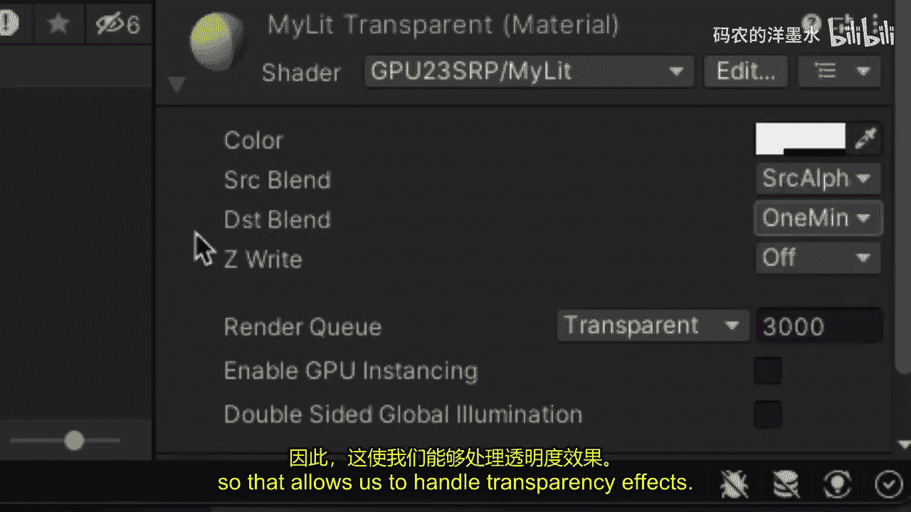

导入完成后，打开 `Scenes` 文件夹中的 `SRP intro` 场景。你可能会看到一些球体显示为黑色，这是因为场景目前仍在使用Unity内置的渲染管线。

## 配置渲染管线

为了让我们的自定义着色器正常工作，需要将项目切换到自定义渲染管线。

1.  进入 **Edit > Project Settings > Player**。
2.  在 **Other Settings** 下，将 **Color Space** 设置为 **Linear**。
3.  进入 **Edit > Project Settings > Graphics**。
4.  在 **Scriptable Render Pipeline Settings** 字段中，点击圆圈图标，选择我们导入的 **My Pipeline** 资产。

完成切换后，场景中的球体应正确显示颜色和光照效果。一个灯光被脚本驱动来回移动，以展示动态光照。

## 理解自定义着色器

我们的自定义着色器名为 `MyLit`。它比URP或HDRP中的标准着色器更简单，但包含了处理光照和透明度的核心逻辑。

### 着色器结构

以下是着色器代码的核心部分概览：

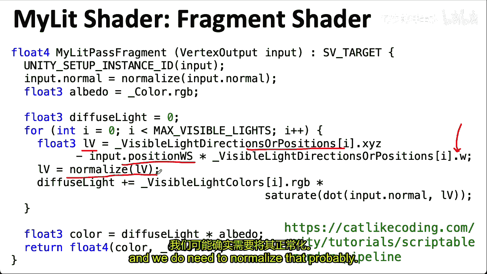

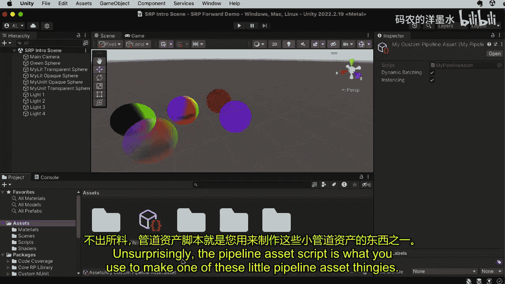

```hlsl
Shader "Custom/MyLit"
{
    Properties
    {
        _Color ("Color", Color) = (1,1,1,1)
    }
    SubShader
    {
        // 定义渲染标签和通道
        Tags { "RenderType"="Opaque" }
        LOD 100

        Pass
        {
            // HLSL代码块开始
            HLSLPROGRAM
            // 顶点和片段着色器函数声明
            #pragma vertex vert
            #pragma fragment frag
            // 包含必要的HLSL库
            #include "Packages/com.unity.render-pipelines.core/ShaderLibrary/Common.hlsl"
            // ... 更多代码
            ENDHLSL
        }
    }
}
```

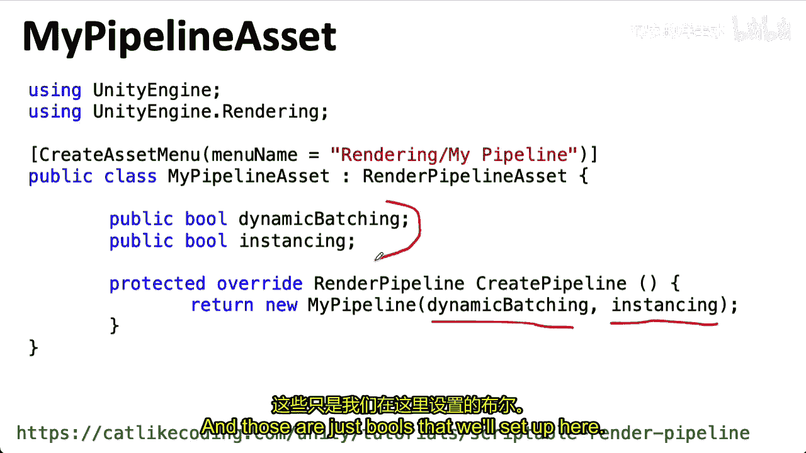

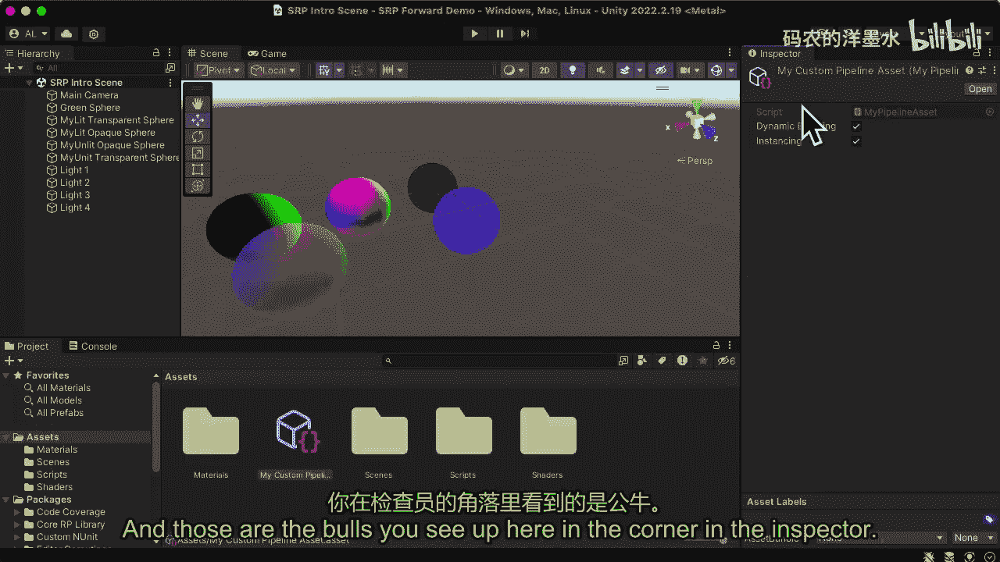

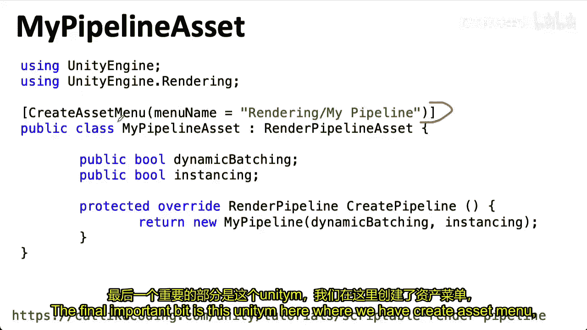

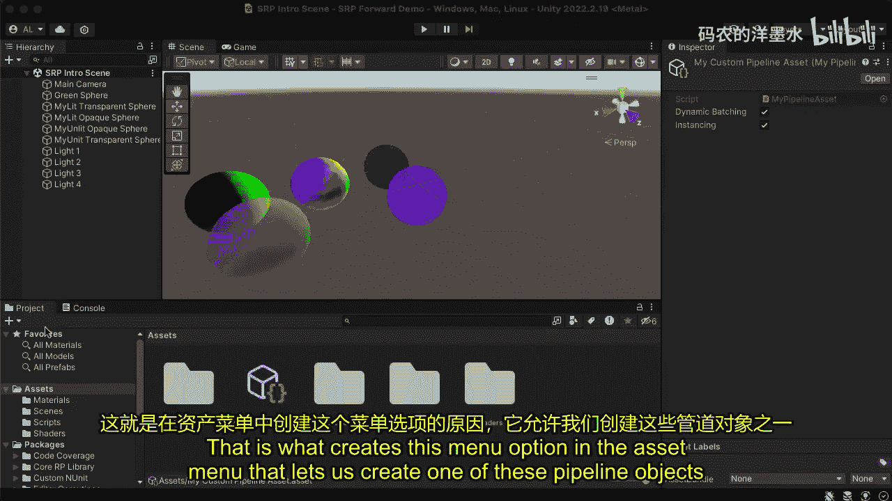

### 处理光源与透明度

与内置管线不同，我们的着色器在单次通道中处理所有（最多4个）光源。光源数据（颜色、方向/位置）通过C#脚本传递到着色器的全局变量数组中。

透明度通过混合模式控制。在材质检视面板中，可以设置 `SrcBlend`（源混合）和 `DstBlend`（目标混合）模式：
*   **不透明物体**：`SrcBlend = One`, `DstBlend = Zero`, `ZWrite = On`
*   **透明物体**：`SrcBlend = SrcAlpha`, `DstBlend = OneMinusSrcAlpha`, `ZWrite = Off`

## 驱动渲染的C#脚本

自定义渲染管线需要两个核心C#脚本：一个用于创建管线资产，另一个用于定义渲染逻辑。

### 1. 管线资产脚本 (`MyPipelineAsset`)

这个脚本继承自 `RenderPipelineAsset`，主要作用是创建我们的自定义管线实例。

```csharp
using UnityEngine;
using UnityEngine.Rendering;

[CreateAssetMenu(menuName = "Rendering/My Pipeline")]
public class MyPipelineAsset : RenderPipelineAsset
{
    public bool dynamicBatching;
    public bool instancing;

    protected override RenderPipeline CreatePipeline()
    {
        // 创建并返回我们的自定义管线实例，传入配置参数
        return new MyPipeline(dynamicBatching, instancing);
    }
}
```
`[CreateAssetMenu]` 属性使得我们可以在Project窗口中通过右键菜单创建此资产。

### 2. 管线渲染脚本 (`MyPipeline`)

这是最复杂的部分，继承自 `RenderPipeline`，并重写了 `Render` 方法以定义完整的渲染流程。

以下是渲染一帧的主要步骤：

1.  **设置与剔除**：获取相机参数，对场景进行剔除，找出可见的渲染器和光源。
2.  **配置光源**：从剔除结果中提取最多4个最重要的光源信息（颜色、方向/位置），并通过命令缓冲区传递给着色器。
    ```csharp
    // 将C#端的光源方向/位置数据传递到着色器
    buffer.SetGlobalVectorArray(visibleLightDirectionsOrPositionsId, visibleLightDirectionsOrPositions);
    buffer.SetGlobalVectorArray(visibleLightColorsId, visibleLightColors);
    ```
3.  **绘制不透明物体**：设置排序方式为 `SortingCriteria.CommonOpaque`（大致从前向后绘制），使用 `RenderQueueRange.opaque` 过滤设置，然后绘制所有不透明物体。
4.  **绘制天空盒**：在绘制完不透明物体后绘制天空盒，避免不必要的覆盖。
5.  **绘制透明物体**：更改排序方式为 `SortingCriteria.CommonTransparent`（从后向前绘制），使用 `RenderQueueRange.transparent` 过滤设置，然后绘制透明物体。

整个过程中，我们使用 `CommandBuffer` 来批量提交渲染命令以提高效率。对于场景视图的支持，需要通过检查 `Camera.cameraType` 并调用 `EmitWorldGeometryForSceneView` 方法来实现。

## 总结

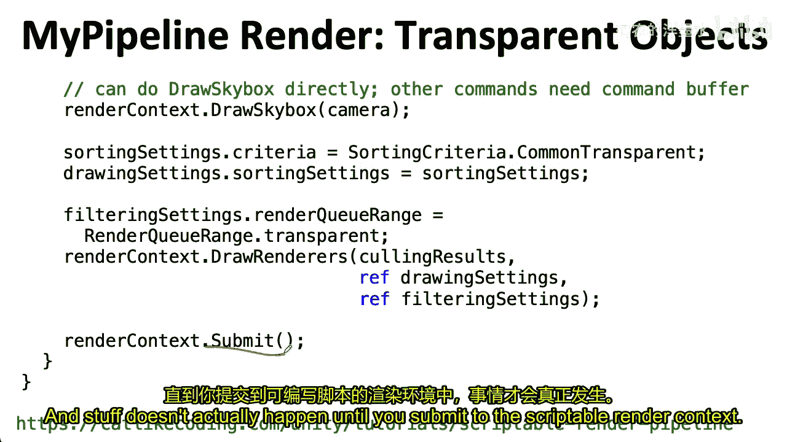

本节课中，我们一起学习了如何在Unity中构建一个自定义的前向脚本化渲染流水线。我们涵盖了从项目设置、导入核心包，到编写处理多光源和透明度的自定义HLSL着色器。更重要的是，我们深入分析了驱动该管线的C#脚本，了解了如何通过 `MyPipelineAsset` 创建配置资产，以及如何在 `MyPipeline` 中实现完整的渲染循环——包括剔除、光源数据传递、命令缓冲区使用以及分别绘制不透明物体、天空盒和透明物体的关键步骤。

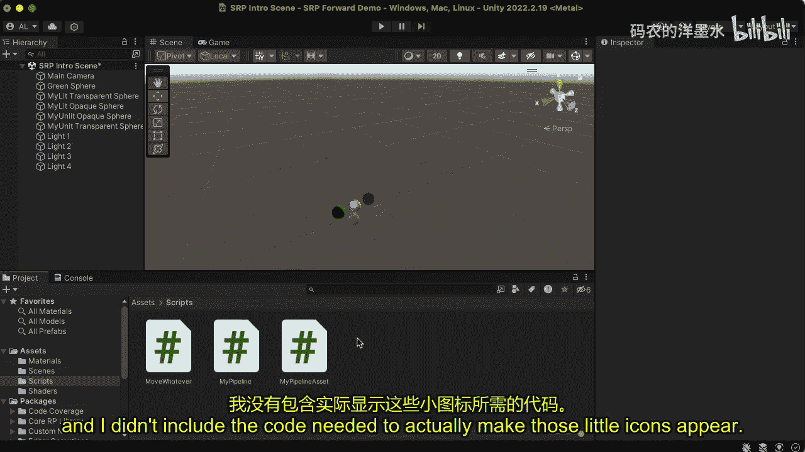

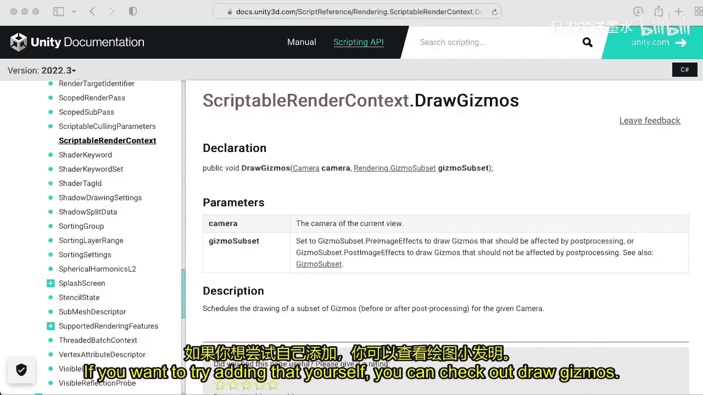

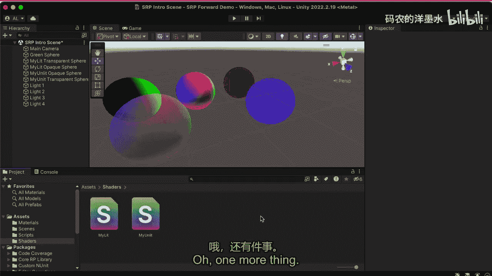

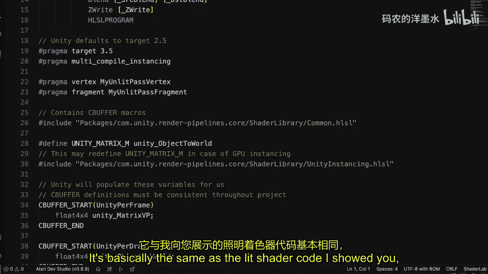

这个自定义管线虽然基础，但它清晰地展示了脚本化渲染流水线的核心控制逻辑，为你进一步探索更复杂的URP或HDRP管线，或打造专属渲染效果奠定了坚实的基础。