# 048：Unity中的自定义延迟渲染脚本化渲染管线

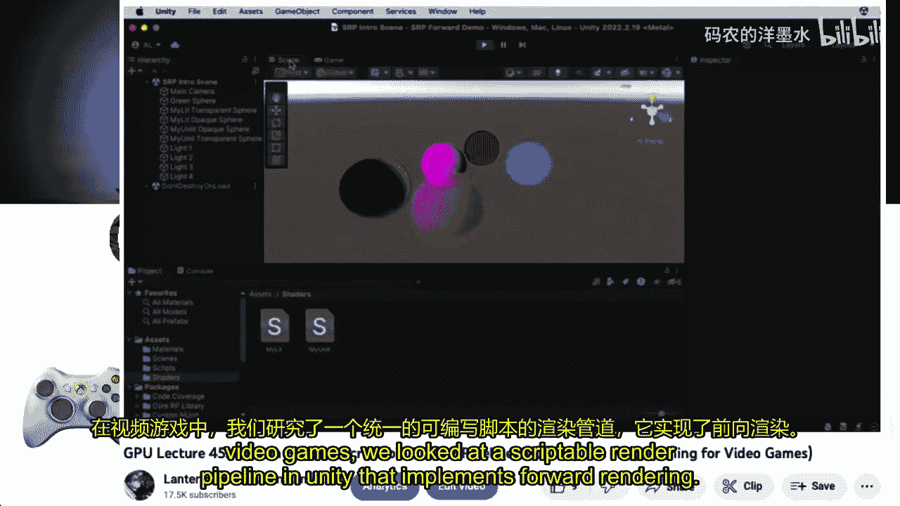

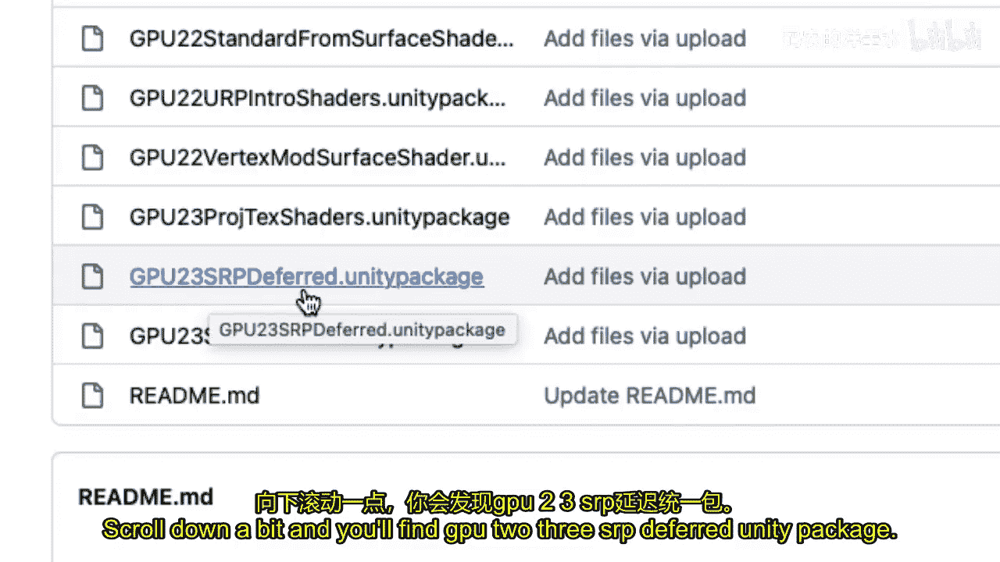

在本节课中，我们将学习如何在Unity中创建一个自定义的脚本化渲染管线，该管线实现了延迟渲染技术。我们将探讨延迟渲染的基本概念，并逐步解析实现该管线所需的着色器代码和C#脚本。

## 概述

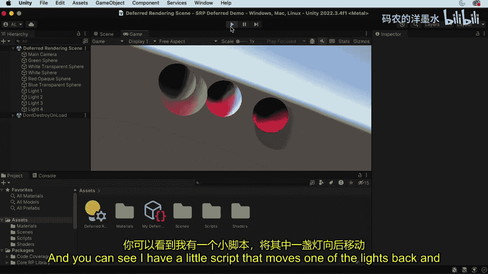

延迟渲染是一种先收集场景几何信息（如位置、法线、颜色），再统一进行光照计算的渲染技术。与正向渲染相比，它特别适合处理大量动态光源的场景。本节课将基于一个自定义的脚本化渲染管线示例，详细讲解其实现过程。

## 准备工作

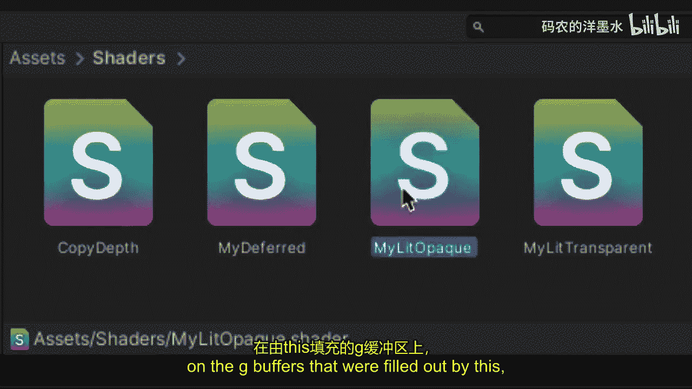

在开始之前，需要确保已经安装了Unity的核心渲染管线库。可以从GitHub获取演示包 `GPp 23 SRPde unity package` 并导入到项目中。

首先，在Unity编辑器中打开包管理器，确保选中Unity注册表，并安装核心RP库。对于自定义脚本化渲染管线，只需要核心RP库。

导入演示包后，打开延迟渲染场景。此时场景可能无法正常显示，因为项目仍在使用内置渲染管线。需要切换到我们自定义的管线。

进入 `Edit -> Project Settings`，进行以下设置：
1.  在 `Player` 设置中，确保颜色空间设置为 `Linear`。
2.  在 `Graphics` 设置中，选择我们的自定义管线资产 `myde pipeline`。

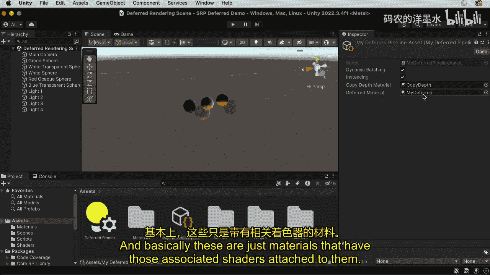

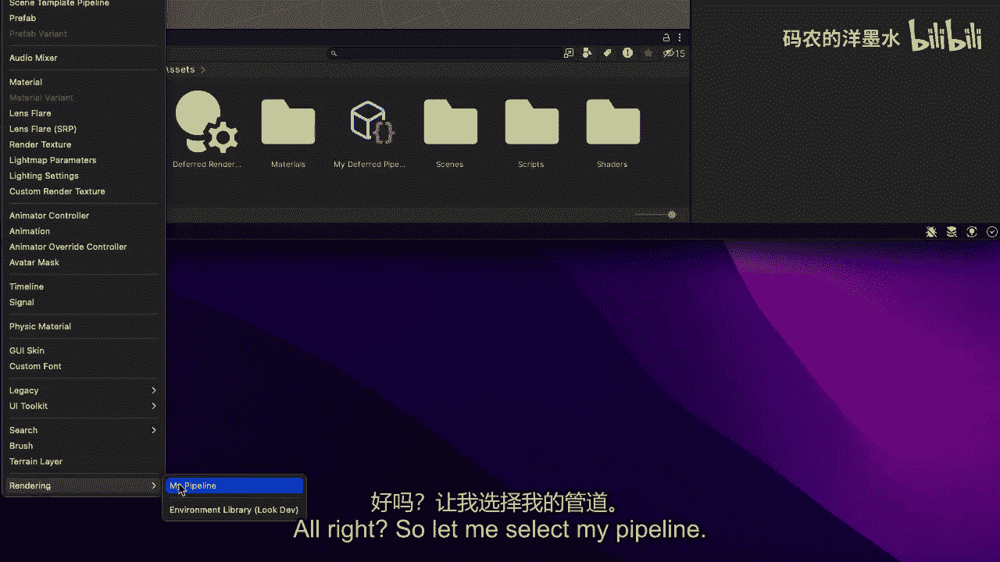

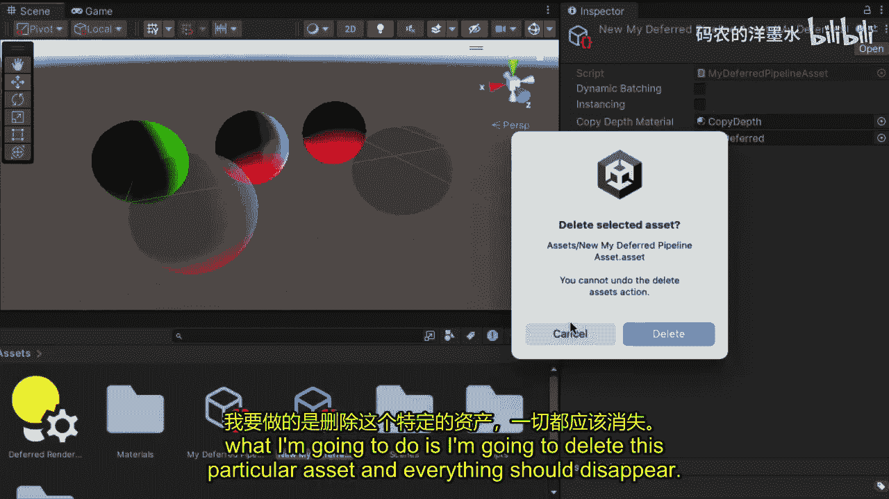

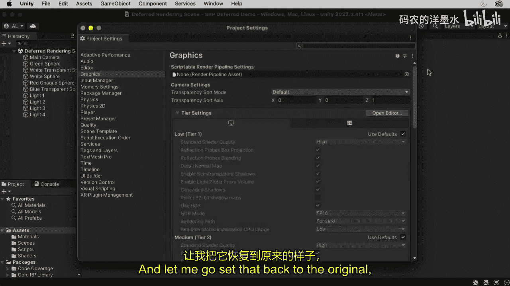

切换管线后，场景应能正常显示。演示场景中包含四个光源（其中一个通过脚本来回移动）以及多个不透明和透明物体。

## 着色器概览

在正向渲染示例中，我们使用一个名为 `mylit` 的着色器处理所有物体。但在延迟渲染中，我们需要两个独立的着色器：
*   `mylit opaque`：用于处理不透明物体，负责向G缓冲区填充反照率和法线信息。
*   `my deferred`：用于执行延迟渲染光照计算，基于G缓冲区中的信息计算最终颜色。

此外，还有两个特殊的着色器用于管线内部流程：
*   `copy depth`：用于深度信息复制。
*   `myde`：即延迟光照着色器。

这些着色器被组织在不同的菜单中，`mylit` 系列在 `GPU23 deferred` 菜单下，而工具类着色器在 `GP23 deferred utility` 菜单下。

## 管线资产配置

自定义管线资产 `My Pipeline Asset` 可以在 `Assets -> Create -> Rendering` 菜单中创建。在资产检查器中，可以启用或禁用动态批处理和GPU实例化等优化选项。最关键的是需要为 `Copy Depth Material` 和 `Deferred Material` 槽位分配对应的材质。

如果创建了新的管线资产但未正确分配材质，切换到该管线时渲染会出错。需要手动将材质拖拽到对应槽位。

## 不透明物体着色器 (mylit opaque)

该着色器的核心任务不是计算最终颜色，而是向G缓冲区输出数据。

以下是其关键部分代码结构：

```hlsl
// 定义渲染类型和光照模式标签
Tags { "RenderType"="Opaque" "LightMode"="GBuffer" }

// 定义输出到多个渲染目标的结构体
struct GBufferOutput
{
    float4 RT0 : SV_Target0; // 反照率 (RGB) 和占位Alpha (A)
    float4 RT1 : SV_Target1; // 编码后的法线信息 (XYZ 映射到 0-1)
};

// 顶点着色器（与正向渲染相同）
Varyings vert (Attributes input)
{
    // ... 计算裁剪空间位置等
}

// 片段着色器
GBufferOutput frag (Varyings input)
{
    // 归一化插值后的法线
    float3 normalWS = normalize(input.normal);

    // 输出到G缓冲区
    GBufferOutput output;
    output.RT0 = float4(_Color.rgb, 1.0); // 输出反照率颜色
    output.RT1 = float4(normalWS * 0.5 + 0.5, 1.0); // 将法线从(-1,1)映射到(0,1)
    return output;
}
```

## 延迟光照着色器 (my deferred)

这个着色器类似于后处理效果，它读取G缓冲区和深度纹理，计算光照并输出最终颜色。

以下是其核心逻辑：

```hlsl
// 声明G缓冲区纹理和深度纹理
TEXTURE2D(_GBuffer0); SAMPLER(sampler_GBuffer0); // 反照率
TEXTURE2D(_GBuffer1); SAMPLER(sampler_GBuffer1); // 法线
TEXTURE2D_FLOAT(_CameraDepthTexture); SAMPLER(sampler_CameraDepthTexture); // 深度

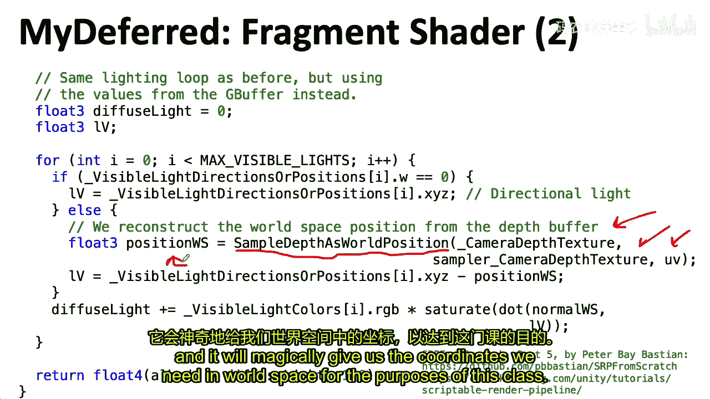

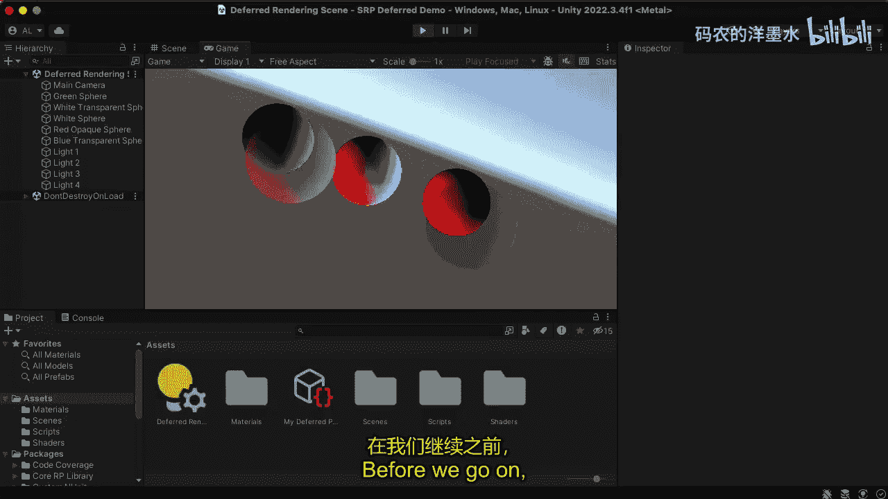

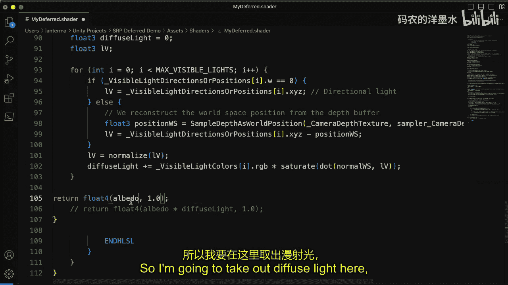

// 顶点着色器（绘制全屏四边形）
float4 vert (float3 vertex : POSITION) : SV_POSITION
{
    return float4(vertex, 1.0);
}

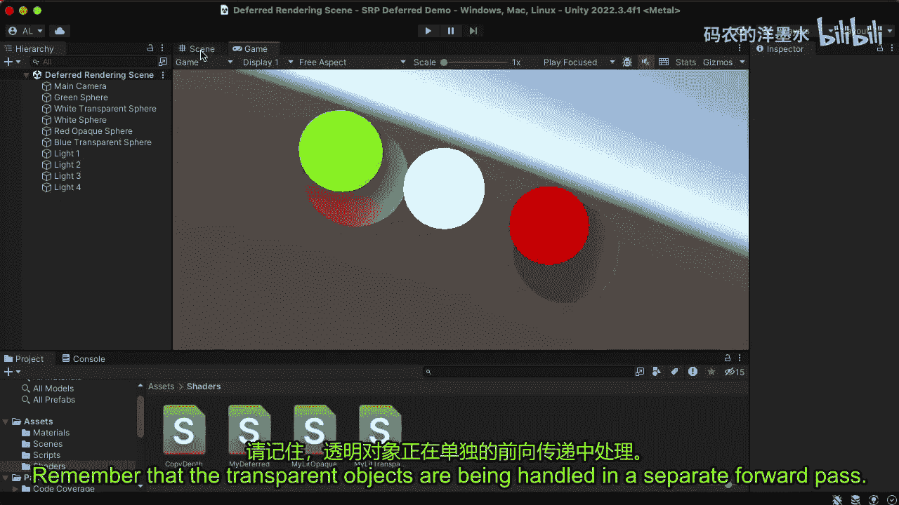

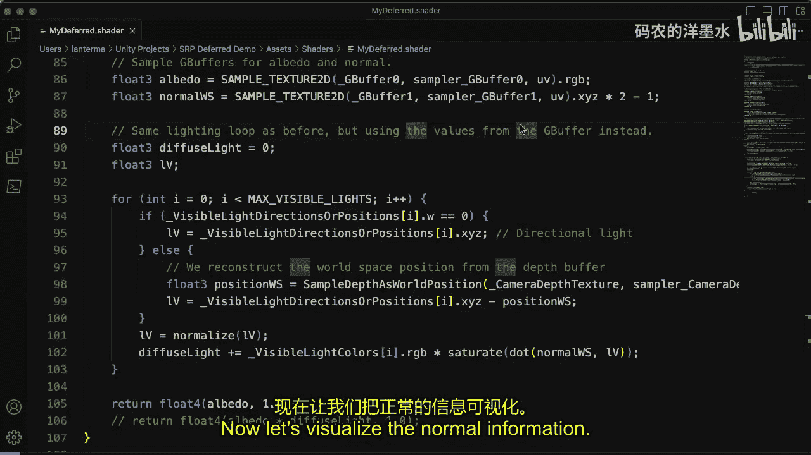

// 片段着色器
float4 frag (float4 positionCS : SV_POSITION) : SV_Target
{
    // 1. 计算屏幕UV
    float2 uv = positionCS.xy * _ScreenParams.zw; // _ScreenParams.zw 为 (1/width, 1/height)

    // 2. 从G缓冲区采样数据
    float4 albedoData = SAMPLE_TEXTURE2D(_GBuffer0, sampler_GBuffer0, uv);
    float3 albedo = albedoData.rgb;

    float4 normalData = SAMPLE_TEXTURE2D(_GBuffer1, sampler_GBuffer1, uv);
    float3 normalWS = normalData.rgb * 2.0 - 1.0; // 将法线从(0,1)映射回(-1,1)

    // 3. 从深度纹理重建世界空间位置（关键步骤）
    float depth = SAMPLE_TEXTURE2D(_CameraDepthTexture, sampler_CameraDepthTexture, uv).r;
    float3 positionWS = SampleDepthAsWorldPosition(uv, depth);

    // 4. 基于G缓冲区数据和重建的位置进行光照计算
    float3 diffuse = 0;
    for (int i = 0; i < _LightCount; i++)
    {
        // 计算每个光源的贡献（漫反射）
        // ... 光照计算代码
        diffuse += CalculateDiffuseLight(_Lights[i], positionWS, normalWS);
    }

    // 5. 输出最终颜色
    return float4(diffuse * albedo, 1.0);
}

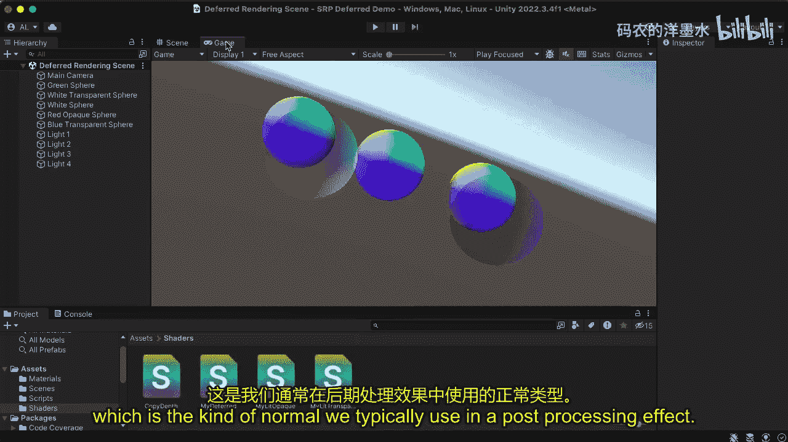

// 从深度值重建世界空间位置的函数
float3 SampleDepthAsWorldPosition(float2 uv, float depth)
{
    // 一系列坐标空间变换（NDC -> 裁剪空间 -> 视图空间 -> 世界空间）
    // 涉及逆投影矩阵和逆视图矩阵
    // ... 具体变换代码
    return worldPos;
}
```

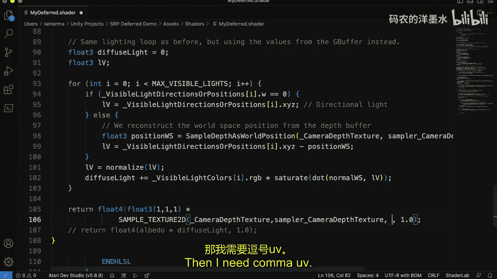

**深度重建说明**：`SampleDepthAsWorldPosition` 函数执行了一系列坐标变换，将屏幕UV和深度值转换回世界空间坐标，这是延迟光照计算所必需的。虽然变换细节复杂，但可以将其视为一个可靠的工具函数。

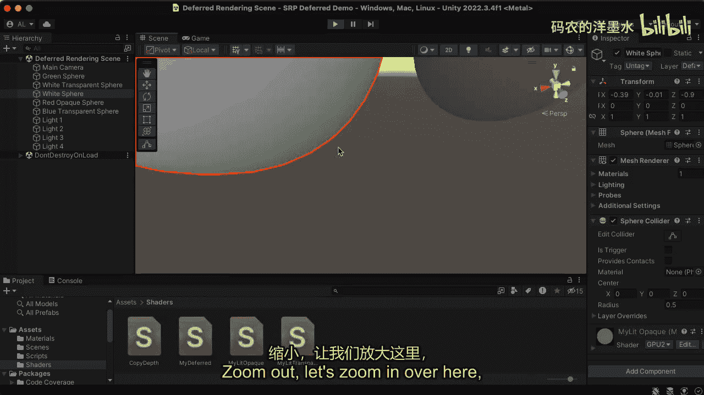

## 可视化G缓冲区

为了理解G缓冲区的内容，我们可以临时修改延迟光照着色器，直接输出其中的数据以便观察。

例如，要可视化反照率缓冲区，可以将最终输出改为：
`return float4(albedo, 1.0);`

要可视化法线缓冲区（世界空间法线），可以输出：
`return float4(normalWS, 1.0);`
注意，因为法线分量可能为负，直接显示时负值会被截断为黑色。

要可视化深度缓冲区，可以采样深度纹理并输出灰度值：
`float depth = SAMPLE_TEXTURE2D(_CameraDepthTexture, sampler_CameraDepthTexture, uv).r; return float4(depth.xxx, 1.0);`

## 透明物体与正向渲染路径

延迟渲染无法直接处理透明混合。因此，透明物体仍需使用传统的正向渲染路径。

透明物体的着色器代码与上一讲的正向渲染着色器基本相同，关键区别在于需要显式设置混合模式和深度写入：
```hlsl
Tags { "LightMode"="Forward" "RenderType"="Transparent" "Queue"="Transparent"}
Blend SrcAlpha OneMinusSrcAlpha
ZWrite Off
```
光照模式标签设为 `"Forward"`，并关闭深度写入(`ZWrite Off`)以允许混合，但深度测试(`ZTest`)默认开启，确保透明物体在不透明物体之后时不会被绘制。

## 深度复制着色器 (copy depth)

这是一个简单的工具着色器，用于将深度纹理中的数据复制回摄像机的深度缓冲区。其片段着色器核心代码如下：
```hlsl
float frag (Varyings input) : SV_Depth
{
    float depth = SAMPLE_TEXTURE2D(_CameraDepthTexture, sampler_CameraDepthTexture, input.uv).r;
    return depth;
}
```
使用 `SV_Depth` 语义表示输出到深度缓冲区。

## C# 渲染管线脚本

C#脚本负责组织整个渲染流程。以下是 `MyPipeline` 渲染器类的主要步骤：

1.  **初始化与资源获取**：构造函数从管线资产中获取材质和设置。
    ```csharp
    public MyPipeline(MyPipelineAsset asset)
    {
        _copyDepthMaterial = asset.copyDepthMaterial;
        _deferredMaterial = asset.deferredMaterial;
        // ... 获取其他设置
    }
    ```

2.  **设置渲染目标**：为G缓冲区（反照率、法线）和深度缓冲区创建临时渲染纹理。
    ```csharp
    // 创建G缓冲区0（反照率，RGB8格式）
    cmd.GetTemporaryRT(_gbuffer0Id, camera.pixelWidth, camera.pixelHeight, 0, FilterMode.Point, RenderTextureFormat.ARGB32);
    // 创建G缓冲区1（法线，RGB10A2格式以获得更高精度）
    cmd.GetTemporaryRT(_gbuffer1Id, camera.pixelWidth, camera.pixelHeight, 0, FilterMode.Point, RenderTextureFormat.ARGB2101010);
    // 创建深度渲染纹理
    cmd.GetTemporaryRT(_depthRTId, camera.pixelWidth, camera.pixelHeight, 24, FilterMode.Point, RenderTextureFormat.Depth);
    ```

3.  **G缓冲区填充通道**：将摄像机的渲染目标设置为G缓冲区，然后绘制所有不透明物体。使用的着色器通道标签是 `"LightMode"="GBuffer"`。
    ```csharp
    var drawSettings = new DrawingSettings(new ShaderTagId("GBuffer"), ...);
    context.DrawRenderers(cullingResults, ref drawSettings, ref filterSettings);
    ```

4.  **延迟光照计算**：使用 `Blit` 命令和 `_deferredMaterial` 材质，读取G缓冲区和深度纹理，计算所有光源的贡献，并将结果绘制到一个中间的颜色渲染纹理(`_colorRTId`)中。
    ```csharp
    cmd.Blit(_gbuffer0Id, _colorRTId, _deferredMaterial); // _gbuffer0Id 仅是占位符，实际数据由材质内部分配
    ```

5.  **绘制天空盒与透明物体**：将渲染目标切换回颜色渲染纹理(`_colorRTId`)，然后绘制天空盒。接着，使用标签 `"LightMode"="Forward"` 绘制所有透明物体（使用正向渲染）。
    ```csharp
    cmd.SetRenderTarget(_colorRTId);
    context.DrawSkybox(camera);
    // ... 绘制透明物体
    ```

6.  **复制到最终缓冲区**：将计算好的颜色和深度信息复制到Unity摄像机最终使用的缓冲区(`BuiltinRenderTextureType.CameraTarget`)。
    *   首先，使用 `_copyDepthMaterial` 将深度信息复制到摄像机的深度缓冲区。
    ```csharp
    cmd.Blit(_depthRTId, BuiltinRenderTextureType.CameraTarget, _copyDepthMaterial);
    ```
    *   然后，将颜色信息直接复制到摄像机的颜色缓冲区。
    ```csharp
    cmd.Blit(_colorRTId, BuiltinRenderTextureType.CameraTarget);
    ```

7.  **清理**：释放所有临时申请的渲染纹理资源。
    ```csharp
    cmd.ReleaseTemporaryRT(_gbuffer0Id);
    cmd.ReleaseTemporaryRT(_gbuffer1Id);
    cmd.ReleaseTemporaryRT(_depthRTId);
    cmd.ReleaseTemporaryRT(_colorRTId);
    ```

**流程疑问**：在实现中，颜色和深度信息需要先渲染到中间纹理，再复制到最终目标，而不是直接渲染到最终缓冲区。这可能是由于Unity脚本化渲染管线API的限制或内部机制决定的。

## 总结

本节课我们一起学习了在Unity中实现自定义延迟渲染脚本化渲染管线的完整过程。

我们首先了解了延迟渲染的基本思想：将几何信息（反照率、法线）先存储到G缓冲区，再统一进行光照计算。接着，我们分析了四个关键着色器的作用：
*   `mylit opaque` 负责填充G缓冲区。
*   `my deferred` 负责进行延迟光照计算。
*   透明物体使用修改后的正向渲染着色器。
*   `copy depth` 用于深度缓冲区管理。

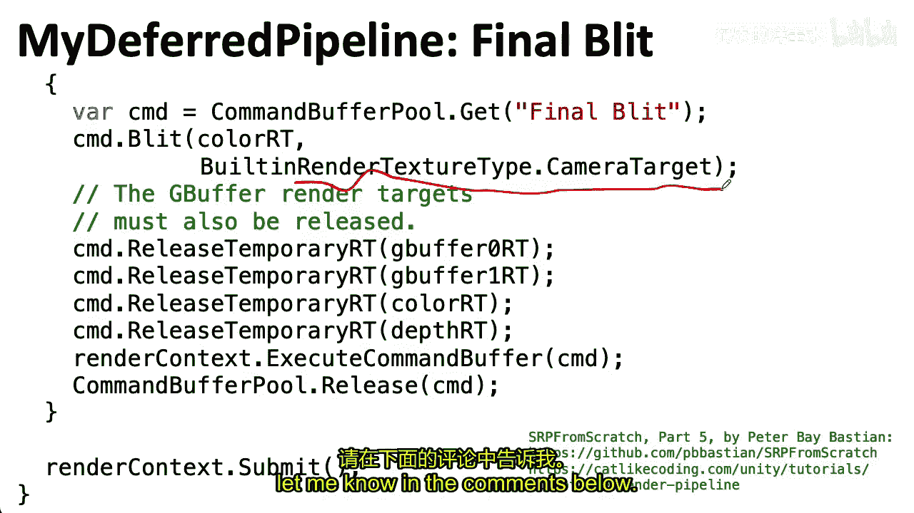

最后，我们剖析了C#渲染管线脚本，它像指挥家一样协调整个流程：设置目标、填充G缓冲区、执行延迟光照、处理透明物体，并将最终结果呈现到屏幕。虽然其中一些步骤（如深度复制）的具体原因可能涉及引擎底层细节，但整个架构清晰地展示了延迟渲染在Unity中的实现路径。